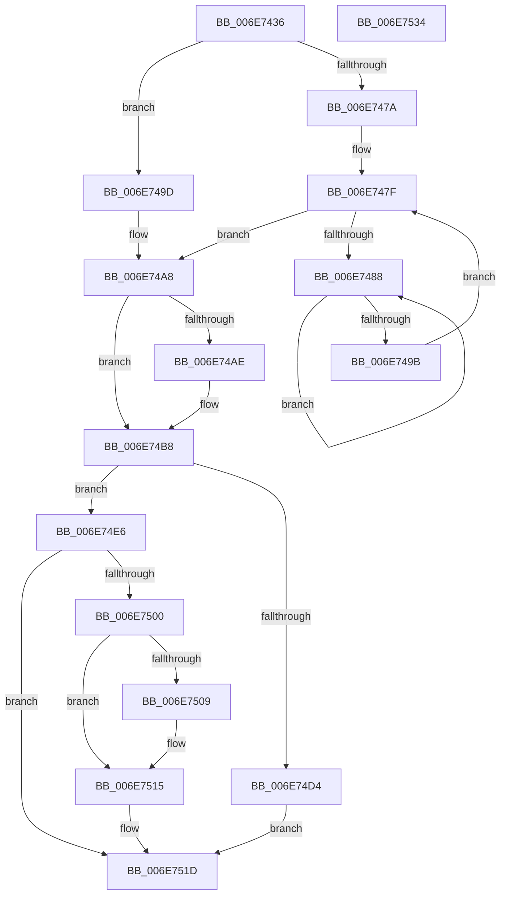

# sub_006E7436

- RVA: `0x006E7436`–`0x006E753B` (길이 `261` bytes)
- VA: `0x00000001406E7436`
- 실행 섹션: `.text`
- PDB 이름 있음: `아니요`; PDB Function 태그: `아니요`
- unwind 정보 RVA: `0x0008C698`
- 디코드: `64`개 명령, `261/261` bytes 표시
- 미해석 바이트: `0` (있으면 어셈블리에 `.byte`로 보존)

> 이 문서는 커널 이미지의 기계어와 PDB 기호를 분석해 생성했습니다. 4번과 5번은 함수 원형과 자료형을 바이너리 사용 방식에서 추정한 C 해석이며 원본 소스 복구 결과는 아닙니다.

## 1. Dependencies

- 직접 호출 지점: **9**; 고유 호출 대상: **9**
- 직접 호출자로 확인된 함수: **0**
- RIP 상대 이미지 참조: **2**

### Outgoing calls
- `0x006E746F` → [MiUpdateLargePageBitMap](../37/MiUpdateLargePageBitMap_function_0037619C.md) (function, `0x0037619C`)
- `0x006E748D` → [KeYieldProcessorEx](../3F/KeYieldProcessorEx_function_003FBD00.md) (function, `0x003FBD00`)
- `0x006E74A0` → [MiLockPageInline](../31/MiLockPageInline_function_0031A340.md) (function, `0x0031A340`)
- `0x006E74B3` → [MiSetPfnModified](../36/MiSetPfnModified_function_00362960.md) (function, `0x00362960`)
- `0x006E74BD` → [MiConvertBaseLargePage](../46/MiConvertBaseLargePage_function_00462294.md) (function, `0x00462294`)
- `0x006E74D4` → [MiInsertPageInFreeOrZeroedList](../33/MiInsertPageInFreeOrZeroedList_function_00334D20.md) (function, `0x00334D20`)
- `0x006E74DF` → [MiUnlockPage](../31/MiUnlockPage_function_0031A3E0.md) (function, `0x0031A3E0`)
- `0x006E74F5` → [MiInsertPossiblyBadPage](../68/MiInsertPossiblyBadPage_function_00689DF0.md) (function, `0x00689DF0`)
- `0x006E7510` → [KiLowerIrqlProcessIrqlFlags](../4F/KiLowerIrqlProcessIrqlFlags_function_004F5698.md) (function, `0x004F5698`)

### Direct callers
- 이 함수 시작 RVA로 연결되는 직접 call은 확인되지 않았습니다. 간접 호출은 완전히 역산할 수 없습니다.

### Static image references
- `0x006E7436` → RVA `0x00011C60` (`.rdata`; read)
- `0x006E7500` → RVA `0x00FC6D20` (`ALMOSTRO`; read)

## 2. Other-region calls and transfers

- 다른 실행 섹션으로 향하는 call: **0**
- call이 아닌 외부 분기/꼬리 이동: **1**
  - `0x006E752F` → [MiFreeLargeZeroPages + 0x45](../3B/MiFreeLargeZeroPages_function_003B5F0C.md) (`tail-transfer`)

## 3. Assembly (complete function range)

```asm
006E7436  4C 8D 25 23 A8 92 FF            lea r12, [rip - 0x6d57dd]
006E743D  4D 8B 24 EC                     mov r12, qword ptr [r12 + rbp*8]
006E7441  48 B8 00 00 00 00 00 DE FF FF   movabs rax, 0xffffde0000000000
006E744B  4C 8B F3                        mov r14, rbx
006E744E  45 8B CD                        mov r9d, r13d
006E7451  4C 2B F0                        sub r14, rax
006E7454  4D 8B C4                        mov r8, r12
006E7457  48 B8 AB AA AA AA AA AA AA AA   movabs rax, 0xaaaaaaaaaaaaaaab
006E7461  49 C1 FE 04                     sar r14, 4
006E7465  4C 0F AF F0                     imul r14, rax
006E7469  49 8B CA                        mov rcx, r10
006E746C  49 8B D6                        mov rdx, r14
006E746F  E8 28 ED C8 FF                  call 0x14037619c
006E7474  41 F6 C5 04                     test r13b, 4
006E7478  74 23                           je 0x1406e749d
006E747A  83 64 24 70 00                  and dword ptr [rsp + 0x70], 0
006E747F  F0 48 0F BA 6B 18 3F            lock bts qword ptr [rbx + 0x18], 0x3f
006E7486  73 20                           jae 0x1406e74a8
006E7488  48 8D 4C 24 70                  lea rcx, [rsp + 0x70]
006E748D  E8 6E 48 D1 FF                  call 0x1403fbd00
006E7492  48 8B 43 18                     mov rax, qword ptr [rbx + 0x18]
006E7496  48 85 C0                        test rax, rax
006E7499  78 ED                           js 0x1406e7488
006E749B  EB E2                           jmp 0x1406e747f
006E749D  48 8B CB                        mov rcx, rbx
006E74A0  E8 9B 2E C3 FF                  call 0x14031a340
006E74A5  40 8A F0                        mov sil, al
006E74A8  F6 43 22 10                     test byte ptr [rbx + 0x22], 0x10
006E74AC  74 0A                           je 0x1406e74b8
006E74AE  33 D2                           xor edx, edx
006E74B0  48 8B CB                        mov rcx, rbx
006E74B3  E8 A8 B4 C7 FF                  call 0x140362960
006E74B8  33 D2                           xor edx, edx
006E74BA  48 8B CB                        mov rcx, rbx
006E74BD  E8 D2 AD D7 FF                  call 0x140462294
006E74C2  48 8B 43 28                     mov rax, qword ptr [rbx + 0x28]
006E74C6  41 8D 57 01                     lea edx, [r15 + 1]
006E74CA  48 0F BA E0 29                  bt rax, 0x29
006E74CF  49 8B CE                        mov rcx, r14
006E74D2  72 12                           jb 0x1406e74e6
006E74D4  E8 47 D8 C4 FF                  call 0x140334d20
006E74D9  40 8A D6                        mov dl, sil
006E74DC  48 8B CB                        mov rcx, rbx
006E74DF  E8 FC 2E C3 FF                  call 0x14031a3e0
006E74E4  EB 37                           jmp 0x1406e751d
006E74E6  48 B8 FF FF FF FF FF FF FF 7F   movabs rax, 0x7fffffffffffffff
006E74F0  F0 48 21 43 18                  lock and qword ptr [rbx + 0x18], rax
006E74F5  E8 F6 28 FA FF                  call 0x140689df0
006E74FA  40 80 FE 02                     cmp sil, 2
006E74FE  73 1D                           jae 0x1406e751d
006E7500  83 3D 19 F8 8D 00 00            cmp dword ptr [rip + 0x8df819], 0
006E7507  74 0C                           je 0x1406e7515
006E7509  44 0F 20 C1                     mov rcx, cr8
006E750D  40 8A D6                        mov dl, sil
006E7510  E8 83 E1 E0 FF                  call 0x1404f5698
006E7515  40 0F B6 C6                     movzx eax, sil
006E7519  44 0F 22 C0                     mov cr8, rax
006E751D  4C 8B 4C 24 68                  mov r9, qword ptr [rsp + 0x68]
006E7522  49 03 FC                        add rdi, r12
006E7525  4C 8B 54 24 60                  mov r10, qword ptr [rsp + 0x60]
006E752A  BE 02 00 00 00                  mov esi, 2
006E752F  E9 1D EA CC FF                  jmp 0x1403b5f51
006E7534  B9 03 00 00 00                  mov ecx, 3
006E7539  CD 29                           int 0x29
```

## 4. C-style interpretation (structured pseudocode)

```c
__int64 __fastcall sub_006E7436(__int64 a1, __int64 a2, __int64 a3, __int64 a4, __int64 a5, __int64 a6, __int64 a7, __int64 a8, __int64 a9, __int64 a10, __int64 a11, __int64 a12, __int64 a13, unsigned int a14)
{
    __int64 result;
    __int64 v_r14;
    __int64 v_rdi;

    v_r14 = (v_rbx) - (result);
    v_r14 = (v_r14) >> (4);
    v_r14 = (v_r14) * (result);
    result = MiUpdateLargePageBitMap(v_r10, v_r14, *(unsigned __int64 *)(v_rip - 7165917 + v_rbp * 8), (unsigned int)((unsigned int)(v_r13)));
    if ((((unsigned __int8)(v_r13)) & (4)) == 0) goto loc_006E749D;
loc_006E747F:
    if (condition_is_above_or_equal) goto loc_006E74A8;
loc_006E7488:
    result = KeYieldProcessorEx(a14, v_r14, *(unsigned __int64 *)(v_rip - 7165917 + v_rbp * 8), (unsigned int)((unsigned int)(v_r13)));
    if (sign_flag) goto loc_006E7488;
    goto loc_006E747F;
loc_006E749D:
    result = MiLockPageInline(v_rbx, v_r14, *(unsigned __int64 *)(v_rip - 7165917 + v_rbp * 8), (unsigned int)((unsigned int)(v_r13)));
loc_006E74A8:
    if (((*(unsigned __int8 *)(v_rbx + 34)) & (16)) != 0) {
        a2 = 0;
        a1 = v_rbx;
        result = MiSetPfnModified(a1, a2, *(unsigned __int64 *)(v_rip - 7165917 + v_rbp * 8), (unsigned int)((unsigned int)(v_r13)));
    }
    a2 = 0;
    result = MiConvertBaseLargePage(v_rbx, a2, *(unsigned __int64 *)(v_rip - 7165917 + v_rbp * 8), (unsigned int)((unsigned int)(v_r13)));
    if (condition_is_below) goto loc_006E74E6;
    result = MiInsertPageInFreeOrZeroedList(v_r14, v_r15 + 1, *(unsigned __int64 *)(v_rip - 7165917 + v_rbp * 8), (unsigned int)((unsigned int)(v_r13)));
    result = MiUnlockPage(v_rbx, (unsigned __int8)((unsigned __int8)(result)), *(unsigned __int64 *)(v_rip - 7165917 + v_rbp * 8), (unsigned int)((unsigned int)(v_r13)));
    goto loc_006E751D;
loc_006E74E6:
    result = MiInsertPossiblyBadPage(v_rbx, (unsigned __int8)((unsigned __int8)(result)), *(unsigned __int64 *)(v_rip - 7165917 + v_rbp * 8), (unsigned int)((unsigned int)(v_r13)));
    if (((unsigned __int8)((unsigned __int8)(result))) >= 2) goto loc_006E751D;
    if ((*(unsigned int *)(v_rip + 9304089)) != 0) {
        a1 = v_cr8;
        a2 = (unsigned __int8)((unsigned __int8)(result));
        result = KiLowerIrqlProcessIrqlFlags(a1, a2, *(unsigned __int64 *)(v_rip - 7165917 + v_rbp * 8), (unsigned int)((unsigned int)(v_r13)));
    }
loc_006E751D:
    v_rdi = (v_rdi) + (*(unsigned __int64 *)(v_rip - 7165917 + v_rbp * 8));
}
```

## 5. (Beta) C Style

```c
int64_t sub_006E7436(int64_t Arg1, int64_t Arg2, int64_t Arg3, int64_t Arg4, uint64_t Arg5, uint64_t Arg6, uint64_t Arg7, uint64_t Arg8, uint64_t Arg9, uint64_t Arg10, uint64_t Arg11, int64_t Arg12, int64_t Arg13, uint32_t Arg14)
{
    int64_t result;
    int64_t local_r14;
    int64_t local_rdi;

    local_r14 = (local_rbx) - (result);
    local_r14 = (local_r14) >> (4);
    local_r14 = (local_r14) * (result);
    result = MiUpdateLargePageBitMap(local_r10, local_r14, *(uint64_t *)(v_rip - 0x6D57DD + local_rbp * 8), (uint32_t)((uint32_t)(local_r13)));
    if ((((uint8_t)(local_r13)) & (4)) == 0) goto loc_006E749D;
loc_006E747F:
    if (condition_is_above_or_equal) goto loc_006E74A8;
loc_006E7488:
    result = KeYieldProcessorEx(Arg14, local_r14, *(uint64_t *)(v_rip - 0x6D57DD + local_rbp * 8), (uint32_t)((uint32_t)(local_r13)));
    if (sign_flag) goto loc_006E7488;
    goto loc_006E747F;
loc_006E749D:
    result = MiLockPageInline(local_rbx, local_r14, *(uint64_t *)(v_rip - 0x6D57DD + local_rbp * 8), (uint32_t)((uint32_t)(local_r13)));
loc_006E74A8:
    if (((*(uint8_t *)(local_rbx + 0x22)) & (16)) != 0) {
        Arg2 = 0;
        Arg1 = local_rbx;
        result = MiSetPfnModified(Arg1, Arg2, *(uint64_t *)(v_rip - 0x6D57DD + local_rbp * 8), (uint32_t)((uint32_t)(local_r13)));
    }
    Arg2 = 0;
    result = MiConvertBaseLargePage(local_rbx, Arg2, *(uint64_t *)(v_rip - 0x6D57DD + local_rbp * 8), (uint32_t)((uint32_t)(local_r13)));
    if (condition_is_below) goto loc_006E74E6;
    result = MiInsertPageInFreeOrZeroedList(local_r14, local_r15 + 1, *(uint64_t *)(v_rip - 0x6D57DD + local_rbp * 8), (uint32_t)((uint32_t)(local_r13)));
    result = MiUnlockPage(local_rbx, (uint8_t)((uint8_t)(result)), *(uint64_t *)(v_rip - 0x6D57DD + local_rbp * 8), (uint32_t)((uint32_t)(local_r13)));
    goto loc_006E751D;
loc_006E74E6:
    result = MiInsertPossiblyBadPage(local_rbx, (uint8_t)((uint8_t)(result)), *(uint64_t *)(v_rip - 0x6D57DD + local_rbp * 8), (uint32_t)((uint32_t)(local_r13)));
    if (((uint8_t)((uint8_t)(result))) >= 2) goto loc_006E751D;
    if ((*(uint32_t *)(v_rip + 0x8DF819)) != 0) {
        Arg1 = v_cr8;
        Arg2 = (uint8_t)((uint8_t)(result));
        result = KiLowerIrqlProcessIrqlFlags(Arg1, Arg2, *(uint64_t *)(v_rip - 0x6D57DD + local_rbp * 8), (uint32_t)((uint32_t)(local_r13)));
    }
loc_006E751D:
    local_rdi = (local_rdi) + (*(uint64_t *)(v_rip - 0x6D57DD + local_rbp * 8));
}
```

## 6. Execution-region graph

[열기: 2D/3D 그래프와 함수 탐색 컨트롤 패널](../../../control-panel.html?section=text&rva=0x006E7436&view=graph)

- 2D 그래프는 위에서 아래로 흐르고, 3D 그래프는 빈 공간을 드래그해 회전합니다. Shift+드래그는 이동, 휠은 확대·축소, 함수 노드 선택은 대상 보고서 이동입니다.

### Static fallback


