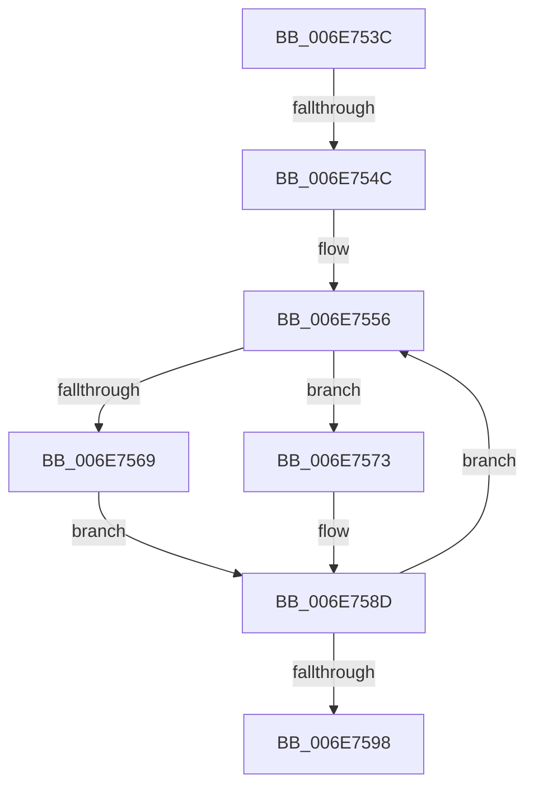

# sub_006E753C

- RVA: `0x006E753C`–`0x006E75A8` (길이 `108` bytes)
- VA: `0x00000001406E753C`
- 실행 섹션: `.text`
- PDB 이름 있음: `아니요`; PDB Function 태그: `아니요`
- unwind 정보 RVA: `0x0008C794`
- 디코드: `27`개 명령, `108/108` bytes 표시
- 미해석 바이트: `0` (있으면 어셈블리에 `.byte`로 보존)

> 이 문서는 커널 이미지의 기계어와 PDB 기호를 분석해 생성했습니다. 4번과 5번은 함수 원형과 자료형을 바이너리 사용 방식에서 추정한 C 해석이며 원본 소스 복구 결과는 아닙니다.

## 1. Dependencies

- 직접 호출 지점: **2**; 고유 호출 대상: **2**
- 직접 호출자로 확인된 함수: **0**
- RIP 상대 이미지 참조: **0**

### Outgoing calls
- `0x006E756C` → [MiMirrorAddPagesToBrownList](../3B/MiMirrorAddPagesToBrownList_function_003B648C.md) (function, `0x003B648C`)
- `0x006E7588` → [MiUpdateLargePageCandidateValue](../33/MiUpdateLargePageCandidateValue_function_0033EF80.md) (function, `0x0033EF80`)

### Direct callers
- 이 함수 시작 RVA로 연결되는 직접 call은 확인되지 않았습니다. 간접 호출은 완전히 역산할 수 없습니다.

### Static image references
- 디코드된 RIP-relative 메모리 참조가 없습니다.

## 2. Other-region calls and transfers

- 다른 실행 섹션으로 향하는 call: **0**
- call이 아닌 외부 분기/꼬리 이동: **2**
  - `0x006E7546` → [MiWalkPagesOnLists + 0x33E](../3B/MiWalkPagesOnLists_function_003B6AA4.md) (`tail-transfer`)
  - `0x006E75A3` → [MiWalkPagesOnLists + 0x3DA](../3B/MiWalkPagesOnLists_function_003B6AA4.md) (`tail-transfer`)

## 3. Assembly (complete function range)

```asm
006E753C  48 C1 E9 0C                     shr rcx, 0xc
006E7540  48 23 CE                        and rcx, rsi
006E7543  48 3B CF                        cmp rcx, rdi
006E7546  0F 84 96 F8 CC FF               je 0x1403b6de2
006E754C  48 BD 00 00 00 00 00 DE FF FF   movabs rbp, 0xffffde0000000000
006E7556  4C 8D 34 49                     lea r14, [rcx + rcx*2]
006E755A  49 C1 E6 04                     shl r14, 4
006E755E  48 8B C5                        mov rax, rbp
006E7561  4C 03 F0                        add r14, rax
006E7564  4D 85 E4                        test r12, r12
006E7567  74 0A                           je 0x1406e7573
006E7569  49 8B D5                        mov rdx, r13
006E756C  E8 1B EF CC FF                  call 0x1403b648c
006E7571  EB 1A                           jmp 0x1406e758d
006E7573  48 83 64 24 20 00               and qword ptr [rsp + 0x20], 0
006E7579  41 B9 03 00 00 00               mov r9d, 3
006E757F  48 8B D1                        mov rdx, rcx
006E7582  45 8B C1                        mov r8d, r9d
006E7585  49 8B CF                        mov rcx, r15
006E7588  E8 F3 79 C5 FF                  call 0x14033ef80
006E758D  49 8B 0E                        mov rcx, qword ptr [r14]
006E7590  48 23 CE                        and rcx, rsi
006E7593  48 3B CF                        cmp rcx, rdi
006E7596  75 BE                           jne 0x1406e7556
006E7598  48 8B 6C 24 38                  mov rbp, qword ptr [rsp + 0x38]
006E759D  41 BE 10 00 00 00               mov r14d, 0x10
006E75A3  E9 D6 F8 CC FF                  jmp 0x1403b6e7e
```

## 4. C-style interpretation (structured pseudocode)

```c
__int64 __fastcall sub_006E753C(__int64 a1, __int64 a2, __int64 a3, __int64 a4, __int64 a5, __int64 a6, __int64 a7)
{
    __int64 result;
    __int64 v_r14;
    unsigned __int64 v_stack_p20;

    a1 = (a1) >> (12);
    a1 = (a1) & (v_rsi);
loc_006E7556:
    v_r14 = (a1 + a1 * 2) << (4);
    v_r14 = (v_r14) + (v_rbp);
    if (v_r12 == 0) goto loc_006E7573;
    result = MiMirrorAddPagesToBrownList(a1, v_r13, a3, a4);
    goto loc_006E758D;
loc_006E7573:
    result = MiUpdateLargePageCandidateValue(v_r15, a1, 3, 3);
loc_006E758D:
    a1 = (*(unsigned __int64 *)(v_r14)) & (v_rsi);
    if (a1 != v_rdi) goto loc_006E7556;
}
```

## 5. (Beta) C Style

```c
int64_t sub_006E753C(int64_t Arg1, int64_t Arg2, int64_t Arg3, int64_t Arg4, uint64_t Arg5, uint64_t Arg6, int64_t Arg7)
{
    int64_t result;
    int64_t local_r14;
    uint64_t v_stack_p20;

    Arg1 = (Arg1) >> (12);
    Arg1 = (Arg1) & (local_rsi);
loc_006E7556:
    local_r14 = (Arg1 + Arg1 * 2) << (4);
    local_r14 = (local_r14) + (local_rbp);
    if (local_r12 == 0) goto loc_006E7573;
    result = MiMirrorAddPagesToBrownList(Arg1, local_r13, Arg3, Arg4);
    goto loc_006E758D;
loc_006E7573:
    result = MiUpdateLargePageCandidateValue(local_r15, Arg1, 3, 3);
loc_006E758D:
    Arg1 = (*(uint64_t *)(local_r14)) & (local_rsi);
    if (Arg1 != local_rdi) goto loc_006E7556;
}
```

## 6. Execution-region graph

[열기: 2D/3D 그래프와 함수 탐색 컨트롤 패널](../../../control-panel.html?section=text&rva=0x006E753C&view=graph)

- 2D 그래프는 위에서 아래로 흐르고, 3D 그래프는 빈 공간을 드래그해 회전합니다. Shift+드래그는 이동, 휠은 확대·축소, 함수 노드 선택은 대상 보고서 이동입니다.

### Static fallback


