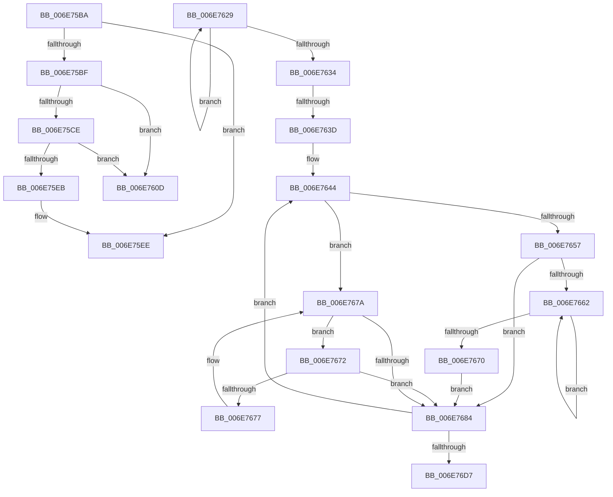

# sub_006E75BA

- RVA: `0x006E75BA`–`0x006E76DC` (길이 `290` bytes)
- VA: `0x00000001406E75BA`
- 실행 섹션: `.text`
- PDB 이름 있음: `아니요`; PDB Function 태그: `아니요`
- unwind 정보 RVA: `0x0008C808`
- 디코드: `81`개 명령, `290/290` bytes 표시
- 미해석 바이트: `0` (있으면 어셈블리에 `.byte`로 보존)

> 이 문서는 커널 이미지의 기계어와 PDB 기호를 분석해 생성했습니다. 4번과 5번은 함수 원형과 자료형을 바이너리 사용 방식에서 추정한 C 해석이며 원본 소스 복구 결과는 아닙니다.

## 1. Dependencies

- 직접 호출 지점: **6**; 고유 호출 대상: **6**
- 직접 호출자로 확인된 함수: **0**
- RIP 상대 이미지 참조: **1**

### Outgoing calls
- `0x006E75DE` → [MiCreatePageChains](../49/MiCreatePageChains_function_0049ECD0.md) (function, `0x0049ECD0`)
- `0x006E75F9` → [MiInsertMdlPageNeedsZero](../37/MiInsertMdlPageNeedsZero_function_00374D7C.md) (function, `0x00374D7C`)
- `0x006E761E` → [MiZeroAndConvertPage](../2C/MiZeroAndConvertPage_function_002C8480.md) (function, `0x002C8480`)
- `0x006E7689` → [RtlAvlRemoveNode](../29/RtlAvlRemoveNode_function_00296650.md) (function, `0x00296650`)
- `0x006E76A1` → [ExFreePoolWithTag](../../poolcode/B8/ExFreePoolWithTag_function_00B82870.md) (function, `0x00B82870`)
- `0x006E76C9` → [MiAssemblePfnList](../47/MiAssemblePfnList_function_0047D1CC.md) (function, `0x0047D1CC`)

### Direct callers
- 이 함수 시작 RVA로 연결되는 직접 call은 확인되지 않았습니다. 간접 호출은 완전히 역산할 수 없습니다.

### Static image references
- `0x006E763D` → RVA `0x00011C60` (`.rdata`; read)

## 2. Other-region calls and transfers

- 다른 실행 섹션으로 향하는 call: **1**
  - `0x006E76A1` → [ExFreePoolWithTag](../../poolcode/B8/ExFreePoolWithTag_function_00B82870.md) (`.text` → `POOLCODE`)
- call이 아닌 외부 분기/꼬리 이동: **4**
  - `0x006E7608` → [MiAllocateLargeZeroPages + 0x138](../3B/MiAllocateLargeZeroPages_function_003B743C.md) (`tail-transfer`)
  - `0x006E7624` → [MiAllocateLargeZeroPages + 0x192](../3B/MiAllocateLargeZeroPages_function_003B743C.md) (`tail-transfer`)
  - `0x006E7637` → [MiAllocateLargeZeroPages + 0xB7](../3B/MiAllocateLargeZeroPages_function_003B743C.md) (`tail-transfer`)
  - `0x006E76D7` → [MiAllocateLargeZeroPages + 0xB7](../3B/MiAllocateLargeZeroPages_function_003B743C.md) (`tail-transfer`)

## 3. Assembly (complete function range)

```asm
006E75BA  4D 85 F6                        test r14, r14
006E75BD  75 2F                           jne 0x1406e75ee
006E75BF  41 8B 1F                        mov ebx, dword ptr [r15]
006E75C2  83 E3 10                        and ebx, 0x10
006E75C5  83 CB 02                        or ebx, 2
006E75C8  D1 EB                           shr ebx, 1
006E75CA  85 F6                           test esi, esi
006E75CC  74 3F                           je 0x1406e760d
006E75CE  44 8B 44 24 30                  mov r8d, dword ptr [rsp + 0x30]
006E75D3  45 33 C9                        xor r9d, r9d
006E75D6  41 8B 57 20                     mov edx, dword ptr [r15 + 0x20]
006E75DA  49 8B 4F 08                     mov rcx, qword ptr [r15 + 8]
006E75DE  E8 ED 76 DB FF                  call 0x14049ecd0
006E75E3  4C 8B F0                        mov r14, rax
006E75E6  48 85 C0                        test rax, rax
006E75E9  74 22                           je 0x1406e760d
006E75EB  89 58 10                        mov dword ptr [rax + 0x10], ebx
006E75EE  4C 8B 44 24 48                  mov r8, qword ptr [rsp + 0x48]
006E75F3  48 8B D7                        mov rdx, rdi
006E75F6  49 8B CE                        mov rcx, r14
006E75F9  E8 7E D7 C8 FF                  call 0x140374d7c
006E75FE  48 8B 54 24 38                  mov rdx, qword ptr [rsp + 0x38]
006E7603  BB 01 00 00 00                  mov ebx, 1
006E7608  E9 67 FF CC FF                  jmp 0x1403b7574
006E760D  44 8B 4C 24 30                  mov r9d, dword ptr [rsp + 0x30]
006E7612  45 8B C5                        mov r8d, r13d
006E7615  48 8B D7                        mov rdx, rdi
006E7618  89 5C 24 20                     mov dword ptr [rsp + 0x20], ebx
006E761C  33 C9                           xor ecx, ecx
006E761E  E8 5D 0E BE FF                  call 0x1402c8480
006E7623  90                              nop
006E7624  E9 A5 FF CC FF                  jmp 0x1403b75ce
006E7629  4C 8B F0                        mov r14, rax
006E762C  48 8B 00                        mov rax, qword ptr [rax]
006E762F  48 85 C0                        test rax, rax
006E7632  75 F5                           jne 0x1406e7629
006E7634  4D 85 F6                        test r14, r14
006E7637  0F 84 B6 FE CC FF               je 0x1403b74f3
006E763D  4C 8D 2D 1C A6 92 FF            lea r13, [rip - 0x6d59e4]
006E7644  49 8B 46 08                     mov rax, qword ptr [r14 + 8]
006E7648  4D 8D 66 F0                     lea r12, [r14 - 0x10]
006E764C  49 8B D6                        mov rdx, r14
006E764F  49 8B CE                        mov rcx, r14
006E7652  48 85 C0                        test rax, rax
006E7655  74 23                           je 0x1406e767a
006E7657  48 8B 08                        mov rcx, qword ptr [rax]
006E765A  4C 8B F0                        mov r14, rax
006E765D  48 85 C9                        test rcx, rcx
006E7660  74 22                           je 0x1406e7684
006E7662  48 8B 01                        mov rax, qword ptr [rcx]
006E7665  4C 8B F1                        mov r14, rcx
006E7668  48 8B C8                        mov rcx, rax
006E766B  48 85 C0                        test rax, rax
006E766E  75 F2                           jne 0x1406e7662
006E7670  EB 12                           jmp 0x1406e7684
006E7672  49 39 0E                        cmp qword ptr [r14], rcx
006E7675  74 0D                           je 0x1406e7684
006E7677  49 8B CE                        mov rcx, r14
006E767A  4D 8B 76 10                     mov r14, qword ptr [r14 + 0x10]
006E767E  49 83 E6 FC                     and r14, 0xfffffffffffffffc
006E7682  75 EE                           jne 0x1406e7672
006E7684  48 8D 4C 24 38                  lea rcx, [rsp + 0x38]
006E7689  E8 C2 EF BA FF                  call 0x140296650
006E768E  41 8B 74 24 08                  mov esi, dword ptr [r12 + 8]
006E7693  33 D2                           xor edx, edx
006E7695  49 8B 3C 24                     mov rdi, qword ptr [r12]
006E7699  49 8B CC                        mov rcx, r12
006E769C  49 8B 5C F5 00                  mov rbx, qword ptr [r13 + rsi*8]
006E76A1  E8 CA B1 49 00                  call 0x140b82870
006E76A6  49 01 5F 48                     add qword ptr [r15 + 0x48], rbx
006E76AA  48 8D 14 7F                     lea rdx, [rdi + rdi*2]
006E76AE  48 C1 E2 04                     shl rdx, 4
006E76B2  48 B8 00 00 00 00 00 DE FF FF   movabs rax, 0xffffde0000000000
006E76BC  48 8B C0                        mov rax, rax
006E76BF  49 8B 4F 50                     mov rcx, qword ptr [r15 + 0x50]
006E76C3  48 03 D0                        add rdx, rax
006E76C6  44 8B C6                        mov r8d, esi
006E76C9  E8 FE 5A D9 FF                  call 0x14047d1cc
006E76CE  4D 85 F6                        test r14, r14
006E76D1  0F 85 6D FF FF FF               jne 0x1406e7644
006E76D7  E9 17 FE CC FF                  jmp 0x1403b74f3
```

## 4. C-style interpretation (structured pseudocode)

```c
__int64 __fastcall sub_006E75BA(__int64 a1, __int64 a2, __int64 a3, int a4, __int64 a5, unsigned int a6, __int64 a7, __int64 a8, __int64 a9)
{
    __int64 result;
    __int64 v_rbx;
    unsigned int v_stack_p20;
    unsigned __int64 v_stack_p38;

    if (v_r14 != 0) goto loc_006E75EE;
    v_rbx = (unsigned int)(((unsigned int)(*(unsigned int *)(v_r15))) & (16));
    v_rbx = (unsigned int)((v_rbx) | (2));
    v_rbx = (unsigned int)((v_rbx) >> (1));
    if ((unsigned int)(v_rsi) == 0) goto loc_006E760D;
    a4 = 0;
    result = MiCreatePageChains(*(unsigned __int64 *)(v_r15 + 8), (unsigned int)(*(unsigned int *)(v_r15 + 32)), (unsigned int)(a6), a4);
    if (result == 0) goto loc_006E760D;
    *(unsigned int *)(result + 16) = (unsigned int)(v_rbx);
loc_006E75EE:
    result = MiInsertMdlPageNeedsZero(result, v_rdi, a9, a4);
loc_006E760D:
    v_stack_p20 = 1;
    a1 = 0;
    result = MiZeroAndConvertPage(a1, v_rdi, (unsigned int)((unsigned int)(v_r13)), (unsigned int)(a6));
}
```

## 5. (Beta) C Style

```c
int64_t sub_006E75BA(int64_t Arg1, int64_t Arg2, int64_t Arg3, int32_t Arg4, uint64_t Arg5, uint32_t Arg6, int64_t Arg7, uint64_t Arg8, int64_t Arg9)
{
    int64_t result;
    int64_t local_rbx;
    uint32_t v_stack_p20;
    uint64_t v_stack_p38;

    if (local_r14 != 0) goto loc_006E75EE;
    local_rbx = (uint32_t)(((uint32_t)(*(uint32_t *)(local_r15))) & (16));
    local_rbx = (uint32_t)((local_rbx) | (2));
    local_rbx = (uint32_t)((local_rbx) >> (1));
    if ((uint32_t)(local_rsi) == 0) goto loc_006E760D;
    Arg4 = 0;
    result = MiCreatePageChains(*(uint64_t *)(local_r15 + 0x8), (uint32_t)(*(uint32_t *)(local_r15 + 0x20)), (uint32_t)(Arg6), Arg4);
    if (result == 0) goto loc_006E760D;
    *(uint32_t *)(result + 0x10) = (uint32_t)(local_rbx);
loc_006E75EE:
    result = MiInsertMdlPageNeedsZero(result, local_rdi, Arg9, Arg4);
loc_006E760D:
    v_stack_p20 = 1;
    Arg1 = 0;
    result = MiZeroAndConvertPage(Arg1, local_rdi, (uint32_t)((uint32_t)(local_r13)), (uint32_t)(Arg6));
}
```

## 6. Execution-region graph

[열기: 2D/3D 그래프와 함수 탐색 컨트롤 패널](../../../control-panel.html?section=text&rva=0x006E75BA&view=graph)

- 2D 그래프는 위에서 아래로 흐르고, 3D 그래프는 빈 공간을 드래그해 회전합니다. Shift+드래그는 이동, 휠은 확대·축소, 함수 노드 선택은 대상 보고서 이동입니다.

### Static fallback


