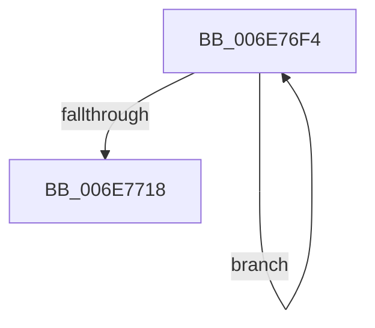

# sub_006E76F4

- RVA: `0x006E76F4`–`0x006E7724` (길이 `48` bytes)
- VA: `0x00000001406E76F4`
- 실행 섹션: `.text`
- PDB 이름 있음: `아니요`; PDB Function 태그: `아니요`
- unwind 정보 RVA: `0x0008C888`
- 디코드: `14`개 명령, `48/48` bytes 표시
- 미해석 바이트: `0` (있으면 어셈블리에 `.byte`로 보존)

> 이 문서는 커널 이미지의 기계어와 PDB 기호를 분석해 생성했습니다. 4번과 5번은 함수 원형과 자료형을 바이너리 사용 방식에서 추정한 C 해석이며 원본 소스 복구 결과는 아닙니다.

## 1. Dependencies

- 직접 호출 지점: **0**; 고유 호출 대상: **0**
- 직접 호출자로 확인된 함수: **0**
- RIP 상대 이미지 참조: **0**

### Outgoing calls
- 직접 디코드된 call 명령이 없습니다.

### Direct callers
- 이 함수 시작 RVA로 연결되는 직접 call은 확인되지 않았습니다. 간접 호출은 완전히 역산할 수 없습니다.

### Static image references
- 디코드된 RIP-relative 메모리 참조가 없습니다.

## 2. Other-region calls and transfers

- 다른 실행 섹션으로 향하는 call: **0**
- call이 아닌 외부 분기/꼬리 이동: **1**
  - `0x006E771F` → [MiAllocateSkipPagesForMdl + 0xF4](../3B/MiAllocateSkipPagesForMdl_function_003B7C08.md) (`tail-transfer`)

## 3. Assembly (complete function range)

```asm
006E76F4  4C 0F AF C1                     imul r8, rcx
006E76F8  33 D2                           xor edx, edx
006E76FA  48 8B C7                        mov rax, rdi
006E76FD  4C 03 44 24 70                  add r8, qword ptr [rsp + 0x70]
006E7702  48 FF C1                        inc rcx
006E7705  4D 89 02                        mov qword ptr [r10], r8
006E7708  4D 8D 52 08                     lea r10, [r10 + 8]
006E770C  4D 8B 46 30                     mov r8, qword ptr [r14 + 0x30]
006E7710  49 F7 F0                        div r8
006E7713  48 3B C8                        cmp rcx, rax
006E7716  72 DC                           jb 0x1406e76f4
006E7718  C1 E1 0C                        shl ecx, 0xc
006E771B  41 01 49 28                     add dword ptr [r9 + 0x28], ecx
006E771F  E9 D8 05 CD FF                  jmp 0x1403b7cfc
```

## 4. C-style interpretation (structured pseudocode)

```c
__int64 __fastcall sub_006E76F4(__int64 a1, int a2, __int64 a3, __int64 a4, __int64 a5, __int64 a6, __int64 a7, __int64 a8, __int64 a9, __int64 a10, __int64 a11, __int64 a12, __int64 a13, __int64 a14)
{
    a3 = (a3) * (a1);
    a2 = 0;
    a3 = (a3) + (a14);
    a1 = (a1) + 1;
    *(unsigned __int64 *)(v_r10) = a3;
    if (a1 < v_rdi) goto loc_006E76F4;
    a1 = (unsigned int)((a1) << (12));
}
```

## 5. (Beta) C Style

```c
int64_t sub_006E76F4(int64_t Arg1, int32_t Arg2, int64_t Arg3, void *Arg4, uint64_t Arg5, uint64_t Arg6, uint64_t Arg7, uint64_t Arg8, uint64_t Arg9, uint64_t Arg10, uint64_t Arg11, uint64_t Arg12, uint64_t Arg13, int64_t Arg14)
{
    uint8_t *arg4 = (uint8_t *)Arg4;

    Arg3 = (Arg3) * (Arg1);
    Arg2 = 0;
    Arg3 = (Arg3) + (Arg14);
    Arg1 = (Arg1) + 1;
    *(uint64_t *)(local_r10) = Arg3;
    if (Arg1 < local_rdi) goto loc_006E76F4;
    Arg1 = (uint32_t)((Arg1) << (12));
}
```

### 관측된 메모리 오프셋

구조체 형식이 확인되지 않은 접근은 인자 기준의 오프셋으로만 기록했습니다.

| 기준 인자 | 오프셋 표현 | 폭 (bit) | 접근 |
|---|---:|---:|---|
| `Arg4` | `+ 0x28` | `32` | `R/W` |

## 6. Execution-region graph

[열기: 2D/3D 그래프와 함수 탐색 컨트롤 패널](../../../control-panel.html?section=text&rva=0x006E76F4&view=graph)

- 2D 그래프는 위에서 아래로 흐르고, 3D 그래프는 빈 공간을 드래그해 회전합니다. Shift+드래그는 이동, 휠은 확대·축소, 함수 노드 선택은 대상 보고서 이동입니다.

### Static fallback


