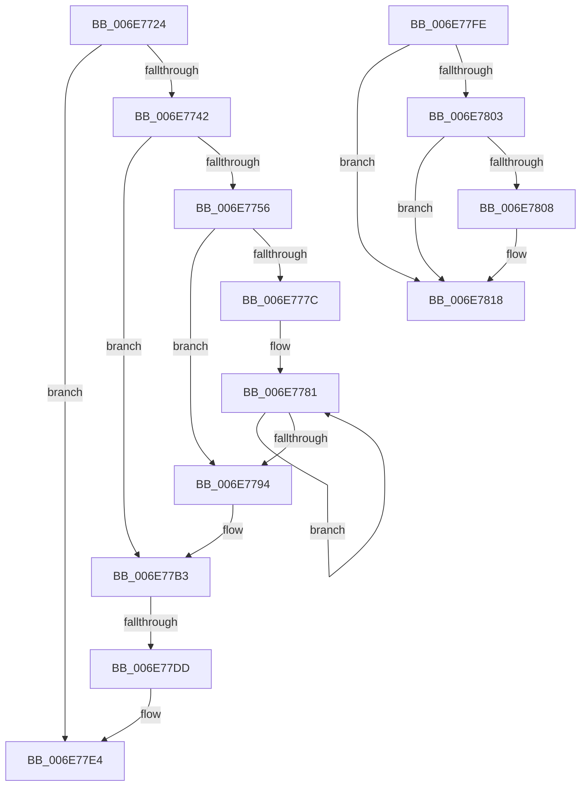

# sub_006E7724

- RVA: `0x006E7724`–`0x006E7821` (길이 `253` bytes)
- VA: `0x00000001406E7724`
- 실행 섹션: `.text`
- PDB 이름 있음: `아니요`; PDB Function 태그: `아니요`
- unwind 정보 RVA: `0x0008C8CC`
- 디코드: `62`개 명령, `253/253` bytes 표시
- 미해석 바이트: `0` (있으면 어셈블리에 `.byte`로 보존)

> 이 문서는 커널 이미지의 기계어와 PDB 기호를 분석해 생성했습니다. 4번과 5번은 함수 원형과 자료형을 바이너리 사용 방식에서 추정한 C 해석이며 원본 소스 복구 결과는 아닙니다.

## 1. Dependencies

- 직접 호출 지점: **2**; 고유 호출 대상: **2**
- 직접 호출자로 확인된 함수: **0**
- RIP 상대 이미지 참조: **2**

### Outgoing calls
- `0x006E772E` → [MiNextPhysicallyContiguousPfnWorthTrying](../69/MiNextPhysicallyContiguousPfnWorthTrying_function_006993EC.md) (function, `0x006993EC`)
- `0x006E77CC` → [MiTryUnlinkNodeLargePages](../68/MiTryUnlinkNodeLargePages_function_0068ADA0.md) (function, `0x0068ADA0`)

### Direct callers
- 이 함수 시작 RVA로 연결되는 직접 call은 확인되지 않았습니다. 간접 호출은 완전히 역산할 수 없습니다.

### Static image references
- `0x006E7746` → RVA `0x000135E8` (`.rdata`; read)
- `0x006E77EC` → RVA `0x00011C60` (`.rdata`; read)

## 2. Other-region calls and transfers

- 다른 실행 섹션으로 향하는 call: **0**
- call이 아닌 외부 분기/꼬리 이동: **3**
  - `0x006E77D7` → [MiGetFastLargePages + 0x21E](../3B/MiGetFastLargePages_function_003B7EE0.md) (`tail-transfer`)
  - `0x006E77F9` → [MiGetFastLargePages + 0xAF](../3B/MiGetFastLargePages_function_003B7EE0.md) (`tail-transfer`)
  - `0x006E781C` → [MiGetFastLargePages + 0x307](../3B/MiGetFastLargePages_function_003B7EE0.md) (`tail-transfer`)

## 3. Assembly (complete function range)

```asm
006E7724  44 8B 77 30                     mov r14d, dword ptr [rdi + 0x30]
006E7728  48 8B CF                        mov rcx, rdi
006E772B  41 8B D6                        mov edx, r14d
006E772E  E8 B9 1C FB FF                  call 0x1406993ec
006E7733  89 84 24 B0 00 00 00            mov dword ptr [rsp + 0xb0], eax
006E773A  85 C0                           test eax, eax
006E773C  0F 84 A2 00 00 00               je 0x1406e77e4
006E7742  48 8B 57 38                     mov rdx, qword ptr [rdi + 0x38]
006E7746  4C 8D 05 9B BE 92 FF            lea r8, [rip - 0x6d4165]
006E774D  47 8B 04 B0                     mov r8d, dword ptr [r8 + r14*4]
006E7751  48 85 D2                        test rdx, rdx
006E7754  74 5D                           je 0x1406e77b3
006E7756  48 C1 EA 09                     shr rdx, 9
006E775A  49 BA F8 FF FF FF 7F 00 00 00   movabs r10, 0x7ffffffff8
006E7764  49 23 D2                        and rdx, r10
006E7767  49 B9 00 00 00 00 80 F6 FF FF   movabs r9, 0xfffff68000000000
006E7771  49 8B C1                        mov rax, r9
006E7774  48 03 D0                        add rdx, rax
006E7777  44 3B F5                        cmp r14d, ebp
006E777A  73 18                           jae 0x1406e7794
006E777C  41 2B EE                        sub ebp, r14d
006E777F  8B CD                           mov ecx, ebp
006E7781  48 C1 EA 09                     shr rdx, 9
006E7785  49 23 D2                        and rdx, r10
006E7788  49 8B C1                        mov rax, r9
006E778B  48 03 D0                        add rdx, rax
006E778E  48 83 E9 01                     sub rcx, 1
006E7792  75 ED                           jne 0x1406e7781
006E7794  48 C1 EA 03                     shr rdx, 3
006E7798  B8 00 02 00 00                  mov eax, 0x200
006E779D  81 E2 FF 01 00 00               and edx, 0x1ff
006E77A3  41 8B C8                        mov ecx, r8d
006E77A6  48 2B C2                        sub rax, rdx
006E77A9  48 D3 E0                        shl rax, cl
006E77AC  48 3B D8                        cmp rbx, rax
006E77AF  48 0F 47 D8                     cmova rbx, rax
006E77B3  48 8B 57 28                     mov rdx, qword ptr [rdi + 0x28]
006E77B7  41 8B C8                        mov ecx, r8d
006E77BA  48 D3 EB                        shr rbx, cl
006E77BD  45 8B C6                        mov r8d, r14d
006E77C0  48 8B 4F 08                     mov rcx, qword ptr [rdi + 8]
006E77C4  4C 8B CB                        mov r9, rbx
006E77C7  44 89 7C 24 20                  mov dword ptr [rsp + 0x20], r15d
006E77CC  E8 CF 35 FA FF                  call 0x14068ada0
006E77D1  48 8B F0                        mov rsi, rax
006E77D4  48 85 C0                        test rax, rax
006E77D7  0F 85 21 09 CD FF               jne 0x1403b80fe
006E77DD  21 84 24 B0 00 00 00            and dword ptr [rsp + 0xb0], eax
006E77E4  44 8B 84 24 A0 00 00 00         mov r8d, dword ptr [rsp + 0xa0]
006E77EC  4C 8D 1D 6D A4 92 FF            lea r11, [rip - 0x6d5b93]
006E77F3  41 BA 01 00 00 00               mov r10d, 1
006E77F9  E9 91 07 CD FF                  jmp 0x1403b7f8f
006E77FE  48 85 D2                        test rdx, rdx
006E7801  74 15                           je 0x1406e7818
006E7803  45 85 C9                        test r9d, r9d
006E7806  74 10                           je 0x1406e7818
006E7808  48 C1 EA 0C                     shr rdx, 0xc
006E780C  41 8D 41 FF                     lea eax, [r9 - 1]
006E7810  49 85 14 C3                     test qword ptr [r11 + rax*8], rdx
006E7814  41 0F 44 EA                     cmove ebp, r10d
006E7818  4C 89 47 28                     mov qword ptr [rdi + 0x28], r8
006E781C  E9 C6 09 CD FF                  jmp 0x1403b81e7
```

## 4. C-style interpretation (structured pseudocode)

```c
__int64 __fastcall sub_006E7724(__int64 a1, __int64 a2, __int64 a3, __int64 a4, __int64 a5, __int64 a6, __int64 a7, __int64 a8, __int64 a9, __int64 a10, __int64 a11, __int64 a12, __int64 a13, __int64 a14, __int64 a15, __int64 a16, __int64 a17, __int64 a18, __int64 a19, unsigned int a20, __int64 a21, unsigned int a22)
{
    __int64 result;
    __int64 v_rbp;
    __int64 v_rbx;
    unsigned int v_stack_p20;
    unsigned int v_stack_pB0;

    result = MiNextPhysicallyContiguousPfnWorthTrying(v_rdi, (unsigned int)((unsigned int)((unsigned int)(*(unsigned int *)(v_rdi + 48)))), a3, a4);
    v_stack_pB0 = (unsigned int)(result);
    if ((unsigned int)(result) == 0) goto loc_006E77E4;
    if (*(unsigned __int64 *)(v_rdi + 56) == 0) goto loc_006E77B3;
    a2 = (*(unsigned __int64 *)(v_rdi + 56)) >> (9);
    a2 = (a2) & (v_r10);
    a2 = (a2) + (a4);
    if (((unsigned int)((unsigned int)(*(unsigned int *)(v_rdi + 48)))) >= ((unsigned int)(v_rbp))) goto loc_006E7794;
    v_rbp = (unsigned int)((v_rbp) - ((unsigned int)((unsigned int)(*(unsigned int *)(v_rdi + 48)))));
loc_006E7781:
    a2 = (a2) >> (9);
    a2 = (a2) & (v_r10);
    a2 = (a2) + (a4);
    a1 = ((unsigned int)((unsigned int)(v_rbp))) - (1);
    if (condition_is_not_equal) goto loc_006E7781;
loc_006E7794:
    a2 = (a2) >> (3);
    a2 = (unsigned int)((a2) & (511));
    result = (512) - (a2);
    result = (result) << ((unsigned __int8)((unsigned int)((unsigned int)((unsigned int)(*(unsigned int *)(v_rip - 7160165 + (unsigned int)(*(unsigned int *)(v_rdi + 48)) * 4))))));
    if (v_rbx > result) { v_rbx = result; }
loc_006E77B3:
    v_rbx = (v_rbx) >> ((unsigned __int8)((unsigned int)((unsigned int)((unsigned int)(*(unsigned int *)(v_rip - 7160165 + (unsigned int)(*(unsigned int *)(v_rdi + 48)) * 4))))));
    v_stack_p20 = (unsigned int)(v_r15);
    result = MiTryUnlinkNodeLargePages(*(unsigned __int64 *)(v_rdi + 8), *(unsigned __int64 *)(v_rdi + 40), (unsigned int)((unsigned int)((unsigned int)(*(unsigned int *)(v_rdi + 48)))), v_rbx);
loc_006E77E4:
}
```

## 5. (Beta) C Style

```c
int64_t sub_006E7724(int64_t Arg1, int64_t Arg2, int64_t Arg3, int64_t Arg4, uint64_t Arg5, uint64_t Arg6, uint64_t Arg7, uint64_t Arg8, uint64_t Arg9, uint64_t Arg10, uint64_t Arg11, uint64_t Arg12, uint64_t Arg13, uint64_t Arg14, uint64_t Arg15, uint64_t Arg16, uint64_t Arg17, uint64_t Arg18, uint64_t Arg19, uint32_t Arg20, uint64_t Arg21, uint32_t Arg22)
{
    int64_t result;
    int64_t local_rbp;
    int64_t local_rbx;
    uint32_t v_stack_p20;
    uint32_t v_stack_pB0;

    result = MiNextPhysicallyContiguousPfnWorthTrying(local_rdi, (uint32_t)((uint32_t)((uint32_t)(*(uint32_t *)(local_rdi + 0x30)))), Arg3, Arg4);
    v_stack_pB0 = (uint32_t)(result);
    if ((uint32_t)(result) == 0) goto loc_006E77E4;
    if (*(uint64_t *)(local_rdi + 0x38) == 0) goto loc_006E77B3;
    Arg2 = (*(uint64_t *)(local_rdi + 0x38)) >> (9);
    Arg2 = (Arg2) & (local_r10);
    Arg2 = (Arg2) + (Arg4);
    if (((uint32_t)((uint32_t)(*(uint32_t *)(local_rdi + 0x30)))) >= ((uint32_t)(local_rbp))) goto loc_006E7794;
    local_rbp = (uint32_t)((local_rbp) - ((uint32_t)((uint32_t)(*(uint32_t *)(local_rdi + 0x30)))));
loc_006E7781:
    Arg2 = (Arg2) >> (9);
    Arg2 = (Arg2) & (local_r10);
    Arg2 = (Arg2) + (Arg4);
    Arg1 = ((uint32_t)((uint32_t)(local_rbp))) - (1);
    if (condition_is_not_equal) goto loc_006E7781;
loc_006E7794:
    Arg2 = (Arg2) >> (3);
    Arg2 = (uint32_t)((Arg2) & (511));
    result = (512) - (Arg2);
    result = (result) << ((uint8_t)((uint32_t)((uint32_t)((uint32_t)(*(uint32_t *)(v_rip - 0x6D4165 + (uint32_t)(*(uint32_t *)(local_rdi + 0x30)) * 4))))));
    if (local_rbx > result) { local_rbx = result; }
loc_006E77B3:
    local_rbx = (local_rbx) >> ((uint8_t)((uint32_t)((uint32_t)((uint32_t)(*(uint32_t *)(v_rip - 0x6D4165 + (uint32_t)(*(uint32_t *)(local_rdi + 0x30)) * 4))))));
    v_stack_p20 = (uint32_t)(local_r15);
    result = MiTryUnlinkNodeLargePages(*(uint64_t *)(local_rdi + 0x8), *(uint64_t *)(local_rdi + 0x28), (uint32_t)((uint32_t)((uint32_t)(*(uint32_t *)(local_rdi + 0x30)))), local_rbx);
loc_006E77E4:
}
```

## 6. Execution-region graph

[열기: 2D/3D 그래프와 함수 탐색 컨트롤 패널](../../../control-panel.html?section=text&rva=0x006E7724&view=graph)

- 2D 그래프는 위에서 아래로 흐르고, 3D 그래프는 빈 공간을 드래그해 회전합니다. Shift+드래그는 이동, 휠은 확대·축소, 함수 노드 선택은 대상 보고서 이동입니다.

### Static fallback


