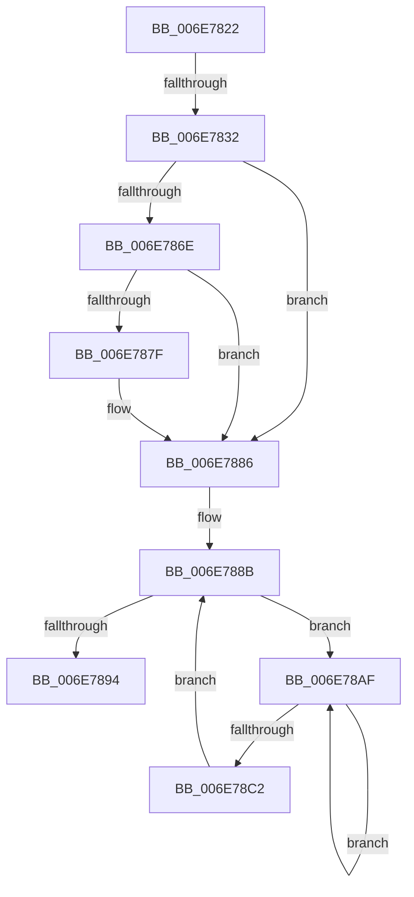

# sub_006E7822

- RVA: `0x006E7822`–`0x006E78C4` (길이 `162` bytes)
- VA: `0x00000001406E7822`
- 실행 섹션: `.text`
- PDB 이름 있음: `아니요`; PDB Function 태그: `아니요`
- unwind 정보 RVA: `0x0008C904`
- 디코드: `37`개 명령, `162/162` bytes 표시
- 미해석 바이트: `0` (있으면 어셈블리에 `.byte`로 보존)

> 이 문서는 커널 이미지의 기계어와 PDB 기호를 분석해 생성했습니다. 4번과 5번은 함수 원형과 자료형을 바이너리 사용 방식에서 추정한 C 해석이며 원본 소스 복구 결과는 아닙니다.

## 1. Dependencies

- 직접 호출 지점: **5**; 고유 호출 대상: **5**
- 직접 호출자로 확인된 함수: **0**
- RIP 상대 이미지 참조: **2**

### Outgoing calls
- `0x006E785F` → [MiAddPageToHeatList](../44/MiAddPageToHeatList_function_0044603C.md) (function, `0x0044603C`)
- `0x006E7881` → [KiRaiseIrqlProcessIrqlFlags](../4F/KiRaiseIrqlProcessIrqlFlags_function_004F56FC.md) (function, `0x004F56FC`)
- `0x006E7899` → [MiSetFreeZeroPfnCold](../37/MiSetFreeZeroPfnCold_function_00379428.md) (function, `0x00379428`)
- `0x006E78A4` → [MiUnlockPage](../31/MiUnlockPage_function_0031A3E0.md) (function, `0x0031A3E0`)
- `0x006E78B4` → [KeYieldProcessorEx](../3F/KeYieldProcessorEx_function_003FBD00.md) (function, `0x003FBD00`)

### Direct callers
- 이 함수 시작 RVA로 연결되는 직접 call은 확인되지 않았습니다. 간접 호출은 완전히 역산할 수 없습니다.

### Static image references
- `0x006E7822` → RVA `0x00FC6AB8` (`ALMOSTRO`; read)
- `0x006E7876` → RVA `0x00FC6D20` (`ALMOSTRO`; read)

## 2. Other-region calls and transfers

- 다른 실행 섹션으로 향하는 call: **0**
- call이 아닌 외부 분기/꼬리 이동: **2**
  - `0x006E782C` → [MiGetLargePageChain + 0x140](../3B/MiGetLargePageChain_function_003B82D0.md) (`tail-transfer`)
  - `0x006E78AA` → [MiGetLargePageChain + 0x140](../3B/MiGetLargePageChain_function_003B82D0.md) (`tail-transfer`)

## 3. Assembly (complete function range)

```asm
006E7822  F7 05 8C F2 8D 00 00 00 20 00   test dword ptr [rip + 0x8df28c], 0x200000
006E782C  0F 84 DE 0B CD FF               je 0x1403b8410
006E7832  48 B8 00 00 00 00 00 DE FF FF   movabs rax, 0xffffde0000000000
006E783C  48 8B D7                        mov rdx, rdi
006E783F  48 8D 4C 24 40                  lea rcx, [rsp + 0x40]
006E7844  48 2B D0                        sub rdx, rax
006E7847  41 B8 01 00 00 00               mov r8d, 1
006E784D  48 C1 FA 04                     sar rdx, 4
006E7851  48 B8 AB AA AA AA AA AA AA AA   movabs rax, 0xaaaaaaaaaaaaaaab
006E785B  48 0F AF D0                     imul rdx, rax
006E785F  E8 D8 E7 D5 FF                  call 0x14044603c
006E7864  B8 02 00 00 00                  mov eax, 2
006E7869  40 3A E8                        cmp bpl, al
006E786C  74 18                           je 0x1406e7886
006E786E  44 0F 20 C1                     mov rcx, cr8
006E7872  44 0F 22 C0                     mov cr8, rax
006E7876  83 3D A3 F4 8D 00 00            cmp dword ptr [rip + 0x8df4a3], 0
006E787D  74 07                           je 0x1406e7886
006E787F  8A D0                           mov dl, al
006E7881  E8 76 DE E0 FF                  call 0x1404f56fc
006E7886  83 64 24 30 00                  and dword ptr [rsp + 0x30], 0
006E788B  F0 48 0F BA 6F 18 3F            lock bts qword ptr [rdi + 0x18], 0x3f
006E7892  72 1B                           jb 0x1406e78af
006E7894  33 D2                           xor edx, edx
006E7896  48 8B CF                        mov rcx, rdi
006E7899  E8 8A 1B C9 FF                  call 0x140379428
006E789E  40 8A D5                        mov dl, bpl
006E78A1  48 8B CF                        mov rcx, rdi
006E78A4  E8 37 2B C3 FF                  call 0x14031a3e0
006E78A9  90                              nop
006E78AA  E9 61 0B CD FF                  jmp 0x1403b8410
006E78AF  48 8D 4C 24 30                  lea rcx, [rsp + 0x30]
006E78B4  E8 47 44 D1 FF                  call 0x1403fbd00
006E78B9  48 8B 47 18                     mov rax, qword ptr [rdi + 0x18]
006E78BD  48 85 C0                        test rax, rax
006E78C0  78 ED                           js 0x1406e78af
006E78C2  EB C7                           jmp 0x1406e788b
```

## 4. C-style interpretation (structured pseudocode)

```c
__int64 __fastcall sub_006E7822(__int64 a1, __int64 a2, __int64 a3, __int64 a4, __int64 a5, unsigned int a6, __int64 a7, __int64 a8)
{
    __int64 result;

    a2 = (v_rdi) - (result);
    a2 = (a2) >> (4);
    a2 = (a2) * (result);
    result = MiAddPageToHeatList(a8, a2, 1, a4);
    if (((unsigned __int8)(v_rbp)) == 2) goto loc_006E7886;
    result = 2;
    if ((*(unsigned int *)(v_rip + 9303203)) != 0) {
        a2 = 2;
        result = KiRaiseIrqlProcessIrqlFlags(v_cr8, a2, 1, a4);
    }
loc_006E788B:
    if ((*(unsigned int *)(v_rip + 9303203)) < 0) goto loc_006E78AF;
    a2 = 0;
    result = MiSetFreeZeroPfnCold(v_rdi, a2, 1, a4);
    result = MiUnlockPage(v_rdi, (unsigned __int8)(v_rbp), 1, a4);
loc_006E78AF:
    result = KeYieldProcessorEx(a6, (unsigned __int8)(v_rbp), 1, a4);
    if (sign_flag) goto loc_006E78AF;
    goto loc_006E788B;
}
```

## 5. (Beta) C Style

```c
int64_t sub_006E7822(int64_t Arg1, int64_t Arg2, int64_t Arg3, int64_t Arg4, uint64_t Arg5, uint32_t Arg6, uint64_t Arg7, int64_t Arg8)
{
    int64_t result;

    Arg2 = (local_rdi) - (result);
    Arg2 = (Arg2) >> (4);
    Arg2 = (Arg2) * (result);
    result = MiAddPageToHeatList(Arg8, Arg2, 1, Arg4);
    if (((uint8_t)(local_rbp)) == 2) goto loc_006E7886;
    result = 2;
    if ((*(uint32_t *)(v_rip + 0x8DF4A3)) != 0) {
        Arg2 = 2;
        result = KiRaiseIrqlProcessIrqlFlags(v_cr8, Arg2, 1, Arg4);
    }
loc_006E788B:
    if ((*(uint32_t *)(v_rip + 0x8DF4A3)) < 0) goto loc_006E78AF;
    Arg2 = 0;
    result = MiSetFreeZeroPfnCold(local_rdi, Arg2, 1, Arg4);
    result = MiUnlockPage(local_rdi, (uint8_t)(local_rbp), 1, Arg4);
loc_006E78AF:
    result = KeYieldProcessorEx(Arg6, (uint8_t)(local_rbp), 1, Arg4);
    if (sign_flag) goto loc_006E78AF;
    goto loc_006E788B;
}
```

## 6. Execution-region graph

[열기: 2D/3D 그래프와 함수 탐색 컨트롤 패널](../../../control-panel.html?section=text&rva=0x006E7822&view=graph)

- 2D 그래프는 위에서 아래로 흐르고, 3D 그래프는 빈 공간을 드래그해 회전합니다. Shift+드래그는 이동, 휠은 확대·축소, 함수 노드 선택은 대상 보고서 이동입니다.

### Static fallback


