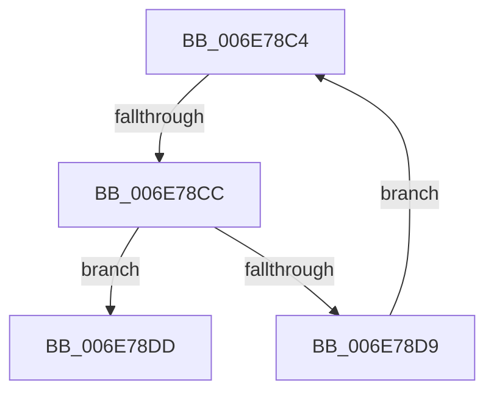

# sub_006E78C4

- RVA: `0x006E78C4`–`0x006E78E7` (길이 `35` bytes)
- VA: `0x00000001406E78C4`
- 실행 섹션: `.text`
- PDB 이름 있음: `아니요`; PDB Function 태그: `아니요`
- unwind 정보 RVA: `0x0008C94C`
- 디코드: `10`개 명령, `35/35` bytes 표시
- 미해석 바이트: `0` (있으면 어셈블리에 `.byte`로 보존)

> 이 문서는 커널 이미지의 기계어와 PDB 기호를 분석해 생성했습니다. 4번과 5번은 함수 원형과 자료형을 바이너리 사용 방식에서 추정한 C 해석이며 원본 소스 복구 결과는 아닙니다.

## 1. Dependencies

- 직접 호출 지점: **0**; 고유 호출 대상: **0**
- 직접 호출자로 확인된 함수: **0**
- RIP 상대 이미지 참조: **0**

### Outgoing calls
- 직접 디코드된 call 명령이 없습니다.

### Direct callers
- 이 함수 시작 RVA로 연결되는 직접 call은 확인되지 않았습니다. 간접 호출은 완전히 역산할 수 없습니다.

### Static image references
- 디코드된 RIP-relative 메모리 참조가 없습니다.

## 2. Other-region calls and transfers

- 다른 실행 섹션으로 향하는 call: **0**
- call이 아닌 외부 분기/꼬리 이동: **2**
  - `0x006E78C6` → [MiGetChannelInformation + 0x96](../3B/MiGetChannelInformation_function_003B8738.md) (`tail-transfer`)
  - `0x006E78E2` → [MiGetChannelInformation + 0x96](../3B/MiGetChannelInformation_function_003B8738.md) (`tail-transfer`)

## 3. Assembly (complete function range)

```asm
006E78C4  3A CA                           cmp cl, dl
006E78C6  0F 83 02 0F CD FF               jae 0x1403b87ce
006E78CC  0F B6 C1                        movzx eax, cl
006E78CF  40 38 B4 28 81 3B 00 00         cmp byte ptr [rax + rbp + 0x3b81], sil
006E78D7  74 04                           je 0x1406e78dd
006E78D9  FE C1                           inc cl
006E78DB  EB E7                           jmp 0x1406e78c4
006E78DD  0F B6 C1                        movzx eax, cl
006E78E0  89 07                           mov dword ptr [rdi], eax
006E78E2  E9 E7 0E CD FF                  jmp 0x1403b87ce
```

## 4. C-style interpretation (structured pseudocode)

```c
__int64 __fastcall sub_006E78C4(unsigned __int8 a1, unsigned __int8 a2)
{
    if ((*(unsigned __int8 *)(a1 + v_rbp * 1 + 15233)) == ((unsigned __int8)(v_rsi))) goto loc_006E78DD;
    a1 = (unsigned __int8)((a1) + 1);
    goto loc_006E78C4;
loc_006E78DD:
    *(unsigned int *)(v_rdi) = a1;
}
```

## 5. (Beta) C Style

```c
int64_t sub_006E78C4(uint8_t Arg1, uint8_t Arg2)
{
    if ((*(uint8_t *)(Arg1 + local_rbp * 1 + 0x3B81)) == ((uint8_t)(local_rsi))) goto loc_006E78DD;
    Arg1 = (uint8_t)((Arg1) + 1);
    goto loc_006E78C4;
loc_006E78DD:
    *(uint32_t *)(local_rdi) = Arg1;
}
```

## 6. Execution-region graph

[열기: 2D/3D 그래프와 함수 탐색 컨트롤 패널](../../../control-panel.html?section=text&rva=0x006E78C4&view=graph)

- 2D 그래프는 위에서 아래로 흐르고, 3D 그래프는 빈 공간을 드래그해 회전합니다. Shift+드래그는 이동, 휠은 확대·축소, 함수 노드 선택은 대상 보고서 이동입니다.

### Static fallback


