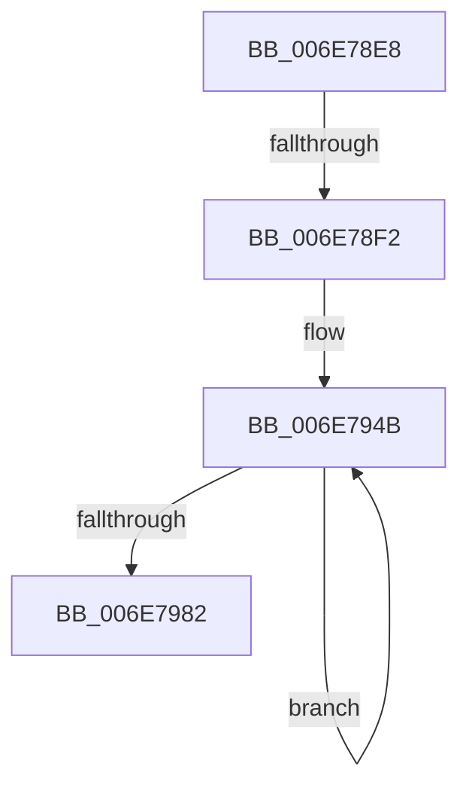

# sub_006E78E8

- RVA: `0x006E78E8`–`0x006E798E` (길이 `166` bytes)
- VA: `0x00000001406E78E8`
- 실행 섹션: `.text`
- PDB 이름 있음: `아니요`; PDB Function 태그: `아니요`
- unwind 정보 RVA: `0x0008C984`
- 디코드: `37`개 명령, `166/166` bytes 표시
- 미해석 바이트: `0` (있으면 어셈블리에 `.byte`로 보존)

> 이 문서는 커널 이미지의 기계어와 PDB 기호를 분석해 생성했습니다. 4번과 5번은 함수 원형과 자료형을 바이너리 사용 방식에서 추정한 C 해석이며 원본 소스 복구 결과는 아닙니다.

## 1. Dependencies

- 직접 호출 지점: **0**; 고유 호출 대상: **0**
- 직접 호출자로 확인된 함수: **0**
- RIP 상대 이미지 참조: **1**

### Outgoing calls
- 직접 디코드된 call 명령이 없습니다.

### Direct callers
- 이 함수 시작 RVA로 연결되는 직접 call은 확인되지 않았습니다. 간접 호출은 완전히 역산할 수 없습니다.

### Static image references
- `0x006E78F6` → RVA `0x00011C60` (`.rdata`; read)

## 2. Other-region calls and transfers

- 다른 실행 섹션으로 향하는 call: **0**
- call이 아닌 외부 분기/꼬리 이동: **2**
  - `0x006E78EC` → [MiGetNodeChannelPageCounts + 0x85](../3B/MiGetNodeChannelPageCounts_function_003B8888.md) (`tail-transfer`)
  - `0x006E7989` → [MiGetNodeChannelPageCounts + 0xE7](../3B/MiGetNodeChannelPageCounts_function_003B8888.md) (`tail-transfer`)

## 3. Assembly (complete function range)

```asm
006E78E8  40 80 FF 02                     cmp dil, 2
006E78EC  0F 84 1B 10 CD FF               je 0x1403b890d
006E78F2  40 0F B6 CF                     movzx ecx, dil
006E78F6  4C 8D 15 63 A3 92 FF            lea r10, [rip - 0x6d5c9d]
006E78FD  41 BD 03 00 00 00               mov r13d, 3
006E7903  48 8D 81 B3 03 00 00            lea rax, [rcx + 0x3b3]
006E790A  48 03 C0                        add rax, rax
006E790D  4C 8D 1C CD C0 03 00 00         lea r11, [rcx*8 + 0x3c0]
006E7915  4C 8D 3C CD D0 03 00 00         lea r15, [rcx*8 + 0x3d0]
006E791D  4C 8D 24 CD B0 03 00 00         lea r12, [rcx*8 + 0x3b0]
006E7925  49 8B 34 C6                     mov rsi, qword ptr [r14 + rax*8]
006E7929  8B C1                           mov eax, ecx
006E792B  48 03 C0                        add rax, rax
006E792E  49 8B AC C6 38 3B 00 00         mov rbp, qword ptr [r14 + rax*8 + 0x3b38]
006E7936  48 8D 04 CD A0 03 00 00         lea rax, [rcx*8 + 0x3a0]
006E793E  4C 2B D8                        sub r11, rax
006E7941  4E 8D 0C 30                     lea r9, [rax + r14]
006E7945  4C 2B F8                        sub r15, rax
006E7948  4C 2B E0                        sub r12, rax
006E794B  4B 8B 0C 0B                     mov rcx, qword ptr [r11 + r9]
006E794F  49 8B 11                        mov rdx, qword ptr [r9]
006E7952  4D 8B 02                        mov r8, qword ptr [r10]
006E7955  48 03 D1                        add rdx, rcx
006E7958  4B 8B 0C 0F                     mov rcx, qword ptr [r15 + r9]
006E795C  4D 8D 52 08                     lea r10, [r10 + 8]
006E7960  49 0F AF D0                     imul rdx, r8
006E7964  48 03 F2                        add rsi, rdx
006E7967  4B 8B 14 0C                     mov rdx, qword ptr [r12 + r9]
006E796B  48 03 D1                        add rdx, rcx
006E796E  4D 8D 89 00 05 00 00            lea r9, [r9 + 0x500]
006E7975  49 0F AF D0                     imul rdx, r8
006E7979  48 03 EA                        add rbp, rdx
006E797C  49 83 ED 01                     sub r13, 1
006E7980  75 C9                           jne 0x1406e794b
006E7982  4C 8B 7C 24 28                  mov r15, qword ptr [rsp + 0x28]
006E7987  33 D2                           xor edx, edx
006E7989  E9 E1 0F CD FF                  jmp 0x1403b896f
```

## 4. C-style interpretation (structured pseudocode)

```c
__int64 __fastcall sub_006E78E8(__int64 a1, __int64 a2, __int64 a3, __int64 a4, __int64 a5)
{
    __int64 result;
    __int64 v_r11;
    __int64 v_r12;
    __int64 v_r13;
    __int64 v_r15;
    __int64 v_rbp;
    __int64 v_rsi;

    result = ((unsigned __int8)(v_rdi) + 947) + ((unsigned __int8)(v_rdi) + 947);
    result = ((unsigned int)((unsigned int)((unsigned __int8)(v_rdi)))) + ((unsigned int)((unsigned int)((unsigned __int8)(v_rdi))));
    v_r11 = ((unsigned __int8)(v_rdi) * 8 + 960) - ((unsigned __int8)(v_rdi) * 8 + 928);
    v_r15 = ((unsigned __int8)(v_rdi) * 8 + 976) - ((unsigned __int8)(v_rdi) * 8 + 928);
    v_r12 = ((unsigned __int8)(v_rdi) * 8 + 944) - ((unsigned __int8)(v_rdi) * 8 + 928);
loc_006E794B:
    a2 = (*(unsigned __int64 *)((unsigned __int8)(v_rdi) * 8 + 928 + v_r14 * 1)) + (*(unsigned __int64 *)(v_r11 + (unsigned __int8)(v_rdi) * 8 + 928 + v_r14 * 1 * 1));
    a2 = (a2) * (*(unsigned __int64 *)(v_rip - 7167133));
    v_rsi = (*(unsigned __int64 *)(v_r14 + result * 8)) + (a2);
    a2 = (*(unsigned __int64 *)(v_r12 + (unsigned __int8)(v_rdi) * 8 + 928 + v_r14 * 1 * 1)) + (*(unsigned __int64 *)(v_r15 + (unsigned __int8)(v_rdi) * 8 + 928 + v_r14 * 1 * 1));
    a2 = (a2) * (*(unsigned __int64 *)(v_rip - 7167133));
    v_rbp = (*(unsigned __int64 *)(v_r14 + result * 8 + 15160)) + (a2);
    v_r13 = (3) - (1);
    if (condition_is_not_equal) goto loc_006E794B;
    a2 = 0;
}
```

## 5. (Beta) C Style

```c
int64_t sub_006E78E8(int64_t Arg1, int64_t Arg2, int64_t Arg3, int64_t Arg4, int64_t Arg5)
{
    int64_t result;
    int64_t local_r11;
    int64_t local_r12;
    int64_t local_r13;
    int64_t local_r15;
    int64_t local_rbp;
    int64_t local_rsi;

    result = ((uint8_t)(local_rdi) + 947) + ((uint8_t)(local_rdi) + 947);
    result = ((uint32_t)((uint32_t)((uint8_t)(local_rdi)))) + ((uint32_t)((uint32_t)((uint8_t)(local_rdi))));
    local_r11 = ((uint8_t)(local_rdi) * 8 + 960) - ((uint8_t)(local_rdi) * 8 + 928);
    local_r15 = ((uint8_t)(local_rdi) * 8 + 976) - ((uint8_t)(local_rdi) * 8 + 928);
    local_r12 = ((uint8_t)(local_rdi) * 8 + 944) - ((uint8_t)(local_rdi) * 8 + 928);
loc_006E794B:
    Arg2 = (*(uint64_t *)((uint8_t)(local_rdi) * 8 + 0x3A0 + local_r14 * 1)) + (*(uint64_t *)(local_r11 + (uint8_t)(local_rdi) * 8 + 0x3A0 + local_r14 * 1 * 1));
    Arg2 = (Arg2) * (*(uint64_t *)(v_rip - 0x6D5C9D));
    local_rsi = (*(uint64_t *)(local_r14 + result * 8)) + (Arg2);
    Arg2 = (*(uint64_t *)(local_r12 + (uint8_t)(local_rdi) * 8 + 0x3A0 + local_r14 * 1 * 1)) + (*(uint64_t *)(local_r15 + (uint8_t)(local_rdi) * 8 + 0x3A0 + local_r14 * 1 * 1));
    Arg2 = (Arg2) * (*(uint64_t *)(v_rip - 0x6D5C9D));
    local_rbp = (*(uint64_t *)(local_r14 + result * 8 + 0x3B38)) + (Arg2);
    local_r13 = (3) - (1);
    if (condition_is_not_equal) goto loc_006E794B;
    Arg2 = 0;
}
```

## 6. Execution-region graph

[열기: 2D/3D 그래프와 함수 탐색 컨트롤 패널](../../../control-panel.html?section=text&rva=0x006E78E8&view=graph)

- 2D 그래프는 위에서 아래로 흐르고, 3D 그래프는 빈 공간을 드래그해 회전합니다. Shift+드래그는 이동, 휠은 확대·축소, 함수 노드 선택은 대상 보고서 이동입니다.

### Static fallback


