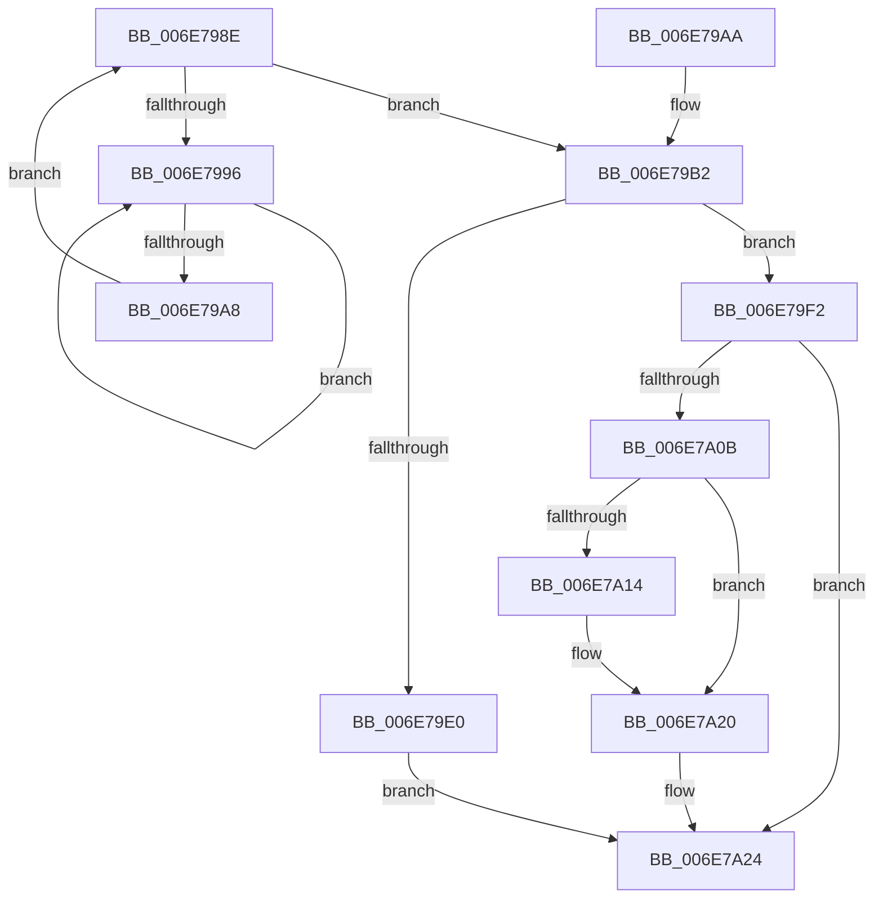

# sub_006E798E

- RVA: `0x006E798E`–`0x006E7A2C` (길이 `158` bytes)
- VA: `0x00000001406E798E`
- 실행 섹션: `.text`
- PDB 이름 있음: `아니요`; PDB Function 태그: `아니요`
- unwind 정보 RVA: `0x0008C9C8`
- 디코드: `41`개 명령, `158/158` bytes 표시
- 미해석 바이트: `0` (있으면 어셈블리에 `.byte`로 보존)

> 이 문서는 커널 이미지의 기계어와 PDB 기호를 분석해 생성했습니다. 4번과 5번은 함수 원형과 자료형을 바이너리 사용 방식에서 추정한 C 해석이며 원본 소스 복구 결과는 아닙니다.

## 1. Dependencies

- 직접 호출 지점: **7**; 고유 호출 대상: **7**
- 직접 호출자로 확인된 함수: **0**
- RIP 상대 이미지 참조: **1**

### Outgoing calls
- `0x006E799B` → [KeYieldProcessorEx](../3F/KeYieldProcessorEx_function_003FBD00.md) (function, `0x003FBD00`)
- `0x006E79AD` → [MiLockPageInline](../31/MiLockPageInline_function_0031A340.md) (function, `0x0031A340`)
- `0x006E79C9` → [MiConvertBaseLargePage](../46/MiConvertBaseLargePage_function_00462294.md) (function, `0x00462294`)
- `0x006E79E0` → [MiInsertPageInFreeOrZeroedList](../33/MiInsertPageInFreeOrZeroedList_function_00334D20.md) (function, `0x00334D20`)
- `0x006E79EB` → [MiUnlockPage](../31/MiUnlockPage_function_0031A3E0.md) (function, `0x0031A3E0`)
- `0x006E7A00` → [MiInsertPossiblyBadPage](../68/MiInsertPossiblyBadPage_function_00689DF0.md) (function, `0x00689DF0`)
- `0x006E7A1B` → [KiLowerIrqlProcessIrqlFlags](../4F/KiLowerIrqlProcessIrqlFlags_function_004F5698.md) (function, `0x004F5698`)

### Direct callers
- 이 함수 시작 RVA로 연결되는 직접 call은 확인되지 않았습니다. 간접 호출은 완전히 역산할 수 없습니다.

### Static image references
- `0x006E7A0B` → RVA `0x00FC6D20` (`ALMOSTRO`; read)

## 2. Other-region calls and transfers

- 다른 실행 섹션으로 향하는 call: **0**
- call이 아닌 외부 분기/꼬리 이동: **1**
  - `0x006E7A27` → [MiFreeLargePageChain + 0x18](../3B/MiFreeLargePageChain_function_003B8CCC.md) (`tail-transfer`)

## 3. Assembly (complete function range)

```asm
006E798E  F0 48 0F BA 2F 3F               lock bts qword ptr [rdi], 0x3f
006E7994  73 1C                           jae 0x1406e79b2
006E7996  48 8D 4C 24 50                  lea rcx, [rsp + 0x50]
006E799B  E8 60 43 D1 FF                  call 0x1403fbd00
006E79A0  48 8B 07                        mov rax, qword ptr [rdi]
006E79A3  48 85 C0                        test rax, rax
006E79A6  78 EE                           js 0x1406e7996
006E79A8  EB E4                           jmp 0x1406e798e
006E79AA  48 8B CB                        mov rcx, rbx
006E79AD  E8 8E 29 C3 FF                  call 0x14031a340
006E79B2  48 8B 43 10                     mov rax, qword ptr [rbx + 0x10]
006E79B6  48 8B CB                        mov rcx, rbx
006E79B9  25 E0 03 00 00                  and eax, 0x3e0
006E79BE  48 F7 D8                        neg rax
006E79C1  45 1B C9                        sbb r9d, r9d
006E79C4  33 D2                           xor edx, edx
006E79C6  41 F7 D9                        neg r9d
006E79C9  E8 C6 A8 D7 FF                  call 0x140462294
006E79CE  48 8B 43 28                     mov rax, qword ptr [rbx + 0x28]
006E79D2  41 8D 51 01                     lea edx, [r9 + 1]
006E79D6  48 0F BA E0 29                  bt rax, 0x29
006E79DB  48 8B CE                        mov rcx, rsi
006E79DE  72 12                           jb 0x1406e79f2
006E79E0  E8 3B D3 C4 FF                  call 0x140334d20
006E79E5  40 8A D5                        mov dl, bpl
006E79E8  48 8B CB                        mov rcx, rbx
006E79EB  E8 F0 29 C3 FF                  call 0x14031a3e0
006E79F0  EB 32                           jmp 0x1406e7a24
006E79F2  48 B8 FF FF FF FF FF FF FF 7F   movabs rax, 0x7fffffffffffffff
006E79FC  F0 48 21 07                     lock and qword ptr [rdi], rax
006E7A00  E8 EB 23 FA FF                  call 0x140689df0
006E7A05  40 80 FD 02                     cmp bpl, 2
006E7A09  73 19                           jae 0x1406e7a24
006E7A0B  83 3D 0E F3 8D 00 00            cmp dword ptr [rip + 0x8df30e], 0
006E7A12  74 0C                           je 0x1406e7a20
006E7A14  44 0F 20 C1                     mov rcx, cr8
006E7A18  40 8A D5                        mov dl, bpl
006E7A1B  E8 78 DC E0 FF                  call 0x1404f5698
006E7A20  44 0F 22 C5                     mov cr8, rbp
006E7A24  49 8B CE                        mov rcx, r14
006E7A27  E9 B8 12 CD FF                  jmp 0x1403b8ce4
```

## 4. C-style interpretation (structured pseudocode)

```c
__int64 __fastcall sub_006E798E(__int64 a1, int a2, __int64 a3, int a4, __int64 a5, __int64 a6, __int64 a7, __int64 a8, __int64 a9, __int64 a10)
{
    __int64 result;

    if (condition_is_above_or_equal) goto loc_006E79B2;
loc_006E7996:
    result = KeYieldProcessorEx(a10, a2, a3, a4);
    if (sign_flag) goto loc_006E7996;
    goto loc_006E798E;
loc_006E79B2:
    result = (unsigned int)((*(unsigned __int64 *)(v_rbx + 16)) & (992));
    result = -(result);
    a2 = 0;
    a4 = (unsigned int)(-(a4));
    result = MiConvertBaseLargePage(v_rbx, a2, a3, a4);
    if (condition_is_below) goto loc_006E79F2;
    result = MiInsertPageInFreeOrZeroedList(v_rsi, a4 + 1, a3, a4);
    result = MiUnlockPage(v_rbx, (unsigned __int8)(v_rbp), a3, a4);
    goto loc_006E7A24;
loc_006E79F2:
    result = MiInsertPossiblyBadPage(v_rbx, (unsigned __int8)(v_rbp), a3, a4);
    if (((unsigned __int8)(v_rbp)) >= 2) goto loc_006E7A24;
    if ((*(unsigned int *)(v_rip + 9302798)) != 0) {
        a1 = v_cr8;
        a2 = (unsigned __int8)(v_rbp);
        result = KiLowerIrqlProcessIrqlFlags(a1, a2, a3, a4);
    }
loc_006E7A24:
}
```

## 5. (Beta) C Style

```c
int64_t sub_006E798E(int64_t Arg1, int32_t Arg2, int64_t Arg3, int32_t Arg4, uint64_t Arg5, uint64_t Arg6, uint64_t Arg7, uint64_t Arg8, uint64_t Arg9, int64_t Arg10)
{
    int64_t result;

    if (condition_is_above_or_equal) goto loc_006E79B2;
loc_006E7996:
    result = KeYieldProcessorEx(Arg10, Arg2, Arg3, Arg4);
    if (sign_flag) goto loc_006E7996;
    goto loc_006E798E;
loc_006E79B2:
    result = (uint32_t)((*(uint64_t *)(local_rbx + 0x10)) & (992));
    result = -(result);
    Arg2 = 0;
    Arg4 = (uint32_t)(-(Arg4));
    result = MiConvertBaseLargePage(local_rbx, Arg2, Arg3, Arg4);
    if (condition_is_below) goto loc_006E79F2;
    result = MiInsertPageInFreeOrZeroedList(local_rsi, Arg4 + 1, Arg3, Arg4);
    result = MiUnlockPage(local_rbx, (uint8_t)(local_rbp), Arg3, Arg4);
    goto loc_006E7A24;
loc_006E79F2:
    result = MiInsertPossiblyBadPage(local_rbx, (uint8_t)(local_rbp), Arg3, Arg4);
    if (((uint8_t)(local_rbp)) >= 2) goto loc_006E7A24;
    if ((*(uint32_t *)(v_rip + 0x8DF30E)) != 0) {
        Arg1 = v_cr8;
        Arg2 = (uint8_t)(local_rbp);
        result = KiLowerIrqlProcessIrqlFlags(Arg1, Arg2, Arg3, Arg4);
    }
loc_006E7A24:
}
```

## 6. Execution-region graph

[열기: 2D/3D 그래프와 함수 탐색 컨트롤 패널](../../../control-panel.html?section=text&rva=0x006E798E&view=graph)

- 2D 그래프는 위에서 아래로 흐르고, 3D 그래프는 빈 공간을 드래그해 회전합니다. Shift+드래그는 이동, 휠은 확대·축소, 함수 노드 선택은 대상 보고서 이동입니다.

### Static fallback


