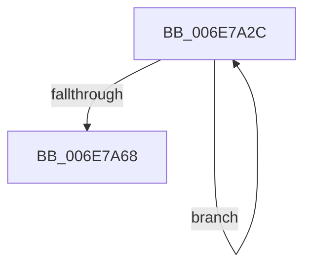

# sub_006E7A2C

- RVA: `0x006E7A2C`–`0x006E7A83` (길이 `87` bytes)
- VA: `0x00000001406E7A2C`
- 실행 섹션: `.text`
- PDB 이름 있음: `아니요`; PDB Function 태그: `아니요`
- unwind 정보 RVA: `0x0008CA00`
- 디코드: `18`개 명령, `87/87` bytes 표시
- 미해석 바이트: `0` (있으면 어셈블리에 `.byte`로 보존)

> 이 문서는 커널 이미지의 기계어와 PDB 기호를 분석해 생성했습니다. 4번과 5번은 함수 원형과 자료형을 바이너리 사용 방식에서 추정한 C 해석이며 원본 소스 복구 결과는 아닙니다.

## 1. Dependencies

- 직접 호출 지점: **1**; 고유 호출 대상: **1**
- 직접 호출자로 확인된 함수: **0**
- RIP 상대 이미지 참조: **0**

### Outgoing calls
- `0x006E7A2F` → [MiPageToNode](../33/MiPageToNode_function_00338CD0.md) (function, `0x00338CD0`)

### Direct callers
- 이 함수 시작 RVA로 연결되는 직접 call은 확인되지 않았습니다. 간접 호출은 완전히 역산할 수 없습니다.

### Static image references
- 디코드된 RIP-relative 메모리 참조가 없습니다.

## 2. Other-region calls and transfers

- 다른 실행 섹션으로 향하는 call: **0**
- call이 아닌 외부 분기/꼬리 이동: **1**
  - `0x006E7A7E` → [MiGetPartitionNodeInformation + 0xC8](../3B/MiGetPartitionNodeInformation_function_003B8D48.md) (`tail-transfer`)

## 3. Assembly (complete function range)

```asm
006E7A2C  49 8B CF                        mov rcx, r15
006E7A2F  E8 9C 12 C5 FF                  call 0x140338cd0
006E7A34  3B C3                           cmp eax, ebx
006E7A36  48 8D 4E 01                     lea rcx, [rsi + 1]
006E7A3A  4B 8D 04 7F                     lea rax, [r15 + r15*2]
006E7A3E  48 0F 45 CE                     cmovne rcx, rsi
006E7A42  48 03 C0                        add rax, rax
006E7A45  48 8B F1                        mov rsi, rcx
006E7A48  49 BF 00 00 00 00 00 DE FF FF   movabs r15, 0xffffde0000000000
006E7A52  4D 8B 3C C7                     mov r15, qword ptr [r15 + rax*8]
006E7A56  48 B8 FF FF FF FF FF 00 00 00   movabs rax, 0xffffffffff
006E7A60  4C 23 F8                        and r15, rax
006E7A63  4C 3B FF                        cmp r15, rdi
006E7A66  75 C4                           jne 0x1406e7a2c
006E7A68  49 8D BE A0 1B 00 00            lea rdi, [r14 + 0x1ba0]
006E7A6F  49 BC FF FF FF FF 3F 00 00 00   movabs r12, 0x3fffffffff
006E7A79  4C 8B 7C 24 20                  mov r15, qword ptr [rsp + 0x20]
006E7A7E  E9 8D 13 CD FF                  jmp 0x1403b8e10
```

## 4. C-style interpretation (structured pseudocode)

```c
__int64 __fastcall sub_006E7A2C(void)
{
    __int64 result;
    __int64 v_r15;
    unsigned __int64 v_stack_p20;

    result = MiPageToNode(v_r15, a2, a3, a4);
    a1 = v_rsi + 1;
    if (((unsigned int)(result)) != ((unsigned int)(v_rbx))) { a1 = v_rsi; }
    result = (v_r15 + v_r15 * 2) + (v_r15 + v_r15 * 2);
    v_r15 = (*(unsigned __int64 *)(v_r15 + result * 8)) & (result);
    if (v_r15 != v_rdi) goto loc_006E7A2C;
}
```

## 5. (Beta) C Style

```c
void sub_006E7A2C(void)
{
    int64_t result;
    int64_t local_r15;
    uint64_t v_stack_p20;

    result = MiPageToNode(local_r15, a2, a3, a4);
    a1 = local_rsi + 1;
    if (((uint32_t)(result)) != ((uint32_t)(local_rbx))) { a1 = local_rsi; }
    result = (local_r15 + local_r15 * 2) + (local_r15 + local_r15 * 2);
    local_r15 = (*(uint64_t *)(local_r15 + result * 8)) & (result);
    if (local_r15 != local_rdi) goto loc_006E7A2C;
}
```

## 6. Execution-region graph

[열기: 2D/3D 그래프와 함수 탐색 컨트롤 패널](../../../control-panel.html?section=text&rva=0x006E7A2C&view=graph)

- 2D 그래프는 위에서 아래로 흐르고, 3D 그래프는 빈 공간을 드래그해 회전합니다. Shift+드래그는 이동, 휠은 확대·축소, 함수 노드 선택은 대상 보고서 이동입니다.

### Static fallback


