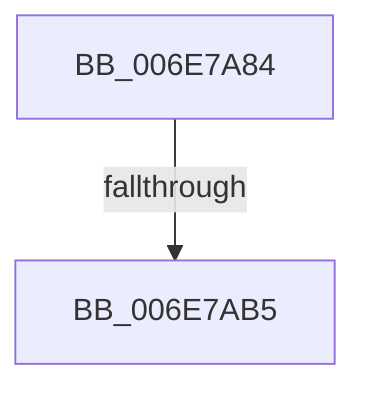

# sub_006E7A84

- RVA: `0x006E7A84`–`0x006E7B00` (길이 `124` bytes)
- VA: `0x00000001406E7A84`
- 실행 섹션: `.text`
- PDB 이름 있음: `아니요`; PDB Function 태그: `아니요`
- unwind 정보 RVA: `0x0008CAAC`
- 디코드: `26`개 명령, `124/124` bytes 표시
- 미해석 바이트: `0` (있으면 어셈블리에 `.byte`로 보존)

> 이 문서는 커널 이미지의 기계어와 PDB 기호를 분석해 생성했습니다. 4번과 5번은 함수 원형과 자료형을 바이너리 사용 방식에서 추정한 C 해석이며 원본 소스 복구 결과는 아닙니다.

## 1. Dependencies

- 직접 호출 지점: **2**; 고유 호출 대상: **2**
- 직접 호출자로 확인된 함수: **0**
- RIP 상대 이미지 참조: **3**

### Outgoing calls
- `0x006E7AA1` → [MmFillEtwHugeIoSpaceInformation](../66/MmFillEtwHugeIoSpaceInformation_function_0066E37C.md) (function, `0x0066E37C`)
- `0x006E7AF5` → [EtwWriteEx](../25/EtwWriteEx_function_0025F0D0.md) (function, `0x0025F0D0`)

### Direct callers
- 이 함수 시작 RVA로 연결되는 직접 call은 확인되지 않았습니다. 간접 호출은 완전히 역산할 수 없습니다.

### Static image references
- `0x006E7A84` → RVA `0x00FC5000` (`ALMOSTRO`; read)
- `0x006E7AB5` → RVA `0x00EFF848` (`.data`; read)
- `0x006E7ABC` → RVA `0x00022840` (`.rdata`; read)

## 2. Other-region calls and transfers

- 다른 실행 섹션으로 향하는 call: **0**
- call이 아닌 외부 분기/꼬리 이동: **2**
  - `0x006E7AAF` → [EtwpLogMemNodeInfo + 0x92](../3B/EtwpLogMemNodeInfo_function_003B991C.md) (`tail-transfer`)
  - `0x006E7AFB` → [EtwpLogMemNodeInfo + 0x92](../3B/EtwpLogMemNodeInfo_function_003B991C.md) (`tail-transfer`)

## 3. Assembly (complete function range)

```asm
006E7A84  44 0F B7 05 74 D5 8D 00         movzx r8d, word ptr [rip + 0x8dd574]
006E7A8C  48 8D 44 24 44                  lea rax, [rsp + 0x44]
006E7A91  4C 8D 4C 24 40                  lea r9, [rsp + 0x40]
006E7A96  48 89 44 24 20                  mov qword ptr [rsp + 0x20], rax
006E7A9B  48 8B D3                        mov rdx, rbx
006E7A9E  48 8B CF                        mov rcx, rdi
006E7AA1  E8 D6 68 F8 FF                  call 0x14066e37c
006E7AA6  89 44 24 48                     mov dword ptr [rsp + 0x48], eax
006E7AAA  40 38 74 24 40                  cmp byte ptr [rsp + 0x40], sil
006E7AAF  0F 84 F9 1E CD FF               je 0x1403b99ae
006E7AB5  48 8B 0D 8C 7D 81 00            mov rcx, qword ptr [rip + 0x817d8c]
006E7ABC  48 8D 15 7D AD 93 FF            lea rdx, [rip - 0x6c5283]
006E7AC3  6B C0 1C                        imul eax, eax, 0x1c
006E7AC6  45 33 C9                        xor r9d, r9d
006E7AC9  45 33 C0                        xor r8d, r8d
006E7ACC  48 89 5C 24 70                  mov qword ptr [rsp + 0x70], rbx
006E7AD1  89 74 24 7C                     mov dword ptr [rsp + 0x7c], esi
006E7AD5  89 44 24 78                     mov dword ptr [rsp + 0x78], eax
006E7AD9  48 8D 44 24 50                  lea rax, [rsp + 0x50]
006E7ADE  48 89 44 24 38                  mov qword ptr [rsp + 0x38], rax
006E7AE3  C7 44 24 30 03 00 00 00         mov dword ptr [rsp + 0x30], 3
006E7AEB  48 89 74 24 28                  mov qword ptr [rsp + 0x28], rsi
006E7AF0  48 89 74 24 20                  mov qword ptr [rsp + 0x20], rsi
006E7AF5  E8 D6 75 B7 FF                  call 0x14025f0d0
006E7AFA  90                              nop
006E7AFB  E9 AE 1E CD FF                  jmp 0x1403b99ae
```

## 4. C-style interpretation (structured pseudocode)

```c
__int64 __fastcall sub_006E7A84(__int64 a1, __int64 a2, __int64 a3, __int64 a4, __int64 a5, __int64 a6, __int64 a7, unsigned __int8 a8, __int64 a9, __int64 a10)
{
    __int64 result;
    unsigned __int64 v_stack_p20;
    unsigned __int64 v_stack_p28;
    unsigned int v_stack_p30;
    unsigned __int64 v_stack_p38;
    unsigned __int64 v_stack_p44;
    unsigned int v_stack_p48;
    unsigned __int64 v_stack_p70;
    unsigned int v_stack_p78;
    unsigned int v_stack_p7C;

    v_stack_p20 = v_stack_p44;
    result = MmFillEtwHugeIoSpaceInformation(v_rdi, v_rbx, *(unsigned __int16 *)(v_rip + 9295220), a8);
    v_stack_p48 = (unsigned int)(result);
    result = (unsigned int)((result) * ((unsigned int)(result)));
    a4 = 0;
    a3 = 0;
    v_stack_p70 = v_rbx;
    v_stack_p7C = (unsigned int)(v_rsi);
    v_stack_p78 = (unsigned int)(result);
    v_stack_p38 = a10;
    v_stack_p30 = 3;
    v_stack_p28 = v_rsi;
    v_stack_p20 = v_rsi;
    result = EtwWriteEx(*(unsigned __int64 *)(v_rip + 8486284), v_rip - 7099011, a3, a4);
}
```

## 5. (Beta) C Style

```c
int64_t sub_006E7A84(int64_t Arg1, int64_t Arg2, int64_t Arg3, int64_t Arg4, uint64_t Arg5, uint64_t Arg6, uint64_t Arg7, uint8_t Arg8, uint64_t Arg9, int64_t Arg10)
{
    int64_t result;
    uint64_t v_stack_p20;
    uint64_t v_stack_p28;
    uint32_t v_stack_p30;
    uint64_t v_stack_p38;
    uint64_t v_stack_p44;
    uint32_t v_stack_p48;
    uint64_t v_stack_p70;
    uint32_t v_stack_p78;
    uint32_t v_stack_p7C;

    v_stack_p20 = v_stack_p44;
    result = MmFillEtwHugeIoSpaceInformation(local_rdi, local_rbx, *(uint16_t *)(v_rip + 0x8DD574), Arg8);
    v_stack_p48 = (uint32_t)(result);
    result = (uint32_t)((result) * ((uint32_t)(result)));
    Arg4 = 0;
    Arg3 = 0;
    v_stack_p70 = local_rbx;
    v_stack_p7C = (uint32_t)(local_rsi);
    v_stack_p78 = (uint32_t)(result);
    v_stack_p38 = Arg10;
    v_stack_p30 = 3;
    v_stack_p28 = local_rsi;
    v_stack_p20 = local_rsi;
    result = EtwWriteEx(*(uint64_t *)(v_rip + 0x817D8C), v_rip - 7099011, Arg3, Arg4);
}
```

## 6. Execution-region graph

[열기: 2D/3D 그래프와 함수 탐색 컨트롤 패널](../../../control-panel.html?section=text&rva=0x006E7A84&view=graph)

- 2D 그래프는 위에서 아래로 흐르고, 3D 그래프는 빈 공간을 드래그해 회전합니다. Shift+드래그는 이동, 휠은 확대·축소, 함수 노드 선택은 대상 보고서 이동입니다.

### Static fallback


