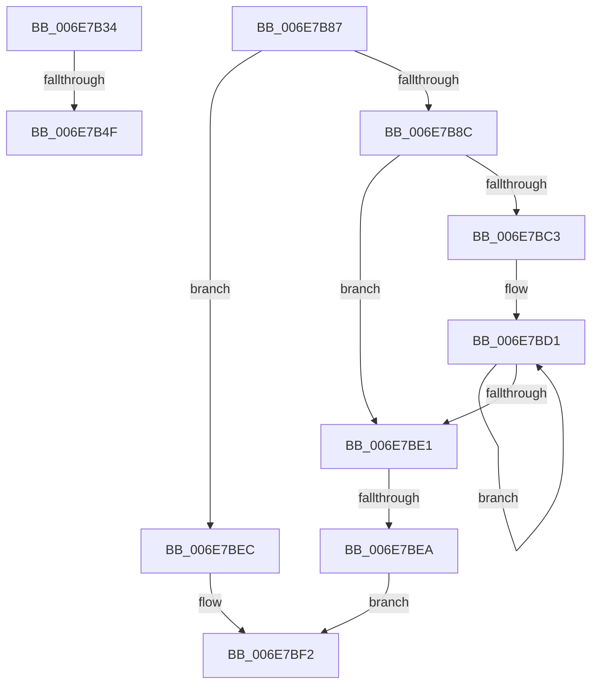

# sub_006E7B34

- RVA: `0x006E7B34`–`0x006E7C06` (길이 `210` bytes)
- VA: `0x00000001406E7B34`
- 실행 섹션: `.text`
- PDB 이름 있음: `아니요`; PDB Function 태그: `아니요`
- unwind 정보 RVA: `0x0008CC20`
- 디코드: `53`개 명령, `210/210` bytes 표시
- 미해석 바이트: `0` (있으면 어셈블리에 `.byte`로 보존)

> 이 문서는 커널 이미지의 기계어와 PDB 기호를 분석해 생성했습니다. 4번과 5번은 함수 원형과 자료형을 바이너리 사용 방식에서 추정한 C 해석이며 원본 소스 복구 결과는 아닙니다.

## 1. Dependencies

- 직접 호출 지점: **1**; 고유 호출 대상: **1**
- 직접 호출자로 확인된 함수: **0**
- RIP 상대 이미지 참조: **3**

### Outgoing calls
- `0x006E7B63` → [MiArePageContentsZero](../4D/MiArePageContentsZero_function_004D4278.md) (function, `0x004D4278`)

### Direct callers
- 이 함수 시작 RVA로 연결되는 직접 call은 확인되지 않았습니다. 간접 호출은 완전히 역산할 수 없습니다.

### Static image references
- `0x006E7B34` → RVA `0x00E30270` (`.data`; read)
- `0x006E7B3D` → RVA `0x00FC5054` (`ALMOSTRO`; reference)
- `0x006E7B43` → RVA `0x00E30270` (`.data`; write)

## 2. Other-region calls and transfers

- 다른 실행 섹션으로 향하는 call: **0**
- call이 아닌 외부 분기/꼬리 이동: **4**
  - `0x006E7B49` → [MiReplenishPageSlist + 0x365](../3B/MiReplenishPageSlist_function_003BADE0.md) (`tail-transfer`)
  - `0x006E7B82` → [MiReplenishPageSlist + 0x365](../3B/MiReplenishPageSlist_function_003BADE0.md) (`tail-transfer`)
  - `0x006E7BE4` → [MiReplenishPageSlist + 0x372](../3B/MiReplenishPageSlist_function_003BADE0.md) (`tail-transfer`)
  - `0x006E7C01` → [MiReplenishPageSlist + 0x372](../3B/MiReplenishPageSlist_function_003BADE0.md) (`tail-transfer`)

## 3. Assembly (complete function range)

```asm
006E7B34  8B 05 36 87 74 00               mov eax, dword ptr [rip + 0x748736]
006E7B3A  41 03 C2                        add eax, r10d
006E7B3D  85 05 11 D5 8D 00               test dword ptr [rip + 0x8dd511], eax
006E7B43  89 05 27 87 74 00               mov dword ptr [rip + 0x748727], eax
006E7B49  0F 85 F6 35 CD FF               jne 0x1403bb145
006E7B4F  48 8B C1                        mov rax, rcx
006E7B52  48 8B CF                        mov rcx, rdi
006E7B55  49 8B D2                        mov rdx, r10
006E7B58  48 2B C8                        sub rcx, rax
006E7B5B  48 C1 F9 04                     sar rcx, 4
006E7B5F  49 0F AF C8                     imul rcx, r8
006E7B63  E8 10 C7 DE FF                  call 0x1404d4278
006E7B68  41 BA 01 00 00 00               mov r10d, 1
006E7B6E  48 B9 00 00 00 00 00 DE FF FF   movabs rcx, 0xffffde0000000000
006E7B78  49 B8 AB AA AA AA AA AA AA AA   movabs r8, 0xaaaaaaaaaaaaaaab
006E7B82  E9 BE 35 CD FF                  jmp 0x1403bb145
006E7B87  4D 85 DB                        test r11, r11
006E7B8A  74 60                           je 0x1406e7bec
006E7B8C  41 83 E2 1F                     and r10d, 0x1f
006E7B90  BA 20 00 00 00                  mov edx, 0x20
006E7B95  41 2B D2                        sub edx, r10d
006E7B98  41 BA 01 00 00 00               mov r10d, 1
006E7B9E  8B CA                           mov ecx, edx
006E7BA0  41 8B C2                        mov eax, r10d
006E7BA3  D3 E0                           shl eax, cl
006E7BA5  49 8B CB                        mov rcx, r11
006E7BA8  41 2B C2                        sub eax, r10d
006E7BAB  D3 E0                           shl eax, cl
006E7BAD  F0 41 09 00                     lock or dword ptr [r8], eax
006E7BB1  8B C2                           mov eax, edx
006E7BB3  45 8B CA                        mov r9d, r10d
006E7BB6  4C 2B C8                        sub r9, rax
006E7BB9  49 83 C0 04                     add r8, 4
006E7BBD  49 83 F9 20                     cmp r9, 0x20
006E7BC1  72 1E                           jb 0x1406e7be1
006E7BC3  49 8B D1                        mov rdx, r9
006E7BC6  48 C1 EA 05                     shr rdx, 5
006E7BCA  48 6B C2 E0                     imul rax, rdx, -0x20
006E7BCE  4C 03 C8                        add r9, rax
006E7BD1  41 C7 00 FF FF FF FF            mov dword ptr [r8], 0xffffffff
006E7BD8  49 83 C0 04                     add r8, 4
006E7BDC  49 2B D2                        sub rdx, r10
006E7BDF  75 F0                           jne 0x1406e7bd1
006E7BE1  4D 85 C9                        test r9, r9
006E7BE4  0F 84 68 35 CD FF               je 0x1403bb152
006E7BEA  EB 06                           jmp 0x1406e7bf2
006E7BEC  41 BA 01 00 00 00               mov r10d, 1
006E7BF2  49 8B C9                        mov rcx, r9
006E7BF5  41 8B C2                        mov eax, r10d
006E7BF8  D3 E0                           shl eax, cl
006E7BFA  41 2B C2                        sub eax, r10d
006E7BFD  F0 41 09 00                     lock or dword ptr [r8], eax
006E7C01  E9 4C 35 CD FF                  jmp 0x1403bb152
```

## 4. C-style interpretation (structured pseudocode)

```c
__int64 __fastcall sub_006E7B34(__int64 a1, __int64 a2, __int64 a3)
{
    __int64 result;

    result = (unsigned int)(((unsigned int)(*(unsigned int *)(v_rip + 7636790))) + ((unsigned int)(v_r10)));
    *(unsigned int *)(v_rip + 7636775) = (unsigned int)(result);
    a1 = (v_rdi) - (a1);
    a1 = (a1) >> (4);
    a1 = (a1) * (a3);
    result = MiArePageContentsZero(a1, v_r10, a3, a4);
}
```

## 5. (Beta) C Style

```c
int64_t sub_006E7B34(int64_t Arg1, int64_t Arg2, int64_t Arg3)
{
    int64_t result;

    result = (uint32_t)(((uint32_t)(*(uint32_t *)(v_rip + 0x748736))) + ((uint32_t)(local_r10)));
    *(uint32_t *)(v_rip + 0x748727) = (uint32_t)(result);
    Arg1 = (local_rdi) - (Arg1);
    Arg1 = (Arg1) >> (4);
    Arg1 = (Arg1) * (Arg3);
    result = MiArePageContentsZero(Arg1, local_r10, Arg3, a4);
}
```

## 6. Execution-region graph

[열기: 2D/3D 그래프와 함수 탐색 컨트롤 패널](../../../control-panel.html?section=text&rva=0x006E7B34&view=graph)

- 2D 그래프는 위에서 아래로 흐르고, 3D 그래프는 빈 공간을 드래그해 회전합니다. Shift+드래그는 이동, 휠은 확대·축소, 함수 노드 선택은 대상 보고서 이동입니다.

### Static fallback


