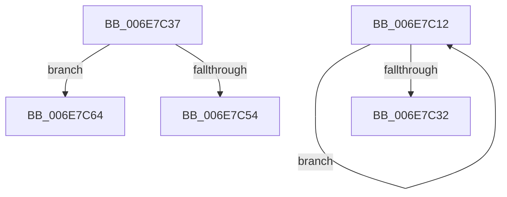

# sub_006E7C12

- RVA: `0x006E7C12`–`0x006E7C89` (길이 `119` bytes)
- VA: `0x00000001406E7C12`
- 실행 섹션: `.text`
- PDB 이름 있음: `아니요`; PDB Function 태그: `아니요`
- unwind 정보 RVA: `0x0008CD74`
- 디코드: `26`개 명령, `119/119` bytes 표시
- 미해석 바이트: `0` (있으면 어셈블리에 `.byte`로 보존)

> 이 문서는 커널 이미지의 기계어와 PDB 기호를 분석해 생성했습니다. 4번과 5번은 함수 원형과 자료형을 바이너리 사용 방식에서 추정한 C 해석이며 원본 소스 복구 결과는 아닙니다.

## 1. Dependencies

- 직접 호출 지점: **2**; 고유 호출 대상: **2**
- 직접 호출자로 확인된 함수: **0**
- RIP 상대 이미지 참조: **1**

### Outgoing calls
- `0x006E7C1E` → [MiNodeFreeZeroPages](../3B/MiNodeFreeZeroPages_function_003BBF60.md) (function, `0x003BBF60`)
- `0x006E7C4A` → [MiSwapNumaStandbyPage](../38/MiSwapNumaStandbyPage_function_00385144.md) (function, `0x00385144`)

### Direct callers
- 이 함수 시작 RVA로 연결되는 직접 call은 확인되지 않았습니다. 간접 호출은 완전히 역산할 수 없습니다.

### Static image references
- `0x006E7C29` → RVA `0x00FC5002` (`ALMOSTRO`; read)

## 2. Other-region calls and transfers

- 다른 실행 섹션으로 향하는 call: **0**
- call이 아닌 외부 분기/꼬리 이동: **3**
  - `0x006E7C32` → [MiPruneStandbyPages + 0x1D1](../3B/MiPruneStandbyPages_function_003BC0E4.md) (`tail-transfer`)
  - `0x006E7C5F` → [MiPruneStandbyPages + 0x12A](../3B/MiPruneStandbyPages_function_003BC0E4.md) (`tail-transfer`)
  - `0x006E7C84` → [MiPruneStandbyPages + 0x12A](../3B/MiPruneStandbyPages_function_003BC0E4.md) (`tail-transfer`)

## 3. Assembly (complete function range)

```asm
006E7C12  41 B8 00 00 08 00               mov r8d, 0x80000
006E7C18  41 8A D4                        mov dl, r12b
006E7C1B  48 8B CD                        mov rcx, rbp
006E7C1E  E8 3D 43 CD FF                  call 0x1403bbf60
006E7C23  4C 03 F8                        add r15, rax
006E7C26  41 FE C6                        inc r14b
006E7C29  44 3A 35 D2 D3 8D 00            cmp r14b, byte ptr [rip + 0x8dd3d2]
006E7C30  72 E0                           jb 0x1406e7c12
006E7C32  E9 7E 46 CD FF                  jmp 0x1403bc2b5
006E7C37  44 8A 84 24 90 00 00 00         mov r8b, byte ptr [rsp + 0x90]
006E7C3F  41 B9 00 30 00 00               mov r9d, 0x3000
006E7C45  8B D7                           mov edx, edi
006E7C47  49 8B CE                        mov rcx, r14
006E7C4A  E8 F5 D4 C9 FF                  call 0x140385144
006E7C4F  49 3B C6                        cmp rax, r14
006E7C52  75 10                           jne 0x1406e7c64
006E7C54  C7 84 24 88 00 00 00 01 00 00 00  mov dword ptr [rsp + 0x88], 1
006E7C5F  E9 AA 45 CD FF                  jmp 0x1403bc20e
006E7C64  48 8D 2C 40                     lea rbp, [rax + rax*2]
006E7C68  4C 8B F0                        mov r14, rax
006E7C6B  48 C1 E5 04                     shl rbp, 4
006E7C6F  48 B8 00 00 00 00 00 DE FF FF   movabs rax, 0xffffde0000000000
006E7C79  48 8B C0                        mov rax, rax
006E7C7C  48 03 E8                        add rbp, rax
006E7C7F  41 0F BA F4 0A                  btr r12d, 0xa
006E7C84  E9 85 45 CD FF                  jmp 0x1403bc20e
```

## 4. C-style interpretation (structured pseudocode)

```c
__int64 __fastcall sub_006E7C12(void)
{
    __int64 result;
    __int64 v_r14;
    __int64 v_r15;
    unsigned int v_stack_p88;
    unsigned __int8 v_stack_p90;

    result = MiNodeFreeZeroPages(v_rbp, (unsigned __int8)(v_r12), (unsigned int)(0x80000ULL), a4);
    v_r15 = (v_r15) + (result);
    v_r14 = (unsigned __int8)((v_r14) + 1);
    if (((unsigned __int8)(v_r14)) < (*(unsigned __int8 *)(v_rip + 9294802))) goto loc_006E7C12;
}
```

## 5. (Beta) C Style

```c
void sub_006E7C12(void)
{
    int64_t result;
    int64_t local_r14;
    int64_t local_r15;
    uint32_t v_stack_p88;
    uint8_t v_stack_p90;

    result = MiNodeFreeZeroPages(local_rbp, (uint8_t)(local_r12), (uint32_t)(0x80000ULL), a4);
    local_r15 = (local_r15) + (result);
    local_r14 = (uint8_t)((local_r14) + 1);
    if (((uint8_t)(local_r14)) < (*(uint8_t *)(v_rip + 0x8DD3D2))) goto loc_006E7C12;
}
```

## 6. Execution-region graph

[열기: 2D/3D 그래프와 함수 탐색 컨트롤 패널](../../../control-panel.html?section=text&rva=0x006E7C12&view=graph)

- 2D 그래프는 위에서 아래로 흐르고, 3D 그래프는 빈 공간을 드래그해 회전합니다. Shift+드래그는 이동, 휠은 확대·축소, 함수 노드 선택은 대상 보고서 이동입니다.

### Static fallback


