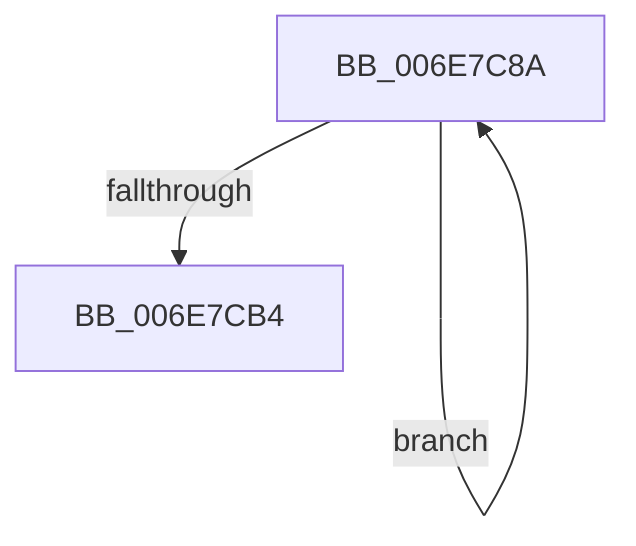

# sub_006E7C8A

- RVA: `0x006E7C8A`–`0x006E7CB9` (길이 `47` bytes)
- VA: `0x00000001406E7C8A`
- 실행 섹션: `.text`
- PDB 이름 있음: `아니요`; PDB Function 태그: `아니요`
- unwind 정보 RVA: `0x0008CDA0`
- 디코드: `11`개 명령, `47/47` bytes 표시
- 미해석 바이트: `0` (있으면 어셈블리에 `.byte`로 보존)

> 이 문서는 커널 이미지의 기계어와 PDB 기호를 분석해 생성했습니다. 4번과 5번은 함수 원형과 자료형을 바이너리 사용 방식에서 추정한 C 해석이며 원본 소스 복구 결과는 아닙니다.

## 1. Dependencies

- 직접 호출 지점: **2**; 고유 호출 대상: **2**
- 직접 호출자로 확인된 함수: **0**
- RIP 상대 이미지 참조: **0**

### Outgoing calls
- `0x006E7CA2` → [MiReturnEnclavePage](../4D/MiReturnEnclavePage_function_004DEEF8.md) (function, `0x004DEEF8`)
- `0x006E7CAA` → [MiUnlinkPageChainHead](../36/MiUnlinkPageChainHead_function_00365C40.md) (function, `0x00365C40`)

### Direct callers
- 이 함수 시작 RVA로 연결되는 직접 call은 확인되지 않았습니다. 간접 호출은 완전히 역산할 수 없습니다.

### Static image references
- 디코드된 RIP-relative 메모리 참조가 없습니다.

## 2. Other-region calls and transfers

- 다른 실행 섹션으로 향하는 call: **0**
- call이 아닌 외부 분기/꼬리 이동: **1**
  - `0x006E7CB4` → [MiAllocateEnclavePages + 0xBB](../3B/MiAllocateEnclavePages_function_003BC43C.md) (`tail-transfer`)

## 3. Assembly (complete function range)

```asm
006E7C8A  48 8B CE                        mov rcx, rsi
006E7C8D  48 2B C1                        sub rax, rcx
006E7C90  48 B9 AB AA AA AA AA AA AA AA   movabs rcx, 0xaaaaaaaaaaaaaaab
006E7C9A  48 C1 F8 04                     sar rax, 4
006E7C9E  48 0F AF C8                     imul rcx, rax
006E7CA2  E8 51 72 DF FF                  call 0x1404deef8
006E7CA7  48 8B CB                        mov rcx, rbx
006E7CAA  E8 91 DF C7 FF                  call 0x140365c40
006E7CAF  48 85 C0                        test rax, rax
006E7CB2  75 D6                           jne 0x1406e7c8a
006E7CB4  E9 3E 48 CD FF                  jmp 0x1403bc4f7
```

## 4. C-style interpretation (structured pseudocode)

```c
__int64 __fastcall sub_006E7C8A(void)
{
    __int64 result;

    result = (result) - (v_rsi);
    result = (result) >> (4);
    a1 = (v_rsi) * (result);
    result = MiReturnEnclavePage(a1, a2, a3, a4);
    result = MiUnlinkPageChainHead(v_rbx, a2, a3, a4);
    if (result != 0) goto loc_006E7C8A;
}
```

## 5. (Beta) C Style

```c
void sub_006E7C8A(void)
{
    int64_t result;

    result = (result) - (local_rsi);
    result = (result) >> (4);
    a1 = (local_rsi) * (result);
    result = MiReturnEnclavePage(a1, a2, a3, a4);
    result = MiUnlinkPageChainHead(local_rbx, a2, a3, a4);
    if (result != 0) goto loc_006E7C8A;
}
```

## 6. Execution-region graph

[열기: 2D/3D 그래프와 함수 탐색 컨트롤 패널](../../../control-panel.html?section=text&rva=0x006E7C8A&view=graph)

- 2D 그래프는 위에서 아래로 흐르고, 3D 그래프는 빈 공간을 드래그해 회전합니다. Shift+드래그는 이동, 휠은 확대·축소, 함수 노드 선택은 대상 보고서 이동입니다.

### Static fallback


