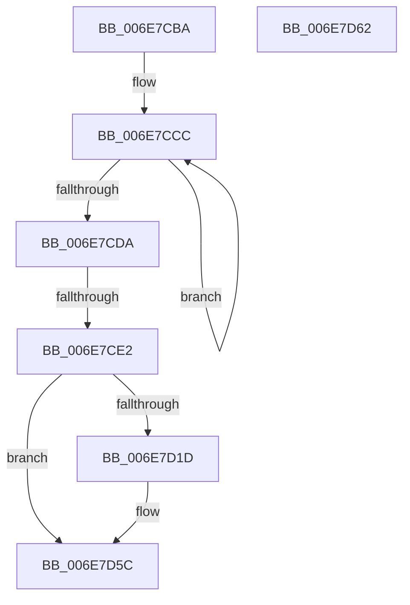

# sub_006E7CBA

- RVA: `0x006E7CBA`–`0x006E7DA1` (길이 `231` bytes)
- VA: `0x00000001406E7CBA`
- 실행 섹션: `.text`
- PDB 이름 있음: `아니요`; PDB Function 태그: `아니요`
- unwind 정보 RVA: `0x0008DE54`
- 디코드: `54`개 명령, `231/231` bytes 표시
- 미해석 바이트: `0` (있으면 어셈블리에 `.byte`로 보존)

> 이 문서는 커널 이미지의 기계어와 PDB 기호를 분석해 생성했습니다. 4번과 5번은 함수 원형과 자료형을 바이너리 사용 방식에서 추정한 C 해석이며 원본 소스 복구 결과는 아닙니다.

## 1. Dependencies

- 직접 호출 지점: **3**; 고유 호출 대상: **3**
- 직접 호출자로 확인된 함수: **0**
- RIP 상대 이미지 참조: **2**

### Outgoing calls
- `0x006E7CFD` → [DbgPrintEx](../35/DbgPrintEx_function_00359290.md) (function, `0x00359290`)
- `0x006E7D10` → [ExAllocatePool2](../../poolcode/B8/ExAllocatePool2_function_00B820F0.md) (function, `0x00B820F0`)
- `0x006E7D56` → [ExQueueWorkItem](../2F/ExQueueWorkItem_function_002F9520.md) (function, `0x002F9520`)

### Direct callers
- 이 함수 시작 RVA로 연결되는 직접 call은 확인되지 않았습니다. 간접 호출은 완전히 역산할 수 없습니다.

### Static image references
- `0x006E7CF2` → RVA `0x006D02F0` (` ?? ::FNODOBFM::`string'`; read)
- `0x006E7D1D` → RVA `0x0065D5E0` (`ExpResourceTimeoutCaptureLiveDump`; read)

## 2. Other-region calls and transfers

- 다른 실행 섹션으로 향하는 call: **1**
  - `0x006E7D10` → [ExAllocatePool2](../../poolcode/B8/ExAllocatePool2_function_00B820F0.md) (`.text` → `POOLCODE`)
- call이 아닌 외부 분기/꼬리 이동: **3**
  - `0x006E7CDC` → [ExpWaitForFastResource + 0x7A](../3B/ExpWaitForFastResource_function_003BE760.md) (`tail-transfer`)
  - `0x006E7D5D` → [ExpWaitForFastResource + 0x7A](../3B/ExpWaitForFastResource_function_003BE760.md) (`tail-transfer`)
  - `0x006E7D9C` → [ExpWaitForFastResource + 0x7A](../3B/ExpWaitForFastResource_function_003BE760.md) (`tail-transfer`)

## 3. Assembly (complete function range)

```asm
006E7CBA  45 33 ED                        xor r13d, r13d
006E7CBD  4C 89 6C 24 48                  mov qword ptr [rsp + 0x48], r13
006E7CC2  41 0F 0D 0C 24                  prefetchw byte ptr [r12]
006E7CC7  41 0F B6 04 24                  movzx eax, byte ptr [r12]
006E7CCC  0F B6 C8                        movzx ecx, al
006E7CCF  80 C9 01                        or cl, 1
006E7CD2  F0 41 0F B0 0C 24               lock cmpxchg byte ptr [r12], cl
006E7CD8  75 F2                           jne 0x1406e7ccc
006E7CDA  A8 01                           test al, 1
006E7CDC  0F 85 F8 6A CD FF               jne 0x1403be7da
006E7CE2  33 C0                           xor eax, eax
006E7CE4  89 84 24 C8 00 00 00            mov dword ptr [rsp + 0xc8], eax
006E7CEB  89 44 24 38                     mov dword ptr [rsp + 0x38], eax
006E7CEF  4C 8B CB                        mov r9, rbx
006E7CF2  4C 8D 05 F7 85 FE FF            lea r8, [rip - 0x17a09]
006E7CF9  33 D2                           xor edx, edx
006E7CFB  33 C9                           xor ecx, ecx
006E7CFD  E8 8E 15 C7 FF                  call 0x140359290
006E7D02  BA 38 00 00 00                  mov edx, 0x38
006E7D07  8D 4A 08                        lea ecx, [rdx + 8]
006E7D0A  41 B8 52 65 54 6F               mov r8d, 0x6f546552
006E7D10  E8 DB A3 49 00                  call 0x140b820f0
006E7D15  4C 8B C0                        mov r8, rax
006E7D18  48 85 C0                        test rax, rax
006E7D1B  74 3F                           je 0x1406e7d5c
006E7D1D  48 8D 05 BC 58 F7 FF            lea rax, [rip - 0x8a744]
006E7D24  49 89 40 10                     mov qword ptr [r8 + 0x10], rax
006E7D28  4D 89 40 18                     mov qword ptr [r8 + 0x18], r8
006E7D2C  4D 89 28                        mov qword ptr [r8], r13
006E7D2F  65 48 8B 0C 25 88 01 00 00      mov rcx, qword ptr gs:[0x188]
006E7D38  49 89 48 20                     mov qword ptr [r8 + 0x20], rcx
006E7D3C  49 89 58 28                     mov qword ptr [r8 + 0x28], rbx
006E7D40  8B 0E                           mov ecx, dword ptr [rsi]
006E7D42  41 89 48 30                     mov dword ptr [r8 + 0x30], ecx
006E7D46  8B 44 24 34                     mov eax, dword ptr [rsp + 0x34]
006E7D4A  41 89 40 34                     mov dword ptr [r8 + 0x34], eax
006E7D4E  BA 01 00 00 00                  mov edx, 1
006E7D53  49 8B C8                        mov rcx, r8
006E7D56  E8 C5 17 C1 FF                  call 0x1402f9520
006E7D5B  90                              nop
006E7D5C  CC                              int3
006E7D5D  E9 78 6A CD FF                  jmp 0x1403be7da
006E7D62  4C 8B BC 24 B8 00 00 00         mov r15, qword ptr [rsp + 0xb8]
006E7D6A  48 8B 9C 24 B0 00 00 00         mov rbx, qword ptr [rsp + 0xb0]
006E7D72  8B 44 24 38                     mov eax, dword ptr [rsp + 0x38]
006E7D76  89 84 24 C8 00 00 00            mov dword ptr [rsp + 0xc8], eax
006E7D7D  8B 44 24 3C                     mov eax, dword ptr [rsp + 0x3c]
006E7D81  89 44 24 30                     mov dword ptr [rsp + 0x30], eax
006E7D85  4C 8B 6C 24 48                  mov r13, qword ptr [rsp + 0x48]
006E7D8A  4C 8B 64 24 50                  mov r12, qword ptr [rsp + 0x50]
006E7D8F  4C 8B 74 24 58                  mov r14, qword ptr [rsp + 0x58]
006E7D94  48 8B 74 24 60                  mov rsi, qword ptr [rsp + 0x60]
006E7D99  49 8B FC                        mov rdi, r12
006E7D9C  E9 39 6A CD FF                  jmp 0x1403be7da
```

## 4. C-style interpretation (structured pseudocode)

```c
__int64 __fastcall sub_006E7CBA(__int64 a1, int a2)
{
    __int64 result;
    __int64 v_r13;
    unsigned int v_stack_p30;
    unsigned int v_stack_p34;
    unsigned int v_stack_p38;
    unsigned int v_stack_p3C;
    unsigned __int64 v_stack_p48;
    unsigned __int64 v_stack_p50;
    unsigned __int64 v_stack_p58;
    unsigned __int64 v_stack_p60;
    unsigned __int64 v_stack_pB0;
    unsigned __int64 v_stack_pB8;
    unsigned int v_stack_pC8;

    v_r13 = 0;
    v_stack_p48 = 0;
loc_006E7CCC:
    a1 = (unsigned __int8)(((unsigned __int8)(*(unsigned __int8 *)(v_r12))) | (1));
    if (condition_is_not_equal) goto loc_006E7CCC;
    result = 0;
    v_stack_pC8 = 0;
    v_stack_p38 = 0;
    a2 = 0;
    a1 = 0;
    result = DbgPrintEx(a1, a2, v_rip - 96777, v_rbx);
    result = ExAllocatePool2(56 + 8, 56, (unsigned int)(0x6F546552ULL), v_rbx);
    if (result != 0) {
        result = v_rip - 567108;
        *(unsigned __int64 *)(result + 16) = result;
        *(unsigned __int64 *)(result + 24) = result;
        *(unsigned __int64 *)(result) = 0;
        a1 = *(unsigned __int64 *)(gs_base + (0 + 392));
        *(unsigned __int64 *)(result + 32) = a1;
        *(unsigned __int64 *)(result + 40) = v_rbx;
        a1 = *(unsigned int *)(v_rsi);
        *(unsigned int *)(result + 48) = (unsigned int)(a1);
        result = v_stack_p34;
        *(unsigned int *)(result + 52) = (unsigned int)(result);
        a2 = 1;
        a1 = result;
        result = ExQueueWorkItem(a1, a2, result, v_rbx);
    }
}
```

## 5. (Beta) C Style

```c
int64_t sub_006E7CBA(int64_t Arg1, int32_t Arg2)
{
    int64_t result;
    int64_t local_r13;
    uint32_t v_stack_p30;
    uint32_t v_stack_p34;
    uint32_t v_stack_p38;
    uint32_t v_stack_p3C;
    uint64_t v_stack_p48;
    uint64_t v_stack_p50;
    uint64_t v_stack_p58;
    uint64_t v_stack_p60;
    uint64_t v_stack_pB0;
    uint64_t v_stack_pB8;
    uint32_t v_stack_pC8;

    local_r13 = 0;
    v_stack_p48 = 0;
loc_006E7CCC:
    Arg1 = (uint8_t)(((uint8_t)(*(uint8_t *)(local_r12))) | (1));
    if (condition_is_not_equal) goto loc_006E7CCC;
    result = 0;
    v_stack_pC8 = 0;
    v_stack_p38 = 0;
    Arg2 = 0;
    Arg1 = 0;
    result = DbgPrintEx(Arg1, Arg2, v_rip - 96777, local_rbx);
    result = ExAllocatePool2(56 + 8, 56, (uint32_t)(0x6F546552ULL), local_rbx);
    if (result != 0) {
        result = v_rip - 567108;
        *(uint64_t *)(result + 0x10) = result;
        *(uint64_t *)(result + 0x18) = result;
        *(uint64_t *)(result) = 0;
        Arg1 = *(uint64_t *)(gs_base + (0 + 0x188));
        *(uint64_t *)(result + 0x20) = Arg1;
        *(uint64_t *)(result + 0x28) = local_rbx;
        Arg1 = *(uint32_t *)(local_rsi);
        *(uint32_t *)(result + 0x30) = (uint32_t)(Arg1);
        result = v_stack_p34;
        *(uint32_t *)(result + 0x34) = (uint32_t)(result);
        Arg2 = 1;
        Arg1 = result;
        result = ExQueueWorkItem(Arg1, Arg2, result, local_rbx);
    }
}
```

## 6. Execution-region graph

[열기: 2D/3D 그래프와 함수 탐색 컨트롤 패널](../../../control-panel.html?section=text&rva=0x006E7CBA&view=graph)

- 2D 그래프는 위에서 아래로 흐르고, 3D 그래프는 빈 공간을 드래그해 회전합니다. Shift+드래그는 이동, 휠은 확대·축소, 함수 노드 선택은 대상 보고서 이동입니다.

### Static fallback


