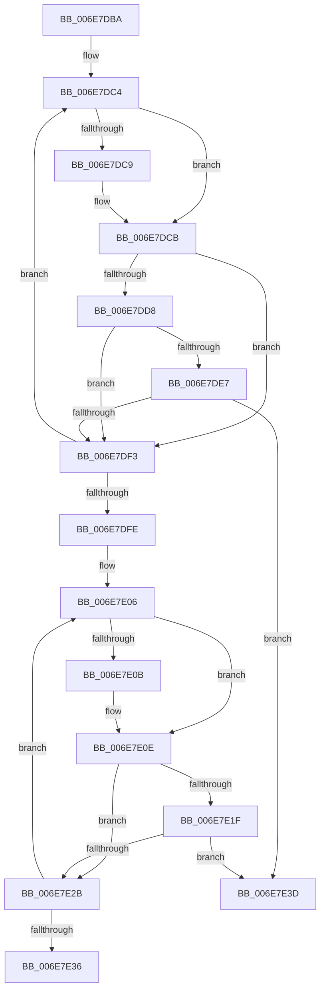

# sub_006E7DBA

- RVA: `0x006E7DBA`–`0x006E7E45` (길이 `139` bytes)
- VA: `0x00000001406E7DBA`
- 실행 섹션: `.text`
- PDB 이름 있음: `아니요`; PDB Function 태그: `아니요`
- unwind 정보 RVA: `0x0008E03C`
- 디코드: `41`개 명령, `139/139` bytes 표시
- 미해석 바이트: `0` (있으면 어셈블리에 `.byte`로 보존)

> 이 문서는 커널 이미지의 기계어와 PDB 기호를 분석해 생성했습니다. 4번과 5번은 함수 원형과 자료형을 바이너리 사용 방식에서 추정한 C 해석이며 원본 소스 복구 결과는 아닙니다.

## 1. Dependencies

- 직접 호출 지점: **0**; 고유 호출 대상: **0**
- 직접 호출자로 확인된 함수: **0**
- RIP 상대 이미지 참조: **1**

### Outgoing calls
- 직접 디코드된 call 명령이 없습니다.

### Direct callers
- 이 함수 시작 RVA로 연결되는 직접 call은 확인되지 않았습니다. 간접 호출은 완전히 역산할 수 없습니다.

### Static image references
- `0x006E7DBD` → RVA `0x00FCF6C0` (`CACHEALI`; read)

## 2. Other-region calls and transfers

- 다른 실행 섹션으로 향하는 call: **0**
- call이 아닌 외부 분기/꼬리 이동: **2**
  - `0x006E7E38` → [KeSelectNodeForAffinity + 0x2E](../3C/KeSelectNodeForAffinity_function_003C09EC.md) (`tail-transfer`)
  - `0x006E7E40` → [KeSelectNodeForAffinity + 0x2E](../3C/KeSelectNodeForAffinity_function_003C09EC.md) (`tail-transfer`)

## 3. Assembly (complete function range)

```asm
006E7DBA  44 8B CE                        mov r9d, esi
006E7DBD  4C 8D 35 FC 78 8E 00            lea r14, [rip + 0x8e78fc]
006E7DC4  66 3B CA                        cmp cx, dx
006E7DC7  72 02                           jb 0x1406e7dcb
006E7DC9  8B CE                           mov ecx, esi
006E7DCB  0F B7 C1                        movzx eax, cx
006E7DCE  4D 8B 04 C6                     mov r8, qword ptr [r14 + rax*8]
006E7DD2  41 84 78 0A                     test byte ptr [r8 + 0xa], dil
006E7DD6  75 1B                           jne 0x1406e7df3
006E7DD8  41 0F B7 42 08                  movzx eax, word ptr [r10 + 8]
006E7DDD  49 8B 44 C0 20                  mov rax, qword ptr [r8 + rax*8 + 0x20]
006E7DE2  48 85 C0                        test rax, rax
006E7DE5  74 0C                           je 0x1406e7df3
006E7DE7  48 8B 80 80 00 00 00            mov rax, qword ptr [rax + 0x80]
006E7DEE  49 85 02                        test qword ptr [r10], rax
006E7DF1  75 4A                           jne 0x1406e7e3d
006E7DF3  44 03 CF                        add r9d, edi
006E7DF6  66 03 CF                        add cx, di
006E7DF9  44 3B CA                        cmp r9d, edx
006E7DFC  72 C6                           jb 0x1406e7dc4
006E7DFE  41 0F B7 5A 08                  movzx ebx, word ptr [r10 + 8]
006E7E03  44 8B CE                        mov r9d, esi
006E7E06  66 3B CA                        cmp cx, dx
006E7E09  72 03                           jb 0x1406e7e0e
006E7E0B  0F B7 CE                        movzx ecx, si
006E7E0E  0F B7 C1                        movzx eax, cx
006E7E11  4D 8B 04 C6                     mov r8, qword ptr [r14 + rax*8]
006E7E15  49 8B 44 D8 20                  mov rax, qword ptr [r8 + rbx*8 + 0x20]
006E7E1A  48 85 C0                        test rax, rax
006E7E1D  74 0C                           je 0x1406e7e2b
006E7E1F  48 8B 80 80 00 00 00            mov rax, qword ptr [rax + 0x80]
006E7E26  49 85 02                        test qword ptr [r10], rax
006E7E29  75 12                           jne 0x1406e7e3d
006E7E2B  44 03 CF                        add r9d, edi
006E7E2E  66 03 CF                        add cx, di
006E7E31  44 3B CA                        cmp r9d, edx
006E7E34  72 D0                           jb 0x1406e7e06
006E7E36  33 C0                           xor eax, eax
006E7E38  E9 DD 8B CD FF                  jmp 0x1403c0a1a
006E7E3D  49 8B C0                        mov rax, r8
006E7E40  E9 D5 8B CD FF                  jmp 0x1403c0a1a
```

## 4. C-style interpretation (structured pseudocode)

```c
__int64 __fastcall sub_006E7DBA(unsigned __int16 a1, int a2)
{
    __int64 result;

loc_006E7DC4:
    if (a1 >= ((unsigned __int16)(a2))) {
        a1 = (unsigned int)(v_rsi);
    }
    if (((*(unsigned __int8 *)(*(unsigned __int64 *)(v_rip + 9337084 + a1 * 8) + 10)) & ((unsigned __int8)(v_rdi))) != 0) goto loc_006E7DF3;
    if (*(unsigned __int64 *)(*(unsigned __int64 *)(v_rip + 9337084 + a1 * 8) + *(unsigned __int16 *)(v_r10 + 8) * 8 + 32) == 0) goto loc_006E7DF3;
    if (((*(unsigned __int64 *)(v_r10)) & (*(unsigned __int64 *)(*(unsigned __int64 *)(*(unsigned __int64 *)(v_rip + 9337084 + a1 * 8) + *(unsigned __int16 *)(v_r10 + 8) * 8 + 32) + 128))) != 0) goto loc_006E7E3D;
loc_006E7DF3:
    a4 = (unsigned int)(((unsigned int)((unsigned int)(v_rsi))) + ((unsigned int)(v_rdi)));
    a1 = (unsigned __int16)((a1) + ((unsigned __int16)(v_rdi)));
    if (((unsigned int)(a4)) < a2) goto loc_006E7DC4;
loc_006E7E06:
    if (a1 >= ((unsigned __int16)(a2))) {
        a1 = (unsigned __int16)(v_rsi);
    }
    if (*(unsigned __int64 *)(*(unsigned __int64 *)(v_rip + 9337084 + a1 * 8) + *(unsigned __int16 *)(v_r10 + 8) * 8 + 32) == 0) goto loc_006E7E2B;
    if (((*(unsigned __int64 *)(v_r10)) & (*(unsigned __int64 *)(*(unsigned __int64 *)(*(unsigned __int64 *)(v_rip + 9337084 + a1 * 8) + *(unsigned __int16 *)(v_r10 + 8) * 8 + 32) + 128))) != 0) goto loc_006E7E3D;
loc_006E7E2B:
    a4 = (unsigned int)(((unsigned int)((unsigned int)(v_rsi))) + ((unsigned int)(v_rdi)));
    a1 = (unsigned __int16)((a1) + ((unsigned __int16)(v_rdi)));
    if (((unsigned int)(a4)) < a2) goto loc_006E7E06;
    result = 0;
loc_006E7E3D:
}
```

## 5. (Beta) C Style

```c
int64_t sub_006E7DBA(uint16_t Arg1, int32_t Arg2)
{
    int64_t result;

loc_006E7DC4:
    if (Arg1 >= ((uint16_t)(Arg2))) {
        Arg1 = (uint32_t)(local_rsi);
    }
    if (((*(uint8_t *)(*(uint64_t *)(v_rip + 0x8E78FC + Arg1 * 8) + 0xA)) & ((uint8_t)(local_rdi))) != 0) goto loc_006E7DF3;
    if (*(uint64_t *)(*(uint64_t *)(v_rip + 0x8E78FC + Arg1 * 8) + *(uint16_t *)(local_r10 + 0x8) * 8 + 0x20) == 0) goto loc_006E7DF3;
    if (((*(uint64_t *)(local_r10)) & (*(uint64_t *)(*(uint64_t *)(*(uint64_t *)(v_rip + 0x8E78FC + Arg1 * 8) + *(uint16_t *)(local_r10 + 0x8) * 8 + 0x20) + 0x80))) != 0) goto loc_006E7E3D;
loc_006E7DF3:
    a4 = (uint32_t)(((uint32_t)((uint32_t)(local_rsi))) + ((uint32_t)(local_rdi)));
    Arg1 = (uint16_t)((Arg1) + ((uint16_t)(local_rdi)));
    if (((uint32_t)(a4)) < Arg2) goto loc_006E7DC4;
loc_006E7E06:
    if (Arg1 >= ((uint16_t)(Arg2))) {
        Arg1 = (uint16_t)(local_rsi);
    }
    if (*(uint64_t *)(*(uint64_t *)(v_rip + 0x8E78FC + Arg1 * 8) + *(uint16_t *)(local_r10 + 0x8) * 8 + 0x20) == 0) goto loc_006E7E2B;
    if (((*(uint64_t *)(local_r10)) & (*(uint64_t *)(*(uint64_t *)(*(uint64_t *)(v_rip + 0x8E78FC + Arg1 * 8) + *(uint16_t *)(local_r10 + 0x8) * 8 + 0x20) + 0x80))) != 0) goto loc_006E7E3D;
loc_006E7E2B:
    a4 = (uint32_t)(((uint32_t)((uint32_t)(local_rsi))) + ((uint32_t)(local_rdi)));
    Arg1 = (uint16_t)((Arg1) + ((uint16_t)(local_rdi)));
    if (((uint32_t)(a4)) < Arg2) goto loc_006E7E06;
    result = 0;
loc_006E7E3D:
}
```

## 6. Execution-region graph

[열기: 2D/3D 그래프와 함수 탐색 컨트롤 패널](../../../control-panel.html?section=text&rva=0x006E7DBA&view=graph)

- 2D 그래프는 위에서 아래로 흐르고, 3D 그래프는 빈 공간을 드래그해 회전합니다. Shift+드래그는 이동, 휠은 확대·축소, 함수 노드 선택은 대상 보고서 이동입니다.

### Static fallback


