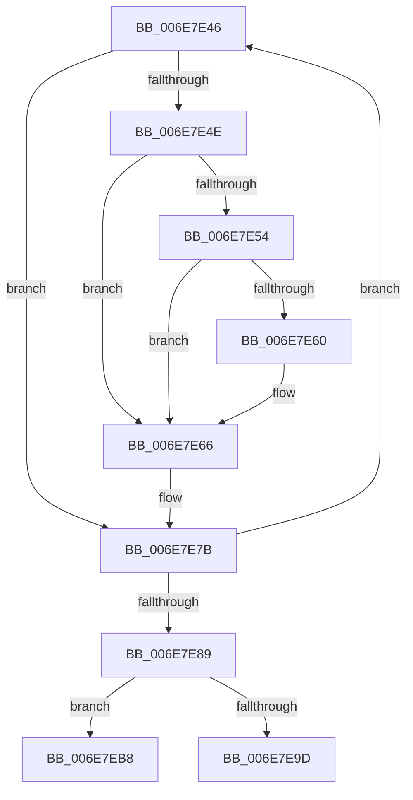

# sub_006E7E46

- RVA: `0x006E7E46`–`0x006E7EC2` (길이 `124` bytes)
- VA: `0x00000001406E7E46`
- 실행 섹션: `.text`
- PDB 이름 있음: `아니요`; PDB Function 태그: `아니요`
- unwind 정보 RVA: `0x0008E074`
- 디코드: `33`개 명령, `124/124` bytes 표시
- 미해석 바이트: `0` (있으면 어셈블리에 `.byte`로 보존)

> 이 문서는 커널 이미지의 기계어와 PDB 기호를 분석해 생성했습니다. 4번과 5번은 함수 원형과 자료형을 바이너리 사용 방식에서 추정한 C 해석이며 원본 소스 복구 결과는 아닙니다.

## 1. Dependencies

- 직접 호출 지점: **2**; 고유 호출 대상: **2**
- 직접 호출자로 확인된 함수: **0**
- RIP 상대 이미지 참조: **0**

### Outgoing calls
- `0x006E7E6F` → [KeAddGroupAffinityEx](../25/KeAddGroupAffinityEx_function_0025B6C0.md) (function, `0x0025B6C0`)
- `0x006E7EA9` → [KiCopyAffinityEx](../2C/KiCopyAffinityEx_function_002CE860.md) (function, `0x002CE860`)

### Direct callers
- 이 함수 시작 RVA로 연결되는 직접 call은 확인되지 않았습니다. 간접 호출은 완전히 역산할 수 없습니다.

### Static image references
- 디코드된 RIP-relative 메모리 참조가 없습니다.

## 2. Other-region calls and transfers

- 다른 실행 섹션으로 향하는 call: **0**
- call이 아닌 외부 분기/꼬리 이동: **2**
  - `0x006E7EB3` → [KeSetAffinityProcess + 0x168](../3C/KeSetAffinityProcess_function_003C0A60.md) (`tail-transfer`)
  - `0x006E7EBD` → [KeSetAffinityProcess + 0x1C2](../3C/KeSetAffinityProcess_function_003C0A60.md) (`tail-transfer`)

## 3. Assembly (complete function range)

```asm
006E7E46  4D 8B 07                        mov r8, qword ptr [r15]
006E7E49  4D 85 C0                        test r8, r8
006E7E4C  74 2D                           je 0x1406e7e7b
006E7E4E  66 44 3B 36                     cmp r14w, word ptr [rsi]
006E7E52  73 12                           jae 0x1406e7e66
006E7E54  49 8B C0                        mov rax, r8
006E7E57  4B 0B 04 2F                     or rax, qword ptr [r15 + r13]
006E7E5B  49 3B C0                        cmp rax, r8
006E7E5E  74 06                           je 0x1406e7e66
006E7E60  4C 8B C0                        mov r8, rax
006E7E63  44 8A E3                        mov r12b, bl
006E7E66  41 0F B7 D6                     movzx edx, r14w
006E7E6A  48 8D 4C 24 60                  lea rcx, [rsp + 0x60]
006E7E6F  E8 4C 38 B7 FF                  call 0x14025b6c0
006E7E74  0F B7 44 24 22                  movzx eax, word ptr [rsp + 0x22]
006E7E79  33 C9                           xor ecx, ecx
006E7E7B  66 44 03 F3                     add r14w, bx
006E7E7F  49 83 C7 08                     add r15, 8
006E7E83  66 44 3B F0                     cmp r14w, ax
006E7E87  72 BD                           jb 0x1406e7e46
006E7E89  48 8B 5C 24 38                  mov rbx, qword ptr [rsp + 0x38]
006E7E8E  45 84 E4                        test r12b, r12b
006E7E91  44 88 64 24 21                  mov byte ptr [rsp + 0x21], r12b
006E7E96  4C 8B 64 24 28                  mov r12, qword ptr [rsp + 0x28]
006E7E9B  74 1B                           je 0x1406e7eb8
006E7E9D  0F B7 57 02                     movzx edx, word ptr [rdi + 2]
006E7EA1  4C 8D 44 24 60                  lea r8, [rsp + 0x60]
006E7EA6  48 8B CF                        mov rcx, rdi
006E7EA9  E8 B2 69 BE FF                  call 0x1402ce860
006E7EAE  44 8A 7C 24 21                  mov r15b, byte ptr [rsp + 0x21]
006E7EB3  E9 10 8D CD FF                  jmp 0x1403c0bc8
006E7EB8  44 8A 7C 24 21                  mov r15b, byte ptr [rsp + 0x21]
006E7EBD  E9 60 8D CD FF                  jmp 0x1403c0c22
```

## 4. C-style interpretation (structured pseudocode)

```c
__int64 __fastcall sub_006E7E46(__int64 a1, __int64 a2, __int64 a3, __int64 a4, __int64 a5, __int64 a6, __int64 a7, __int64 a8, __int64 a9, __int64 a10, __int64 a11, __int64 a12)
{
    __int64 result;
    __int64 v_r12;
    __int64 v_r14;
    __int64 v_r15;
    unsigned __int8 v_stack_p21;
    unsigned __int16 v_stack_p22;

    if (*(unsigned __int64 *)(v_r15) == 0) goto loc_006E7E7B;
    if (((unsigned __int16)(v_r14)) >= (*(unsigned __int16 *)(v_rsi))) goto loc_006E7E66;
    result = (*(unsigned __int64 *)(v_r15)) | (*(unsigned __int64 *)(v_r15 + v_r13 * 1));
    if (result != (*(unsigned __int64 *)(v_r15))) {
        a3 = result;
        v_r12 = (unsigned __int8)(v_rbx);
    }
    result = KeAddGroupAffinityEx(a12, (unsigned __int16)(v_r14), a3, a4);
    a1 = 0;
loc_006E7E7B:
    v_r14 = (unsigned __int16)((v_r14) + ((unsigned __int16)(v_rbx)));
    v_r15 = (v_r15) + (8);
    if (((unsigned __int16)(v_r14)) < ((unsigned __int16)(v_stack_p22))) goto loc_006E7E46;
    v_stack_p21 = (unsigned __int8)(v_r12);
    if ((unsigned __int8)(v_r12) == 0) goto loc_006E7EB8;
    result = KiCopyAffinityEx(v_rdi, *(unsigned __int16 *)(v_rdi + 2), a12, a4);
loc_006E7EB8:
}
```

## 5. (Beta) C Style

```c
int64_t sub_006E7E46(int64_t Arg1, int64_t Arg2, int64_t Arg3, int64_t Arg4, int64_t Arg5, uint64_t Arg6, int64_t Arg7, uint64_t Arg8, uint64_t Arg9, uint64_t Arg10, uint64_t Arg11, int64_t Arg12)
{
    int64_t result;
    int64_t local_r12;
    int64_t local_r14;
    int64_t local_r15;
    uint8_t v_stack_p21;
    uint16_t v_stack_p22;

    if (*(uint64_t *)(local_r15) == 0) goto loc_006E7E7B;
    if (((uint16_t)(local_r14)) >= (*(uint16_t *)(local_rsi))) goto loc_006E7E66;
    result = (*(uint64_t *)(local_r15)) | (*(uint64_t *)(local_r15 + local_r13 * 1));
    if (result != (*(uint64_t *)(local_r15))) {
        Arg3 = result;
        local_r12 = (uint8_t)(local_rbx);
    }
    result = KeAddGroupAffinityEx(Arg12, (uint16_t)(local_r14), Arg3, Arg4);
    Arg1 = 0;
loc_006E7E7B:
    local_r14 = (uint16_t)((local_r14) + ((uint16_t)(local_rbx)));
    local_r15 = (local_r15) + (8);
    if (((uint16_t)(local_r14)) < ((uint16_t)(v_stack_p22))) goto loc_006E7E46;
    v_stack_p21 = (uint8_t)(local_r12);
    if ((uint8_t)(local_r12) == 0) goto loc_006E7EB8;
    result = KiCopyAffinityEx(local_rdi, *(uint16_t *)(local_rdi + 0x2), Arg12, Arg4);
loc_006E7EB8:
}
```

## 6. Execution-region graph

[열기: 2D/3D 그래프와 함수 탐색 컨트롤 패널](../../../control-panel.html?section=text&rva=0x006E7E46&view=graph)

- 2D 그래프는 위에서 아래로 흐르고, 3D 그래프는 빈 공간을 드래그해 회전합니다. Shift+드래그는 이동, 휠은 확대·축소, 함수 노드 선택은 대상 보고서 이동입니다.

### Static fallback


