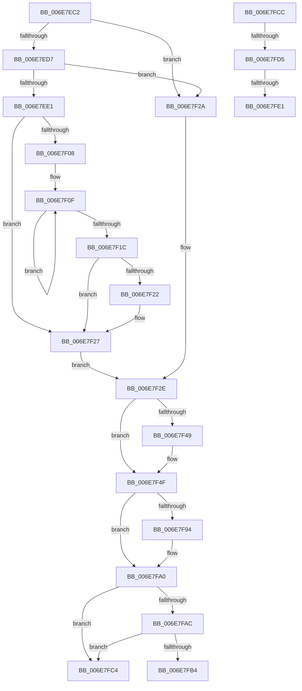

# sub_006E7EC2

- RVA: `0x006E7EC2`–`0x006E8003` (길이 `321` bytes)
- VA: `0x00000001406E7EC2`
- 실행 섹션: `.text`
- PDB 이름 있음: `아니요`; PDB Function 태그: `아니요`
- unwind 정보 RVA: `0x0008E2C8`
- 디코드: `87`개 명령, `321/321` bytes 표시
- 미해석 바이트: `0` (있으면 어셈블리에 `.byte`로 보존)

> 이 문서는 커널 이미지의 기계어와 PDB 기호를 분석해 생성했습니다. 4번과 5번은 함수 원형과 자료형을 바이너리 사용 방식에서 추정한 C 해석이며 원본 소스 복구 결과는 아닙니다.

## 1. Dependencies

- 직접 호출 지점: **8**; 고유 호출 대상: **8**
- 직접 호출자로 확인된 함수: **0**
- RIP 상대 이미지 참조: **1**

### Outgoing calls
- `0x006E7EEB` → [KiUpdateTotalCyclesCurrentThread](../37/KiUpdateTotalCyclesCurrentThread_function_0037DE40.md) (function, `0x0037DE40`)
- `0x006E7F22` → [KiRemoveSystemWorkPriorityKick](../26/KiRemoveSystemWorkPriorityKick_function_002631D0.md) (function, `0x002631D0`)
- `0x006E7F31` → [KiQueryQuantumReset](../21/KiQueryQuantumReset_function_0021F6B4.md) (function, `0x0021F6B4`)
- `0x006E7F5A` → [KiSetBasePriorityAndClearDecrement](../3C/KiSetBasePriorityAndClearDecrement_function_003C6B9C.md) (function, `0x003C6B9C`)
- `0x006E7F67` → [KiComputeThreadPriority](../3C/KiComputeThreadPriority_function_003C45F4.md) (function, `0x003C45F4`)
- `0x006E7F8B` → [KiSetPriorityThread](../22/KiSetPriorityThread_function_00220E78.md) (function, `0x00220E78`)
- `0x006E7FB7` → [KiPriQueueThreadPriorityChanged](../3C/KiPriQueueThreadPriorityChanged_function_003C4640.md) (function, `0x003C4640`)
- `0x006E7FF8` → [EtwTracePriority](../3C/EtwTracePriority_function_003C41A4.md) (function, `0x003C41A4`)

### Direct callers
- 이 함수 시작 RVA로 연결되는 직접 call은 확인되지 않았습니다. 간접 호출은 완전히 역산할 수 없습니다.

### Static image references
- `0x006E7F36` → RVA `0x00FC5098` (`ALMOSTRO`; read)

## 2. Other-region calls and transfers

- 다른 실행 섹션으로 향하는 call: **0**
- call이 아닌 외부 분기/꼬리 이동: **5**
  - `0x006E7FBF` → [KeSetPriorityAndQuantumProcess + 0x436](../3C/KeSetPriorityAndQuantumProcess_function_003C2EC0.md) (`tail-transfer`)
  - `0x006E7FC7` → [KeSetPriorityAndQuantumProcess + 0x42E](../3C/KeSetPriorityAndQuantumProcess_function_003C2EC0.md) (`tail-transfer`)
  - `0x006E7FCF` → [KeSetPriorityAndQuantumProcess + 0x440](../3C/KeSetPriorityAndQuantumProcess_function_003C2EC0.md) (`tail-transfer`)
  - `0x006E7FDB` → [KeSetPriorityAndQuantumProcess + 0x440](../3C/KeSetPriorityAndQuantumProcess_function_003C2EC0.md) (`tail-transfer`)
  - `0x006E7FFE` → [KeSetPriorityAndQuantumProcess + 0x440](../3C/KeSetPriorityAndQuantumProcess_function_003C2EC0.md) (`tail-transfer`)

## 3. Assembly (complete function range)

```asm
006E7EC2  41 0F 48 F8                     cmovs edi, r8d
006E7EC6  89 7D B8                        mov dword ptr [rbp - 0x48], edi
006E7EC9  44 0F BE B3 33 02 00 00         movsx r14d, byte ptr [rbx + 0x233]
006E7ED1  48 3B 5D E0                     cmp rbx, qword ptr [rbp - 0x20]
006E7ED5  75 53                           jne 0x1406e7f2a
006E7ED7  48 8B 45 D8                     mov rax, qword ptr [rbp - 0x28]
006E7EDB  80 78 20 00                     cmp byte ptr [rax + 0x20], 0
006E7EDF  75 49                           jne 0x1406e7f2a
006E7EE1  FA                              cli
006E7EE2  45 33 C0                        xor r8d, r8d
006E7EE5  48 8B D3                        mov rdx, rbx
006E7EE8  48 8B C8                        mov rcx, rax
006E7EEB  E8 50 5F C9 FF                  call 0x14037de40
006E7EF0  65 48 8B 0C 25 20 00 00 00      mov rcx, qword ptr gs:[0x20]
006E7EF9  48 8B F8                        mov rdi, rax
006E7EFC  4C 8B 81 B8 8E 00 00            mov r8, qword ptr [rcx + 0x8eb8]
006E7F03  4D 85 C0                        test r8, r8
006E7F06  74 1F                           je 0x1406e7f27
006E7F08  41 0F 0D 08                     prefetchw byte ptr [r8]
006E7F0C  41 8B 00                        mov eax, dword ptr [r8]
006E7F0F  8B D0                           mov edx, eax
006E7F11  0F BA F2 15                     btr edx, 0x15
006E7F15  F0 41 0F B1 10                  lock cmpxchg dword ptr [r8], edx
006E7F1A  75 F3                           jne 0x1406e7f0f
006E7F1C  0F BA E0 15                     bt eax, 0x15
006E7F20  73 05                           jae 0x1406e7f27
006E7F22  E8 A9 B2 B7 FF                  call 0x1402631d0
006E7F27  FB                              sti
006E7F28  EB 04                           jmp 0x1406e7f2e
006E7F2A  48 8B 7B 48                     mov rdi, qword ptr [rbx + 0x48]
006E7F2E  48 8B CB                        mov rcx, rbx
006E7F31  E8 7E 77 B3 FF                  call 0x14021f6b4
006E7F36  0F AF 05 5B D1 8D 00            imul eax, dword ptr [rip + 0x8dd15b]
006E7F3D  8B C8                           mov ecx, eax
006E7F3F  8B 43 78                        mov eax, dword ptr [rbx + 0x78]
006E7F42  48 03 CF                        add rcx, rdi
006E7F45  A8 20                           test al, 0x20
006E7F47  74 06                           je 0x1406e7f4f
006E7F49  F0 0F BA 73 78 05               lock btr dword ptr [rbx + 0x78], 5
006E7F4F  48 89 4B 20                     mov qword ptr [rbx + 0x20], rcx
006E7F53  48 8D 55 B8                     lea rdx, [rbp - 0x48]
006E7F57  48 8B CB                        mov rcx, rbx
006E7F5A  E8 3D EC CD FF                  call 0x1403c6b9c
006E7F5F  45 33 C0                        xor r8d, r8d
006E7F62  33 D2                           xor edx, edx
006E7F64  48 8B CB                        mov rcx, rbx
006E7F67  E8 88 C6 CD FF                  call 0x1403c45f4
006E7F6C  44 8B E0                        mov r12d, eax
006E7F6F  48 8D 55 D0                     lea rdx, [rbp - 0x30]
006E7F73  0F BE 83 C3 00 00 00            movsx eax, byte ptr [rbx + 0xc3]
006E7F7A  BF 01 00 00 00                  mov edi, 1
006E7F7F  45 8B C4                        mov r8d, r12d
006E7F82  89 45 BC                        mov dword ptr [rbp - 0x44], eax
006E7F85  48 8B CB                        mov rcx, rbx
006E7F88  40 8A F7                        mov sil, dil
006E7F8B  E8 E8 8E B3 FF                  call 0x140220e78
006E7F90  84 C0                           test al, al
006E7F92  74 0C                           je 0x1406e7fa0
006E7F94  44 0F BE A3 C3 00 00 00         movsx r12d, byte ptr [rbx + 0xc3]
006E7F9C  40 88 7D 50                     mov byte ptr [rbp + 0x50], dil
006E7FA0  48 8B 8B E8 00 00 00            mov rcx, qword ptr [rbx + 0xe8]
006E7FA7  48 85 C9                        test rcx, rcx
006E7FAA  74 18                           je 0x1406e7fc4
006E7FAC  8A 01                           mov al, byte ptr [rcx]
006E7FAE  24 7F                           and al, 0x7f
006E7FB0  3C 15                           cmp al, 0x15
006E7FB2  75 10                           jne 0x1406e7fc4
006E7FB4  48 8B D3                        mov rdx, rbx
006E7FB7  E8 84 C6 CD FF                  call 0x1403c4640
006E7FBC  8B 7D B8                        mov edi, dword ptr [rbp - 0x48]
006E7FBF  E9 32 B3 CD FF                  jmp 0x1403c32f6
006E7FC4  8B 7D B8                        mov edi, dword ptr [rbp - 0x48]
006E7FC7  E9 22 B3 CD FF                  jmp 0x1403c32ee
006E7FCC  40 84 F6                        test sil, sil
006E7FCF  0F 84 2B B3 CD FF               je 0x1403c3300
006E7FD5  40 32 F6                        xor sil, sil
006E7FD8  44 3B F7                        cmp r14d, edi
006E7FDB  0F 84 1F B3 CD FF               je 0x1403c3300
006E7FE1  48 8D 45 B8                     lea rax, [rbp - 0x48]
006E7FE5  BA 31 05 00 00                  mov edx, 0x531
006E7FEA  44 8B CF                        mov r9d, edi
006E7FED  48 89 44 24 20                  mov qword ptr [rsp + 0x20], rax
006E7FF2  45 8B C6                        mov r8d, r14d
006E7FF5  48 8B CB                        mov rcx, rbx
006E7FF8  E8 A7 C1 CD FF                  call 0x1403c41a4
006E7FFD  90                              nop
006E7FFE  E9 FD B2 CD FF                  jmp 0x1403c3300
```

## 4. C-style interpretation (structured pseudocode)

```c
__int64 __fastcall sub_006E7EC2(__int64 a1, __int64 a2, int a3)
{
    __int64 result;
    __int64 v_r12;
    __int64 v_rdi;
    unsigned __int64 v_stack_p20;

    if (sign_flag) { v_rdi = a3; }
    *(unsigned int *)(v_rbp - 72) = (unsigned int)(v_rdi);
    if (v_rbx != (*(unsigned __int64 *)(v_rbp - 32))) goto loc_006E7F2A;
    if ((*(unsigned __int8 *)(*(unsigned __int64 *)(v_rbp - 40) + 32)) != 0) goto loc_006E7F2A;
    a3 = 0;
    result = KiUpdateTotalCyclesCurrentThread(*(unsigned __int64 *)(v_rbp - 40), v_rbx, a3, a4);
    if (*(unsigned __int64 *)(*(unsigned __int64 *)(gs_base + (0 + 32)) + 36536) == 0) goto loc_006E7F27;
loc_006E7F0F:
    if (*(unsigned __int64 *)(*(unsigned __int64 *)(gs_base + (0 + 32)) + 36536) != 0) goto loc_006E7F0F;
    result = (unsigned int)(*(unsigned int *)(*(unsigned __int64 *)(*(unsigned __int64 *)(gs_base + (0 + 32)) + 36536)));
    if (!(condition_is_above_or_equal)) {
        result = KiRemoveSystemWorkPriorityKick(*(unsigned __int64 *)(gs_base + (0 + 32)), (unsigned int)((unsigned int)((unsigned int)(*(unsigned int *)(*(unsigned __int64 *)(*(unsigned __int64 *)(gs_base + (0 + 32)) + 36536))))), *(unsigned __int64 *)(*(unsigned __int64 *)(gs_base + (0 + 32)) + 36536), a4);
    }
    goto loc_006E7F2E;
loc_006E7F2A:
loc_006E7F2E:
    result = KiQueryQuantumReset(v_rbx, (unsigned int)((unsigned int)((unsigned int)(*(unsigned int *)(*(unsigned __int64 *)(*(unsigned __int64 *)(gs_base + (0 + 32)) + 36536))))), *(unsigned __int64 *)(*(unsigned __int64 *)(gs_base + (0 + 32)) + 36536), a4);
    result = (unsigned int)((result) * (*(unsigned int *)(v_rip + 9294171)));
    a1 = ((unsigned int)((unsigned int)(result))) + (*(unsigned __int64 *)(v_rbx + 72));
    if ((((unsigned __int8)((unsigned int)(*(unsigned int *)(v_rbx + 120)))) & (32)) != 0) {
    }
    *(unsigned __int64 *)(v_rbx + 32) = a1;
    result = KiSetBasePriorityAndClearDecrement(v_rbx, v_rbp - 72, *(unsigned __int64 *)(*(unsigned __int64 *)(gs_base + (0 + 32)) + 36536), a4);
    a3 = 0;
    a2 = 0;
    result = KiComputeThreadPriority(v_rbx, a2, a3, a4);
    *(unsigned int *)(v_rbp - 68) = (unsigned int)((__int8)(*(unsigned __int8 *)(v_rbx + 195)));
    result = KiSetPriorityThread(v_rbx, v_rbp - 48, (unsigned int)((unsigned int)((unsigned int)((unsigned int)(result)))), a4);
    v_r12 = (unsigned int)((unsigned int)(result));
    if ((unsigned __int8)(result) != 0) {
        v_r12 = (__int8)(*(unsigned __int8 *)(v_rbx + 195));
        *(unsigned __int8 *)(v_rbp + 80) = 1;
    }
    if (*(unsigned __int64 *)(v_rbx + 232) == 0) goto loc_006E7FC4;
    result = (unsigned __int8)((*(unsigned __int8 *)(*(unsigned __int64 *)(v_rbx + 232))) & (127));
    if (((unsigned __int8)(result)) != 21) goto loc_006E7FC4;
    result = KiPriQueueThreadPriorityChanged(*(unsigned __int64 *)(v_rbx + 232), v_rbx, (unsigned int)((unsigned int)((unsigned int)((unsigned int)(result)))), a4);
loc_006E7FC4:
}
```

## 5. (Beta) C Style

```c
int64_t sub_006E7EC2(int64_t Arg1, int64_t Arg2, int32_t Arg3)
{
    int64_t result;
    int64_t local_r12;
    int64_t local_rdi;
    uint64_t v_stack_p20;

    if (sign_flag) { local_rdi = Arg3; }
    *(uint32_t *)(local_rbp - 0x48) = (uint32_t)(local_rdi);
    if (local_rbx != (*(uint64_t *)(local_rbp - 0x20))) goto loc_006E7F2A;
    if ((*(uint8_t *)(*(uint64_t *)(local_rbp - 0x28) + 0x20)) != 0) goto loc_006E7F2A;
    Arg3 = 0;
    result = KiUpdateTotalCyclesCurrentThread(*(uint64_t *)(local_rbp - 0x28), local_rbx, Arg3, a4);
    if (*(uint64_t *)(*(uint64_t *)(gs_base + (0 + 0x20)) + 0x8EB8) == 0) goto loc_006E7F27;
loc_006E7F0F:
    if (*(uint64_t *)(*(uint64_t *)(gs_base + (0 + 0x20)) + 0x8EB8) != 0) goto loc_006E7F0F;
    result = (uint32_t)(*(uint32_t *)(*(uint64_t *)(*(uint64_t *)(gs_base + (0 + 0x20)) + 0x8EB8)));
    if (!(condition_is_above_or_equal)) {
        result = KiRemoveSystemWorkPriorityKick(*(uint64_t *)(gs_base + (0 + 0x20)), (uint32_t)((uint32_t)((uint32_t)(*(uint32_t *)(*(uint64_t *)(*(uint64_t *)(gs_base + (0 + 0x20)) + 0x8EB8))))), *(uint64_t *)(*(uint64_t *)(gs_base + (0 + 0x20)) + 0x8EB8), a4);
    }
    goto loc_006E7F2E;
loc_006E7F2A:
loc_006E7F2E:
    result = KiQueryQuantumReset(local_rbx, (uint32_t)((uint32_t)((uint32_t)(*(uint32_t *)(*(uint64_t *)(*(uint64_t *)(gs_base + (0 + 0x20)) + 0x8EB8))))), *(uint64_t *)(*(uint64_t *)(gs_base + (0 + 0x20)) + 0x8EB8), a4);
    result = (uint32_t)((result) * (*(uint32_t *)(v_rip + 0x8DD15B)));
    Arg1 = ((uint32_t)((uint32_t)(result))) + (*(uint64_t *)(local_rbx + 0x48));
    if ((((uint8_t)((uint32_t)(*(uint32_t *)(local_rbx + 0x78)))) & (32)) != 0) {
    }
    *(uint64_t *)(local_rbx + 0x20) = Arg1;
    result = KiSetBasePriorityAndClearDecrement(local_rbx, local_rbp - 72, *(uint64_t *)(*(uint64_t *)(gs_base + (0 + 0x20)) + 0x8EB8), a4);
    Arg3 = 0;
    Arg2 = 0;
    result = KiComputeThreadPriority(local_rbx, Arg2, Arg3, a4);
    *(uint32_t *)(local_rbp - 0x44) = (uint32_t)((int8_t)(*(uint8_t *)(local_rbx + 0xC3)));
    result = KiSetPriorityThread(local_rbx, local_rbp - 48, (uint32_t)((uint32_t)((uint32_t)((uint32_t)(result)))), a4);
    local_r12 = (uint32_t)((uint32_t)(result));
    if ((uint8_t)(result) != 0) {
        local_r12 = (int8_t)(*(uint8_t *)(local_rbx + 0xC3));
        *(uint8_t *)(local_rbp + 0x50) = 1;
    }
    if (*(uint64_t *)(local_rbx + 0xE8) == 0) goto loc_006E7FC4;
    result = (uint8_t)((*(uint8_t *)(*(uint64_t *)(local_rbx + 0xE8))) & (127));
    if (((uint8_t)(result)) != 21) goto loc_006E7FC4;
    result = KiPriQueueThreadPriorityChanged(*(uint64_t *)(local_rbx + 0xE8), local_rbx, (uint32_t)((uint32_t)((uint32_t)((uint32_t)(result)))), a4);
loc_006E7FC4:
}
```

## 6. Execution-region graph

[열기: 2D/3D 그래프와 함수 탐색 컨트롤 패널](../../../control-panel.html?section=text&rva=0x006E7EC2&view=graph)

- 2D 그래프는 위에서 아래로 흐르고, 3D 그래프는 빈 공간을 드래그해 회전합니다. Shift+드래그는 이동, 휠은 확대·축소, 함수 노드 선택은 대상 보고서 이동입니다.

### Static fallback


