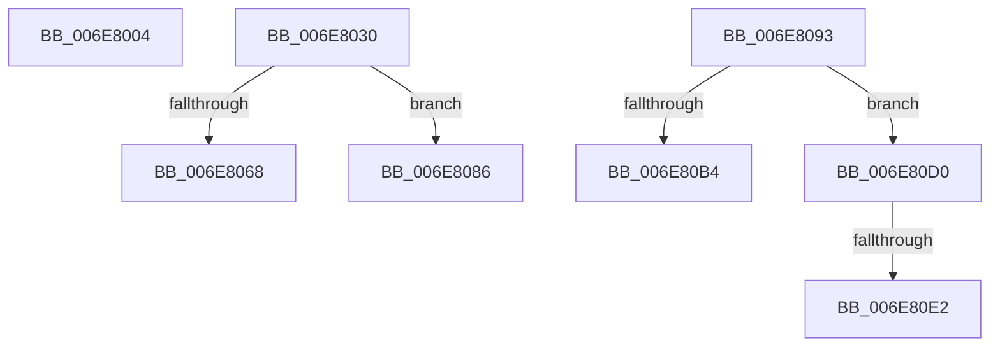

# sub_006E8004

- RVA: `0x006E8004`–`0x006E80FB` (길이 `247` bytes)
- VA: `0x00000001406E8004`
- 실행 섹션: `.text`
- PDB 이름 있음: `아니요`; PDB Function 태그: `아니요`
- unwind 정보 RVA: `0x0008E34C`
- 디코드: `63`개 명령, `247/247` bytes 표시
- 미해석 바이트: `0` (있으면 어셈블리에 `.byte`로 보존)

> 이 문서는 커널 이미지의 기계어와 PDB 기호를 분석해 생성했습니다. 4번과 5번은 함수 원형과 자료형을 바이너리 사용 방식에서 추정한 C 해석이며 원본 소스 복구 결과는 아닙니다.

## 1. Dependencies

- 직접 호출 지점: **8**; 고유 호출 대상: **7**
- 직접 호출자로 확인된 함수: **0**
- RIP 상대 이미지 참조: **0**

### Outgoing calls
- `0x006E8025` → [ZwUnlockVirtualMemory](../6B/ZwUnlockVirtualMemory_function_006B0CB0.md) (function, `0x006B0CB0`)
- `0x006E8046` → [SmFpAllocate](../31/SmFpAllocate_function_00317D10.md) (function, `0x00317D10`)
- `0x006E805D` → [SmKmProbeAndLockAddress](../3C/SmKmProbeAndLockAddress_function_003C3DCC.md) (function, `0x003C3DCC`)
- `0x006E807B` → [SmFpFree](../43/SmFpFree_function_00436350.md) (function, `0x00436350`)
- `0x006E809F` → [SmKmVirtualLockCtxLockMemory](../61/SmKmVirtualLockCtxLockMemory_function_0061000C.md) (function, `0x0061000C`)
- `0x006E80C2` → [SmAcquireReleaseCharges](../28/SmAcquireReleaseCharges_function_00285C40.md) (function, `0x00285C40`)
- `0x006E80D4` → [MmStoreFreeVirtualMemory](../../page/A7/MmStoreFreeVirtualMemory_function_00A767A8.md) (function, `0x00A767A8`)
- `0x006E80F0` → [SmAcquireReleaseCharges](../28/SmAcquireReleaseCharges_function_00285C40.md) (function, `0x00285C40`)

### Direct callers
- 이 함수 시작 RVA로 연결되는 직접 call은 확인되지 않았습니다. 간접 호출은 완전히 역산할 수 없습니다.

### Static image references
- 디코드된 RIP-relative 메모리 참조가 없습니다.

## 2. Other-region calls and transfers

- 다른 실행 섹션으로 향하는 call: **1**
  - `0x006E80D4` → [MmStoreFreeVirtualMemory](../../page/A7/MmStoreFreeVirtualMemory_function_00A767A8.md) (`.text` → `PAGE`)
- call이 아닌 외부 분기/꼬리 이동: **6**
  - `0x006E802B` → [SmKmStoreHelperCommandProcess + 0x144](../3C/SmKmStoreHelperCommandProcess_function_003C3AA4.md) (`tail-transfer`)
  - `0x006E8081` → [SmKmStoreHelperCommandProcess + 0xE8](../3C/SmKmStoreHelperCommandProcess_function_003C3AA4.md) (`tail-transfer`)
  - `0x006E808E` → [SmKmStoreHelperCommandProcess + 0xE8](../3C/SmKmStoreHelperCommandProcess_function_003C3AA4.md) (`tail-transfer`)
  - `0x006E80CB` → [SmKmStoreHelperCommandProcess + 0x1E6](../3C/SmKmStoreHelperCommandProcess_function_003C3AA4.md) (`tail-transfer`)
  - `0x006E80DC` → [SmKmStoreHelperCommandProcess + 0x168](../3C/SmKmStoreHelperCommandProcess_function_003C3AA4.md) (`tail-transfer`)
  - `0x006E80F6` → [SmKmStoreHelperCommandProcess + 0x168](../3C/SmKmStoreHelperCommandProcess_function_003C3AA4.md) (`tail-transfer`)

## 3. Assembly (complete function range)

```asm
006E8004  49 8B 00                        mov rax, qword ptr [r8]
006E8007  48 8D 55 F0                     lea rdx, [rbp - 0x10]
006E800B  48 89 45 F0                     mov qword ptr [rbp - 0x10], rax
006E800F  41 B9 01 00 00 00               mov r9d, 1
006E8015  49 8B 40 08                     mov rax, qword ptr [r8 + 8]
006E8019  48 83 C9 FF                     or rcx, 0xffffffffffffffff
006E801D  4C 8D 45 58                     lea r8, [rbp + 0x58]
006E8021  48 89 45 58                     mov qword ptr [rbp + 0x58], rax
006E8025  E8 86 8C FC FF                  call 0x1406b0cb0
006E802A  90                              nop
006E802B  E9 B8 BB CD FF                  jmp 0x1403c3be8
006E8030  49 8B 8F 80 00 00 00            mov rcx, qword ptr [r15 + 0x80]
006E8037  45 33 C9                        xor r9d, r9d
006E803A  4D 8B C7                        mov r8, r15
006E803D  44 89 74 24 20                  mov dword ptr [rsp + 0x20], r14d
006E8042  41 8D 51 04                     lea edx, [r9 + 4]
006E8046  E8 C5 FC C2 FF                  call 0x140317d10
006E804B  48 8B 55 58                     mov rdx, qword ptr [rbp + 0x58]
006E804F  45 8B CE                        mov r9d, r14d
006E8052  48 8B 4D F0                     mov rcx, qword ptr [rbp - 0x10]
006E8056  4D 8B C4                        mov r8, r12
006E8059  48 89 45 F8                     mov qword ptr [rbp - 8], rax
006E805D  E8 6A BD CD FF                  call 0x1403c3dcc
006E8062  8B D8                           mov ebx, eax
006E8064  85 C0                           test eax, eax
006E8066  79 1E                           jns 0x1406e8086
006E8068  4C 8B 4D F8                     mov r9, qword ptr [rbp - 8]
006E806C  4D 8B C7                        mov r8, r15
006E806F  49 8B 8F 80 00 00 00            mov rcx, qword ptr [r15 + 0x80]
006E8076  BA 04 00 00 00                  mov edx, 4
006E807B  E8 D0 E2 D4 FF                  call 0x140436350
006E8080  90                              nop
006E8081  E9 06 BB CD FF                  jmp 0x1403c3b8c
006E8086  48 8B 45 F8                     mov rax, qword ptr [rbp - 8]
006E808A  49 89 04 24                     mov qword ptr [r12], rax
006E808E  E9 F9 BA CD FF                  jmp 0x1403c3b8c
006E8093  4C 8B 45 58                     mov r8, qword ptr [rbp + 0x58]
006E8097  48 8B 55 F0                     mov rdx, qword ptr [rbp - 0x10]
006E809B  49 8B 4F 78                     mov rcx, qword ptr [r15 + 0x78]
006E809F  E8 68 7F F2 FF                  call 0x14061000c
006E80A4  8B D8                           mov ebx, eax
006E80A6  8A 45 48                        mov al, byte ptr [rbp + 0x48]
006E80A9  41 88 85 27 07 00 00            mov byte ptr [r13 + 0x727], al
006E80B0  85 DB                           test ebx, ebx
006E80B2  78 1C                           js 0x1406e80d0
006E80B4  48 8B 55 58                     mov rdx, qword ptr [rbp + 0x58]
006E80B8  45 8B CE                        mov r9d, r14d
006E80BB  48 8B 4F 10                     mov rcx, qword ptr [rdi + 0x10]
006E80BF  45 8B C6                        mov r8d, r14d
006E80C2  E8 79 DB B9 FF                  call 0x140285c40
006E80C7  48 8B 4D F0                     mov rcx, qword ptr [rbp - 0x10]
006E80CB  E9 BA BB CD FF                  jmp 0x1403c3c8a
006E80D0  48 8B 4D F0                     mov rcx, qword ptr [rbp - 0x10]
006E80D4  E8 CF E6 38 00                  call 0x140a767a8
006E80D9  45 85 E4                        test r12d, r12d
006E80DC  0F 84 2A BB CD FF               je 0x1403c3c0c
006E80E2  48 8B 55 58                     mov rdx, qword ptr [rbp + 0x58]
006E80E6  45 8B CE                        mov r9d, r14d
006E80E9  48 8B 4F 10                     mov rcx, qword ptr [rdi + 0x10]
006E80ED  45 8B C6                        mov r8d, r14d
006E80F0  E8 4B DB B9 FF                  call 0x140285c40
006E80F5  90                              nop
006E80F6  E9 11 BB CD FF                  jmp 0x1403c3c0c
```

## 4. C-style interpretation (structured pseudocode)

```c
__int64 __fastcall sub_006E8004(__int64 a1, __int64 a2, __int64 a3)
{
    __int64 result;
    unsigned int v_stack_p20;

    *(unsigned __int64 *)(v_rbp - 16) = *(unsigned __int64 *)(a3);
    a1 = (a1) | (-1);
    *(unsigned __int64 *)(v_rbp + 88) = *(unsigned __int64 *)(a3 + 8);
    result = ZwUnlockVirtualMemory(a1, v_rbp - 16, v_rbp + 88, 1);
}
```

## 5. (Beta) C Style

```c
int64_t sub_006E8004(int64_t Arg1, int64_t Arg2, void *Arg3)
{
    uint8_t *arg3 = (uint8_t *)Arg3;

    int64_t result;
    uint32_t v_stack_p20;

    *(uint64_t *)(local_rbp - 0x10) = *(uint64_t *)(arg3);
    Arg1 = (Arg1) | (-1);
    *(uint64_t *)(local_rbp + 0x58) = *(uint64_t *)(arg3 + 0x8);
    result = ZwUnlockVirtualMemory(Arg1, local_rbp - 16, local_rbp + 88, 1);
}
```

### 관측된 메모리 오프셋

구조체 형식이 확인되지 않은 접근은 인자 기준의 오프셋으로만 기록했습니다.

| 기준 인자 | 오프셋 표현 | 폭 (bit) | 접근 |
|---|---:|---:|---|
| `Arg3` | `+ 0x0` | `64` | `R` |
| `Arg3` | `+ 0x8` | `64` | `R` |

## 6. Execution-region graph

[열기: 2D/3D 그래프와 함수 탐색 컨트롤 패널](../../../control-panel.html?section=text&rva=0x006E8004&view=graph)

- 2D 그래프는 위에서 아래로 흐르고, 3D 그래프는 빈 공간을 드래그해 회전합니다. Shift+드래그는 이동, 휠은 확대·축소, 함수 노드 선택은 대상 보고서 이동입니다.

### Static fallback


