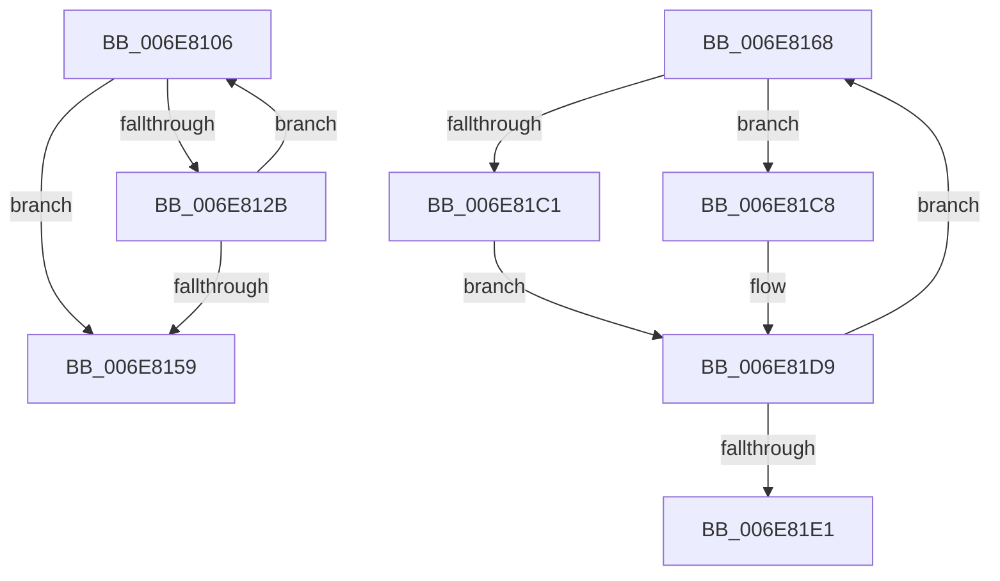

# sub_006E8106

- RVA: `0x006E8106`–`0x006E81F0` (길이 `234` bytes)
- VA: `0x00000001406E8106`
- 실행 섹션: `.text`
- PDB 이름 있음: `아니요`; PDB Function 태그: `아니요`
- unwind 정보 RVA: `0x0008E4A4`
- 디코드: `59`개 명령, `234/234` bytes 표시
- 미해석 바이트: `0` (있으면 어셈블리에 `.byte`로 보존)

> 이 문서는 커널 이미지의 기계어와 PDB 기호를 분석해 생성했습니다. 4번과 5번은 함수 원형과 자료형을 바이너리 사용 방식에서 추정한 C 해석이며 원본 소스 복구 결과는 아닙니다.

## 1. Dependencies

- 직접 호출 지점: **4**; 고유 호출 대상: **3**
- 직접 호출자로 확인된 함수: **0**
- RIP 상대 이미지 참조: **0**

### Outgoing calls
- `0x006E811E` → [KeAbPreAcquire](../21/KeAbPreAcquire_function_00210230.md) (function, `0x00210230`)
- `0x006E8132` → [KeAbPreWait](../20/KeAbPreWait_function_0020E560.md) (function, `0x0020E560`)
- `0x006E81B7` → [KeAbPreAcquire](../21/KeAbPreAcquire_function_00210230.md) (function, `0x00210230`)
- `0x006E81D4` → [KeAbPostReleaseEx](../26/KeAbPostReleaseEx_function_00262210.md) (function, `0x00262210`)

### Direct callers
- 이 함수 시작 RVA로 연결되는 직접 call은 확인되지 않았습니다. 간접 호출은 완전히 역산할 수 없습니다.

### Static image references
- 디코드된 RIP-relative 메모리 참조가 없습니다.

## 2. Other-region calls and transfers

- 다른 실행 섹션으로 향하는 call: **0**
- call이 아닌 외부 분기/꼬리 이동: **2**
  - `0x006E8163` → [KiWaitForAllObjects + 0x5D6](../3C/KiWaitForAllObjects_function_003C5800.md) (`tail-transfer`)
  - `0x006E81EB` → [KiWaitForAllObjects + 0x620](../3C/KiWaitForAllObjects_function_003C5800.md) (`tail-transfer`)

## 3. Assembly (complete function range)

```asm
006E8106  49 0F BC C5                     bsf rax, r13
006E810A  45 33 C0                        xor r8d, r8d
006E810D  33 D2                           xor edx, edx
006E810F  44 8B E0                        mov r12d, eax
006E8112  89 44 24 5C                     mov dword ptr [rsp + 0x5c], eax
006E8116  4D 0F B3 E5                     btr r13, r12
006E811A  49 8B 0C C6                     mov rcx, qword ptr [r14 + rax*8]
006E811E  E8 0D 81 B2 FF                  call 0x140210230
006E8123  4C 8B F0                        mov r14, rax
006E8126  48 85 C0                        test rax, rax
006E8129  74 2E                           je 0x1406e8159
006E812B  48 8B C8                        mov rcx, rax
006E812E  4C 0F AB E6                     bts rsi, r12
006E8132  E8 29 64 B2 FF                  call 0x14020e560
006E8137  41 0F B6 4E 08                  movzx ecx, byte ptr [r14 + 8]
006E813C  4C 8B 74 24 38                  mov r14, qword ptr [rsp + 0x38]
006E8141  80 E1 3F                        and cl, 0x3f
006E8144  02 C9                           add cl, cl
006E8146  8B C7                           mov eax, edi
006E8148  80 C9 01                        or cl, 1
006E814B  FF C7                           inc edi
006E814D  88 8C 05 80 01 00 00            mov byte ptr [rbp + rax + 0x180], cl
006E8154  4D 85 ED                        test r13, r13
006E8157  75 AD                           jne 0x1406e8106
006E8159  4C 8B 7C 24 78                  mov r15, qword ptr [rsp + 0x78]
006E815E  4C 8B 5C 24 68                  mov r11, qword ptr [rsp + 0x68]
006E8163  E9 6E DC CD FF                  jmp 0x1403c5dd6
006E8168  65 4C 8B 04 25 88 01 00 00      mov r8, qword ptr gs:[0x188]
006E8171  48 0F BC C6                     bsf rax, rsi
006E8175  44 8B C8                        mov r9d, eax
006E8178  89 44 24 60                     mov dword ptr [rsp + 0x60], eax
006E817C  4C 0F B3 CE                     btr rsi, r9
006E8180  41 8B C6                        mov eax, r14d
006E8183  0F B6 8C 05 80 01 00 00         movzx ecx, byte ptr [rbp + rax + 0x180]
006E818B  49 8B 80 70 04 00 00            mov rax, qword ptr [r8 + 0x470]
006E8192  45 33 C0                        xor r8d, r8d
006E8195  48 D1 E9                        shr rcx, 1
006E8198  48 83 C0 10                     add rax, 0x10
006E819C  4C 6B E9 58                     imul r13, rcx, 0x58
006E81A0  4C 03 E8                        add r13, rax
006E81A3  4A 8D 04 CD 00 00 00 00         lea rax, [r9*8]
006E81AB  48 8B 0C 38                     mov rcx, qword ptr [rax + rdi]
006E81AF  49 8B D5                        mov rdx, r13
006E81B2  48 89 44 24 50                  mov qword ptr [rsp + 0x50], rax
006E81B7  E8 74 80 B2 FF                  call 0x140210230
006E81BC  45 84 E4                        test r12b, r12b
006E81BF  74 07                           je 0x1406e81c8
006E81C1  41 C6 45 0A 01                  mov byte ptr [r13 + 0xa], 1
006E81C6  EB 11                           jmp 0x1406e81d9
006E81C8  48 8B 4C 24 50                  mov rcx, qword ptr [rsp + 0x50]
006E81CD  49 8B D5                        mov rdx, r13
006E81D0  48 8B 0C 39                     mov rcx, qword ptr [rcx + rdi]
006E81D4  E8 37 A0 B7 FF                  call 0x140262210
006E81D9  41 FF C6                        inc r14d
006E81DC  48 85 F6                        test rsi, rsi
006E81DF  75 87                           jne 0x1406e8168
006E81E1  4C 8B 7C 24 78                  mov r15, qword ptr [rsp + 0x78]
006E81E6  48 8B 7C 24 48                  mov rdi, qword ptr [rsp + 0x48]
006E81EB  E9 30 DC CD FF                  jmp 0x1403c5e20
```

## 4. C-style interpretation (structured pseudocode)

```c
__int64 __fastcall sub_006E8106(__int64 a1, int a2, int a3, __int64 a4, __int64 a5, __int64 a6, __int64 a7, __int64 a8, __int64 a9, __int64 a10, __int64 a11, __int64 a12, __int64 a13, __int64 a14, __int64 a15)
{
    __int64 result;
    __int64 v_rdi;
    unsigned __int64 v_stack_p48;
    unsigned __int64 v_stack_p50;
    unsigned int v_stack_p5C;
    unsigned int v_stack_p60;
    unsigned __int64 v_stack_p78;

    a3 = 0;
    a2 = 0;
    v_stack_p5C = (unsigned int)(result);
    result = KeAbPreAcquire(*(unsigned __int64 *)(v_r14 + result * 8), a2, a3, a4);
    if (result == 0) goto loc_006E8159;
    result = KeAbPreWait(result, a2, a3, a4);
    a1 = (unsigned __int8)((*(unsigned __int8 *)(result + 8)) & (63));
    a1 = (unsigned __int8)((a1) + ((unsigned __int8)(a1)));
    a1 = (unsigned __int8)((a1) | (1));
    v_rdi = (unsigned int)((v_rdi) + 1);
    *(unsigned __int8 *)(v_rbp + (unsigned int)((unsigned int)(v_rdi)) * 1 + 384) = (unsigned __int8)(a1);
    if (v_r13 != 0) goto loc_006E8106;
loc_006E8159:
}
```

## 5. (Beta) C Style

```c
int64_t sub_006E8106(int64_t Arg1, int32_t Arg2, int32_t Arg3, int64_t Arg4, uint64_t Arg5, uint64_t Arg6, int64_t Arg7, uint64_t Arg8, uint64_t Arg9, uint64_t Arg10, uint64_t Arg11, uint64_t Arg12, int64_t Arg13, uint64_t Arg14, int64_t Arg15)
{
    int64_t result;
    int64_t local_rdi;
    uint64_t v_stack_p48;
    uint64_t v_stack_p50;
    uint32_t v_stack_p5C;
    uint32_t v_stack_p60;
    uint64_t v_stack_p78;

    Arg3 = 0;
    Arg2 = 0;
    v_stack_p5C = (uint32_t)(result);
    result = KeAbPreAcquire(*(uint64_t *)(local_r14 + result * 8), Arg2, Arg3, Arg4);
    if (result == 0) goto loc_006E8159;
    result = KeAbPreWait(result, Arg2, Arg3, Arg4);
    Arg1 = (uint8_t)((*(uint8_t *)(result + 0x8)) & (63));
    Arg1 = (uint8_t)((Arg1) + ((uint8_t)(Arg1)));
    Arg1 = (uint8_t)((Arg1) | (1));
    local_rdi = (uint32_t)((local_rdi) + 1);
    *(uint8_t *)(local_rbp + (uint32_t)((uint32_t)(local_rdi)) * 1 + 0x180) = (uint8_t)(Arg1);
    if (local_r13 != 0) goto loc_006E8106;
loc_006E8159:
}
```

## 6. Execution-region graph

[열기: 2D/3D 그래프와 함수 탐색 컨트롤 패널](../../../control-panel.html?section=text&rva=0x006E8106&view=graph)

- 2D 그래프는 위에서 아래로 흐르고, 3D 그래프는 빈 공간을 드래그해 회전합니다. Shift+드래그는 이동, 휠은 확대·축소, 함수 노드 선택은 대상 보고서 이동입니다.

### Static fallback


