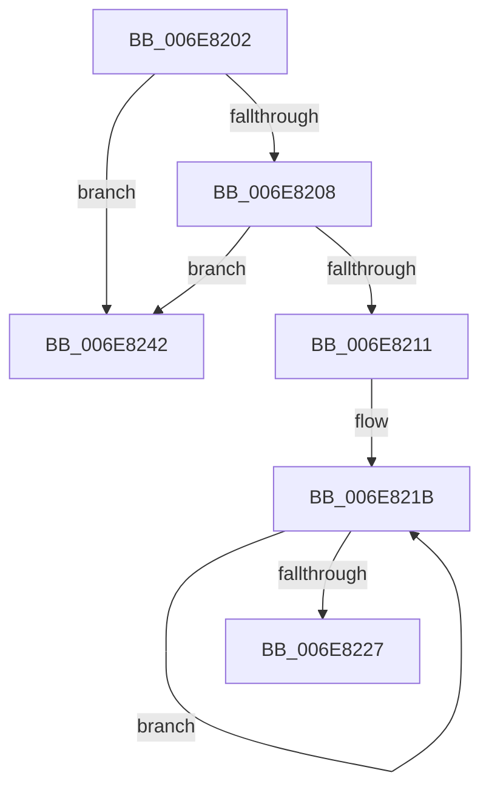

# sub_006E8202

- RVA: `0x006E8202`–`0x006E8249` (길이 `71` bytes)
- VA: `0x00000001406E8202`
- 실행 섹션: `.text`
- PDB 이름 있음: `아니요`; PDB Function 태그: `아니요`
- unwind 정보 RVA: `0x0008E530`
- 디코드: `21`개 명령, `71/71` bytes 표시
- 미해석 바이트: `0` (있으면 어셈블리에 `.byte`로 보존)

> 이 문서는 커널 이미지의 기계어와 PDB 기호를 분석해 생성했습니다. 4번과 5번은 함수 원형과 자료형을 바이너리 사용 방식에서 추정한 C 해석이며 원본 소스 복구 결과는 아닙니다.

## 1. Dependencies

- 직접 호출 지점: **1**; 고유 호출 대상: **1**
- 직접 호출자로 확인된 함수: **0**
- RIP 상대 이미지 참조: **0**

### Outgoing calls
- `0x006E8235` → [KiReleaseThreadLockLowerIrql](../3C/KiReleaseThreadLockLowerIrql_function_003C65D0.md) (function, `0x003C65D0`)

### Direct callers
- 이 함수 시작 RVA로 연결되는 직접 call은 확인되지 않았습니다. 간접 호출은 완전히 역산할 수 없습니다.

### Static image references
- 디코드된 RIP-relative 메모리 참조가 없습니다.

## 2. Other-region calls and transfers

- 다른 실행 섹션으로 향하는 call: **0**
- call이 아닌 외부 분기/꼬리 이동: **1**
  - `0x006E823D` → [KiFlushQueueApc + 0x5E](../3C/KiFlushQueueApc_function_003C653C.md) (`tail-transfer`)

## 3. Assembly (complete function range)

```asm
006E8202  48 39 5F 08                     cmp qword ptr [rdi + 8], rbx
006E8206  75 3A                           jne 0x1406e8242
006E8208  48 8B 43 08                     mov rax, qword ptr [rbx + 8]
006E820C  48 39 18                        cmp qword ptr [rax], rbx
006E820F  75 31                           jne 0x1406e8242
006E8211  48 89 38                        mov qword ptr [rax], rdi
006E8214  48 89 47 08                     mov qword ptr [rdi + 8], rax
006E8218  48 8B C7                        mov rax, rdi
006E821B  C6 40 42 00                     mov byte ptr [rax + 0x42], 0
006E821F  48 8B 00                        mov rax, qword ptr [rax]
006E8222  48 3B C7                        cmp rax, rdi
006E8225  75 F4                           jne 0x1406e821b
006E8227  48 89 5B 08                     mov qword ptr [rbx + 8], rbx
006E822B  48 89 1B                        mov qword ptr [rbx], rbx
006E822E  8A 54 24 38                     mov dl, byte ptr [rsp + 0x38]
006E8232  48 8B CE                        mov rcx, rsi
006E8235  E8 96 E3 CD FF                  call 0x1403c65d0
006E823A  48 8B C7                        mov rax, rdi
006E823D  E9 58 E3 CD FF                  jmp 0x1403c659a
006E8242  B9 03 00 00 00                  mov ecx, 3
006E8247  CD 29                           int 0x29
```

## 4. C-style interpretation (structured pseudocode)

```c
__int64 __fastcall sub_006E8202(__int64 a1, __int64 a2, __int64 a3, __int64 a4, __int64 a5, __int64 a6, unsigned __int8 a7)
{
    __int64 result;

    if ((*(unsigned __int64 *)(v_rdi + 8)) != v_rbx) goto loc_006E8242;
    if ((*(unsigned __int64 *)(*(unsigned __int64 *)(v_rbx + 8))) != v_rbx) goto loc_006E8242;
    *(unsigned __int64 *)(*(unsigned __int64 *)(v_rbx + 8)) = v_rdi;
    *(unsigned __int64 *)(v_rdi + 8) = *(unsigned __int64 *)(v_rbx + 8);
loc_006E821B:
    *(unsigned __int8 *)(v_rdi + 66) = 0;
    if ((*(unsigned __int64 *)(v_rdi)) != v_rdi) goto loc_006E821B;
    *(unsigned __int64 *)(v_rbx + 8) = v_rbx;
    *(unsigned __int64 *)(v_rbx) = v_rbx;
    result = KiReleaseThreadLockLowerIrql(v_rsi, a7, a3, a4);
loc_006E8242:
    return v_rdi;
}
```

## 5. (Beta) C Style

```c
int64_t sub_006E8202(int64_t Arg1, int64_t Arg2, int64_t Arg3, int64_t Arg4, uint64_t Arg5, uint64_t Arg6, uint8_t Arg7)
{
    int64_t result;

    if ((*(uint64_t *)(local_rdi + 0x8)) != local_rbx) goto loc_006E8242;
    if ((*(uint64_t *)(*(uint64_t *)(local_rbx + 0x8))) != local_rbx) goto loc_006E8242;
    *(uint64_t *)(*(uint64_t *)(local_rbx + 0x8)) = local_rdi;
    *(uint64_t *)(local_rdi + 0x8) = *(uint64_t *)(local_rbx + 0x8);
loc_006E821B:
    *(uint8_t *)(local_rdi + 0x42) = 0;
    if ((*(uint64_t *)(local_rdi)) != local_rdi) goto loc_006E821B;
    *(uint64_t *)(local_rbx + 0x8) = local_rbx;
    *(uint64_t *)(local_rbx) = local_rbx;
    result = KiReleaseThreadLockLowerIrql(local_rsi, Arg7, Arg3, Arg4);
loc_006E8242:
    return local_rdi;
}
```

## 6. Execution-region graph

[열기: 2D/3D 그래프와 함수 탐색 컨트롤 패널](../../../control-panel.html?section=text&rva=0x006E8202&view=graph)

- 2D 그래프는 위에서 아래로 흐르고, 3D 그래프는 빈 공간을 드래그해 회전합니다. Shift+드래그는 이동, 휠은 확대·축소, 함수 노드 선택은 대상 보고서 이동입니다.

### Static fallback


