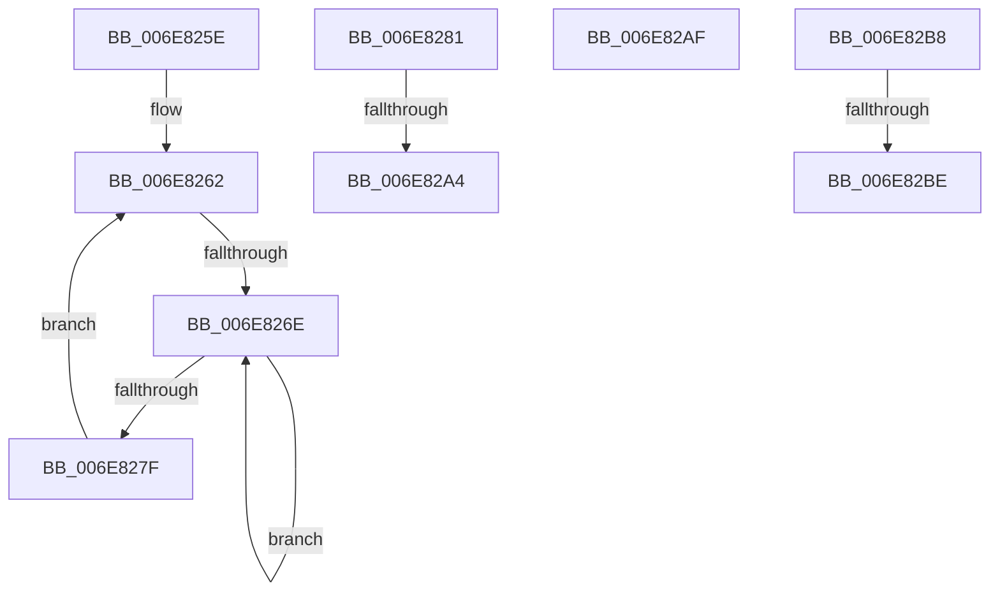

# sub_006E825E

- RVA: `0x006E825E`–`0x006E82CD` (길이 `111` bytes)
- VA: `0x00000001406E825E`
- 실행 섹션: `.text`
- PDB 이름 있음: `아니요`; PDB Function 태그: `아니요`
- unwind 정보 RVA: `0x0008E8F4`
- 디코드: `28`개 명령, `111/111` bytes 표시
- 미해석 바이트: `0` (있으면 어셈블리에 `.byte`로 보존)

> 이 문서는 커널 이미지의 기계어와 PDB 기호를 분석해 생성했습니다. 4번과 5번은 함수 원형과 자료형을 바이너리 사용 방식에서 추정한 C 해석이며 원본 소스 복구 결과는 아닙니다.

## 1. Dependencies

- 직접 호출 지점: **3**; 고유 호출 대상: **3**
- 직접 호출자로 확인된 함수: **0**
- RIP 상대 이미지 참조: **1**

### Outgoing calls
- `0x006E8272` → [KeYieldProcessorEx](../3F/KeYieldProcessorEx_function_003FBD00.md) (function, `0x003FBD00`)
- `0x006E82A4` → [KeWakeAddressAll](../21/KeWakeAddressAll_function_00217C20.md) (function, `0x00217C20`)
- `0x006E82C1` → [KiQueryEffectivePriorityThreadWithStateLock](../5C/KiQueryEffectivePriorityThreadWithStateLock_function_005C6604.md) (function, `0x005C6604`)

### Direct callers
- 이 함수 시작 RVA로 연결되는 직접 call은 확인되지 않았습니다. 간접 호출은 완전히 역산할 수 없습니다.

### Static image references
- `0x006E8295` → RVA `0x00FC8C40` (`ALMOSTRO`; read)

## 2. Other-region calls and transfers

- 다른 실행 섹션으로 향하는 call: **0**
- call이 아닌 외부 분기/꼬리 이동: **6**
  - `0x006E8268` → [KeQueryEffectivePriorityThread + 0x1FD](../3C/KeQueryEffectivePriorityThread_function_003C7CA0.md) (`tail-transfer`)
  - `0x006E829E` → [KeQueryEffectivePriorityThread + 0xA9](../3C/KeQueryEffectivePriorityThread_function_003C7CA0.md) (`tail-transfer`)
  - `0x006E82AA` → [KeQueryEffectivePriorityThread + 0xA2](../3C/KeQueryEffectivePriorityThread_function_003C7CA0.md) (`tail-transfer`)
  - `0x006E82B3` → [KeQueryEffectivePriorityThread + 0xA2](../3C/KeQueryEffectivePriorityThread_function_003C7CA0.md) (`tail-transfer`)
  - `0x006E82B8` → [KeQueryEffectivePriorityThread + 0x13E](../3C/KeQueryEffectivePriorityThread_function_003C7CA0.md) (`tail-transfer`)
  - `0x006E82C8` → [KeQueryEffectivePriorityThread + 0x13E](../3C/KeQueryEffectivePriorityThread_function_003C7CA0.md) (`tail-transfer`)

## 3. Assembly (complete function range)

```asm
006E825E  44 89 6D 48                     mov dword ptr [rbp + 0x48], r13d
006E8262  F0 48 0F BA 2E 00               lock bts qword ptr [rsi], 0
006E8268  0F 83 2F FC CD FF               jae 0x1403c7e9d
006E826E  48 8D 4D 48                     lea rcx, [rbp + 0x48]
006E8272  E8 89 3A D1 FF                  call 0x1403fbd00
006E8277  48 8B 06                        mov rax, qword ptr [rsi]
006E827A  48 85 C0                        test rax, rax
006E827D  75 EF                           jne 0x1406e826e
006E827F  EB E1                           jmp 0x1406e8262
006E8281  48 8D 48 08                     lea rcx, [rax + 8]
006E8285  4C 89 6D F0                     mov qword ptr [rbp - 0x10], r13
006E8289  48 8B 55 F8                     mov rdx, qword ptr [rbp - 8]
006E828D  48 8B C2                        mov rax, rdx
006E8290  48 87 01                        xchg qword ptr [rcx], rax
006E8293  32 C2                           xor al, dl
006E8295  48 8D 15 A4 09 8E 00            lea rdx, [rip + 0x8e09a4]
006E829C  A8 04                           test al, 4
006E829E  0F 84 A5 FA CD FF               je 0x1403c7d49
006E82A4  E8 77 F9 B2 FF                  call 0x140217c20
006E82A9  90                              nop
006E82AA  E9 93 FA CD FF                  jmp 0x1403c7d42
006E82AF  F0 4C 21 2E                     lock and qword ptr [rsi], r13
006E82B3  E9 8A FA CD FF                  jmp 0x1403c7d42
006E82B8  0F 85 20 FB CD FF               jne 0x1403c7dde
006E82BE  48 8B CB                        mov rcx, rbx
006E82C1  E8 3E E3 ED FF                  call 0x1405c6604
006E82C6  8B F8                           mov edi, eax
006E82C8  E9 11 FB CD FF                  jmp 0x1403c7dde
```

## 4. C-style interpretation (structured pseudocode)

```c
__int64 __fastcall sub_006E825E(void)
{
    __int64 result;

    *(unsigned int *)(v_rbp + 72) = (unsigned int)(v_r13);
loc_006E8262:
loc_006E826E:
    result = KeYieldProcessorEx(v_rbp + 72, a2, a3, a4);
    if (*(unsigned __int64 *)(v_rsi) != 0) goto loc_006E826E;
    goto loc_006E8262;
}
```

## 5. (Beta) C Style

```c
void sub_006E825E(void)
{
    int64_t result;

    *(uint32_t *)(local_rbp + 0x48) = (uint32_t)(local_r13);
loc_006E8262:
loc_006E826E:
    result = KeYieldProcessorEx(local_rbp + 72, a2, a3, a4);
    if (*(uint64_t *)(local_rsi) != 0) goto loc_006E826E;
    goto loc_006E8262;
}
```

## 6. Execution-region graph

[열기: 2D/3D 그래프와 함수 탐색 컨트롤 패널](../../../control-panel.html?section=text&rva=0x006E825E&view=graph)

- 2D 그래프는 위에서 아래로 흐르고, 3D 그래프는 빈 공간을 드래그해 회전합니다. Shift+드래그는 이동, 휠은 확대·축소, 함수 노드 선택은 대상 보고서 이동입니다.

### Static fallback


