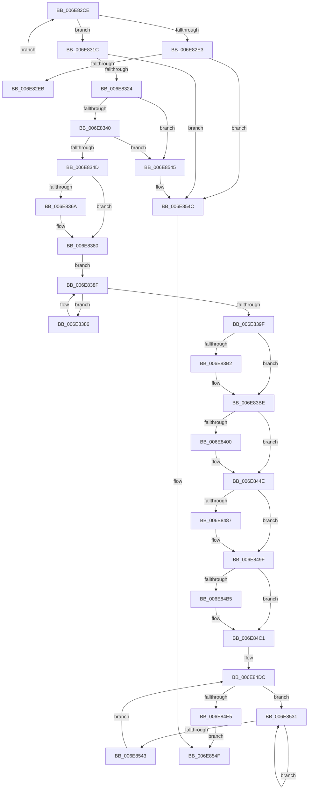

# sub_006E82CE

- RVA: `0x006E82CE`–`0x006E855D` (길이 `655` bytes)
- VA: `0x00000001406E82CE`
- 실행 섹션: `.text`
- PDB 이름 있음: `아니요`; PDB Function 태그: `아니요`
- unwind 정보 RVA: `0x0008E958`
- 디코드: `156`개 명령, `655/655` bytes 표시
- 미해석 바이트: `0` (있으면 어셈블리에 `.byte`로 보존)

> 이 문서는 커널 이미지의 기계어와 PDB 기호를 분석해 생성했습니다. 4번과 5번은 함수 원형과 자료형을 바이너리 사용 방식에서 추정한 C 해석이며 원본 소스 복구 결과는 아닙니다.

## 1. Dependencies

- 직접 호출 지점: **21**; 고유 호출 대상: **15**
- 직접 호출자로 확인된 함수: **0**
- RIP 상대 이미지 참조: **4**

### Outgoing calls
- `0x006E82F9` → [MiReleaseSpinLockExclusive](../24/MiReleaseSpinLockExclusive_function_002482C0.md) (function, `0x002482C0`)
- `0x006E8309` → [KeWaitForGate](../2C/KeWaitForGate_function_002CA794.md) (function, `0x002CA794`)
- `0x006E8311` → [ExAcquireSpinLockExclusive](../24/ExAcquireSpinLockExclusive_function_00248690.md) (function, `0x00248690`)
- `0x006E835D` → [MiReleaseSpinLockExclusive](../24/MiReleaseSpinLockExclusive_function_002482C0.md) (function, `0x002482C0`)
- `0x006E836D` → [MiGetVmAccessLoggingPartition](../38/MiGetVmAccessLoggingPartition_function_003815A0.md) (function, `0x003815A0`)
- `0x006E8378` → [MiEmptyPageAccessLog](../34/MiEmptyPageAccessLog_function_00348700.md) (function, `0x00348700`)
- `0x006E838A` → [KeYieldProcessorEx](../3F/KeYieldProcessorEx_function_003FBD00.md) (function, `0x003FBD00`)
- `0x006E8396` → [KeIsEmptyAffinityEx](../2D/KeIsEmptyAffinityEx_function_002D1580.md) (function, `0x002D1580`)
- `0x006E83A4` → [KeFlushProcessTb](../46/KeFlushProcessTb_function_00465BC8.md) (function, `0x00465BC8`)
- `0x006E83B9` → [KeFlushProcessTb](../46/KeFlushProcessTb_function_00465BC8.md) (function, `0x00465BC8`)
- `0x006E83EC` → [MiMapPageInHyperSpaceWorker](../33/MiMapPageInHyperSpaceWorker_function_00332B10.md) (function, `0x00332B10`)
- `0x006E8465` → [MiMakeTransitionPte](../36/MiMakeTransitionPte_function_00363F70.md) (function, `0x00363F70`)
- `0x006E847C` → [MiUnmapPageInHyperSpaceWorker](../43/MiUnmapPageInHyperSpaceWorker_function_00432800.md) (function, `0x00432800`)
- `0x006E848D` → [MiOutSwapFreeSoftWslePxe](../69/MiOutSwapFreeSoftWslePxe_function_00697928.md) (function, `0x00697928`)
- `0x006E849A` → [MiLockAndDecrementShareCount](../2A/MiLockAndDecrementShareCount_function_002A2854.md) (function, `0x002A2854`)
- `0x006E84A7` → [MiLockAndDecrementShareCount](../2A/MiLockAndDecrementShareCount_function_002A2854.md) (function, `0x002A2854`)
- `0x006E84BC` → [KiLowerIrqlProcessIrqlFlags](../4F/KiLowerIrqlProcessIrqlFlags_function_004F5698.md) (function, `0x004F5698`)
- `0x006E84D0` → [ExAcquireSpinLockExclusive](../24/ExAcquireSpinLockExclusive_function_00248690.md) (function, `0x00248690`)
- `0x006E8514` → [MiDecrementShareCountEx](../33/MiDecrementShareCountEx_function_00333F70.md) (function, `0x00333F70`)
- `0x006E8535` → [KeYieldProcessorEx](../3F/KeYieldProcessorEx_function_003FBD00.md) (function, `0x003FBD00`)
- `0x006E8552` → [MiReleaseSpinLockExclusive](../24/MiReleaseSpinLockExclusive_function_002482C0.md) (function, `0x002482C0`)

### Direct callers
- 이 함수 시작 RVA로 연결되는 직접 call은 확인되지 않았습니다. 간접 호출은 완전히 역산할 수 없습니다.

### Static image references
- `0x006E8400` → RVA `0x00E38C58` (`.data`; read)
- `0x006E8443` → RVA `0x00010880` (`.rdata`; read)
- `0x006E84AC` → RVA `0x00FC6D20` (`ALMOSTRO`; read)
- `0x006E84C9` → RVA `0x00E374C0` (`.data`; read)

## 2. Other-region calls and transfers

- 다른 실행 섹션으로 향하는 call: **0**
- call이 아닌 외부 분기/꼬리 이동: **1**
  - `0x006E8558` → [MmOutSwapProcess + 0x77](../3C/MmOutSwapProcess_function_003C8224.md) (`tail-transfer`)

## 3. Assembly (complete function range)

```asm
006E82CE  88 45 48                        mov byte ptr [rbp + 0x48], al
006E82D1  8B 86 B8 00 00 00               mov eax, dword ptr [rsi + 0xb8]
006E82D7  C1 E8 08                        shr eax, 8
006E82DA  8A C8                           mov cl, al
006E82DC  C0 E9 04                        shr cl, 4
006E82DF  A8 06                           test al, 6
006E82E1  74 39                           je 0x1406e831c
006E82E3  84 C9                           test cl, cl
006E82E5  0F 85 61 02 00 00               jne 0x1406e854c
006E82EB  8A 55 48                        mov dl, byte ptr [rbp + 0x48]
006E82EE  48 8D 45 D8                     lea rax, [rbp - 0x28]
006E82F2  49 8B CE                        mov rcx, r14
006E82F5  48 89 46 68                     mov qword ptr [rsi + 0x68], rax
006E82F9  E8 C2 FF B5 FF                  call 0x1402482c0
006E82FE  45 33 C0                        xor r8d, r8d
006E8301  48 8D 4D D8                     lea rcx, [rbp - 0x28]
006E8305  41 8D 50 12                     lea edx, [r8 + 0x12]
006E8309  E8 86 24 BE FF                  call 0x1402ca794
006E830E  49 8B CE                        mov rcx, r14
006E8311  E8 7A 03 B6 FF                  call 0x140248690
006E8316  4C 89 6E 68                     mov qword ptr [rsi + 0x68], r13
006E831A  EB B2                           jmp 0x1406e82ce
006E831C  84 C9                           test cl, cl
006E831E  0F 85 28 02 00 00               jne 0x1406e854c
006E8324  F0 81 8F F4 01 00 00 80 00 00 00  lock or dword ptr [rdi + 0x1f4], 0x80
006E832F  48 8D 46 18                     lea rax, [rsi + 0x18]
006E8333  48 8B 10                        mov rdx, qword ptr [rax]
006E8336  48 39 42 08                     cmp qword ptr [rdx + 8], rax
006E833A  0F 85 05 02 00 00               jne 0x1406e8545
006E8340  48 8B 48 08                     mov rcx, qword ptr [rax + 8]
006E8344  48 39 01                        cmp qword ptr [rcx], rax
006E8347  0F 85 F8 01 00 00               jne 0x1406e8545
006E834D  48 89 11                        mov qword ptr [rcx], rdx
006E8350  48 89 4A 08                     mov qword ptr [rdx + 8], rcx
006E8354  49 8B CE                        mov rcx, r14
006E8357  8A 55 48                        mov dl, byte ptr [rbp + 0x48]
006E835A  4C 89 28                        mov qword ptr [rax], r13
006E835D  E8 5E FF B5 FF                  call 0x1402482c0
006E8362  4C 8B 03                        mov r8, qword ptr [rbx]
006E8365  4D 85 C0                        test r8, r8
006E8368  74 16                           je 0x1406e8380
006E836A  48 8B CE                        mov rcx, rsi
006E836D  E8 2E 92 C9 FF                  call 0x1403815a0
006E8372  48 8B C8                        mov rcx, rax
006E8375  49 8B D0                        mov rdx, r8
006E8378  E8 83 03 C6 FF                  call 0x140348700
006E837D  4C 89 2B                        mov qword ptr [rbx], r13
006E8380  44 89 6D 50                     mov dword ptr [rbp + 0x50], r13d
006E8384  EB 09                           jmp 0x1406e838f
006E8386  48 8D 4D 50                     lea rcx, [rbp + 0x50]
006E838A  E8 71 39 D1 FF                  call 0x1403fbd00
006E838F  48 8B 8F 80 00 00 00            mov rcx, qword ptr [rdi + 0x80]
006E8396  E8 E5 91 BE FF                  call 0x1402d1580
006E839B  85 C0                           test eax, eax
006E839D  74 E7                           je 0x1406e8386
006E839F  90                              nop
006E83A0  48 8B 4F 28                     mov rcx, qword ptr [rdi + 0x28]
006E83A4  E8 1F D8 D7 FF                  call 0x140465bc8
006E83A9  4C 39 AF 08 05 00 00            cmp qword ptr [rdi + 0x508], r13
006E83B0  74 0C                           je 0x1406e83be
006E83B2  48 8B 8F 58 01 00 00            mov rcx, qword ptr [rdi + 0x158]
006E83B9  E8 0A D8 D7 FF                  call 0x140465bc8
006E83BE  48 8B 5F 28                     mov rbx, qword ptr [rdi + 0x28]
006E83C2  48 C1 EB 0C                     shr rbx, 0xc
006E83C6  4C 8D 34 5B                     lea r14, [rbx + rbx*2]
006E83CA  49 C1 E6 04                     shl r14, 4
006E83CE  48 B8 00 00 00 00 00 DE FF FF   movabs rax, 0xffffde0000000000
006E83D8  41 B8 00 00 00 80               mov r8d, 0x80000000
006E83DE  48 8D 55 48                     lea rdx, [rbp + 0x48]
006E83E2  48 8B CB                        mov rcx, rbx
006E83E5  4C 03 F0                        add r14, rax
006E83E8  49 83 CF FF                     or r15, 0xffffffffffffffff
006E83EC  E8 1F A7 C4 FF                  call 0x140332b10
006E83F1  4C 8B D0                        mov r10, rax
006E83F4  41 B8 FF 01 00 00               mov r8d, 0x1ff
006E83FA  4D 39 2C 24                     cmp qword ptr [r12], r13
006E83FE  74 4E                           je 0x1406e844e
006E8400  48 8B 15 51 08 75 00            mov rdx, qword ptr [rip + 0x750851]
006E8407  48 B8 00 00 00 00 80 00 00 00   movabs rax, 0x8000000000
006E8411  48 03 D0                        add rdx, rax
006E8414  48 C1 EA 27                     shr rdx, 0x27
006E8418  C1 E2 03                        shl edx, 3
006E841B  48 B8 00 D0 BE 7D FB F6 FF FF   movabs rax, 0xfffff6fb7dbed000
006E8425  03 D0                           add edx, eax
006E8427  48 B8 FF FF FF FF FF 00 00 00   movabs rax, 0xffffffffff
006E8431  48 C1 EA 03                     shr rdx, 3
006E8435  49 23 D0                        and rdx, r8
006E8438  4D 8B 3C D2                     mov r15, qword ptr [r10 + rdx*8]
006E843C  49 C1 EF 0C                     shr r15, 0xc
006E8440  4C 23 F8                        and r15, rax
006E8443  48 8B 05 36 84 92 FF            mov rax, qword ptr [rip - 0x6d7bca]
006E844A  49 89 04 D2                     mov qword ptr [r10 + rdx*8], rax
006E844E  4D 8B 4E 08                     mov r9, qword ptr [r14 + 8]
006E8452  BA 04 00 00 00                  mov edx, 4
006E8457  49 C1 E9 03                     shr r9, 3
006E845B  48 8B CB                        mov rcx, rbx
006E845E  4D 23 C8                        and r9, r8
006E8461  4B 8B 04 CA                     mov rax, qword ptr [r10 + r9*8]
006E8465  E8 06 BB C7 FF                  call 0x140363f70
006E846A  B2 11                           mov dl, 0x11
006E846C  4B 89 04 CA                     mov qword ptr [r10 + r9*8], rax
006E8470  49 8B CA                        mov rcx, r10
006E8473  41 B8 00 00 00 80               mov r8d, 0x80000000
006E8479  48 8B D8                        mov rbx, rax
006E847C  E8 7F A3 D4 FF                  call 0x140432800
006E8481  49 83 FF FF                     cmp r15, -1
006E8485  74 18                           je 0x1406e849f
006E8487  49 8B D7                        mov rdx, r15
006E848A  48 8B CF                        mov rcx, rdi
006E848D  E8 96 F4 FA FF                  call 0x140697928
006E8492  BA 02 00 00 00                  mov edx, 2
006E8497  49 8B CE                        mov rcx, r14
006E849A  E8 B5 A3 BB FF                  call 0x1402a2854
006E849F  BA 02 00 00 00                  mov edx, 2
006E84A4  49 8B CE                        mov rcx, r14
006E84A7  E8 A8 A3 BB FF                  call 0x1402a2854
006E84AC  44 39 2D 6D E8 8D 00            cmp dword ptr [rip + 0x8de86d], r13d
006E84B3  74 0C                           je 0x1406e84c1
006E84B5  44 0F 20 C1                     mov rcx, cr8
006E84B9  8A 55 48                        mov dl, byte ptr [rbp + 0x48]
006E84BC  E8 D7 D1 E0 FF                  call 0x1404f5698
006E84C1  0F B6 45 48                     movzx eax, byte ptr [rbp + 0x48]
006E84C5  44 0F 22 C0                     mov cr8, rax
006E84C9  48 8D 0D F0 EF 74 00            lea rcx, [rip + 0x74eff0]
006E84D0  E8 BB 01 B6 FF                  call 0x140248690
006E84D5  88 45 48                        mov byte ptr [rbp + 0x48], al
006E84D8  44 89 6D 58                     mov dword ptr [rbp + 0x58], r13d
006E84DC  F0 49 0F BA 6E 18 3F            lock bts qword ptr [r14 + 0x18], 0x3f
006E84E3  72 4C                           jb 0x1406e8531
006E84E5  48 8D 87 28 03 00 00            lea rax, [rdi + 0x328]
006E84EC  33 D2                           xor edx, edx
006E84EE  49 89 46 08                     mov qword ptr [r14 + 8], rax
006E84F2  49 8B CE                        mov rcx, r14
006E84F5  48 89 18                        mov qword ptr [rax], rbx
006E84F8  4C 89 AE 80 00 00 00            mov qword ptr [rsi + 0x80], r13
006E84FF  4C 89 AE 88 00 00 00            mov qword ptr [rsi + 0x88], r13
006E8506  4C 89 AE 90 00 00 00            mov qword ptr [rsi + 0x90], r13
006E850D  4C 89 AE 98 00 00 00            mov qword ptr [rsi + 0x98], r13
006E8514  E8 57 BA C4 FF                  call 0x140333f70
006E8519  48 B8 FF FF FF FF FF FF FF 7F   movabs rax, 0x7fffffffffffffff
006E8523  F0 49 21 46 18                  lock and qword ptr [r14 + 0x18], rax
006E8528  48 8D 0D 91 EF 74 00            lea rcx, [rip + 0x74ef91]
006E852F  EB 1E                           jmp 0x1406e854f
006E8531  48 8D 4D 58                     lea rcx, [rbp + 0x58]
006E8535  E8 C6 37 D1 FF                  call 0x1403fbd00
006E853A  49 8B 46 18                     mov rax, qword ptr [r14 + 0x18]
006E853E  48 85 C0                        test rax, rax
006E8541  78 EE                           js 0x1406e8531
006E8543  EB 97                           jmp 0x1406e84dc
006E8545  B9 03 00 00 00                  mov ecx, 3
006E854A  CD 29                           int 0x29
006E854C  49 8B CE                        mov rcx, r14
006E854F  8A 55 48                        mov dl, byte ptr [rbp + 0x48]
006E8552  E8 69 FD B5 FF                  call 0x1402482c0
006E8557  90                              nop
006E8558  E9 3E FD CD FF                  jmp 0x1403c829b
```

## 4. C-style interpretation (structured pseudocode)

```c
__int64 __fastcall sub_006E82CE(__int64 a1, __int64 a2, int a3)
{
    __int64 result;
    __int64 v_r14;
    __int64 v_r15;
    __int64 v_rbx;

    *(unsigned __int8 *)(v_rbp + 72) = (unsigned __int8)(result);
    result = (unsigned int)(((unsigned int)(*(unsigned int *)(v_rsi + 184))) >> (8));
    a1 = (unsigned __int8)(((unsigned __int8)(result)) >> (4));
    if ((((unsigned __int8)(result)) & (6)) == 0) goto loc_006E831C;
    if ((unsigned __int8)(a1) != 0) goto loc_006E854C;
    *(unsigned __int64 *)(v_rsi + 104) = v_rbp - 40;
    result = MiReleaseSpinLockExclusive(v_r14, *(unsigned __int8 *)(v_rbp + 72), a3, a4);
    a3 = 0;
    result = KeWaitForGate(v_rbp - 40, a3 + 18, a3, a4);
    result = ExAcquireSpinLockExclusive(v_r14, a3 + 18, a3, a4);
    *(unsigned __int64 *)(v_rsi + 104) = v_r13;
    goto loc_006E82CE;
loc_006E831C:
    if ((unsigned __int8)(v_r14) != 0) goto loc_006E854C;
    if ((*(unsigned __int64 *)(*(unsigned __int64 *)(v_rsi + 24) + 8)) != (v_rsi + 24)) goto loc_006E8545;
    if ((*(unsigned __int64 *)(*(unsigned __int64 *)(v_rsi + 24 + 8))) != (v_rsi + 24)) goto loc_006E8545;
    *(unsigned __int64 *)(*(unsigned __int64 *)(v_rsi + 24 + 8)) = *(unsigned __int64 *)(v_rsi + 24);
    *(unsigned __int64 *)(*(unsigned __int64 *)(v_rsi + 24) + 8) = *(unsigned __int64 *)(v_rsi + 24 + 8);
    *(unsigned __int64 *)(v_rsi + 24) = v_r13;
    result = MiReleaseSpinLockExclusive(v_r14, *(unsigned __int8 *)(v_rbp + 72), a3, a4);
    if (*(unsigned __int64 *)(v_rbx) != 0) {
        a1 = v_rsi;
        result = MiGetVmAccessLoggingPartition(a1, *(unsigned __int8 *)(v_rbp + 72), *(unsigned __int64 *)(v_rbx), a4);
        a1 = result;
        a2 = *(unsigned __int64 *)(v_rbx);
        result = MiEmptyPageAccessLog(a1, a2, *(unsigned __int64 *)(v_rbx), a4);
        *(unsigned __int64 *)(v_rbx) = v_r13;
    }
    *(unsigned int *)(v_rbp + 80) = (unsigned int)(v_r13);
    goto loc_006E838F;
loc_006E8386:
    result = KeYieldProcessorEx(v_rbp + 80, a2, *(unsigned __int64 *)(v_rbx), a4);
loc_006E838F:
    result = KeIsEmptyAffinityEx(*(unsigned __int64 *)(v_rdi + 128), a2, *(unsigned __int64 *)(v_rbx), a4);
    if ((unsigned int)(result) == 0) goto loc_006E8386;
    result = KeFlushProcessTb(*(unsigned __int64 *)(v_rdi + 40), a2, *(unsigned __int64 *)(v_rbx), a4);
    if ((*(unsigned __int64 *)(v_rdi + 1288)) != v_r13) {
        a1 = *(unsigned __int64 *)(v_rdi + 344);
        result = KeFlushProcessTb(a1, a2, *(unsigned __int64 *)(v_rbx), a4);
    }
    v_rbx = (*(unsigned __int64 *)(v_rdi + 40)) >> (12);
    v_r14 = (v_rbx + v_rbx * 2) << (4);
    v_r14 = (v_r14) + (result);
    v_r15 = (v_r15) | (-1);
    result = MiMapPageInHyperSpaceWorker(v_rbx, v_rbp + 72, (unsigned int)(0x80000000ULL), a4);
    if ((*(unsigned __int64 *)(v_r12)) != v_r13) {
        a2 = *(unsigned __int64 *)(v_rip + 7669841);
        a2 = (a2) + (result);
        a2 = (a2) >> (39);
        a2 = (unsigned int)((a2) << (3));
        a2 = (unsigned int)((a2) + ((unsigned int)(result)));
        a2 = (a2) >> (3);
        a2 = (a2) & (511);
        v_r15 = *(unsigned __int64 *)(result + a2 * 8);
        v_r15 = (v_r15) >> (12);
        v_r15 = (v_r15) & (result);
        result = *(unsigned __int64 *)(v_rip - 7175114);
        *(unsigned __int64 *)(result + a2 * 8) = result;
    }
    a4 = (*(unsigned __int64 *)(v_r14 + 8)) >> (3);
    a4 = (a4) & (511);
    result = MiMakeTransitionPte(v_rbx, 4, 511, a4);
    *(unsigned __int64 *)(result + a4 * 8) = result;
    result = MiUnmapPageInHyperSpaceWorker(result, 17, (unsigned int)(0x80000000ULL), a4);
    if (v_r15 != -1) {
        a2 = v_r15;
        a1 = v_rdi;
        result = MiOutSwapFreeSoftWslePxe(a1, a2, (unsigned int)(0x80000000ULL), a4);
        a2 = 2;
        a1 = v_r14;
        result = MiLockAndDecrementShareCount(a1, a2, (unsigned int)(0x80000000ULL), a4);
    }
    result = MiLockAndDecrementShareCount(v_r14, 2, (unsigned int)(0x80000000ULL), a4);
    if ((*(unsigned int *)(v_rip + 9300077)) != ((unsigned int)(v_r13))) {
        a1 = v_cr8;
        a2 = *(unsigned __int8 *)(v_rbp + 72);
        result = KiLowerIrqlProcessIrqlFlags(a1, a2, (unsigned int)(0x80000000ULL), a4);
    }
    result = ExAcquireSpinLockExclusive(v_rip + 7663600, a2, (unsigned int)(0x80000000ULL), a4);
    *(unsigned __int8 *)(v_rbp + 72) = (unsigned __int8)(result);
    *(unsigned int *)(v_rbp + 88) = (unsigned int)(v_r13);
loc_006E84DC:
    if ((*(unsigned int *)(v_rip + 9300077)) < ((unsigned int)(v_r13))) goto loc_006E8531;
    a2 = 0;
    *(unsigned __int64 *)(v_r14 + 8) = v_rdi + 808;
    *(unsigned __int64 *)(v_rdi + 808) = result;
    *(unsigned __int64 *)(v_rsi + 128) = v_r13;
    *(unsigned __int64 *)(v_rsi + 136) = v_r13;
    *(unsigned __int64 *)(v_rsi + 144) = v_r13;
    *(unsigned __int64 *)(v_rsi + 152) = v_r13;
    result = MiDecrementShareCountEx(v_r14, a2, (unsigned int)(0x80000000ULL), a4);
    goto loc_006E854F;
loc_006E8531:
    result = KeYieldProcessorEx(v_rbp + 88, a2, (unsigned int)(0x80000000ULL), a4);
    if (sign_flag) goto loc_006E8531;
    goto loc_006E84DC;
loc_006E8545:
loc_006E854C:
loc_006E854F:
    result = MiReleaseSpinLockExclusive(v_r14, *(unsigned __int8 *)(v_rbp + 72), (unsigned int)(0x80000000ULL), a4);
}
```

## 5. (Beta) C Style

```c
int64_t sub_006E82CE(int64_t Arg1, int64_t Arg2, int32_t Arg3)
{
    int64_t result;
    int64_t local_r14;
    int64_t local_r15;
    int64_t local_rbx;

    *(uint8_t *)(local_rbp + 0x48) = (uint8_t)(result);
    result = (uint32_t)(((uint32_t)(*(uint32_t *)(local_rsi + 0xB8))) >> (8));
    Arg1 = (uint8_t)(((uint8_t)(result)) >> (4));
    if ((((uint8_t)(result)) & (6)) == 0) goto loc_006E831C;
    if ((uint8_t)(Arg1) != 0) goto loc_006E854C;
    *(uint64_t *)(local_rsi + 0x68) = local_rbp - 40;
    result = MiReleaseSpinLockExclusive(local_r14, *(uint8_t *)(local_rbp + 0x48), Arg3, a4);
    Arg3 = 0;
    result = KeWaitForGate(local_rbp - 40, Arg3 + 18, Arg3, a4);
    result = ExAcquireSpinLockExclusive(local_r14, Arg3 + 18, Arg3, a4);
    *(uint64_t *)(local_rsi + 0x68) = local_r13;
    goto loc_006E82CE;
loc_006E831C:
    if ((uint8_t)(local_r14) != 0) goto loc_006E854C;
    if ((*(uint64_t *)(*(uint64_t *)(local_rsi + 0x18) + 0x8)) != (local_rsi + 24)) goto loc_006E8545;
    if ((*(uint64_t *)(*(uint64_t *)(local_rsi + 0x18 + 0x8))) != (local_rsi + 24)) goto loc_006E8545;
    *(uint64_t *)(*(uint64_t *)(local_rsi + 0x18 + 0x8)) = *(uint64_t *)(local_rsi + 0x18);
    *(uint64_t *)(*(uint64_t *)(local_rsi + 0x18) + 0x8) = *(uint64_t *)(local_rsi + 0x18 + 0x8);
    *(uint64_t *)(local_rsi + 0x18) = local_r13;
    result = MiReleaseSpinLockExclusive(local_r14, *(uint8_t *)(local_rbp + 0x48), Arg3, a4);
    if (*(uint64_t *)(local_rbx) != 0) {
        Arg1 = local_rsi;
        result = MiGetVmAccessLoggingPartition(Arg1, *(uint8_t *)(local_rbp + 0x48), *(uint64_t *)(local_rbx), a4);
        Arg1 = result;
        Arg2 = *(uint64_t *)(local_rbx);
        result = MiEmptyPageAccessLog(Arg1, Arg2, *(uint64_t *)(local_rbx), a4);
        *(uint64_t *)(local_rbx) = local_r13;
    }
    *(uint32_t *)(local_rbp + 0x50) = (uint32_t)(local_r13);
    goto loc_006E838F;
loc_006E8386:
    result = KeYieldProcessorEx(local_rbp + 80, Arg2, *(uint64_t *)(local_rbx), a4);
loc_006E838F:
    result = KeIsEmptyAffinityEx(*(uint64_t *)(local_rdi + 0x80), Arg2, *(uint64_t *)(local_rbx), a4);
    if ((uint32_t)(result) == 0) goto loc_006E8386;
    result = KeFlushProcessTb(*(uint64_t *)(local_rdi + 0x28), Arg2, *(uint64_t *)(local_rbx), a4);
    if ((*(uint64_t *)(local_rdi + 0x508)) != local_r13) {
        Arg1 = *(uint64_t *)(local_rdi + 0x158);
        result = KeFlushProcessTb(Arg1, Arg2, *(uint64_t *)(local_rbx), a4);
    }
    local_rbx = (*(uint64_t *)(local_rdi + 0x28)) >> (12);
    local_r14 = (local_rbx + local_rbx * 2) << (4);
    local_r14 = (local_r14) + (result);
    local_r15 = (local_r15) | (-1);
    result = MiMapPageInHyperSpaceWorker(local_rbx, local_rbp + 72, (uint32_t)(0x80000000ULL), a4);
    if ((*(uint64_t *)(local_r12)) != local_r13) {
        Arg2 = *(uint64_t *)(v_rip + 0x750851);
        Arg2 = (Arg2) + (result);
        Arg2 = (Arg2) >> (39);
        Arg2 = (uint32_t)((Arg2) << (3));
        Arg2 = (uint32_t)((Arg2) + ((uint32_t)(result)));
        Arg2 = (Arg2) >> (3);
        Arg2 = (Arg2) & (511);
        local_r15 = *(uint64_t *)(result + Arg2 * 8);
        local_r15 = (local_r15) >> (12);
        local_r15 = (local_r15) & (result);
        result = *(uint64_t *)(v_rip - 0x6D7BCA);
        *(uint64_t *)(result + Arg2 * 8) = result;
    }
    a4 = (*(uint64_t *)(local_r14 + 0x8)) >> (3);
    a4 = (a4) & (511);
    result = MiMakeTransitionPte(local_rbx, 4, 511, a4);
    *(uint64_t *)(result + a4 * 8) = result;
    result = MiUnmapPageInHyperSpaceWorker(result, 17, (uint32_t)(0x80000000ULL), a4);
    if (local_r15 != -1) {
        Arg2 = local_r15;
        Arg1 = local_rdi;
        result = MiOutSwapFreeSoftWslePxe(Arg1, Arg2, (uint32_t)(0x80000000ULL), a4);
        Arg2 = 2;
        Arg1 = local_r14;
        result = MiLockAndDecrementShareCount(Arg1, Arg2, (uint32_t)(0x80000000ULL), a4);
    }
    result = MiLockAndDecrementShareCount(local_r14, 2, (uint32_t)(0x80000000ULL), a4);
    if ((*(uint32_t *)(v_rip + 0x8DE86D)) != ((uint32_t)(local_r13))) {
        Arg1 = v_cr8;
        Arg2 = *(uint8_t *)(local_rbp + 0x48);
        result = KiLowerIrqlProcessIrqlFlags(Arg1, Arg2, (uint32_t)(0x80000000ULL), a4);
    }
    result = ExAcquireSpinLockExclusive(v_rip + 7663600, Arg2, (uint32_t)(0x80000000ULL), a4);
    *(uint8_t *)(local_rbp + 0x48) = (uint8_t)(result);
    *(uint32_t *)(local_rbp + 0x58) = (uint32_t)(local_r13);
loc_006E84DC:
    if ((*(uint32_t *)(v_rip + 0x8DE86D)) < ((uint32_t)(local_r13))) goto loc_006E8531;
    Arg2 = 0;
    *(uint64_t *)(local_r14 + 0x8) = local_rdi + 808;
    *(uint64_t *)(local_rdi + 0x328) = result;
    *(uint64_t *)(local_rsi + 0x80) = local_r13;
    *(uint64_t *)(local_rsi + 0x88) = local_r13;
    *(uint64_t *)(local_rsi + 0x90) = local_r13;
    *(uint64_t *)(local_rsi + 0x98) = local_r13;
    result = MiDecrementShareCountEx(local_r14, Arg2, (uint32_t)(0x80000000ULL), a4);
    goto loc_006E854F;
loc_006E8531:
    result = KeYieldProcessorEx(local_rbp + 88, Arg2, (uint32_t)(0x80000000ULL), a4);
    if (sign_flag) goto loc_006E8531;
    goto loc_006E84DC;
loc_006E8545:
loc_006E854C:
loc_006E854F:
    result = MiReleaseSpinLockExclusive(local_r14, *(uint8_t *)(local_rbp + 0x48), (uint32_t)(0x80000000ULL), a4);
}
```

## 6. Execution-region graph

[열기: 2D/3D 그래프와 함수 탐색 컨트롤 패널](../../../control-panel.html?section=text&rva=0x006E82CE&view=graph)

- 2D 그래프는 위에서 아래로 흐르고, 3D 그래프는 빈 공간을 드래그해 회전합니다. Shift+드래그는 이동, 휠은 확대·축소, 함수 노드 선택은 대상 보고서 이동입니다.

### Static fallback


