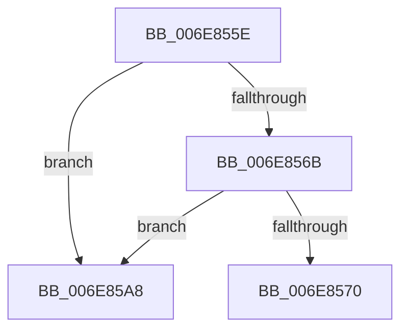

# sub_006E855E

- RVA: `0x006E855E`–`0x006E85AF` (길이 `81` bytes)
- VA: `0x00000001406E855E`
- 실행 섹션: `.text`
- PDB 이름 있음: `아니요`; PDB Function 태그: `아니요`
- unwind 정보 RVA: `0x0008F73C`
- 디코드: `20`개 명령, `81/81` bytes 표시
- 미해석 바이트: `0` (있으면 어셈블리에 `.byte`로 보존)

> 이 문서는 커널 이미지의 기계어와 PDB 기호를 분석해 생성했습니다. 4번과 5번은 함수 원형과 자료형을 바이너리 사용 방식에서 추정한 C 해석이며 원본 소스 복구 결과는 아닙니다.

## 1. Dependencies

- 직접 호출 지점: **1**; 고유 호출 대상: **1**
- 직접 호출자로 확인된 함수: **0**
- RIP 상대 이미지 참조: **0**

### Outgoing calls
- `0x006E859D` → [KeReleaseInStackQueuedSpinLockFromDpcLevel](../21/KeReleaseInStackQueuedSpinLockFromDpcLevel_function_002171B0.md) (function, `0x002171B0`)

### Direct callers
- 이 함수 시작 RVA로 연결되는 직접 call은 확인되지 않았습니다. 간접 호출은 완전히 역산할 수 없습니다.

### Static image references
- 디코드된 RIP-relative 메모리 참조가 없습니다.

## 2. Other-region calls and transfers

- 다른 실행 섹션으로 향하는 call: **0**
- call이 아닌 외부 분기/꼬리 이동: **1**
  - `0x006E85A3` → [CcMapAndCopyInToCache + 0xAB5](../3C/CcMapAndCopyInToCache_function_003CA7F0.md) (`tail-transfer`)

## 3. Assembly (complete function range)

```asm
006E855E  48 8B 0B                        mov rcx, qword ptr [rbx]
006E8561  48 8B 43 08                     mov rax, qword ptr [rbx + 8]
006E8565  48 39 59 08                     cmp qword ptr [rcx + 8], rbx
006E8569  75 3D                           jne 0x1406e85a8
006E856B  48 39 18                        cmp qword ptr [rax], rbx
006E856E  75 38                           jne 0x1406e85a8
006E8570  48 89 08                        mov qword ptr [rax], rcx
006E8573  48 89 41 08                     mov qword ptr [rcx + 8], rax
006E8577  48 89 53 08                     mov qword ptr [rbx + 8], rdx
006E857B  48 89 13                        mov qword ptr [rbx], rdx
006E857E  48 89 97 F8 01 00 00            mov qword ptr [rdi + 0x1f8], rdx
006E8585  83 A7 98 00 00 00 DF            and dword ptr [rdi + 0x98], 0xffffffdf
006E858C  B8 01 00 00 00                  mov eax, 1
006E8591  88 44 24 44                     mov byte ptr [rsp + 0x44], al
006E8595  48 8D 8C 24 18 01 00 00         lea rcx, [rsp + 0x118]
006E859D  E8 0E EC B2 FF                  call 0x1402171b0
006E85A2  90                              nop
006E85A3  E9 FD 2C CE FF                  jmp 0x1403cb2a5
006E85A8  B9 03 00 00 00                  mov ecx, 3
006E85AD  CD 29                           int 0x29
```

## 4. C-style interpretation (structured pseudocode)

```c
__int64 __fastcall sub_006E855E(__int64 a1, __int64 a2, __int64 a3, __int64 a4, __int64 a5, __int64 a6, __int64 a7, __int64 a8, __int64 a9, __int64 a10, __int64 a11, __int64 a12, __int64 a13, __int64 a14, __int64 a15, __int64 a16, __int64 a17, __int64 a18, __int64 a19, __int64 a20, __int64 a21, __int64 a22, __int64 a23, __int64 a24, __int64 a25, __int64 a26, __int64 a27, __int64 a28, __int64 a29, __int64 a30, __int64 a31, __int64 a32, __int64 a33, __int64 a34, __int64 a35)
{
    __int64 result;
    unsigned __int8 v_stack_p44;

    if ((*(unsigned __int64 *)(*(unsigned __int64 *)(v_rbx) + 8)) != v_rbx) goto loc_006E85A8;
    if ((*(unsigned __int64 *)(*(unsigned __int64 *)(v_rbx + 8))) != v_rbx) goto loc_006E85A8;
    *(unsigned __int64 *)(*(unsigned __int64 *)(v_rbx + 8)) = *(unsigned __int64 *)(v_rbx);
    *(unsigned __int64 *)(*(unsigned __int64 *)(v_rbx) + 8) = *(unsigned __int64 *)(v_rbx + 8);
    *(unsigned __int64 *)(v_rbx + 8) = a2;
    *(unsigned __int64 *)(v_rbx) = a2;
    *(unsigned __int64 *)(v_rdi + 504) = a2;
    v_stack_p44 = 1;
    result = KeReleaseInStackQueuedSpinLockFromDpcLevel(a35, a2, a3, a4);
loc_006E85A8:
    return result;
}
```

## 5. (Beta) C Style

```c
int64_t sub_006E855E(int64_t Arg1, int64_t Arg2, int64_t Arg3, int64_t Arg4, uint64_t Arg5, uint64_t Arg6, uint64_t Arg7, uint64_t Arg8, uint64_t Arg9, uint64_t Arg10, uint64_t Arg11, uint64_t Arg12, uint64_t Arg13, uint64_t Arg14, uint64_t Arg15, uint64_t Arg16, uint64_t Arg17, uint64_t Arg18, uint64_t Arg19, uint64_t Arg20, uint64_t Arg21, uint64_t Arg22, uint64_t Arg23, uint64_t Arg24, uint64_t Arg25, uint64_t Arg26, uint64_t Arg27, uint64_t Arg28, uint64_t Arg29, uint64_t Arg30, uint64_t Arg31, uint64_t Arg32, uint64_t Arg33, uint64_t Arg34, int64_t Arg35)
{
    int64_t result;
    uint8_t v_stack_p44;

    if ((*(uint64_t *)(*(uint64_t *)(local_rbx) + 0x8)) != local_rbx) goto loc_006E85A8;
    if ((*(uint64_t *)(*(uint64_t *)(local_rbx + 0x8))) != local_rbx) goto loc_006E85A8;
    *(uint64_t *)(*(uint64_t *)(local_rbx + 0x8)) = *(uint64_t *)(local_rbx);
    *(uint64_t *)(*(uint64_t *)(local_rbx) + 0x8) = *(uint64_t *)(local_rbx + 0x8);
    *(uint64_t *)(local_rbx + 0x8) = Arg2;
    *(uint64_t *)(local_rbx) = Arg2;
    *(uint64_t *)(local_rdi + 0x1F8) = Arg2;
    v_stack_p44 = 1;
    result = KeReleaseInStackQueuedSpinLockFromDpcLevel(Arg35, Arg2, Arg3, Arg4);
loc_006E85A8:
    return result;
}
```

## 6. Execution-region graph

[열기: 2D/3D 그래프와 함수 탐색 컨트롤 패널](../../../control-panel.html?section=text&rva=0x006E855E&view=graph)

- 2D 그래프는 위에서 아래로 흐르고, 3D 그래프는 빈 공간을 드래그해 회전합니다. Shift+드래그는 이동, 휠은 확대·축소, 함수 노드 선택은 대상 보고서 이동입니다.

### Static fallback


