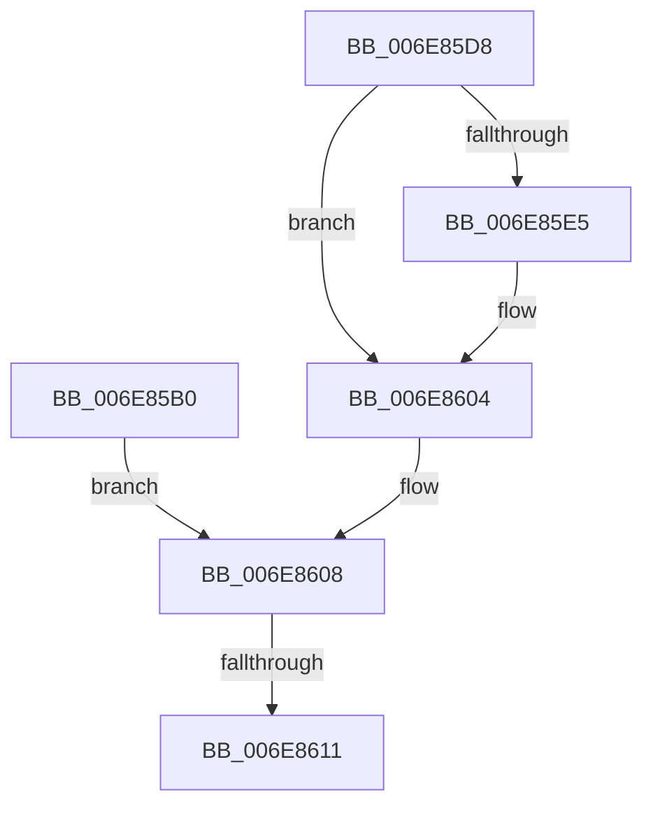

# sub_006E85B0

- RVA: `0x006E85B0`–`0x006E8616` (길이 `102` bytes)
- VA: `0x00000001406E85B0`
- 실행 섹션: `.text`
- PDB 이름 있음: `아니요`; PDB Function 태그: `아니요`
- unwind 정보 RVA: `0x0008F834`
- 디코드: `24`개 명령, `102/102` bytes 표시
- 미해석 바이트: `0` (있으면 어셈블리에 `.byte`로 보존)

> 이 문서는 커널 이미지의 기계어와 PDB 기호를 분석해 생성했습니다. 4번과 5번은 함수 원형과 자료형을 바이너리 사용 방식에서 추정한 C 해석이며 원본 소스 복구 결과는 아닙니다.

## 1. Dependencies

- 직접 호출 지점: **5**; 고유 호출 대상: **4**
- 직접 호출자로 확인된 함수: **0**
- RIP 상대 이미지 참조: **0**

### Outgoing calls
- `0x006E85B3` → [CcInsertIntoDirtySharedCacheMapList](../3C/CcInsertIntoDirtySharedCacheMapList_function_003CD9D8.md) (function, `0x003CD9D8`)
- `0x006E85C4` → [CcScheduleLazyWriteScan](../3C/CcScheduleLazyWriteScan_function_003CBD20.md) (function, `0x003CBD20`)
- `0x006E85CD` → [KeReleaseInStackQueuedSpinLock](../34/KeReleaseInStackQueuedSpinLock_function_00342CE0.md) (function, `0x00342CE0`)
- `0x006E85F0` → [KeAcquireInStackQueuedSpinLock](../27/KeAcquireInStackQueuedSpinLock_function_002757A0.md) (function, `0x002757A0`)
- `0x006E85FF` → [KeReleaseInStackQueuedSpinLock](../34/KeReleaseInStackQueuedSpinLock_function_00342CE0.md) (function, `0x00342CE0`)

### Direct callers
- 이 함수 시작 RVA로 연결되는 직접 call은 확인되지 않았습니다. 간접 호출은 완전히 역산할 수 없습니다.

### Static image references
- 디코드된 RIP-relative 메모리 참조가 없습니다.

## 2. Other-region calls and transfers

- 다른 실행 섹션으로 향하는 call: **0**
- call이 아닌 외부 분기/꼬리 이동: **2**
  - `0x006E860B` → [CcSetDirtyInMask + 0x296](../3C/CcSetDirtyInMask_function_003CB688.md) (`tail-transfer`)
  - `0x006E8611` → [CcSetDirtyInMask + 0x28A](../3C/CcSetDirtyInMask_function_003CB688.md) (`tail-transfer`)

## 3. Assembly (complete function range)

```asm
006E85B0  48 8B CB                        mov rcx, rbx
006E85B3  E8 20 54 CE FF                  call 0x1403cd9d8
006E85B8  45 33 C9                        xor r9d, r9d
006E85BB  45 33 C0                        xor r8d, r8d
006E85BE  48 8B D7                        mov rdx, rdi
006E85C1  49 8B CD                        mov rcx, r13
006E85C4  E8 57 37 CE FF                  call 0x1403cbd20
006E85C9  48 8D 4D E0                     lea rcx, [rbp - 0x20]
006E85CD  E8 0E A7 C5 FF                  call 0x140342ce0
006E85D2  48 8B 7D C8                     mov rdi, qword ptr [rbp - 0x38]
006E85D6  EB 30                           jmp 0x1406e8608
006E85D8  BE 00 00 02 00                  mov esi, 0x20000
006E85DD  85 B3 98 00 00 00               test dword ptr [rbx + 0x98], esi
006E85E3  75 1F                           jne 0x1406e8604
006E85E5  49 8D 8D 00 03 00 00            lea rcx, [r13 + 0x300]
006E85EC  48 8D 55 E0                     lea rdx, [rbp - 0x20]
006E85F0  E8 AB D1 B8 FF                  call 0x1402757a0
006E85F5  09 B3 98 00 00 00               or dword ptr [rbx + 0x98], esi
006E85FB  48 8D 4D E0                     lea rcx, [rbp - 0x20]
006E85FF  E8 DC A6 C5 FF                  call 0x140342ce0
006E8604  44 8B 75 C0                     mov r14d, dword ptr [rbp - 0x40]
006E8608  45 85 F6                        test r14d, r14d
006E860B  0F 84 0D 33 CE FF               je 0x1403cb91e
006E8611  E9 FC 32 CE FF                  jmp 0x1403cb912
```

## 4. C-style interpretation (structured pseudocode)

```c
__int64 __fastcall sub_006E85B0(__int64 a1, __int64 a2, int a3, int a4)
{
    __int64 result;

    result = CcInsertIntoDirtySharedCacheMapList(v_rbx, a2, a3, a4);
    a4 = 0;
    a3 = 0;
    result = CcScheduleLazyWriteScan(v_r13, v_rdi, a3, a4);
    result = KeReleaseInStackQueuedSpinLock(v_rbp - 32, v_rdi, a3, a4);
    goto loc_006E8608;
loc_006E8608:
}
```

## 5. (Beta) C Style

```c
int64_t sub_006E85B0(int64_t Arg1, int64_t Arg2, int32_t Arg3, int32_t Arg4)
{
    int64_t result;

    result = CcInsertIntoDirtySharedCacheMapList(local_rbx, Arg2, Arg3, Arg4);
    Arg4 = 0;
    Arg3 = 0;
    result = CcScheduleLazyWriteScan(local_r13, local_rdi, Arg3, Arg4);
    result = KeReleaseInStackQueuedSpinLock(local_rbp - 32, local_rdi, Arg3, Arg4);
    goto loc_006E8608;
loc_006E8608:
}
```

## 6. Execution-region graph

[열기: 2D/3D 그래프와 함수 탐색 컨트롤 패널](../../../control-panel.html?section=text&rva=0x006E85B0&view=graph)

- 2D 그래프는 위에서 아래로 흐르고, 3D 그래프는 빈 공간을 드래그해 회전합니다. Shift+드래그는 이동, 휠은 확대·축소, 함수 노드 선택은 대상 보고서 이동입니다.

### Static fallback


