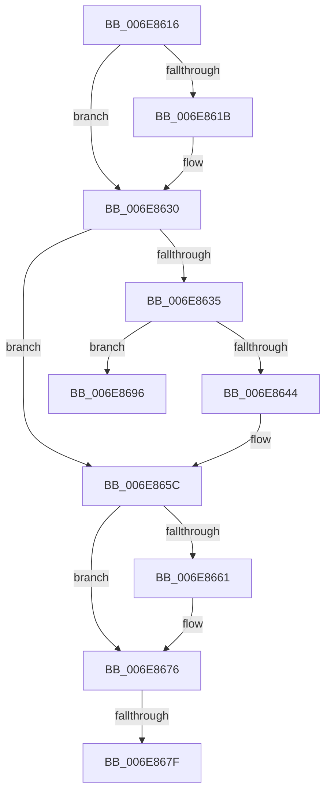

# sub_006E8616

- RVA: `0x006E8616`–`0x006E86AF` (길이 `153` bytes)
- VA: `0x00000001406E8616`
- 실행 섹션: `.text`
- PDB 이름 있음: `아니요`; PDB Function 태그: `아니요`
- unwind 정보 RVA: `0x0008F8A4`
- 디코드: `39`개 명령, `153/153` bytes 표시
- 미해석 바이트: `0` (있으면 어셈블리에 `.byte`로 보존)

> 이 문서는 커널 이미지의 기계어와 PDB 기호를 분석해 생성했습니다. 4번과 5번은 함수 원형과 자료형을 바이너리 사용 방식에서 추정한 C 해석이며 원본 소스 복구 결과는 아닙니다.

## 1. Dependencies

- 직접 호출 지점: **5**; 고유 호출 대상: **3**
- 직접 호출자로 확인된 함수: **0**
- RIP 상대 이미지 참조: **0**

### Outgoing calls
- `0x006E8627` → [KeSetEvent](../33/KeSetEvent_function_0033F310.md) (function, `0x0033F310`)
- `0x006E8653` → [KiSetTimerEx](../23/KiSetTimerEx_function_00232CB0.md) (function, `0x00232CB0`)
- `0x006E866D` → [KeSetEvent](../33/KeSetEvent_function_0033F310.md) (function, `0x0033F310`)
- `0x006E868B` → [KeSetEvent](../33/KeSetEvent_function_0033F310.md) (function, `0x0033F310`)
- `0x006E86A9` → [KeBugCheckEx](../4F/KeBugCheckEx_function_004FD660.md) (function, `0x004FD660`)

### Direct callers
- 이 함수 시작 RVA로 연결되는 직접 call은 확인되지 않았습니다. 간접 호출은 완전히 역산할 수 없습니다.

### Static image references
- 디코드된 RIP-relative 메모리 참조가 없습니다.

## 2. Other-region calls and transfers

- 다른 실행 섹션으로 향하는 call: **0**
- call이 아닌 외부 분기/꼬리 이동: **2**
  - `0x006E8679` → [CcNotifyWriteBehindInternal + 0x38](../3C/CcNotifyWriteBehindInternal_function_003CC224.md) (`tail-transfer`)
  - `0x006E8691` → [CcNotifyWriteBehindInternal + 0x38](../3C/CcNotifyWriteBehindInternal_function_003CC224.md) (`tail-transfer`)

## 3. Assembly (complete function range)

```asm
006E8616  F6 C2 02                        test dl, 2
006E8619  74 15                           je 0x1406e8630
006E861B  48 8D 8F 88 03 00 00            lea rcx, [rdi + 0x388]
006E8622  45 33 C0                        xor r8d, r8d
006E8625  33 D2                           xor edx, edx
006E8627  E8 E4 6C C5 FF                  call 0x14033f310
006E862C  8B 54 24 48                     mov edx, dword ptr [rsp + 0x48]
006E8630  F6 C2 04                        test dl, 4
006E8633  74 27                           je 0x1406e865c
006E8635  48 83 64 24 20 00               and qword ptr [rsp + 0x20], 0
006E863B  80 BF 18 04 00 00 00            cmp byte ptr [rdi + 0x418], 0
006E8642  74 52                           je 0x1406e8696
006E8644  48 8D 8F D8 03 00 00            lea rcx, [rdi + 0x3d8]
006E864B  45 33 C9                        xor r9d, r9d
006E864E  45 33 C0                        xor r8d, r8d
006E8651  33 D2                           xor edx, edx
006E8653  E8 58 A6 B4 FF                  call 0x140232cb0
006E8658  8B 54 24 48                     mov edx, dword ptr [rsp + 0x48]
006E865C  F6 C2 08                        test dl, 8
006E865F  74 15                           je 0x1406e8676
006E8661  48 8D 8F A0 03 00 00            lea rcx, [rdi + 0x3a0]
006E8668  45 33 C0                        xor r8d, r8d
006E866B  33 D2                           xor edx, edx
006E866D  E8 9E 6C C5 FF                  call 0x14033f310
006E8672  8B 54 24 48                     mov edx, dword ptr [rsp + 0x48]
006E8676  F6 C2 10                        test dl, 0x10
006E8679  0F 84 DD 3B CE FF               je 0x1403cc25c
006E867F  48 8D 8F B8 03 00 00            lea rcx, [rdi + 0x3b8]
006E8686  45 33 C0                        xor r8d, r8d
006E8689  33 D2                           xor edx, edx
006E868B  E8 80 6C C5 FF                  call 0x14033f310
006E8690  90                              nop
006E8691  E9 C6 3B CE FF                  jmp 0x1403cc25c
006E8696  45 33 C9                        xor r9d, r9d
006E8699  BA B4 12 00 00                  mov edx, 0x12b4
006E869E  49 C7 C0 20 04 00 C0            mov r8, 0xffffffffc0000420
006E86A5  41 8D 49 34                     lea ecx, [r9 + 0x34]
006E86A9  E8 B2 4F E1 FF                  call 0x1404fd660
006E86AE  CC                              int3
```

## 4. C-style interpretation (structured pseudocode)

```c
__int64 __fastcall sub_006E8616(__int64 a1, int a2, int a3, int a4, __int64 a5, __int64 a6, __int64 a7, __int64 a8, unsigned int a9)
{
    __int64 result;
    unsigned __int64 v_stack_p20;

    if ((((unsigned __int8)(a2)) & (2)) != 0) {
        a1 = v_rdi + 904;
        a3 = 0;
        a2 = 0;
        result = KeSetEvent(a1, a2, a3, a4);
        a2 = a9;
    }
    if ((((unsigned __int8)(a2)) & (4)) == 0) goto loc_006E865C;
    if ((*(unsigned __int8 *)(v_rdi + 1048)) == 0) goto loc_006E8696;
    a4 = 0;
    a3 = 0;
    a2 = 0;
    result = KiSetTimerEx(v_rdi + 984, a2, a3, a4);
loc_006E865C:
    if ((((unsigned __int8)((unsigned int)(a9))) & (8)) != 0) {
        a1 = v_rdi + 928;
        a3 = 0;
        a2 = 0;
        result = KeSetEvent(a1, a2, a3, a4);
        a2 = a9;
    }
    a3 = 0;
    a2 = 0;
    result = KeSetEvent(v_rdi + 952, a2, a3, a4);
loc_006E8696:
    a4 = 0;
    result = KeBugCheckEx(a4 + 52, (unsigned int)(0x12B4ULL), 0xFFFFFFFFC0000420ULL, a4);
    return result;
}
```

## 5. (Beta) C Style

```c
int64_t sub_006E8616(int64_t Arg1, int32_t Arg2, int32_t Arg3, int32_t Arg4, uint64_t Arg5, uint64_t Arg6, uint64_t Arg7, uint64_t Arg8, uint32_t Arg9)
{
    int64_t result;
    uint64_t v_stack_p20;

    if ((((uint8_t)(Arg2)) & (2)) != 0) {
        Arg1 = local_rdi + 904;
        Arg3 = 0;
        Arg2 = 0;
        result = KeSetEvent(Arg1, Arg2, Arg3, Arg4);
        Arg2 = Arg9;
    }
    if ((((uint8_t)(Arg2)) & (4)) == 0) goto loc_006E865C;
    if ((*(uint8_t *)(local_rdi + 0x418)) == 0) goto loc_006E8696;
    Arg4 = 0;
    Arg3 = 0;
    Arg2 = 0;
    result = KiSetTimerEx(local_rdi + 984, Arg2, Arg3, Arg4);
loc_006E865C:
    if ((((uint8_t)((uint32_t)(Arg9))) & (8)) != 0) {
        Arg1 = local_rdi + 928;
        Arg3 = 0;
        Arg2 = 0;
        result = KeSetEvent(Arg1, Arg2, Arg3, Arg4);
        Arg2 = Arg9;
    }
    Arg3 = 0;
    Arg2 = 0;
    result = KeSetEvent(local_rdi + 952, Arg2, Arg3, Arg4);
loc_006E8696:
    Arg4 = 0;
    result = KeBugCheckEx(Arg4 + 52, (uint32_t)(0x12B4ULL), 0xFFFFFFFFC0000420ULL, Arg4);
    return result;
}
```

## 6. Execution-region graph

[열기: 2D/3D 그래프와 함수 탐색 컨트롤 패널](../../../control-panel.html?section=text&rva=0x006E8616&view=graph)

- 2D 그래프는 위에서 아래로 흐르고, 3D 그래프는 빈 공간을 드래그해 회전합니다. Shift+드래그는 이동, 휠은 확대·축소, 함수 노드 선택은 대상 보고서 이동입니다.

### Static fallback


