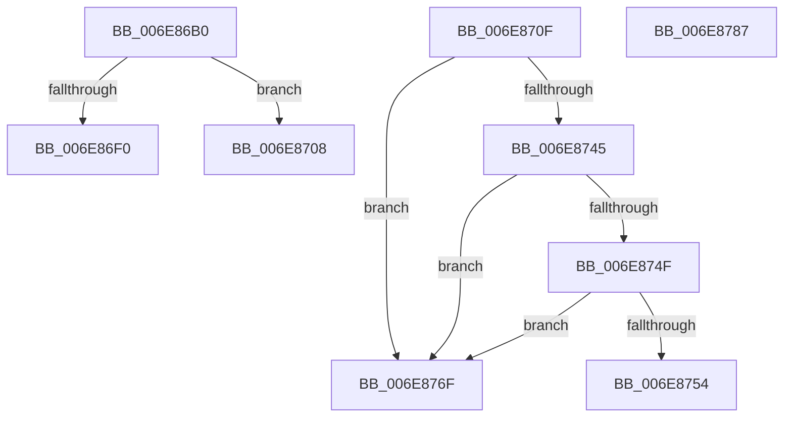

# sub_006E86B0

- RVA: `0x006E86B0`–`0x006E878F` (길이 `223` bytes)
- VA: `0x00000001406E86B0`
- 실행 섹션: `.text`
- PDB 이름 있음: `아니요`; PDB Function 태그: `아니요`
- unwind 정보 RVA: `0x0008F978`
- 디코드: `59`개 명령, `223/223` bytes 표시
- 미해석 바이트: `0` (있으면 어셈블리에 `.byte`로 보존)

> 이 문서는 커널 이미지의 기계어와 PDB 기호를 분석해 생성했습니다. 4번과 5번은 함수 원형과 자료형을 바이너리 사용 방식에서 추정한 C 해석이며 원본 소스 복구 결과는 아닙니다.

## 1. Dependencies

- 직접 호출 지점: **11**; 고유 호출 대상: **8**
- 직접 호출자로 확인된 함수: **0**
- RIP 상대 이미지 참조: **0**

### Outgoing calls
- `0x006E86B6` → [CcIncrementOpenCount](../4A/CcIncrementOpenCount_function_004A5CC4.md) (function, `0x004A5CC4`)
- `0x006E86BF` → [KeReleaseInStackQueuedSpinLock](../34/KeReleaseInStackQueuedSpinLock_function_00342CE0.md) (function, `0x00342CE0`)
- `0x006E86C8` → [KeReleaseInStackQueuedSpinLock](../34/KeReleaseInStackQueuedSpinLock_function_00342CE0.md) (function, `0x00342CE0`)
- `0x006E86E1` → [KeWaitForSingleObject](../20/KeWaitForSingleObject_function_0020E6B0.md) (function, `0x0020E6B0`)
- `0x006E86F2` → [FsRtlIsNtstatusExpected](../26/FsRtlIsNtstatusExpected_function_0026D390.md) (function, `0x0026D390`)
- `0x006E8727` → [KeBugCheckEx](../4F/KeBugCheckEx_function_004FD660.md) (function, `0x004FD660`)
- `0x006E873B` → [CcDecrementOpenCountDeferDelete](../4B/CcDecrementOpenCountDeferDelete_function_004B7134.md) (function, `0x004B7134`)
- `0x006E8764` → [CcDeleteSharedCacheMap](../38/CcDeleteSharedCacheMap_function_0038A804.md) (function, `0x0038A804`)
- `0x006E8773` → [KeReleaseInStackQueuedSpinLock](../34/KeReleaseInStackQueuedSpinLock_function_00342CE0.md) (function, `0x00342CE0`)
- `0x006E877C` → [KeReleaseInStackQueuedSpinLock](../34/KeReleaseInStackQueuedSpinLock_function_00342CE0.md) (function, `0x00342CE0`)
- `0x006E8789` → [RtlRaiseStatus](../2F/RtlRaiseStatus_function_002F6A50.md) (function, `0x002F6A50`)

### Direct callers
- 이 함수 시작 RVA로 연결되는 직접 call은 확인되지 않았습니다. 간접 호출은 완전히 역산할 수 없습니다.

### Static image references
- 디코드된 RIP-relative 메모리 참조가 없습니다.

## 2. Other-region calls and transfers

- 다른 실행 섹션으로 향하는 call: **0**
- call이 아닌 외부 분기/꼬리 이동: **4**
  - `0x006E8703` → [CcInitializeCacheMapInternal + 0x6E9](../3C/CcInitializeCacheMapInternal_function_003CC720.md) (`tail-transfer`)
  - `0x006E870A` → [CcInitializeCacheMapInternal + 0x596](../3C/CcInitializeCacheMapInternal_function_003CC720.md) (`tail-transfer`)
  - `0x006E876A` → [CcInitializeCacheMapInternal + 0x4CF](../3C/CcInitializeCacheMapInternal_function_003CC720.md) (`tail-transfer`)
  - `0x006E8782` → [CcInitializeCacheMapInternal + 0x4CF](../3C/CcInitializeCacheMapInternal_function_003CC720.md) (`tail-transfer`)

## 3. Assembly (complete function range)

```asm
006E86B0  45 33 C0                        xor r8d, r8d
006E86B3  48 8B CF                        mov rcx, rdi
006E86B6  E8 09 D6 DB FF                  call 0x1404a5cc4
006E86BB  48 8D 4D 87                     lea rcx, [rbp - 0x79]
006E86BF  E8 1C A6 C5 FF                  call 0x140342ce0
006E86C4  48 8D 4D 9F                     lea rcx, [rbp - 0x61]
006E86C8  E8 13 A6 C5 FF                  call 0x140342ce0
006E86CD  48 8B 8F B8 00 00 00            mov rcx, qword ptr [rdi + 0xb8]
006E86D4  45 33 C9                        xor r9d, r9d
006E86D7  45 33 C0                        xor r8d, r8d
006E86DA  48 89 5C 24 20                  mov qword ptr [rsp + 0x20], rbx
006E86DF  33 D2                           xor edx, edx
006E86E1  E8 CA 5F B2 FF                  call 0x14020e6b0
006E86E6  8B 9F A0 00 00 00               mov ebx, dword ptr [rdi + 0xa0]
006E86EC  85 DB                           test ebx, ebx
006E86EE  79 18                           jns 0x1406e8708
006E86F0  8B CB                           mov ecx, ebx
006E86F2  E8 99 4C B8 FF                  call 0x14026d390
006E86F7  84 C0                           test al, al
006E86F9  BE EA 00 00 C0                  mov esi, 0xc00000ea
006E86FE  0F 45 F3                        cmovne esi, ebx
006E8701  33 DB                           xor ebx, ebx
006E8703  E9 01 47 CE FF                  jmp 0x1403cce09
006E8708  33 DB                           xor ebx, ebx
006E870A  E9 A7 45 CE FF                  jmp 0x1403cccb6
006E870F  45 33 C9                        xor r9d, r9d
006E8712  48 89 54 24 20                  mov qword ptr [rsp + 0x20], rdx
006E8717  BA 18 0A 00 00                  mov edx, 0xa18
006E871C  49 C7 C0 20 04 00 C0            mov r8, 0xffffffffc0000420
006E8723  41 8D 49 34                     lea ecx, [r9 + 0x34]
006E8727  E8 34 4F E1 FF                  call 0x1404fd660
006E872C  CC                              int3
006E872D  0F BA B7 98 00 00 00 08         btr dword ptr [rdi + 0x98], 8
006E8735  45 33 C0                        xor r8d, r8d
006E8738  48 8B CF                        mov rcx, rdi
006E873B  E8 F4 E9 DC FF                  call 0x1404b7134
006E8740  39 5F 04                        cmp dword ptr [rdi + 4], ebx
006E8743  75 2A                           jne 0x1406e876f
006E8745  8B 87 98 00 00 00               mov eax, dword ptr [rdi + 0x98]
006E874B  A8 20                           test al, 0x20
006E874D  75 20                           jne 0x1406e876f
006E874F  39 5F 70                        cmp dword ptr [rdi + 0x70], ebx
006E8752  75 1B                           jne 0x1406e876f
006E8754  45 33 C9                        xor r9d, r9d
006E8757  48 89 5C 24 20                  mov qword ptr [rsp + 0x20], rbx
006E875C  4C 8D 45 87                     lea r8, [rbp - 0x79]
006E8760  48 8D 55 9F                     lea rdx, [rbp - 0x61]
006E8764  E8 9B 20 CA FF                  call 0x14038a804
006E8769  90                              nop
006E876A  E9 80 44 CE FF                  jmp 0x1403ccbef
006E876F  48 8D 4D 87                     lea rcx, [rbp - 0x79]
006E8773  E8 68 A5 C5 FF                  call 0x140342ce0
006E8778  48 8D 4D 9F                     lea rcx, [rbp - 0x61]
006E877C  E8 5F A5 C5 FF                  call 0x140342ce0
006E8781  90                              nop
006E8782  E9 68 44 CE FF                  jmp 0x1403ccbef
006E8787  8B CE                           mov ecx, esi
006E8789  E8 C2 E2 C0 FF                  call 0x1402f6a50
006E878E  CC                              int3
```

## 4. C-style interpretation (structured pseudocode)

```c
__int64 __fastcall sub_006E86B0(__int64 a1, int a2, int a3, int a4)
{
    __int64 result;
    __int64 v_rbx;
    __int64 v_rsi;
    unsigned __int64 v_stack_p20;

    a3 = 0;
    result = CcIncrementOpenCount(v_rdi, a2, a3, a4);
    result = KeReleaseInStackQueuedSpinLock(v_rbp - 121, a2, a3, a4);
    result = KeReleaseInStackQueuedSpinLock(v_rbp - 97, a2, a3, a4);
    a4 = 0;
    a3 = 0;
    v_stack_p20 = v_rbx;
    a2 = 0;
    result = KeWaitForSingleObject(*(unsigned __int64 *)(v_rdi + 184), a2, a3, a4);
    if (!sign_flag) goto loc_006E8708;
    result = FsRtlIsNtstatusExpected((unsigned int)((unsigned int)((unsigned int)(*(unsigned int *)(v_rdi + 160)))), a2, a3, a4);
    v_rsi = (unsigned int)(0xC00000EAULL);
    if ((unsigned __int8)(result) != 0) { v_rsi = (unsigned int)((unsigned int)(*(unsigned int *)(v_rdi + 160))); }
    v_rbx = 0;
loc_006E8708:
    v_rbx = 0;
}
```

## 5. (Beta) C Style

```c
int64_t sub_006E86B0(int64_t Arg1, int32_t Arg2, int32_t Arg3, int32_t Arg4)
{
    int64_t result;
    int64_t local_rbx;
    int64_t local_rsi;
    uint64_t v_stack_p20;

    Arg3 = 0;
    result = CcIncrementOpenCount(local_rdi, Arg2, Arg3, Arg4);
    result = KeReleaseInStackQueuedSpinLock(local_rbp - 121, Arg2, Arg3, Arg4);
    result = KeReleaseInStackQueuedSpinLock(local_rbp - 97, Arg2, Arg3, Arg4);
    Arg4 = 0;
    Arg3 = 0;
    v_stack_p20 = local_rbx;
    Arg2 = 0;
    result = KeWaitForSingleObject(*(uint64_t *)(local_rdi + 0xB8), Arg2, Arg3, Arg4);
    if (!sign_flag) goto loc_006E8708;
    result = FsRtlIsNtstatusExpected((uint32_t)((uint32_t)((uint32_t)(*(uint32_t *)(local_rdi + 0xA0)))), Arg2, Arg3, Arg4);
    local_rsi = (uint32_t)(0xC00000EAULL);
    if ((uint8_t)(result) != 0) { local_rsi = (uint32_t)((uint32_t)(*(uint32_t *)(local_rdi + 0xA0))); }
    local_rbx = 0;
loc_006E8708:
    local_rbx = 0;
}
```

## 6. Execution-region graph

[열기: 2D/3D 그래프와 함수 탐색 컨트롤 패널](../../../control-panel.html?section=text&rva=0x006E86B0&view=graph)

- 2D 그래프는 위에서 아래로 흐르고, 3D 그래프는 빈 공간을 드래그해 회전합니다. Shift+드래그는 이동, 휠은 확대·축소, 함수 노드 선택은 대상 보고서 이동입니다.

### Static fallback


