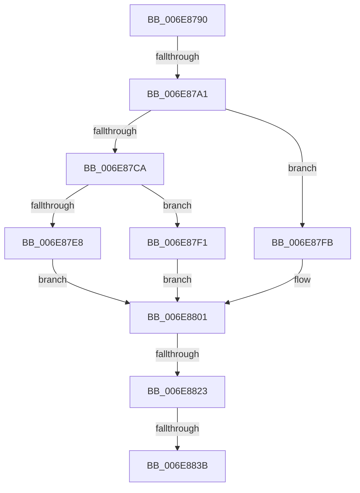

# sub_006E8790

- RVA: `0x006E8790`–`0x006E8840` (길이 `176` bytes)
- VA: `0x00000001406E8790`
- 실행 섹션: `.text`
- PDB 이름 있음: `아니요`; PDB Function 태그: `아니요`
- unwind 정보 RVA: `0x0008F9A0`
- 디코드: `40`개 명령, `176/176` bytes 표시
- 미해석 바이트: `0` (있으면 어셈블리에 `.byte`로 보존)

> 이 문서는 커널 이미지의 기계어와 PDB 기호를 분석해 생성했습니다. 4번과 5번은 함수 원형과 자료형을 바이너리 사용 방식에서 추정한 C 해석이며 원본 소스 복구 결과는 아닙니다.

## 1. Dependencies

- 직접 호출 지점: **8**; 고유 호출 대상: **8**
- 직접 호출자로 확인된 함수: **0**
- RIP 상대 이미지 참조: **2**

### Outgoing calls
- `0x006E8790` → [CcCreatePartition](../57/CcCreatePartition_function_0057DE10.md) (function, `0x0057DE10`)
- `0x006E87AD` → [KeAcquireInStackQueuedSpinLock](../27/KeAcquireInStackQueuedSpinLock_function_002757A0.md) (function, `0x002757A0`)
- `0x006E87B9` → [KeAcquireSpinLockRaiseToDpc](../20/KeAcquireSpinLockRaiseToDpc_function_00208470.md) (function, `0x00208470`)
- `0x006E87DF` → [PsReferencePartitionSafe](../3B/PsReferencePartitionSafe_function_003BA6C0.md) (function, `0x003BA6C0`)
- `0x006E87F4` → [PsDereferencePartition](../34/PsDereferencePartition_function_00342E70.md) (function, `0x00342E70`)
- `0x006E880B` → [KeReleaseSpinLock](../39/KeReleaseSpinLock_function_00392BA0.md) (function, `0x00392BA0`)
- `0x006E8815` → [KeReleaseInStackQueuedSpinLock](../34/KeReleaseInStackQueuedSpinLock_function_00342CE0.md) (function, `0x00342CE0`)
- `0x006E882D` → [CcDeletePartition](../57/CcDeletePartition_function_0057DE9C.md) (function, `0x0057DE9C`)

### Direct callers
- 이 함수 시작 RVA로 연결되는 직접 call은 확인되지 않았습니다. 간접 호출은 완전히 역산할 수 없습니다.

### Static image references
- `0x006E87B2` → RVA `0x00F8F510` (`.data`; read)
- `0x006E87CA` → RVA `0x00F8F518` (`.data`; read/write)

## 2. Other-region calls and transfers

- 다른 실행 섹션으로 향하는 call: **0**
- call이 아닌 외부 분기/꼬리 이동: **4**
  - `0x006E879B` → [CcGetPartitionWithCreate + 0x3D](../3C/CcGetPartitionWithCreate_function_003CD310.md) (`tail-transfer`)
  - `0x006E881D` → [CcGetPartitionWithCreate + 0x34](../3C/CcGetPartitionWithCreate_function_003CD310.md) (`tail-transfer`)
  - `0x006E8835` → [CcGetPartitionWithCreate + 0x3D](../3C/CcGetPartitionWithCreate_function_003CD310.md) (`tail-transfer`)
  - `0x006E883B` → [CcGetPartitionWithCreate + 0x34](../3C/CcGetPartitionWithCreate_function_003CD310.md) (`tail-transfer`)

## 3. Assembly (complete function range)

```asm
006E8790  E8 7B 56 E9 FF                  call 0x14057de10
006E8795  48 8B D8                        mov rbx, rax
006E8798  48 85 C0                        test rax, rax
006E879B  0F 84 AC 4B CE FF               je 0x1403cd34d
006E87A1  48 8D 88 00 03 00 00            lea rcx, [rax + 0x300]
006E87A8  48 8D 54 24 30                  lea rdx, [rsp + 0x30]
006E87AD  E8 EE CF B8 FF                  call 0x1402757a0
006E87B2  48 8D 0D 57 6D 8A 00            lea rcx, [rip + 0x8a6d57]
006E87B9  E8 B2 FC B1 FF                  call 0x140208470
006E87BE  48 8B 4F 08                     mov rcx, qword ptr [rdi + 8]
006E87C2  40 8A E8                        mov bpl, al
006E87C5  48 85 C9                        test rcx, rcx
006E87C8  75 31                           jne 0x1406e87fb
006E87CA  66 FF 05 47 6D 8A 00            inc word ptr [rip + 0x8a6d47]
006E87D1  48 8B CF                        mov rcx, rdi
006E87D4  48 89 5F 08                     mov qword ptr [rdi + 8], rbx
006E87D8  C6 83 0D 05 00 00 01            mov byte ptr [rbx + 0x50d], 1
006E87DF  E8 DC 1E CD FF                  call 0x1403ba6c0
006E87E4  84 C0                           test al, al
006E87E6  75 09                           jne 0x1406e87f1
006E87E8  C6 83 0E 05 00 00 01            mov byte ptr [rbx + 0x50e], 1
006E87EF  EB 10                           jmp 0x1406e8801
006E87F1  48 8B CF                        mov rcx, rdi
006E87F4  E8 77 A6 C5 FF                  call 0x140342e70
006E87F9  EB 06                           jmp 0x1406e8801
006E87FB  48 8B F3                        mov rsi, rbx
006E87FE  48 8B D9                        mov rbx, rcx
006E8801  40 8A D5                        mov dl, bpl
006E8804  48 8D 0D 05 6D 8A 00            lea rcx, [rip + 0x8a6d05]
006E880B  E8 90 A3 CA FF                  call 0x140392ba0
006E8810  48 8D 4C 24 30                  lea rcx, [rsp + 0x30]
006E8815  E8 C6 A4 C5 FF                  call 0x140342ce0
006E881A  48 85 F6                        test rsi, rsi
006E881D  0F 84 21 4B CE FF               je 0x1403cd344
006E8823  48 8B CE                        mov rcx, rsi
006E8826  C6 86 0E 05 00 00 02            mov byte ptr [rsi + 0x50e], 2
006E882D  E8 6A 56 E9 FF                  call 0x14057de9c
006E8832  48 85 DB                        test rbx, rbx
006E8835  0F 84 12 4B CE FF               je 0x1403cd34d
006E883B  E9 04 4B CE FF                  jmp 0x1403cd344
```

## 4. C-style interpretation (structured pseudocode)

```c
__int64 __fastcall sub_006E8790(__int64 a1, __int64 a2, __int64 a3, __int64 a4, __int64 a5, __int64 a6)
{
    __int64 result;

    result = CcCreatePartition(a1, a2, a3, a4);
    result = KeAcquireInStackQueuedSpinLock(result + 768, a6, a3, a4);
    result = KeAcquireSpinLockRaiseToDpc(v_rip + 9071959, a6, a3, a4);
    if (*(unsigned __int64 *)(v_rdi + 8) != 0) goto loc_006E87FB;
    *(unsigned __int64 *)(v_rdi + 8) = result;
    *(unsigned __int8 *)(result + 1293) = 1;
    result = PsReferencePartitionSafe(v_rdi, a6, a3, a4);
    if ((unsigned __int8)(result) != 0) goto loc_006E87F1;
    *(unsigned __int8 *)(result + 1294) = 1;
    goto loc_006E8801;
loc_006E87F1:
    result = PsDereferencePartition(v_rdi, a6, a3, a4);
    goto loc_006E8801;
loc_006E87FB:
loc_006E8801:
    result = KeReleaseSpinLock(v_rip + 9071877, (unsigned __int8)((unsigned __int8)(result)), a3, a4);
    result = KeReleaseInStackQueuedSpinLock(a6, (unsigned __int8)((unsigned __int8)(result)), a3, a4);
    *(unsigned __int8 *)(result + 1294) = 2;
    result = CcDeletePartition(result, (unsigned __int8)((unsigned __int8)(result)), a3, a4);
}
```

## 5. (Beta) C Style

```c
int64_t sub_006E8790(int64_t Arg1, int64_t Arg2, int64_t Arg3, int64_t Arg4, uint64_t Arg5, int64_t Arg6)
{
    int64_t result;

    result = CcCreatePartition(Arg1, Arg2, Arg3, Arg4);
    result = KeAcquireInStackQueuedSpinLock(result + 768, Arg6, Arg3, Arg4);
    result = KeAcquireSpinLockRaiseToDpc(v_rip + 9071959, Arg6, Arg3, Arg4);
    if (*(uint64_t *)(local_rdi + 0x8) != 0) goto loc_006E87FB;
    *(uint64_t *)(local_rdi + 0x8) = result;
    *(uint8_t *)(result + 0x50D) = 1;
    result = PsReferencePartitionSafe(local_rdi, Arg6, Arg3, Arg4);
    if ((uint8_t)(result) != 0) goto loc_006E87F1;
    *(uint8_t *)(result + 0x50E) = 1;
    goto loc_006E8801;
loc_006E87F1:
    result = PsDereferencePartition(local_rdi, Arg6, Arg3, Arg4);
    goto loc_006E8801;
loc_006E87FB:
loc_006E8801:
    result = KeReleaseSpinLock(v_rip + 9071877, (uint8_t)((uint8_t)(result)), Arg3, Arg4);
    result = KeReleaseInStackQueuedSpinLock(Arg6, (uint8_t)((uint8_t)(result)), Arg3, Arg4);
    *(uint8_t *)(result + 0x50E) = 2;
    result = CcDeletePartition(result, (uint8_t)((uint8_t)(result)), Arg3, Arg4);
}
```

## 6. Execution-region graph

[열기: 2D/3D 그래프와 함수 탐색 컨트롤 패널](../../../control-panel.html?section=text&rva=0x006E8790&view=graph)

- 2D 그래프는 위에서 아래로 흐르고, 3D 그래프는 빈 공간을 드래그해 회전합니다. Shift+드래그는 이동, 휠은 확대·축소, 함수 노드 선택은 대상 보고서 이동입니다.

### Static fallback


