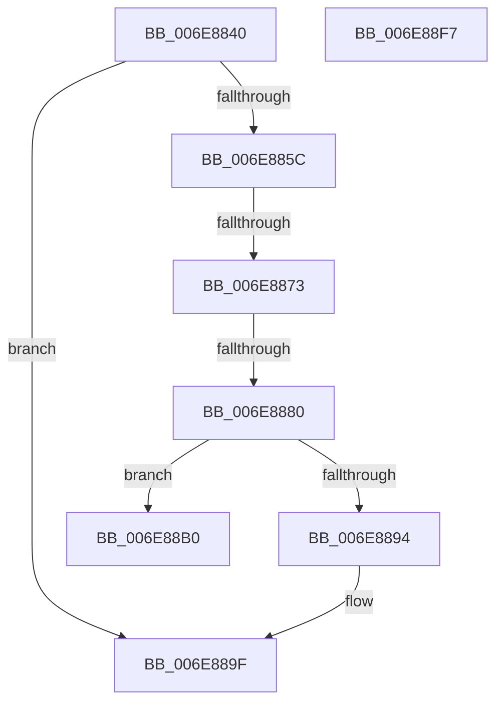

# sub_006E8840

- RVA: `0x006E8840`–`0x006E8923` (길이 `227` bytes)
- VA: `0x00000001406E8840`
- 실행 섹션: `.text`
- PDB 이름 있음: `아니요`; PDB Function 태그: `아니요`
- unwind 정보 RVA: `0x0008FA24`
- 디코드: `55`개 명령, `227/227` bytes 표시
- 미해석 바이트: `0` (있으면 어셈블리에 `.byte`로 보존)

> 이 문서는 커널 이미지의 기계어와 PDB 기호를 분석해 생성했습니다. 4번과 5번은 함수 원형과 자료형을 바이너리 사용 방식에서 추정한 C 해석이며 원본 소스 복구 결과는 아닙니다.

## 1. Dependencies

- 직접 호출 지점: **6**; 고유 호출 대상: **5**
- 직접 호출자로 확인된 함수: **0**
- RIP 상대 이미지 참조: **1**

### Outgoing calls
- `0x006E884B` → [KeAcquireInStackQueuedSpinLockAtDpcLevel](../27/KeAcquireInStackQueuedSpinLockAtDpcLevel_function_00275740.md) (function, `0x00275740`)
- `0x006E889A` → [CcDecrementOpenCountDeferDelete](../4B/CcDecrementOpenCountDeferDelete_function_004B7134.md) (function, `0x004B7134`)
- `0x006E88A3` → [KeReleaseInStackQueuedSpinLockFromDpcLevel](../21/KeReleaseInStackQueuedSpinLockFromDpcLevel_function_002171B0.md) (function, `0x002171B0`)
- `0x006E88C6` → [KeBugCheckEx](../4F/KeBugCheckEx_function_004FD660.md) (function, `0x004FD660`)
- `0x006E890F` → [KeBugCheckEx](../4F/KeBugCheckEx_function_004FD660.md) (function, `0x004FD660`)
- `0x006E8918` → [CcFreeWorkQueueEntry](../35/CcFreeWorkQueueEntry_function_0035723C.md) (function, `0x0035723C`)

### Direct callers
- 이 함수 시작 RVA로 연결되는 직접 call은 확인되지 않았습니다. 간접 호출은 완전히 역산할 수 없습니다.

### Static image references
- `0x006E885F` → RVA `0x00E65B30` (`.data`; read/write)

## 2. Other-region calls and transfers

- 다른 실행 섹션으로 향하는 call: **0**
- call이 아닌 외부 분기/꼬리 이동: **5**
  - `0x006E886D` → [CcUninitializeCacheMap + 0xF2](../3C/CcUninitializeCacheMap_function_003CD520.md) (`tail-transfer`)
  - `0x006E887A` → [CcUninitializeCacheMap + 0xF2](../3C/CcUninitializeCacheMap_function_003CD520.md) (`tail-transfer`)
  - `0x006E88AB` → [CcUninitializeCacheMap + 0xD4](../3C/CcUninitializeCacheMap_function_003CD520.md) (`tail-transfer`)
  - `0x006E88F2` → [CcUninitializeCacheMap + 0x35E](../3C/CcUninitializeCacheMap_function_003CD520.md) (`tail-transfer`)
  - `0x006E891E` → [CcUninitializeCacheMap + 0x1BD](../3C/CcUninitializeCacheMap_function_003CD520.md) (`tail-transfer`)

## 3. Assembly (complete function range)

```asm
006E8840  48 8D 8F 40 03 00 00            lea rcx, [rdi + 0x340]
006E8847  48 8D 55 E8                     lea rdx, [rbp - 0x18]
006E884B  E8 F0 CE B8 FF                  call 0x140275740
006E8850  49 8B 47 70                     mov rax, qword ptr [r15 + 0x70]
006E8854  45 33 C9                        xor r9d, r9d
006E8857  48 85 C0                        test rax, rax
006E885A  74 43                           je 0x1406e889f
006E885C  48 8B 10                        mov rdx, qword ptr [rax]
006E885F  FF 05 CB D2 77 00               inc dword ptr [rip + 0x77d2cb]
006E8865  48 89 45 B0                     mov qword ptr [rbp - 0x50], rax
006E8869  48 39 42 08                     cmp qword ptr [rdx + 8], rax
006E886D  0F 85 9F 4D CE FF               jne 0x1403cd612
006E8873  48 8B 48 08                     mov rcx, qword ptr [rax + 8]
006E8877  48 39 01                        cmp qword ptr [rcx], rax
006E887A  0F 85 92 4D CE FF               jne 0x1403cd612
006E8880  48 89 11                        mov qword ptr [rcx], rdx
006E8883  48 89 4A 08                     mov qword ptr [rdx + 8], rcx
006E8887  4C 89 48 08                     mov qword ptr [rax + 8], r9
006E888B  4C 89 08                        mov qword ptr [rax], r9
006E888E  4C 39 60 10                     cmp qword ptr [rax + 0x10], r12
006E8892  75 1C                           jne 0x1406e88b0
006E8894  41 B0 01                        mov r8b, 1
006E8897  48 8B CB                        mov rcx, rbx
006E889A  E8 95 E8 DC FF                  call 0x1404b7134
006E889F  48 8D 4D E8                     lea rcx, [rbp - 0x18]
006E88A3  E8 08 E9 B2 FF                  call 0x1402171b0
006E88A8  45 33 DB                        xor r11d, r11d
006E88AB  E9 44 4D CE FF                  jmp 0x1403cd5f4
006E88B0  BA C4 0B 00 00                  mov edx, 0xbc4
006E88B5  4C 89 4C 24 20                  mov qword ptr [rsp + 0x20], r9
006E88BA  B9 34 00 00 00                  mov ecx, 0x34
006E88BF  49 C7 C0 20 04 00 C0            mov r8, 0xffffffffc0000420
006E88C6  E8 95 4D E1 FF                  call 0x1404fd660
006E88CB  CC                              int3
006E88CC  48 8B 83 18 01 00 00            mov rax, qword ptr [rbx + 0x118]
006E88D3  48 89 06                        mov qword ptr [rsi], rax
006E88D6  48 89 B3 18 01 00 00            mov qword ptr [rbx + 0x118], rsi
006E88DD  49 8B 44 24 08                  mov rax, qword ptr [r12 + 8]
006E88E2  F6 40 34 10                     test byte ptr [rax + 0x34], 0x10
006E88E6  8B 45 58                        mov eax, dword ptr [rbp + 0x58]
006E88E9  0F B6 C0                        movzx eax, al
006E88EC  0F 45 C2                        cmovne eax, edx
006E88EF  89 45 58                        mov dword ptr [rbp + 0x58], eax
006E88F2  E9 87 4F CE FF                  jmp 0x1403cd87e
006E88F7  45 33 C9                        xor r9d, r9d
006E88FA  4C 89 5C 24 20                  mov qword ptr [rsp + 0x20], r11
006E88FF  BA EB 0C 00 00                  mov edx, 0xceb
006E8904  49 C7 C0 20 04 00 C0            mov r8, 0xffffffffc0000420
006E890B  41 8D 49 34                     lea ecx, [r9 + 0x34]
006E890F  E8 4C 4D E1 FF                  call 0x1404fd660
006E8914  CC                              int3
006E8915  48 8B CB                        mov rcx, rbx
006E8918  E8 1F E9 C6 FF                  call 0x14035723c
006E891D  90                              nop
006E891E  E9 BA 4D CE FF                  jmp 0x1403cd6dd
```

## 4. C-style interpretation (structured pseudocode)

```c
__int64 __fastcall sub_006E8840(__int64 a1, __int64 a2, __int64 a3, int a4)
{
    __int64 result;
    __int64 v_r11;
    unsigned __int64 v_stack_p20;

    result = KeAcquireInStackQueuedSpinLockAtDpcLevel(v_rdi + 832, v_rbp - 24, a3, a4);
    a4 = 0;
    if (*(unsigned __int64 *)(v_r15 + 112) == 0) goto loc_006E889F;
    *(unsigned __int64 *)(v_rbp - 80) = *(unsigned __int64 *)(v_r15 + 112);
    *(unsigned __int64 *)(*(unsigned __int64 *)(*(unsigned __int64 *)(v_r15 + 112) + 8)) = *(unsigned __int64 *)(*(unsigned __int64 *)(v_r15 + 112));
    *(unsigned __int64 *)(*(unsigned __int64 *)(*(unsigned __int64 *)(v_r15 + 112)) + 8) = *(unsigned __int64 *)(*(unsigned __int64 *)(v_r15 + 112) + 8);
    *(unsigned __int64 *)(*(unsigned __int64 *)(v_r15 + 112) + 8) = 0;
    *(unsigned __int64 *)(*(unsigned __int64 *)(v_r15 + 112)) = 0;
    if ((*(unsigned __int64 *)(*(unsigned __int64 *)(v_r15 + 112) + 16)) != v_r12) goto loc_006E88B0;
    result = CcDecrementOpenCountDeferDelete(v_rbx, *(unsigned __int64 *)(*(unsigned __int64 *)(v_r15 + 112)), 1, a4);
loc_006E889F:
    result = KeReleaseInStackQueuedSpinLockFromDpcLevel(v_rbp - 24, *(unsigned __int64 *)(*(unsigned __int64 *)(v_r15 + 112)), 1, a4);
    v_r11 = 0;
loc_006E88B0:
    v_stack_p20 = 0;
    result = KeBugCheckEx(52, (unsigned int)(0xBC4ULL), 0xFFFFFFFFC0000420ULL, a4);
    *(unsigned __int64 *)(v_rsi) = *(unsigned __int64 *)(v_rbx + 280);
    *(unsigned __int64 *)(v_rbx + 280) = v_rsi;
    result = (unsigned __int8)((unsigned int)(*(unsigned int *)(v_rbp + 88)));
    if (((*(unsigned __int8 *)(*(unsigned __int64 *)(v_r12 + 8) + 52)) & (16)) != 0) { result = (unsigned int)((unsigned int)(0xBC4ULL)); }
    *(unsigned int *)(v_rbp + 88) = (unsigned int)(result);
}
```

## 5. (Beta) C Style

```c
int64_t sub_006E8840(int64_t Arg1, int64_t Arg2, int64_t Arg3, int32_t Arg4)
{
    int64_t result;
    int64_t local_r11;
    uint64_t v_stack_p20;

    result = KeAcquireInStackQueuedSpinLockAtDpcLevel(local_rdi + 832, local_rbp - 24, Arg3, Arg4);
    Arg4 = 0;
    if (*(uint64_t *)(local_r15 + 0x70) == 0) goto loc_006E889F;
    *(uint64_t *)(local_rbp - 0x50) = *(uint64_t *)(local_r15 + 0x70);
    *(uint64_t *)(*(uint64_t *)(*(uint64_t *)(local_r15 + 0x70) + 0x8)) = *(uint64_t *)(*(uint64_t *)(local_r15 + 0x70));
    *(uint64_t *)(*(uint64_t *)(*(uint64_t *)(local_r15 + 0x70)) + 0x8) = *(uint64_t *)(*(uint64_t *)(local_r15 + 0x70) + 0x8);
    *(uint64_t *)(*(uint64_t *)(local_r15 + 0x70) + 0x8) = 0;
    *(uint64_t *)(*(uint64_t *)(local_r15 + 0x70)) = 0;
    if ((*(uint64_t *)(*(uint64_t *)(local_r15 + 0x70) + 0x10)) != local_r12) goto loc_006E88B0;
    result = CcDecrementOpenCountDeferDelete(local_rbx, *(uint64_t *)(*(uint64_t *)(local_r15 + 0x70)), 1, Arg4);
loc_006E889F:
    result = KeReleaseInStackQueuedSpinLockFromDpcLevel(local_rbp - 24, *(uint64_t *)(*(uint64_t *)(local_r15 + 0x70)), 1, Arg4);
    local_r11 = 0;
loc_006E88B0:
    v_stack_p20 = 0;
    result = KeBugCheckEx(52, (uint32_t)(0xBC4ULL), 0xFFFFFFFFC0000420ULL, Arg4);
    *(uint64_t *)(local_rsi) = *(uint64_t *)(local_rbx + 0x118);
    *(uint64_t *)(local_rbx + 0x118) = local_rsi;
    result = (uint8_t)((uint32_t)(*(uint32_t *)(local_rbp + 0x58)));
    if (((*(uint8_t *)(*(uint64_t *)(local_r12 + 0x8) + 0x34)) & (16)) != 0) { result = (uint32_t)((uint32_t)(0xBC4ULL)); }
    *(uint32_t *)(local_rbp + 0x58) = (uint32_t)(result);
}
```

## 6. Execution-region graph

[열기: 2D/3D 그래프와 함수 탐색 컨트롤 패널](../../../control-panel.html?section=text&rva=0x006E8840&view=graph)

- 2D 그래프는 위에서 아래로 흐르고, 3D 그래프는 빈 공간을 드래그해 회전합니다. Shift+드래그는 이동, 휠은 확대·축소, 함수 노드 선택은 대상 보고서 이동입니다.

### Static fallback


