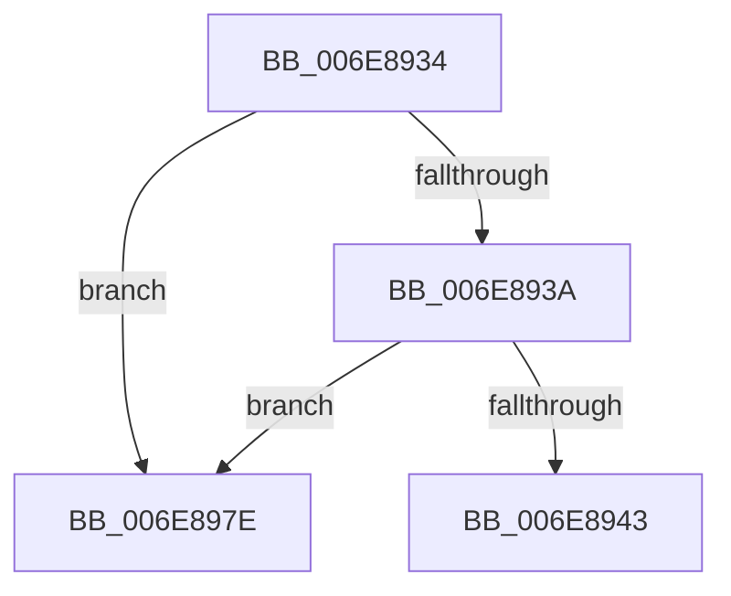

# sub_006E8934

- RVA: `0x006E8934`–`0x006E8985` (길이 `81` bytes)
- VA: `0x00000001406E8934`
- 실행 섹션: `.text`
- PDB 이름 있음: `아니요`; PDB Function 태그: `아니요`
- unwind 정보 RVA: `0x0008FA74`
- 디코드: `21`개 명령, `81/81` bytes 표시
- 미해석 바이트: `0` (있으면 어셈블리에 `.byte`로 보존)

> 이 문서는 커널 이미지의 기계어와 PDB 기호를 분석해 생성했습니다. 4번과 5번은 함수 원형과 자료형을 바이너리 사용 방식에서 추정한 C 해석이며 원본 소스 복구 결과는 아닙니다.

## 1. Dependencies

- 직접 호출 지점: **1**; 고유 호출 대상: **1**
- 직접 호출자로 확인된 함수: **0**
- RIP 상대 이미지 참조: **0**

### Outgoing calls
- `0x006E8973` → [CcInsertPrivateVolumeCacheMap](../3C/CcInsertPrivateVolumeCacheMap_function_003CE714.md) (function, `0x003CE714`)

### Direct callers
- 이 함수 시작 RVA로 연결되는 직접 call은 확인되지 않았습니다. 간접 호출은 완전히 역산할 수 없습니다.

### Static image references
- 디코드된 RIP-relative 메모리 참조가 없습니다.

## 2. Other-region calls and transfers

- 다른 실행 섹션으로 향하는 call: **0**
- call이 아닌 외부 분기/꼬리 이동: **1**
  - `0x006E8979` → [CcFindPrivateVolumeCacheMap + 0xAB](../3C/CcFindPrivateVolumeCacheMap_function_003CDC80.md) (`tail-transfer`)

## 3. Assembly (complete function range)

```asm
006E8934  48 39 4A 08                     cmp qword ptr [rdx + 8], rcx
006E8938  75 44                           jne 0x1406e897e
006E893A  48 8B 41 08                     mov rax, qword ptr [rcx + 8]
006E893E  48 39 08                        cmp qword ptr [rax], rcx
006E8941  75 3B                           jne 0x1406e897e
006E8943  48 89 10                        mov qword ptr [rax], rdx
006E8946  4C 8D 84 24 A0 00 00 00         lea r8, [rsp + 0xa0]
006E894E  48 89 42 08                     mov qword ptr [rdx + 8], rax
006E8952  41 B1 01                        mov r9b, 1
006E8955  FF 43 04                        inc dword ptr [rbx + 4]
006E8958  48 8D 84 24 90 00 00 00         lea rax, [rsp + 0x90]
006E8960  48 89 44 24 28                  mov qword ptr [rsp + 0x28], rax
006E8965  48 8B D3                        mov rdx, rbx
006E8968  49 8B CF                        mov rcx, r15
006E896B  C6 44 24 20 01                  mov byte ptr [rsp + 0x20], 1
006E8970  48 8B EB                        mov rbp, rbx
006E8973  E8 9C 5D CE FF                  call 0x1403ce714
006E8978  90                              nop
006E8979  E9 AD 53 CE FF                  jmp 0x1403cdd2b
006E897E  B9 03 00 00 00                  mov ecx, 3
006E8983  CD 29                           int 0x29
```

## 4. C-style interpretation (structured pseudocode)

```c
__int64 __fastcall sub_006E8934(__int64 a1, __int64 a2, __int64 a3, __int64 a4, __int64 a5, __int64 a6, __int64 a7, __int64 a8, __int64 a9, __int64 a10, __int64 a11, __int64 a12, __int64 a13, __int64 a14, __int64 a15, __int64 a16, __int64 a17, __int64 a18, __int64 a19, __int64 a20)
{
    __int64 result;
    unsigned __int8 v_stack_p20;
    unsigned __int64 v_stack_p28;

    if ((*(unsigned __int64 *)(a2 + 8)) != a1) goto loc_006E897E;
    if ((*(unsigned __int64 *)(*(unsigned __int64 *)(a1 + 8))) != a1) goto loc_006E897E;
    *(unsigned __int64 *)(*(unsigned __int64 *)(a1 + 8)) = a2;
    *(unsigned __int64 *)(a2 + 8) = *(unsigned __int64 *)(a1 + 8);
    v_stack_p28 = a18;
    v_stack_p20 = 1;
    result = CcInsertPrivateVolumeCacheMap(v_r15, v_rbx, a20, 1);
loc_006E897E:
    return result;
}
```

## 5. (Beta) C Style

```c
int64_t sub_006E8934(void *Arg1, void *Arg2, int64_t Arg3, int64_t Arg4, uint64_t Arg5, uint64_t Arg6, uint64_t Arg7, uint64_t Arg8, uint64_t Arg9, uint64_t Arg10, uint64_t Arg11, uint64_t Arg12, uint64_t Arg13, uint64_t Arg14, uint64_t Arg15, uint64_t Arg16, uint64_t Arg17, int64_t Arg18, uint64_t Arg19, int64_t Arg20)
{
    uint8_t *arg1 = (uint8_t *)Arg1;
    uint8_t *arg2 = (uint8_t *)Arg2;

    int64_t result;
    uint8_t v_stack_p20;
    uint64_t v_stack_p28;

    if ((*(uint64_t *)(arg2 + 0x8)) != Arg1) goto loc_006E897E;
    if ((*(uint64_t *)(*(uint64_t *)(arg1 + 0x8))) != Arg1) goto loc_006E897E;
    *(void **)(*(uint64_t *)(arg1 + 0x8)) = Arg2;
    *(uint64_t *)(arg2 + 0x8) = *(uint64_t *)(arg1 + 0x8);
    v_stack_p28 = Arg18;
    v_stack_p20 = 1;
    result = CcInsertPrivateVolumeCacheMap(local_r15, local_rbx, Arg20, 1);
loc_006E897E:
    return result;
}
```

### 관측된 메모리 오프셋

구조체 형식이 확인되지 않은 접근은 인자 기준의 오프셋으로만 기록했습니다.

| 기준 인자 | 오프셋 표현 | 폭 (bit) | 접근 |
|---|---:|---:|---|
| `Arg1` | `+ 0x8` | `64` | `R` |
| `Arg2` | `+ 0x8` | `64` | `R` |
| `Arg2` | `+ 0x8` | `64` | `W` |

## 6. Execution-region graph

[열기: 2D/3D 그래프와 함수 탐색 컨트롤 패널](../../../control-panel.html?section=text&rva=0x006E8934&view=graph)

- 2D 그래프는 위에서 아래로 흐르고, 3D 그래프는 빈 공간을 드래그해 회전합니다. Shift+드래그는 이동, 휠은 확대·축소, 함수 노드 선택은 대상 보고서 이동입니다.

### Static fallback


