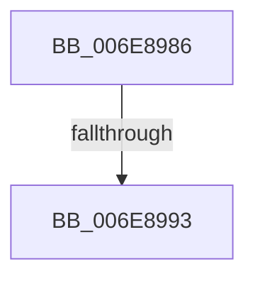

# sub_006E8986

- RVA: `0x006E8986`–`0x006E89DA` (길이 `84` bytes)
- VA: `0x00000001406E8986`
- 실행 섹션: `.text`
- PDB 이름 있음: `아니요`; PDB Function 태그: `아니요`
- unwind 정보 RVA: `0x0008FAE8`
- 디코드: `17`개 명령, `84/84` bytes 표시
- 미해석 바이트: `0` (있으면 어셈블리에 `.byte`로 보존)

> 이 문서는 커널 이미지의 기계어와 PDB 기호를 분석해 생성했습니다. 4번과 5번은 함수 원형과 자료형을 바이너리 사용 방식에서 추정한 C 해석이며 원본 소스 복구 결과는 아닙니다.

## 1. Dependencies

- 직접 호출 지점: **2**; 고유 호출 대상: **2**
- 직접 호출자로 확인된 함수: **0**
- RIP 상대 이미지 참조: **1**

### Outgoing calls
- `0x006E899F` → [KeAcquireInStackQueuedSpinLock](../27/KeAcquireInStackQueuedSpinLock_function_002757A0.md) (function, `0x002757A0`)
- `0x006E89CF` → [KeReleaseInStackQueuedSpinLock](../34/KeReleaseInStackQueuedSpinLock_function_00342CE0.md) (function, `0x00342CE0`)

### Direct callers
- 이 함수 시작 RVA로 연결되는 직접 call은 확인되지 않았습니다. 간접 호출은 완전히 역산할 수 없습니다.

### Static image references
- `0x006E8998` → RVA `0x00E11CC0` (`.data`; read)

## 2. Other-region calls and transfers

- 다른 실행 섹션으로 향하는 call: **0**
- call이 아닌 외부 분기/꼬리 이동: **2**
  - `0x006E898D` → [CcInsertPrivateVolumeCacheMap + 0x123](../3C/CcInsertPrivateVolumeCacheMap_function_003CE714.md) (`tail-transfer`)
  - `0x006E89D5` → [CcInsertPrivateVolumeCacheMap + 0x123](../3C/CcInsertPrivateVolumeCacheMap_function_003CE714.md) (`tail-transfer`)

## 3. Assembly (complete function range)

```asm
006E8986  48 8B 77 28                     mov rsi, qword ptr [rdi + 0x28]
006E898A  48 85 F6                        test rsi, rsi
006E898D  0F 84 A4 5E CE FF               je 0x1403ce837
006E8993  48 8D 54 24 78                  lea rdx, [rsp + 0x78]
006E8998  48 8D 0D 21 93 72 00            lea rcx, [rip + 0x729321]
006E899F  E8 FC CD B8 FF                  call 0x1402757a0
006E89A4  48 8B 8E E0 00 00 00            mov rcx, qword ptr [rsi + 0xe0]
006E89AB  48 8D 97 50 02 00 00            lea rdx, [rdi + 0x250]
006E89B2  48 8D 86 D8 00 00 00            lea rax, [rsi + 0xd8]
006E89B9  48 89 02                        mov qword ptr [rdx], rax
006E89BC  48 89 4A 08                     mov qword ptr [rdx + 8], rcx
006E89C0  48 89 11                        mov qword ptr [rcx], rdx
006E89C3  48 8D 4C 24 78                  lea rcx, [rsp + 0x78]
006E89C8  48 89 96 E0 00 00 00            mov qword ptr [rsi + 0xe0], rdx
006E89CF  E8 0C A3 C5 FF                  call 0x140342ce0
006E89D4  90                              nop
006E89D5  E9 5D 5E CE FF                  jmp 0x1403ce837
```

## 4. C-style interpretation (structured pseudocode)

```c
__int64 __fastcall sub_006E8986(__int64 a1, __int64 a2, __int64 a3, __int64 a4, __int64 a5, __int64 a6, __int64 a7, __int64 a8, __int64 a9, __int64 a10, __int64 a11, __int64 a12, __int64 a13, __int64 a14, __int64 a15)
{
    __int64 result;

    result = KeAcquireInStackQueuedSpinLock(v_rip + 7508769, a15, a3, a4);
    *(unsigned __int64 *)(v_rdi + 592) = *(unsigned __int64 *)(v_rdi + 40) + 216;
    *(unsigned __int64 *)(v_rdi + 592 + 8) = *(unsigned __int64 *)(*(unsigned __int64 *)(v_rdi + 40) + 224);
    *(unsigned __int64 *)(*(unsigned __int64 *)(*(unsigned __int64 *)(v_rdi + 40) + 224)) = v_rdi + 592;
    *(unsigned __int64 *)(*(unsigned __int64 *)(v_rdi + 40) + 224) = v_rdi + 592;
    result = KeReleaseInStackQueuedSpinLock(a15, v_rdi + 592, a3, a4);
}
```

## 5. (Beta) C Style

```c
int64_t sub_006E8986(int64_t Arg1, int64_t Arg2, int64_t Arg3, int64_t Arg4, uint64_t Arg5, uint64_t Arg6, uint64_t Arg7, uint64_t Arg8, uint64_t Arg9, uint64_t Arg10, uint64_t Arg11, uint64_t Arg12, uint64_t Arg13, uint64_t Arg14, int64_t Arg15)
{
    int64_t result;

    result = KeAcquireInStackQueuedSpinLock(v_rip + 7508769, Arg15, Arg3, Arg4);
    *(uint64_t *)(local_rdi + 0x250) = *(uint64_t *)(local_rdi + 0x28) + 216;
    *(uint64_t *)(local_rdi + 0x250 + 0x8) = *(uint64_t *)(*(uint64_t *)(local_rdi + 0x28) + 0xE0);
    *(uint64_t *)(*(uint64_t *)(*(uint64_t *)(local_rdi + 0x28) + 0xE0)) = local_rdi + 592;
    *(uint64_t *)(*(uint64_t *)(local_rdi + 0x28) + 0xE0) = local_rdi + 592;
    result = KeReleaseInStackQueuedSpinLock(Arg15, local_rdi + 592, Arg3, Arg4);
}
```

## 6. Execution-region graph

[열기: 2D/3D 그래프와 함수 탐색 컨트롤 패널](../../../control-panel.html?section=text&rva=0x006E8986&view=graph)

- 2D 그래프는 위에서 아래로 흐르고, 3D 그래프는 빈 공간을 드래그해 회전합니다. Shift+드래그는 이동, 휠은 확대·축소, 함수 노드 선택은 대상 보고서 이동입니다.

### Static fallback


