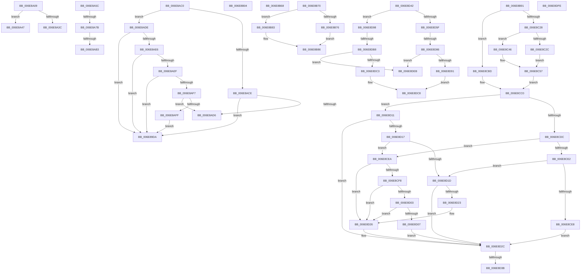

# sub_006E89DA

- RVA: `0x006E89DA`–`0x006E8E06` (길이 `1,068` bytes)
- VA: `0x00000001406E89DA`
- 실행 섹션: `.text`
- PDB 이름 있음: `아니요`; PDB Function 태그: `아니요`
- unwind 정보 RVA: `0x00090FDC`
- 디코드: `257`개 명령, `1,068/1,068` bytes 표시
- 미해석 바이트: `0` (있으면 어셈블리에 `.byte`로 보존)

> 이 문서는 커널 이미지의 기계어와 PDB 기호를 분석해 생성했습니다. 4번과 5번은 함수 원형과 자료형을 바이너리 사용 방식에서 추정한 C 해석이며 원본 소스 복구 결과는 아닙니다.

## 1. Dependencies

- 직접 호출 지점: **12**; 고유 호출 대상: **5**
- 직접 호출자로 확인된 함수: **0**
- RIP 상대 이미지 참조: **1**

### Outgoing calls
- `0x006E89FE` → [AuthzBasepSetTypeListAccessReasons](../46/AuthzBasepSetTypeListAccessReasons_function_0046A414.md) (function, `0x0046A414`)
- `0x006E8A22` → [AuthzBasepSetTypeListAccessReasons](../46/AuthzBasepSetTypeListAccessReasons_function_0046A414.md) (function, `0x0046A414`)
- `0x006E8A6E` → [SepSinglePrivilegeCheck](../3D/SepSinglePrivilegeCheck_function_003D191C.md) (function, `0x003D191C`)
- `0x006E8A98` → [AuthzBasepSetTypeListAccessReasons](../46/AuthzBasepSetTypeListAccessReasons_function_0046A414.md) (function, `0x0046A414`)
- `0x006E8B5D` → [SepNormalAccessCheckEx](../3C/SepNormalAccessCheckEx_function_003CFD8C.md) (function, `0x003CFD8C`)
- `0x006E8BEF` → [SepMaximumAccessCheckEx](../60/SepMaximumAccessCheckEx_function_00606D78.md) (function, `0x00606D78`)
- `0x006E8C0C` → [AuthzBasepSetTypeListAccessReasons](../46/AuthzBasepSetTypeListAccessReasons_function_0046A414.md) (function, `0x0046A414`)
- `0x006E8CB6` → [SepMaximumAccessCheckEx](../60/SepMaximumAccessCheckEx_function_00606D78.md) (function, `0x00606D78`)
- `0x006E8CC4` → [Feature_DecoupleAppContainerAndIntegrityLevel__private_IsEnabledDeviceUsageNoInline](../4E/Feature_DecoupleAppContainerAndIntegrityLevel__private_IsEnabledDeviceUsageNoInline_function_004EF788.md) (function, `0x004EF788`)
- `0x006E8D6C` → [AuthzBasepSetTypeListAccessReasons](../46/AuthzBasepSetTypeListAccessReasons_function_0046A414.md) (function, `0x0046A414`)
- `0x006E8D9E` → [AuthzBasepSetTypeListAccessReasons](../46/AuthzBasepSetTypeListAccessReasons_function_0046A414.md) (function, `0x0046A414`)
- `0x006E8DD9` → [AuthzBasepSetTypeListAccessReasons](../46/AuthzBasepSetTypeListAccessReasons_function_0046A414.md) (function, `0x0046A414`)

### Direct callers
- 이 함수 시작 RVA로 연결되는 직접 call은 확인되지 않았습니다. 간접 호출은 완전히 역산할 수 없습니다.

### Static image references
- `0x006E8A67` → RVA `0x00FD9B28` (`PAGEDATA`; read)

## 2. Other-region calls and transfers

- 다른 실행 섹션으로 향하는 call: **0**
- call이 아닌 외부 분기/꼬리 이동: **17**
  - `0x006E8A04` → [SepAccessCheckEx + 0x31E](../3C/SepAccessCheckEx_function_003CF7B0.md) (`tail-transfer`)
  - `0x006E8A42` → [SepAccessCheckEx + 0x30A](../3C/SepAccessCheckEx_function_003CF7B0.md) (`tail-transfer`)
  - `0x006E8A57` → [SepAccessCheckEx + 0x152](../3C/SepAccessCheckEx_function_003CF7B0.md) (`tail-transfer`)
  - `0x006E8A75` → [SepAccessCheckEx + 0x1CE](../3C/SepAccessCheckEx_function_003CF7B0.md) (`tail-transfer`)
  - `0x006E8AAD` → [SepAccessCheckEx + 0x302](../3C/SepAccessCheckEx_function_003CF7B0.md) (`tail-transfer`)
  - `0x006E8ABB` → [SepAccessCheckEx + 0x1CE](../3C/SepAccessCheckEx_function_003CF7B0.md) (`tail-transfer`)
  - `0x006E8AD9` → [SepAccessCheckEx + 0x312](../3C/SepAccessCheckEx_function_003CF7B0.md) (`tail-transfer`)
  - `0x006E8B63` → [SepAccessCheckEx + 0x28D](../3C/SepAccessCheckEx_function_003CF7B0.md) (`tail-transfer`)
  - `0x006E8B6B` → [SepAccessCheckEx + 0x2EF](../3C/SepAccessCheckEx_function_003CF7B0.md) (`tail-transfer`)
  - `0x006E8B8C` → [SepAccessCheckEx + 0x2F5](../3C/SepAccessCheckEx_function_003CF7B0.md) (`tail-transfer`)
  - `0x006E8D35` → [SepAccessCheckEx + 0x52E](../3C/SepAccessCheckEx_function_003CF7B0.md) (`tail-transfer`)
  - `0x006E8D3D` → [SepAccessCheckEx + 0x302](../3C/SepAccessCheckEx_function_003CF7B0.md) (`tail-transfer`)
  - `0x006E8D80` → [SepAccessCheckEx + 0x302](../3C/SepAccessCheckEx_function_003CF7B0.md) (`tail-transfer`)
  - `0x006E8DB2` → [SepAccessCheckEx + 0x302](../3C/SepAccessCheckEx_function_003CF7B0.md) (`tail-transfer`)
  - `0x006E8DE6` → [SepAccessCheckEx + 0x5CB](../3C/SepAccessCheckEx_function_003CF7B0.md) (`tail-transfer`)
  - `0x006E8DF9` → [SepAccessCheckEx + 0x302](../3C/SepAccessCheckEx_function_003CF7B0.md) (`tail-transfer`)
  - `0x006E8E01` → [SepAccessCheckEx + 0x31E](../3C/SepAccessCheckEx_function_003CF7B0.md) (`tail-transfer`)

## 3. Assembly (complete function range)

```asm
006E89DA  45 33 ED                        xor r13d, r13d
006E89DD  BB 22 00 00 C0                  mov ebx, 0xc0000022
006E89E2  45 33 C0                        xor r8d, r8d
006E89E5  4D 8B CE                        mov r9, r14
006E89E8  BA 00 00 60 00                  mov edx, 0x600000
006E89ED  B9 FF FF FF FD                  mov ecx, 0xfdffffff
006E89F2  44 88 6C 24 28                  mov byte ptr [rsp + 0x28], r13b
006E89F7  41 8B FD                        mov edi, r13d
006E89FA  89 6C 24 20                     mov dword ptr [rsp + 0x20], ebp
006E89FE  E8 11 1A D8 FF                  call 0x14046a414
006E8A03  90                              nop
006E8A04  E9 C5 70 CE FF                  jmp 0x1403cface
006E8A09  8B BC 24 80 01 00 00            mov edi, dword ptr [rsp + 0x180]
006E8A10  BA 00 00 20 00                  mov edx, 0x200000
006E8A15  44 88 5C 24 28                  mov byte ptr [rsp + 0x28], r11b
006E8A1A  0F BA EF 18                     bts edi, 0x18
006E8A1E  89 6C 24 20                     mov dword ptr [rsp + 0x20], ebp
006E8A22  E8 ED 19 D8 FF                  call 0x14046a414
006E8A27  45 33 DB                        xor r11d, r11d
006E8A2A  44 89 7C 24 74                  mov dword ptr [rsp + 0x74], r15d
006E8A2F  44 88 7C 24 72                  mov byte ptr [rsp + 0x72], r15b
006E8A34  81 E6 FF FF FF FE               and esi, 0xfeffffff
006E8A3A  75 0B                           jne 0x1406e8a47
006E8A3C  41 8B DB                        mov ebx, r11d
006E8A3F  44 8A EB                        mov r13b, bl
006E8A42  E9 73 70 CE FF                  jmp 0x1403cfaba
006E8A47  44 8B 94 24 60 01 00 00         mov r10d, dword ptr [rsp + 0x160]
006E8A4F  4C 8B 8C 24 90 00 00 00         mov r9, qword ptr [rsp + 0x90]
006E8A57  E9 A6 6E CE FF                  jmp 0x1403cf902
006E8A5C  44 8A 84 24 88 01 00 00         mov r8b, byte ptr [rsp + 0x188]
006E8A64  49 8B D4                        mov rdx, r12
006E8A67  48 8B 0D BA 10 8F 00            mov rcx, qword ptr [rip + 0x8f10ba]
006E8A6E  E8 A9 8E CE FF                  call 0x1403d191c
006E8A73  84 C0                           test al, al
006E8A75  0F 84 03 6F CE FF               je 0x1403cf97e
006E8A7B  44 88 6C 24 28                  mov byte ptr [rsp + 0x28], r13b
006E8A80  4D 8B CE                        mov r9, r14
006E8A83  BA 00 00 20 00                  mov edx, 0x200000
006E8A88  89 6C 24 20                     mov dword ptr [rsp + 0x20], ebp
006E8A8C  41 B8 20 00 00 00               mov r8d, 0x20
006E8A92  41 8B CA                        mov ecx, r10d
006E8A95  41 0B FA                        or edi, r10d
006E8A98  E8 77 19 D8 FF                  call 0x14046a414
006E8A9D  44 01 7C 24 74                  add dword ptr [rsp + 0x74], r15d
006E8AA2  44 88 7C 24 71                  mov byte ptr [rsp + 0x71], r15b
006E8AA7  81 E6 FF FF F7 FF               and esi, 0xfff7ffff
006E8AAD  0F 84 FF 6F CE FF               je 0x1403cfab2
006E8AB3  4C 8B 9C 24 88 00 00 00         mov r11, qword ptr [rsp + 0x88]
006E8ABB  E9 BE 6E CE FF                  jmp 0x1403cf97e
006E8AC0  41 BC 00 00 00 02               mov r12d, 0x2000000
006E8AC6  45 33 DB                        xor r11d, r11d
006E8AC9  41 3B F4                        cmp esi, r12d
006E8ACC  75 10                           jne 0x1406e8ade
006E8ACE  85 FF                           test edi, edi
006E8AD0  0F 84 04 FF FF FF               je 0x1406e89da
006E8AD6  41 8B DB                        mov ebx, r11d
006E8AD9  E9 E4 6F CE FF                  jmp 0x1403cfac2
006E8ADE  85 F6                           test esi, esi
006E8AE0  0F 85 F4 FE FF FF               jne 0x1406e89da
006E8AE6  44 39 1B                        cmp dword ptr [rbx], r11d
006E8AE9  0F 84 EB FE FF FF               je 0x1406e89da
006E8AEF  85 FF                           test edi, edi
006E8AF1  0F 84 E3 FE FF FF               je 0x1406e89da
006E8AF7  F7 C1 00 60 00 00               test ecx, 0x6000
006E8AFD  74 D7                           je 0x1406e8ad6
006E8AFF  E9 D6 FE FF FF                  jmp 0x1406e89da
006E8B04  8B 84 24 70 01 00 00            mov eax, dword ptr [rsp + 0x170]
006E8B0B  23 CE                           and ecx, esi
006E8B0D  4C 8B 8C 24 88 00 00 00         mov r9, qword ptr [rsp + 0x88]
006E8B15  4C 8B 84 24 A0 00 00 00         mov r8, qword ptr [rsp + 0xa0]
006E8B1D  48 89 5C 24 68                  mov qword ptr [rsp + 0x68], rbx
006E8B22  44 88 64 24 60                  mov byte ptr [rsp + 0x60], r12b
006E8B27  44 88 6C 24 58                  mov byte ptr [rsp + 0x58], r13b
006E8B2C  45 33 ED                        xor r13d, r13d
006E8B2F  44 88 7C 24 50                  mov byte ptr [rsp + 0x50], r15b
006E8B34  89 44 24 48                     mov dword ptr [rsp + 0x48], eax
006E8B38  48 8B 84 24 98 00 00 00         mov rax, qword ptr [rsp + 0x98]
006E8B40  4C 89 74 24 40                  mov qword ptr [rsp + 0x40], r14
006E8B45  89 6C 24 38                     mov dword ptr [rsp + 0x38], ebp
006E8B49  4C 89 6C 24 30                  mov qword ptr [rsp + 0x30], r13
006E8B4E  48 89 44 24 28                  mov qword ptr [rsp + 0x28], rax
006E8B53  48 8B 44 24 78                  mov rax, qword ptr [rsp + 0x78]
006E8B58  48 89 44 24 20                  mov qword ptr [rsp + 0x20], rax
006E8B5D  E8 2A 72 CE FF                  call 0x1403cfd8c
006E8B62  90                              nop
006E8B63  E9 D5 6E CE FF                  jmp 0x1403cfa3d
006E8B68  41 8B F5                        mov esi, r13d
006E8B6B  E9 2F 6F CE FF                  jmp 0x1403cfa9f
006E8B70  44 38 6B 14                     cmp byte ptr [rbx + 0x14], r13b
006E8B74  74 0D                           je 0x1406e8b83
006E8B76  8B 43 04                        mov eax, dword ptr [rbx + 4]
006E8B79  8B CE                           mov ecx, esi
006E8B7B  0B 0B                           or ecx, dword ptr [rbx]
006E8B7D  F7 D0                           not eax
006E8B7F  23 C8                           and ecx, eax
006E8B81  EB 03                           jmp 0x1406e8b86
006E8B83  41 8B CD                        mov ecx, r13d
006E8B86  41 89 4E 18                     mov dword ptr [r14 + 0x18], ecx
006E8B8A  85 C9                           test ecx, ecx
006E8B8C  E9 14 6F CE FF                  jmp 0x1403cfaa5
006E8B91  8A 84 24 B8 01 00 00            mov al, byte ptr [rsp + 0x1b8]
006E8B98  4D 8B C3                        mov r8, r11
006E8B9B  44 8A AC 24 C0 01 00 00         mov r13b, byte ptr [rsp + 0x1c0]
006E8BA3  4C 8B 4C 24 78                  mov r9, qword ptr [rsp + 0x78]
006E8BA8  48 8B 94 24 A0 00 00 00         mov rdx, qword ptr [rsp + 0xa0]
006E8BB0  44 88 6C 24 60                  mov byte ptr [rsp + 0x60], r13b
006E8BB5  88 44 24 58                     mov byte ptr [rsp + 0x58], al
006E8BB9  8B 84 24 70 01 00 00            mov eax, dword ptr [rsp + 0x170]
006E8BC0  88 4C 24 50                     mov byte ptr [rsp + 0x50], cl
006E8BC4  89 4C 24 48                     mov dword ptr [rsp + 0x48], ecx
006E8BC8  89 44 24 40                     mov dword ptr [rsp + 0x40], eax
006E8BCC  48 8B 84 24 98 00 00 00         mov rax, qword ptr [rsp + 0x98]
006E8BD4  4C 89 74 24 38                  mov qword ptr [rsp + 0x38], r14
006E8BD9  89 6C 24 30                     mov dword ptr [rsp + 0x30], ebp
006E8BDD  48 89 4C 24 28                  mov qword ptr [rsp + 0x28], rcx
006E8BE2  48 8B 8C 24 80 00 00 00         mov rcx, qword ptr [rsp + 0x80]
006E8BEA  48 89 44 24 20                  mov qword ptr [rsp + 0x20], rax
006E8BEF  E8 84 E1 F1 FF                  call 0x140606d78
006E8BF4  33 C9                           xor ecx, ecx
006E8BF6  4D 8B CE                        mov r9, r14
006E8BF9  88 4C 24 28                     mov byte ptr [rsp + 0x28], cl
006E8BFD  45 33 C0                        xor r8d, r8d
006E8C00  83 C9 FF                        or ecx, 0xffffffff
006E8C03  89 6C 24 20                     mov dword ptr [rsp + 0x20], ebp
006E8C07  BA 00 00 80 00                  mov edx, 0x800000
006E8C0C  E8 03 18 D8 FF                  call 0x14046a414
006E8C11  4C 8B 94 24 80 00 00 00         mov r10, qword ptr [rsp + 0x80]
006E8C19  41 8B 82 C8 00 00 00            mov eax, dword ptr [r10 + 0xc8]
006E8C20  A8 10                           test al, 0x10
006E8C22  0F 84 95 00 00 00               je 0x1406e8cbd
006E8C28  A8 08                           test al, 8
006E8C2A  74 1A                           je 0x1406e8c46
006E8C2C  48 8B 94 24 90 00 00 00         mov rdx, qword ptr [rsp + 0x90]
006E8C34  8B 4A 08                        mov ecx, dword ptr [rdx + 8]
006E8C37  0B 0A                           or ecx, dword ptr [rdx]
006E8C39  F7 D1                           not ecx
006E8C3B  23 4A 04                        and ecx, dword ptr [rdx + 4]
006E8C3E  81 C9 00 00 0D 01               or ecx, 0x10d0000
006E8C44  EB 11                           jmp 0x1406e8c57
006E8C46  48 8B 8C 24 90 00 00 00         mov rcx, qword ptr [rsp + 0x90]
006E8C4E  8B 49 0C                        mov ecx, dword ptr [rcx + 0xc]
006E8C51  81 C9 FF FF 1F 00               or ecx, 0x1fffff
006E8C57  8A 84 24 B8 01 00 00            mov al, byte ptr [rsp + 0x1b8]
006E8C5E  4C 8B 4C 24 78                  mov r9, qword ptr [rsp + 0x78]
006E8C63  4C 8B 84 24 88 00 00 00         mov r8, qword ptr [rsp + 0x88]
006E8C6B  48 8B 94 24 A0 00 00 00         mov rdx, qword ptr [rsp + 0xa0]
006E8C73  48 89 5C 24 68                  mov qword ptr [rsp + 0x68], rbx
006E8C78  44 88 6C 24 60                  mov byte ptr [rsp + 0x60], r13b
006E8C7D  45 33 ED                        xor r13d, r13d
006E8C80  88 44 24 58                     mov byte ptr [rsp + 0x58], al
006E8C84  8B 84 24 70 01 00 00            mov eax, dword ptr [rsp + 0x170]
006E8C8B  44 88 7C 24 50                  mov byte ptr [rsp + 0x50], r15b
006E8C90  89 4C 24 48                     mov dword ptr [rsp + 0x48], ecx
006E8C94  49 8B CA                        mov rcx, r10
006E8C97  89 44 24 40                     mov dword ptr [rsp + 0x40], eax
006E8C9B  48 8B 84 24 98 00 00 00         mov rax, qword ptr [rsp + 0x98]
006E8CA3  4C 89 74 24 38                  mov qword ptr [rsp + 0x38], r14
006E8CA8  89 6C 24 30                     mov dword ptr [rsp + 0x30], ebp
006E8CAC  4C 89 6C 24 28                  mov qword ptr [rsp + 0x28], r13
006E8CB1  48 89 44 24 20                  mov qword ptr [rsp + 0x20], rax
006E8CB6  E8 BD E0 F1 FF                  call 0x140606d78
006E8CBB  EB 03                           jmp 0x1406e8cc0
006E8CBD  45 33 ED                        xor r13d, r13d
006E8CC0  41 8B 6E 1C                     mov ebp, dword ptr [r14 + 0x1c]
006E8CC4  E8 BF 6A E0 FF                  call 0x1404ef788
006E8CC9  4C 8B 94 24 80 00 00 00         mov r10, qword ptr [rsp + 0x80]
006E8CD1  41 8B 92 C8 00 00 00            mov edx, dword ptr [r10 + 0xc8]
006E8CD8  85 C0                           test eax, eax
006E8CDA  74 35                           je 0x1406e8d11
006E8CDC  0F BA E2 0E                     bt edx, 0xe
006E8CE0  72 08                           jb 0x1406e8cea
006E8CE2  0F BA E2 0D                     bt edx, 0xd
006E8CE6  73 35                           jae 0x1406e8d1d
006E8CE8  EB 42                           jmp 0x1406e8d2c
006E8CEA  8B 4B 08                        mov ecx, dword ptr [rbx + 8]
006E8CED  0B 4B 04                        or ecx, dword ptr [rbx + 4]
006E8CF0  23 E9                           and ebp, ecx
006E8CF2  41 3B 6E 1C                     cmp ebp, dword ptr [r14 + 0x1c]
006E8CF6  74 2E                           je 0x1406e8d26
006E8CF8  B8 00 00 00 03                  mov eax, 0x3000000
006E8CFD  23 D0                           and edx, eax
006E8CFF  3B D0                           cmp edx, eax
006E8D01  75 23                           jne 0x1406e8d26
006E8D03  85 ED                           test ebp, ebp
006E8D05  75 1F                           jne 0x1406e8d26
006E8D07  44 88 7B 17                     mov byte ptr [rbx + 0x17], r15b
006E8D0B  41 8B 6E 1C                     mov ebp, dword ptr [r14 + 0x1c]
006E8D0F  EB 1B                           jmp 0x1406e8d2c
006E8D11  0F BA E2 0D                     bt edx, 0xd
006E8D15  72 15                           jb 0x1406e8d2c
006E8D17  0F BA E2 0E                     bt edx, 0xe
006E8D1B  72 CD                           jb 0x1406e8cea
006E8D1D  44 38 6B 14                     cmp byte ptr [rbx + 0x14], r13b
006E8D21  74 09                           je 0x1406e8d2c
006E8D23  23 6B 04                        and ebp, dword ptr [rbx + 4]
006E8D26  8B 03                           mov eax, dword ptr [rbx]
006E8D28  F7 D0                           not eax
006E8D2A  23 F8                           and edi, eax
006E8D2C  8B C5                           mov eax, ebp
006E8D2E  41 0B C4                        or eax, r12d
006E8D31  F7 D0                           not eax
006E8D33  85 C6                           test esi, eax
006E8D35  0F 85 A3 6F CE FF               jne 0x1403cfcde
006E8D3B  0B FD                           or edi, ebp
006E8D3D  E9 70 6D CE FF                  jmp 0x1403cfab2
006E8D42  41 0B FA                        or edi, r10d
006E8D45  44 88 6C 24 28                  mov byte ptr [rsp + 0x28], r13b
006E8D4A  45 33 C0                        xor r8d, r8d
006E8D4D  89 6C 24 20                     mov dword ptr [rsp + 0x20], ebp
006E8D51  41 0F BA E2 19                  bt r10d, 0x19
006E8D56  BE 00 00 50 00                  mov esi, 0x500000
006E8D5B  8B D6                           mov edx, esi
006E8D5D  73 39                           jae 0x1406e8d98
006E8D5F  0F BA F7 19                     btr edi, 0x19
006E8D63  41 0B 79 0C                     or edi, dword ptr [r9 + 0xc]
006E8D67  4D 8B CE                        mov r9, r14
006E8D6A  8B CF                           mov ecx, edi
006E8D6C  E8 A3 16 D8 FF                  call 0x14046a414
006E8D71  41 8B 8C 24 C8 00 00 00         mov ecx, dword ptr [r12 + 0xc8]
006E8D79  4D 8B D4                        mov r10, r12
006E8D7C  0F BA E1 0E                     bt ecx, 0xe
006E8D80  0F 83 2C 6D CE FF               jae 0x1403cfab2
006E8D86  B8 00 00 00 03                  mov eax, 0x3000000
006E8D8B  23 C8                           and ecx, eax
006E8D8D  3B C8                           cmp ecx, eax
006E8D8F  74 5A                           je 0x1406e8deb
006E8D91  44 88 7C 24 28                  mov byte ptr [rsp + 0x28], r15b
006E8D96  EB 30                           jmp 0x1406e8dc8
006E8D98  4D 8B CE                        mov r9, r14
006E8D9B  41 8B CA                        mov ecx, r10d
006E8D9E  E8 71 16 D8 FF                  call 0x14046a414
006E8DA3  41 8B 8C 24 C8 00 00 00         mov ecx, dword ptr [r12 + 0xc8]
006E8DAB  4D 8B D4                        mov r10, r12
006E8DAE  0F BA E1 0E                     bt ecx, 0xe
006E8DB2  0F 83 FA 6C CE FF               jae 0x1403cfab2
006E8DB8  B8 00 00 00 03                  mov eax, 0x3000000
006E8DBD  23 C8                           and ecx, eax
006E8DBF  3B C8                           cmp ecx, eax
006E8DC1  74 28                           je 0x1406e8deb
006E8DC3  44 88 6C 24 28                  mov byte ptr [rsp + 0x28], r13b
006E8DC8  4D 8B CE                        mov r9, r14
006E8DCB  89 6C 24 20                     mov dword ptr [rsp + 0x20], ebp
006E8DCF  45 33 C0                        xor r8d, r8d
006E8DD2  8B D6                           mov edx, esi
006E8DD4  33 C9                           xor ecx, ecx
006E8DD6  41 8B FD                        mov edi, r13d
006E8DD9  E8 36 16 D8 FF                  call 0x14046a414
006E8DDE  44 88 6B 15                     mov byte ptr [rbx + 0x15], r13b
006E8DE2  44 89 6B 04                     mov dword ptr [rbx + 4], r13d
006E8DE6  E9 90 6F CE FF                  jmp 0x1403cfd7b
006E8DEB  44 88 7B 17                     mov byte ptr [rbx + 0x17], r15b
006E8DEF  89 7B 04                        mov dword ptr [rbx + 4], edi
006E8DF2  44 88 7B 15                     mov byte ptr [rbx + 0x15], r15b
006E8DF6  44 89 2B                        mov dword ptr [rbx], r13d
006E8DF9  E9 B4 6C CE FF                  jmp 0x1403cfab2
006E8DFE  41 8B FD                        mov edi, r13d
006E8E01  E9 C8 6C CE FF                  jmp 0x1403cface
```

## 4. C-style interpretation (structured pseudocode)

```c
__int64 __fastcall sub_006E89DA(__int64 a1, __int64 a2, int a3)
{
    __int64 result;
    __int64 v_r13;
    unsigned int v_stack_p160;
    unsigned int v_stack_p170;
    unsigned int v_stack_p180;
    unsigned __int8 v_stack_p188;
    unsigned __int8 v_stack_p1B8;
    unsigned __int8 v_stack_p1C0;
    unsigned int v_stack_p20;
    unsigned __int8 v_stack_p28;
    unsigned __int64 v_stack_p30;
    unsigned int v_stack_p38;
    unsigned __int64 v_stack_p40;
    unsigned int v_stack_p48;
    unsigned __int8 v_stack_p50;
    unsigned __int8 v_stack_p58;
    unsigned __int8 v_stack_p60;
    unsigned __int64 v_stack_p68;
    unsigned __int8 v_stack_p71;
    unsigned __int8 v_stack_p72;
    unsigned int v_stack_p74;
    unsigned __int64 v_stack_p78;
    unsigned __int64 v_stack_p80;
    unsigned __int64 v_stack_p88;
    unsigned __int64 v_stack_p90;
    unsigned __int64 v_stack_p98;
    unsigned __int64 v_stack_pA0;

    v_r13 = 0;
    a3 = 0;
    v_stack_p28 = 0;
    v_stack_p20 = (unsigned int)(v_rbp);
    result = AuthzBasepSetTypeListAccessReasons((unsigned int)(0xFDFFFFFFULL), (unsigned int)(0x600000ULL), a3, v_r14);
}
```

## 5. (Beta) C Style

```c
int64_t sub_006E89DA(int64_t Arg1, int64_t Arg2, int32_t Arg3)
{
    int64_t result;
    int64_t local_r13;
    uint32_t v_stack_p160;
    uint32_t v_stack_p170;
    uint32_t v_stack_p180;
    uint8_t v_stack_p188;
    uint8_t v_stack_p1B8;
    uint8_t v_stack_p1C0;
    uint32_t v_stack_p20;
    uint8_t v_stack_p28;
    uint64_t v_stack_p30;
    uint32_t v_stack_p38;
    uint64_t v_stack_p40;
    uint32_t v_stack_p48;
    uint8_t v_stack_p50;
    uint8_t v_stack_p58;
    uint8_t v_stack_p60;
    uint64_t v_stack_p68;
    uint8_t v_stack_p71;
    uint8_t v_stack_p72;
    uint32_t v_stack_p74;
    uint64_t v_stack_p78;
    uint64_t v_stack_p80;
    uint64_t v_stack_p88;
    uint64_t v_stack_p90;
    uint64_t v_stack_p98;
    uint64_t v_stack_pA0;

    local_r13 = 0;
    Arg3 = 0;
    v_stack_p28 = 0;
    v_stack_p20 = (uint32_t)(local_rbp);
    result = AuthzBasepSetTypeListAccessReasons((uint32_t)(0xFDFFFFFFULL), (uint32_t)(0x600000ULL), Arg3, local_r14);
}
```

## 6. Execution-region graph

[열기: 2D/3D 그래프와 함수 탐색 컨트롤 패널](../../../control-panel.html?section=text&rva=0x006E89DA&view=graph)

- 2D 그래프는 위에서 아래로 흐르고, 3D 그래프는 빈 공간을 드래그해 회전합니다. Shift+드래그는 이동, 휠은 확대·축소, 함수 노드 선택은 대상 보고서 이동입니다.

### Static fallback


