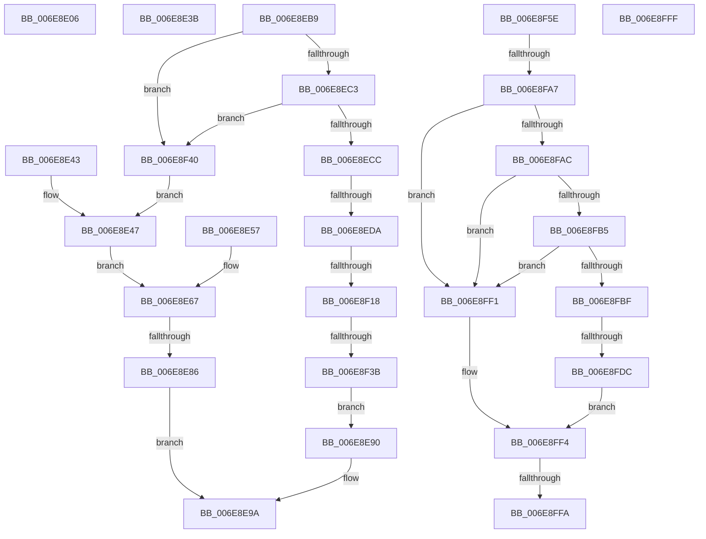

# sub_006E8E06

- RVA: `0x006E8E06`–`0x006E9020` (길이 `538` bytes)
- VA: `0x00000001406E8E06`
- 실행 섹션: `.text`
- PDB 이름 있음: `아니요`; PDB Function 태그: `아니요`
- unwind 정보 RVA: `0x00091008`
- 디코드: `133`개 명령, `538/538` bytes 표시
- 미해석 바이트: `0` (있으면 어셈블리에 `.byte`로 보존)

> 이 문서는 커널 이미지의 기계어와 PDB 기호를 분석해 생성했습니다. 4번과 5번은 함수 원형과 자료형을 바이너리 사용 방식에서 추정한 C 해석이며 원본 소스 복구 결과는 아닙니다.

## 1. Dependencies

- 직접 호출 지점: **7**; 고유 호출 대상: **4**
- 직접 호출자로 확인된 함수: **0**
- RIP 상대 이미지 참조: **0**

### Outgoing calls
- `0x006E8E71` → [SepSidInToken](../3D/SepSidInToken_function_003D0430.md) (function, `0x003D0430`)
- `0x006E8EAE` → [AuthzBasepAddAccessTypeList](../3D/AuthzBasepAddAccessTypeList_function_003D196C.md) (function, `0x003D196C`)
- `0x006E8F0B` → [SepSidInToken](../3D/SepSidInToken_function_003D0430.md) (function, `0x003D0430`)
- `0x006E8F26` → [AuthzBasepObjectInTypeList](../4B/AuthzBasepObjectInTypeList_function_004B8FF4.md) (function, `0x004B8FF4`)
- `0x006E8F9A` → [SepSidInToken](../3D/SepSidInToken_function_003D0430.md) (function, `0x003D0430`)
- `0x006E8FCF` → [AuthzBasepObjectInTypeList](../4B/AuthzBasepObjectInTypeList_function_004B8FF4.md) (function, `0x004B8FF4`)
- `0x006E9015` → [AuthzBasepSetAccessReasons](../42/AuthzBasepSetAccessReasons_function_0042F980.md) (function, `0x0042F980`)

### Direct callers
- 이 함수 시작 RVA로 연결되는 직접 call은 확인되지 않았습니다. 간접 호출은 완전히 역산할 수 없습니다.

### Static image references
- 디코드된 RIP-relative 메모리 참조가 없습니다.

## 2. Other-region calls and transfers

- 다른 실행 섹션으로 향하는 call: **0**
- call이 아닌 외부 분기/꼬리 이동: **12**
  - `0x006E8E36` → [SepNormalAccessCheckEx + 0x1D9](../3C/SepNormalAccessCheckEx_function_003CFD8C.md) (`tail-transfer`)
  - `0x006E8E3E` → [SepNormalAccessCheckEx + 0x40F](../3C/SepNormalAccessCheckEx_function_003CFD8C.md) (`tail-transfer`)
  - `0x006E8E80` → [SepNormalAccessCheckEx + 0x1FD](../3C/SepNormalAccessCheckEx_function_003CFD8C.md) (`tail-transfer`)
  - `0x006E8EB4` → [SepNormalAccessCheckEx + 0x1FD](../3C/SepNormalAccessCheckEx_function_003CFD8C.md) (`tail-transfer`)
  - `0x006E8ED4` → [SepNormalAccessCheckEx + 0x1F5](../3C/SepNormalAccessCheckEx_function_003CFD8C.md) (`tail-transfer`)
  - `0x006E8F12` → [SepNormalAccessCheckEx + 0x1F5](../3C/SepNormalAccessCheckEx_function_003CFD8C.md) (`tail-transfer`)
  - `0x006E8F35` → [SepNormalAccessCheckEx + 0x1FD](../3C/SepNormalAccessCheckEx_function_003CFD8C.md) (`tail-transfer`)
  - `0x006E8FA1` → [SepNormalAccessCheckEx + 0x1F5](../3C/SepNormalAccessCheckEx_function_003CFD8C.md) (`tail-transfer`)
  - `0x006E8FD6` → [SepNormalAccessCheckEx + 0x1F5](../3C/SepNormalAccessCheckEx_function_003CFD8C.md) (`tail-transfer`)
  - `0x006E8FF4` → [SepNormalAccessCheckEx + 0x161](../3C/SepNormalAccessCheckEx_function_003CFD8C.md) (`tail-transfer`)
  - `0x006E8FFA` → [SepNormalAccessCheckEx + 0x1F5](../3C/SepNormalAccessCheckEx_function_003CFD8C.md) (`tail-transfer`)
  - `0x006E901B` → [SepNormalAccessCheckEx + 0x161](../3C/SepNormalAccessCheckEx_function_003CFD8C.md) (`tail-transfer`)

## 3. Assembly (complete function range)

```asm
006E8E06  4C 8D 45 15                     lea r8, [rbp + 0x15]
006E8E0A  48 8D 45 18                     lea rax, [rbp + 0x18]
006E8E0E  48 89 44 24 40                  mov qword ptr [rsp + 0x40], rax
006E8E13  48 8D 4D 10                     lea rcx, [rbp + 0x10]
006E8E17  48 89 4C 24 38                  mov qword ptr [rsp + 0x38], rcx
006E8E1C  48 8D 55 14                     lea rdx, [rbp + 0x14]
006E8E20  48 89 54 24 30                  mov qword ptr [rsp + 0x30], rdx
006E8E25  48 8D 5D 04                     lea rbx, [rbp + 4]
006E8E29  48 89 5C 24 28                  mov qword ptr [rsp + 0x28], rbx
006E8E2E  4C 89 44 24 20                  mov qword ptr [rsp + 0x20], r8
006E8E33  4D 8B C7                        mov r8, r15
006E8E36  E9 2A 71 CE FF                  jmp 0x1403cff65
006E8E3B  4D 8B C7                        mov r8, r15
006E8E3E  E9 58 73 CE FF                  jmp 0x1403d019b
006E8E43  4C 8D 47 08                     lea r8, [rdi + 8]
006E8E47  8A 84 24 08 01 00 00            mov al, byte ptr [rsp + 0x108]
006E8E4E  88 44 24 28                     mov byte ptr [rsp + 0x28], al
006E8E52  49 8B CD                        mov rcx, r13
006E8E55  EB 10                           jmp 0x1406e8e67
006E8E57  48 8B 8C 24 C0 00 00 00         mov rcx, qword ptr [rsp + 0xc0]
006E8E5F  4C 8D 47 0C                     lea r8, [rdi + 0xc]
006E8E63  88 5C 24 28                     mov byte ptr [rsp + 0x28], bl
006E8E67  45 33 C9                        xor r9d, r9d
006E8E6A  44 88 64 24 20                  mov byte ptr [rsp + 0x20], r12b
006E8E6F  33 D2                           xor edx, edx
006E8E71  E8 BA 75 CE FF                  call 0x1403d0430
006E8E76  44 8B BC 24 B8 00 00 00         mov r15d, dword ptr [rsp + 0xb8]
006E8E7E  84 C0                           test al, al
006E8E80  0F 84 03 71 CE FF               je 0x1403cff89
006E8E86  83 64 24 28 00                  and dword ptr [rsp + 0x28], 0
006E8E8B  45 33 C0                        xor r8d, r8d
006E8E8E  EB 0A                           jmp 0x1406e8e9a
006E8E90  83 64 24 28 00                  and dword ptr [rsp + 0x28], 0
006E8E95  44 8B 44 24 68                  mov r8d, dword ptr [rsp + 0x68]
006E8E9A  8B 47 04                        mov eax, dword ptr [rdi + 4]
006E8E9D  45 8B CF                        mov r9d, r15d
006E8EA0  8B 94 24 E8 00 00 00            mov edx, dword ptr [rsp + 0xe8]
006E8EA7  49 8B CE                        mov rcx, r14
006E8EAA  89 44 24 20                     mov dword ptr [rsp + 0x20], eax
006E8EAE  E8 B9 8A CE FF                  call 0x1403d196c
006E8EB3  90                              nop
006E8EB4  E9 D0 70 CE FF                  jmp 0x1403cff89
006E8EB9  8B 4F 08                        mov ecx, dword ptr [rdi + 8]
006E8EBC  8B C1                           mov eax, ecx
006E8EBE  83 E0 01                        and eax, 1
006E8EC1  74 7D                           je 0x1406e8f40
006E8EC3  48 8D 5F 0C                     lea rbx, [rdi + 0xc]
006E8EC7  48 85 DB                        test rbx, rbx
006E8ECA  74 74                           je 0x1406e8f40
006E8ECC  83 BC 24 F8 00 00 00 00         cmp dword ptr [rsp + 0xf8], 0
006E8ED4  0F 84 A7 70 CE FF               je 0x1403cff81
006E8EDA  83 E1 02                        and ecx, 2
006E8EDD  44 8B C0                        mov r8d, eax
006E8EE0  48 C1 E1 03                     shl rcx, 3
006E8EE4  45 33 C9                        xor r9d, r9d
006E8EE7  48 83 C9 0C                     or rcx, 0xc
006E8EEB  49 C1 E0 04                     shl r8, 4
006E8EEF  33 D2                           xor edx, edx
006E8EF1  48 8D 04 0F                     lea rax, [rdi + rcx]
006E8EF5  49 8B CD                        mov rcx, r13
006E8EF8  4C 03 C0                        add r8, rax
006E8EFB  8A 84 24 08 01 00 00            mov al, byte ptr [rsp + 0x108]
006E8F02  88 44 24 28                     mov byte ptr [rsp + 0x28], al
006E8F06  44 88 64 24 20                  mov byte ptr [rsp + 0x20], r12b
006E8F0B  E8 20 75 CE FF                  call 0x1403d0430
006E8F10  84 C0                           test al, al
006E8F12  0F 84 69 70 CE FF               je 0x1403cff81
006E8F18  4C 8D 4C 24 68                  lea r9, [rsp + 0x68]
006E8F1D  45 8B C7                        mov r8d, r15d
006E8F20  49 8B D6                        mov rdx, r14
006E8F23  48 8B CB                        mov rcx, rbx
006E8F26  E8 C9 00 DD FF                  call 0x1404b8ff4
006E8F2B  44 8B BC 24 B8 00 00 00         mov r15d, dword ptr [rsp + 0xb8]
006E8F33  84 C0                           test al, al
006E8F35  0F 84 4E 70 CE FF               je 0x1403cff89
006E8F3B  E9 50 FF FF FF                  jmp 0x1406e8e90
006E8F40  83 E1 02                        and ecx, 2
006E8F43  44 8B C0                        mov r8d, eax
006E8F46  48 C1 E1 03                     shl rcx, 3
006E8F4A  48 83 C9 0C                     or rcx, 0xc
006E8F4E  49 C1 E0 04                     shl r8, 4
006E8F52  48 8D 04 0F                     lea rax, [rdi + rcx]
006E8F56  4C 03 C0                        add r8, rax
006E8F59  E9 E9 FE FF FF                  jmp 0x1406e8e47
006E8F5E  8B 4F 08                        mov ecx, dword ptr [rdi + 8]
006E8F61  41 B1 01                        mov r9b, 1
006E8F64  8B C1                           mov eax, ecx
006E8F66  33 D2                           xor edx, edx
006E8F68  83 E0 01                        and eax, 1
006E8F6B  83 E1 02                        and ecx, 2
006E8F6E  44 8B C0                        mov r8d, eax
006E8F71  48 C1 E1 03                     shl rcx, 3
006E8F75  48 83 C9 0C                     or rcx, 0xc
006E8F79  44 8B F8                        mov r15d, eax
006E8F7C  49 C1 E0 04                     shl r8, 4
006E8F80  48 8D 04 0F                     lea rax, [rdi + rcx]
006E8F84  49 8B CD                        mov rcx, r13
006E8F87  4C 03 C0                        add r8, rax
006E8F8A  8A 84 24 08 01 00 00            mov al, byte ptr [rsp + 0x108]
006E8F91  88 44 24 28                     mov byte ptr [rsp + 0x28], al
006E8F95  44 88 64 24 20                  mov byte ptr [rsp + 0x20], r12b
006E8F9A  E8 91 74 CE FF                  call 0x1403d0430
006E8F9F  84 C0                           test al, al
006E8FA1  0F 84 DA 6F CE FF               je 0x1403cff81
006E8FA7  45 85 FF                        test r15d, r15d
006E8FAA  74 45                           je 0x1406e8ff1
006E8FAC  48 8D 4F 0C                     lea rcx, [rdi + 0xc]
006E8FB0  48 85 C9                        test rcx, rcx
006E8FB3  74 3C                           je 0x1406e8ff1
006E8FB5  83 BC 24 F8 00 00 00 00         cmp dword ptr [rsp + 0xf8], 0
006E8FBD  74 32                           je 0x1406e8ff1
006E8FBF  44 8B 84 24 E8 00 00 00         mov r8d, dword ptr [rsp + 0xe8]
006E8FC7  4C 8D 4C 24 68                  lea r9, [rsp + 0x68]
006E8FCC  49 8B D6                        mov rdx, r14
006E8FCF  E8 20 00 DD FF                  call 0x1404b8ff4
006E8FD4  84 C0                           test al, al
006E8FD6  0F 84 A5 6F CE FF               je 0x1403cff81
006E8FDC  8B 44 24 68                     mov eax, dword ptr [rsp + 0x68]
006E8FE0  48 8D 04 40                     lea rax, [rax + rax*2]
006E8FE4  48 03 C0                        add rax, rax
006E8FE7  41 8B 44 C6 18                  mov eax, dword ptr [r14 + rax*8 + 0x18]
006E8FEC  85 47 04                        test dword ptr [rdi + 4], eax
006E8FEF  EB 03                           jmp 0x1406e8ff4
006E8FF1  85 5F 04                        test dword ptr [rdi + 4], ebx
006E8FF4  0F 85 F3 6E CE FF               jne 0x1403cfeed
006E8FFA  E9 82 6F CE FF                  jmp 0x1403cff81
006E8FFF  4D 8B 4E 28                     mov r9, qword ptr [r14 + 0x28]
006E9003  BA 00 00 02 00                  mov edx, 0x20000
006E9008  44 8B 84 24 B8 00 00 00         mov r8d, dword ptr [rsp + 0xb8]
006E9010  C6 44 24 20 00                  mov byte ptr [rsp + 0x20], 0
006E9015  E8 66 69 D4 FF                  call 0x14042f980
006E901A  90                              nop
006E901B  E9 CD 6E CE FF                  jmp 0x1403cfeed
```

## 4. C-style interpretation (structured pseudocode)

```c
__int64 __fastcall sub_006E8E06(__int64 a1, __int64 a2, __int64 a3, int a4)
{
    unsigned __int8 v_stack_p108;
    unsigned __int64 v_stack_p20;
    unsigned __int64 v_stack_p28;
    unsigned __int64 v_stack_p30;
    unsigned __int64 v_stack_p38;
    unsigned __int64 v_stack_p40;
    unsigned int v_stack_p68;
    unsigned int v_stack_pB8;
    unsigned __int64 v_stack_pC0;
    unsigned int v_stack_pE8;
    unsigned int v_stack_pF8;

    v_stack_p40 = v_rbp + 24;
    v_stack_p38 = v_rbp + 16;
    v_stack_p30 = v_rbp + 20;
    v_stack_p28 = v_rbp + 4;
    v_stack_p20 = v_rbp + 21;
}
```

## 5. (Beta) C Style

```c
int64_t sub_006E8E06(int64_t Arg1, int64_t Arg2, int64_t Arg3, int32_t Arg4)
{
    uint8_t v_stack_p108;
    uint64_t v_stack_p20;
    uint64_t v_stack_p28;
    uint64_t v_stack_p30;
    uint64_t v_stack_p38;
    uint64_t v_stack_p40;
    uint32_t v_stack_p68;
    uint32_t v_stack_pB8;
    uint64_t v_stack_pC0;
    uint32_t v_stack_pE8;
    uint32_t v_stack_pF8;

    v_stack_p40 = local_rbp + 24;
    v_stack_p38 = local_rbp + 16;
    v_stack_p30 = local_rbp + 20;
    v_stack_p28 = local_rbp + 4;
    v_stack_p20 = local_rbp + 21;
}
```

## 6. Execution-region graph

[열기: 2D/3D 그래프와 함수 탐색 컨트롤 패널](../../../control-panel.html?section=text&rva=0x006E8E06&view=graph)

- 2D 그래프는 위에서 아래로 흐르고, 3D 그래프는 빈 공간을 드래그해 회전합니다. Shift+드래그는 이동, 휠은 확대·축소, 함수 노드 선택은 대상 보고서 이동입니다.

### Static fallback


