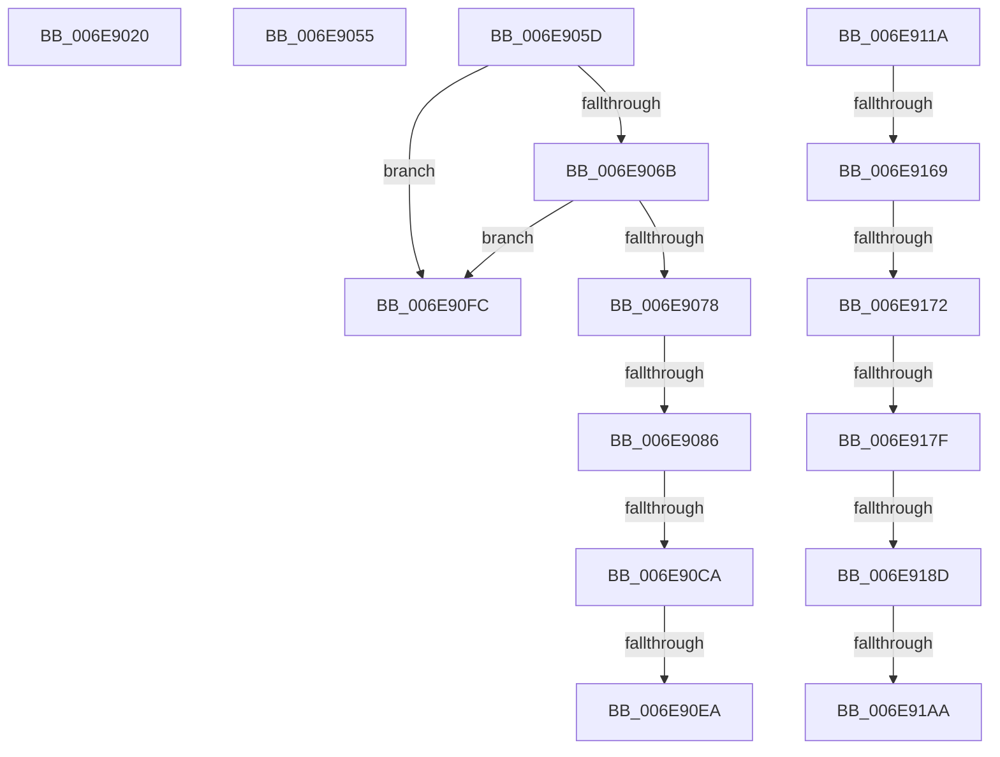

# sub_006E9020

- RVA: `0x006E9020`–`0x006E91C2` (길이 `418` bytes)
- VA: `0x00000001406E9020`
- 실행 섹션: `.text`
- PDB 이름 있음: `아니요`; PDB Function 태그: `아니요`
- unwind 정보 RVA: `0x000910E8`
- 디코드: `97`개 명령, `418/418` bytes 표시
- 미해석 바이트: `0` (있으면 어셈블리에 `.byte`로 보존)

> 이 문서는 커널 이미지의 기계어와 PDB 기호를 분석해 생성했습니다. 4번과 5번은 함수 원형과 자료형을 바이너리 사용 방식에서 추정한 C 해석이며 원본 소스 복구 결과는 아닙니다.

## 1. Dependencies

- 직접 호출 지점: **4**; 고유 호출 대상: **2**
- 직접 호출자로 확인된 함수: **0**
- RIP 상대 이미지 참조: **0**

### Outgoing calls
- `0x006E90BD` → [SepSidInToken](../3D/SepSidInToken_function_003D0430.md) (function, `0x003D0430`)
- `0x006E90DD` → [AuthzBasepObjectInTypeList](../4B/AuthzBasepObjectInTypeList_function_004B8FF4.md) (function, `0x004B8FF4`)
- `0x006E915C` → [SepSidInToken](../3D/SepSidInToken_function_003D0430.md) (function, `0x003D0430`)
- `0x006E919D` → [AuthzBasepObjectInTypeList](../4B/AuthzBasepObjectInTypeList_function_004B8FF4.md) (function, `0x004B8FF4`)

### Direct callers
- 이 함수 시작 RVA로 연결되는 직접 call은 확인되지 않았습니다. 간접 호출은 완전히 역산할 수 없습니다.

### Static image references
- 디코드된 RIP-relative 메모리 참조가 없습니다.

## 2. Other-region calls and transfers

- 다른 실행 섹션으로 향하는 call: **0**
- call이 아닌 외부 분기/꼬리 이동: **13**
  - `0x006E9050` → [SepNormalAccessCheck + 0x1B6](../3D/SepNormalAccessCheck_function_003D0688.md) (`tail-transfer`)
  - `0x006E9058` → [SepNormalAccessCheck + 0x374](../3D/SepNormalAccessCheck_function_003D0688.md) (`tail-transfer`)
  - `0x006E9080` → [SepNormalAccessCheck + 0x1D2](../3D/SepNormalAccessCheck_function_003D0688.md) (`tail-transfer`)
  - `0x006E90C4` → [SepNormalAccessCheck + 0x1D2](../3D/SepNormalAccessCheck_function_003D0688.md) (`tail-transfer`)
  - `0x006E90E4` → [SepNormalAccessCheck + 0x1D2](../3D/SepNormalAccessCheck_function_003D0688.md) (`tail-transfer`)
  - `0x006E90F7` → [SepNormalAccessCheck + 0x4AF](../3D/SepNormalAccessCheck_function_003D0688.md) (`tail-transfer`)
  - `0x006E9115` → [SepNormalAccessCheck + 0x11D](../3D/SepNormalAccessCheck_function_003D0688.md) (`tail-transfer`)
  - `0x006E9163` → [SepNormalAccessCheck + 0x1D2](../3D/SepNormalAccessCheck_function_003D0688.md) (`tail-transfer`)
  - `0x006E916C` → [SepNormalAccessCheck + 0x2C6](../3D/SepNormalAccessCheck_function_003D0688.md) (`tail-transfer`)
  - `0x006E9179` → [SepNormalAccessCheck + 0x2C6](../3D/SepNormalAccessCheck_function_003D0688.md) (`tail-transfer`)
  - `0x006E9187` → [SepNormalAccessCheck + 0x2C6](../3D/SepNormalAccessCheck_function_003D0688.md) (`tail-transfer`)
  - `0x006E91A4` → [SepNormalAccessCheck + 0x1D2](../3D/SepNormalAccessCheck_function_003D0688.md) (`tail-transfer`)
  - `0x006E91BD` → [SepNormalAccessCheck + 0x2C9](../3D/SepNormalAccessCheck_function_003D0688.md) (`tail-transfer`)

## 3. Assembly (complete function range)

```asm
006E9020  4C 8D 45 15                     lea r8, [rbp + 0x15]
006E9024  48 8D 45 18                     lea rax, [rbp + 0x18]
006E9028  48 89 44 24 40                  mov qword ptr [rsp + 0x40], rax
006E902D  48 8D 4D 10                     lea rcx, [rbp + 0x10]
006E9031  48 89 4C 24 38                  mov qword ptr [rsp + 0x38], rcx
006E9036  48 8D 55 14                     lea rdx, [rbp + 0x14]
006E903A  48 89 54 24 30                  mov qword ptr [rsp + 0x30], rdx
006E903F  48 8D 5D 04                     lea rbx, [rbp + 4]
006E9043  48 89 5C 24 28                  mov qword ptr [rsp + 0x28], rbx
006E9048  4C 89 44 24 20                  mov qword ptr [rsp + 0x20], r8
006E904D  4D 8B C6                        mov r8, r14
006E9050  E9 E9 77 CE FF                  jmp 0x1403d083e
006E9055  4D 8B C6                        mov r8, r14
006E9058  E9 9F 79 CE FF                  jmp 0x1403d09fc
006E905D  8B 4F 08                        mov ecx, dword ptr [rdi + 8]
006E9060  8B C1                           mov eax, ecx
006E9062  83 E0 01                        and eax, 1
006E9065  0F 84 91 00 00 00               je 0x1406e90fc
006E906B  4C 8D 77 0C                     lea r14, [rdi + 0xc]
006E906F  4D 85 F6                        test r14, r14
006E9072  0F 84 84 00 00 00               je 0x1406e90fc
006E9078  83 BC 24 08 01 00 00 00         cmp dword ptr [rsp + 0x108], 0
006E9080  0F 84 D4 77 CE FF               je 0x1403d085a
006E9086  48 8B 94 24 F0 00 00 00         mov rdx, qword ptr [rsp + 0xf0]
006E908E  83 E1 02                        and ecx, 2
006E9091  44 8B C0                        mov r8d, eax
006E9094  45 33 C9                        xor r9d, r9d
006E9097  48 C1 E1 03                     shl rcx, 3
006E909B  48 83 C9 0C                     or rcx, 0xc
006E909F  49 C1 E0 04                     shl r8, 4
006E90A3  48 8D 04 0F                     lea rax, [rdi + rcx]
006E90A7  49 8B CD                        mov rcx, r13
006E90AA  4C 03 C0                        add r8, rax
006E90AD  8A 84 24 18 01 00 00            mov al, byte ptr [rsp + 0x118]
006E90B4  88 44 24 28                     mov byte ptr [rsp + 0x28], al
006E90B8  44 88 64 24 20                  mov byte ptr [rsp + 0x20], r12b
006E90BD  E8 6E 73 CE FF                  call 0x1403d0430
006E90C2  84 C0                           test al, al
006E90C4  0F 84 90 77 CE FF               je 0x1403d085a
006E90CA  44 8B 84 24 F8 00 00 00         mov r8d, dword ptr [rsp + 0xf8]
006E90D2  4C 8D 4C 24 64                  lea r9, [rsp + 0x64]
006E90D7  49 8B D7                        mov rdx, r15
006E90DA  49 8B CE                        mov rcx, r14
006E90DD  E8 12 FF DC FF                  call 0x1404b8ff4
006E90E2  84 C0                           test al, al
006E90E4  0F 84 70 77 CE FF               je 0x1403d085a
006E90EA  83 64 24 28 00                  and dword ptr [rsp + 0x28], 0
006E90EF  8B 47 04                        mov eax, dword ptr [rdi + 4]
006E90F2  44 8B 44 24 64                  mov r8d, dword ptr [rsp + 0x64]
006E90F7  E9 3B 7A CE FF                  jmp 0x1403d0b37
006E90FC  83 E1 02                        and ecx, 2
006E90FF  44 8B C0                        mov r8d, eax
006E9102  48 C1 E1 03                     shl rcx, 3
006E9106  48 83 C9 0C                     or rcx, 0xc
006E910A  49 C1 E0 04                     shl r8, 4
006E910E  48 8D 04 0F                     lea rax, [rdi + rcx]
006E9112  4C 03 C0                        add r8, rax
006E9115  E9 8B 76 CE FF                  jmp 0x1403d07a5
006E911A  8B 4F 08                        mov ecx, dword ptr [rdi + 8]
006E911D  41 B1 01                        mov r9b, 1
006E9120  48 8B 94 24 F0 00 00 00         mov rdx, qword ptr [rsp + 0xf0]
006E9128  8B C1                           mov eax, ecx
006E912A  83 E0 01                        and eax, 1
006E912D  83 E1 02                        and ecx, 2
006E9130  44 8B C0                        mov r8d, eax
006E9133  48 C1 E1 03                     shl rcx, 3
006E9137  48 83 C9 0C                     or rcx, 0xc
006E913B  44 8B F0                        mov r14d, eax
006E913E  49 C1 E0 04                     shl r8, 4
006E9142  48 8D 04 0F                     lea rax, [rdi + rcx]
006E9146  49 8B CD                        mov rcx, r13
006E9149  4C 03 C0                        add r8, rax
006E914C  8A 84 24 18 01 00 00            mov al, byte ptr [rsp + 0x118]
006E9153  88 44 24 28                     mov byte ptr [rsp + 0x28], al
006E9157  44 88 64 24 20                  mov byte ptr [rsp + 0x20], r12b
006E915C  E8 CF 72 CE FF                  call 0x1403d0430
006E9161  84 C0                           test al, al
006E9163  0F 84 F1 76 CE FF               je 0x1403d085a
006E9169  45 85 F6                        test r14d, r14d
006E916C  0F 84 DC 77 CE FF               je 0x1403d094e
006E9172  48 8D 4F 0C                     lea rcx, [rdi + 0xc]
006E9176  48 85 C9                        test rcx, rcx
006E9179  0F 84 CF 77 CE FF               je 0x1403d094e
006E917F  83 BC 24 08 01 00 00 00         cmp dword ptr [rsp + 0x108], 0
006E9187  0F 84 C1 77 CE FF               je 0x1403d094e
006E918D  44 8B 84 24 F8 00 00 00         mov r8d, dword ptr [rsp + 0xf8]
006E9195  4C 8D 4C 24 64                  lea r9, [rsp + 0x64]
006E919A  49 8B D7                        mov rdx, r15
006E919D  E8 52 FE DC FF                  call 0x1404b8ff4
006E91A2  84 C0                           test al, al
006E91A4  0F 84 B0 76 CE FF               je 0x1403d085a
006E91AA  8B 44 24 64                     mov eax, dword ptr [rsp + 0x64]
006E91AE  48 8D 04 40                     lea rax, [rax + rax*2]
006E91B2  48 03 C0                        add rax, rax
006E91B5  41 8B 44 C7 18                  mov eax, dword ptr [r15 + rax*8 + 0x18]
006E91BA  85 47 04                        test dword ptr [rdi + 4], eax
006E91BD  E9 8F 77 CE FF                  jmp 0x1403d0951
```

## 4. C-style interpretation (structured pseudocode)

```c
__int64 __fastcall sub_006E9020(__int64 a1, __int64 a2, __int64 a3, int a4)
{
    unsigned int v_stack_p108;
    unsigned __int8 v_stack_p118;
    unsigned __int64 v_stack_p20;
    unsigned __int64 v_stack_p28;
    unsigned __int64 v_stack_p30;
    unsigned __int64 v_stack_p38;
    unsigned __int64 v_stack_p40;
    unsigned __int64 v_stack_p64;
    unsigned __int64 v_stack_pF0;
    unsigned int v_stack_pF8;

    v_stack_p40 = v_rbp + 24;
    v_stack_p38 = v_rbp + 16;
    v_stack_p30 = v_rbp + 20;
    v_stack_p28 = v_rbp + 4;
    v_stack_p20 = v_rbp + 21;
}
```

## 5. (Beta) C Style

```c
int64_t sub_006E9020(int64_t Arg1, int64_t Arg2, int64_t Arg3, int32_t Arg4)
{
    uint32_t v_stack_p108;
    uint8_t v_stack_p118;
    uint64_t v_stack_p20;
    uint64_t v_stack_p28;
    uint64_t v_stack_p30;
    uint64_t v_stack_p38;
    uint64_t v_stack_p40;
    uint64_t v_stack_p64;
    uint64_t v_stack_pF0;
    uint32_t v_stack_pF8;

    v_stack_p40 = local_rbp + 24;
    v_stack_p38 = local_rbp + 16;
    v_stack_p30 = local_rbp + 20;
    v_stack_p28 = local_rbp + 4;
    v_stack_p20 = local_rbp + 21;
}
```

## 6. Execution-region graph

[열기: 2D/3D 그래프와 함수 탐색 컨트롤 패널](../../../control-panel.html?section=text&rva=0x006E9020&view=graph)

- 2D 그래프는 위에서 아래로 흐르고, 3D 그래프는 빈 공간을 드래그해 회전합니다. Shift+드래그는 이동, 휠은 확대·축소, 함수 노드 선택은 대상 보고서 이동입니다.

### Static fallback


