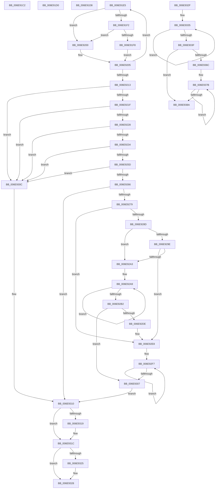

# sub_006E91C2

- RVA: `0x006E91C2`–`0x006E9392` (길이 `464` bytes)
- VA: `0x00000001406E91C2`
- 실행 섹션: `.text`
- PDB 이름 있음: `아니요`; PDB Function 태그: `아니요`
- unwind 정보 RVA: `0x00091184`
- 디코드: `139`개 명령, `464/464` bytes 표시
- 미해석 바이트: `0` (있으면 어셈블리에 `.byte`로 보존)

> 이 문서는 커널 이미지의 기계어와 PDB 기호를 분석해 생성했습니다. 4번과 5번은 함수 원형과 자료형을 바이너리 사용 방식에서 추정한 C 해석이며 원본 소스 복구 결과는 아닙니다.

## 1. Dependencies

- 직접 호출 지점: **2**; 고유 호출 대상: **2**
- 직접 호출자로 확인된 함수: **0**
- RIP 상대 이미지 참조: **0**

### Outgoing calls
- `0x006E924D` → [SepAssemblePrivileges](../../page/A2/SepAssemblePrivileges_function_00A210BC.md) (function, `0x00A210BC`)
- `0x006E92D2` → [memset](../6C/memset_function_006C6C40.md) (function, `0x006C6C40`)

### Direct callers
- 이 함수 시작 RVA로 연결되는 직접 call은 확인되지 않았습니다. 간접 호출은 완전히 역산할 수 없습니다.

### Static image references
- 디코드된 RIP-relative 메모리 참조가 없습니다.

## 2. Other-region calls and transfers

- 다른 실행 섹션으로 향하는 call: **1**
  - `0x006E924D` → [SepAssemblePrivileges](../../page/A2/SepAssemblePrivileges_function_00A210BC.md) (`.text` → `PAGE`)
- call이 아닌 외부 분기/꼬리 이동: **5**
  - `0x006E91CB` → [SepAccessCheck + 0xED](../3D/SepAccessCheck_function_003D0E54.md) (`tail-transfer`)
  - `0x006E91D3` → [SepAccessCheck + 0x3BA](../3D/SepAccessCheck_function_003D0E54.md) (`tail-transfer`)
  - `0x006E91E0` → [SepAccessCheck + 0x38A](../3D/SepAccessCheck_function_003D0E54.md) (`tail-transfer`)
  - `0x006E932A` → [SepAccessCheck + 0x3FD](../3D/SepAccessCheck_function_003D0E54.md) (`tail-transfer`)
  - `0x006E938D` → [SepAccessCheck + 0x3DF](../3D/SepAccessCheck_function_003D0E54.md) (`tail-transfer`)

## 3. Assembly (complete function range)

```asm
006E91C2  4C 8B 4D 90                     mov r9, qword ptr [rbp - 0x70]
006E91C6  B8 04 00 00 00                  mov eax, 4
006E91CB  E9 71 7D CE FF                  jmp 0x1403d0f41
006E91D0  41 8B D9                        mov ebx, r9d
006E91D3  E9 36 80 CE FF                  jmp 0x1403d120e
006E91D8  C6 47 17 01                     mov byte ptr [rdi + 0x17], 1
006E91DC  45 8B 70 1C                     mov r14d, dword ptr [r8 + 0x1c]
006E91E0  E9 F9 7F CE FF                  jmp 0x1403d11de
006E91E5  8B C6                           mov eax, esi
006E91E7  41 0B 00                        or eax, dword ptr [r8]
006E91EA  41 23 C2                        and eax, r10d
006E91ED  89 04 0F                        mov dword ptr [rdi + rcx], eax
006E91F0  74 0E                           je 0x1406e9200
006E91F2  F7 D0                           not eax
006E91F4  85 C2                           test edx, eax
006E91F6  75 08                           jne 0x1406e9200
006E91F8  83 21 00                        and dword ptr [rcx], 0
006E91FB  41 B6 01                        mov r14b, 1
006E91FE  EB 05                           jmp 0x1406e9205
006E9200  89 19                           mov dword ptr [rcx], ebx
006E9202  41 B5 01                        mov r13b, 1
006E9205  49 83 C0 30                     add r8, 0x30
006E9209  48 83 C1 04                     add rcx, 4
006E920D  49 83 E9 01                     sub r9, 1
006E9211  75 D2                           jne 0x1406e91e5
006E9213  44 0F 20 C0                     mov rax, cr8
006E9217  3C 02                           cmp al, 2
006E9219  0F 83 ED 00 00 00               jae 0x1406e930c
006E921F  45 84 F6                        test r14b, r14b
006E9222  0F 84 E4 00 00 00               je 0x1406e930c
006E9228  8B 44 24 74                     mov eax, dword ptr [rsp + 0x74]
006E922C  85 C0                           test eax, eax
006E922E  0F 84 D8 00 00 00               je 0x1406e930c
006E9234  48 8B 7D D0                     mov rdi, qword ptr [rbp - 0x30]
006E9238  8B C8                           mov ecx, eax
006E923A  44 8A 4C 24 72                  mov r9b, byte ptr [rsp + 0x72]
006E923F  44 8A 44 24 70                  mov r8b, byte ptr [rsp + 0x70]
006E9244  8A 54 24 73                     mov dl, byte ptr [rsp + 0x73]
006E9248  48 89 7C 24 20                  mov qword ptr [rsp + 0x20], rdi
006E924D  E8 6A 7E 33 00                  call 0x140a210bc
006E9252  33 C0                           xor eax, eax
006E9254  48 85 FF                        test rdi, rdi
006E9257  0F 84 AF 00 00 00               je 0x1406e930c
006E925D  48 39 07                        cmp qword ptr [rdi], rax
006E9260  0F 85 A6 00 00 00               jne 0x1406e930c
006E9266  8A C8                           mov cl, al
006E9268  44 8A F0                        mov r14b, al
006E926B  41 B5 01                        mov r13b, 1
006E926E  8B D0                           mov edx, eax
006E9270  45 85 FF                        test r15d, r15d
006E9273  0F 84 97 00 00 00               je 0x1406e9310
006E9279  4C 8B 4D 80                     mov r9, qword ptr [rbp - 0x80]
006E927D  44 8D 40 04                     lea r8d, [rax + 4]
006E9281  48 C7 C3 17 00 00 C0            mov rbx, 0xffffffffc0000017
006E9288  45 3B F8                        cmp r15d, r8d
006E928B  72 5B                           jb 0x1406e92e8
006E928D  41 8D 47 FF                     lea eax, [r15 - 1]
006E9291  49 8D 3C 81                     lea rdi, [r9 + rax*4]
006E9295  49 8D 04 84                     lea rax, [r12 + rax*4]
006E9299  4C 3B C8                        cmp r9, rax
006E929C  77 05                           ja 0x1406e92a3
006E929E  49 3B FC                        cmp rdi, r12
006E92A1  73 45                           jae 0x1406e92e8
006E92A3  41 8B C7                        mov eax, r15d
006E92A6  83 E0 FC                        and eax, 0xfffffffc
006E92A9  41 03 D0                        add edx, r8d
006E92AC  8B F2                           mov esi, edx
006E92AE  3B D0                           cmp edx, eax
006E92B0  72 F7                           jb 0x1406e92a9
006E92B2  4C 8D 04 85 00 00 00 00         lea r8, [rax*4]
006E92BA  49 8B FC                        mov rdi, r12
006E92BD  49 8B C8                        mov rcx, r8
006E92C0  48 8B C3                        mov rax, rbx
006E92C3  48 C1 E9 02                     shr rcx, 2
006E92C7  49 83 E0 FC                     and r8, 0xfffffffffffffffc
006E92CB  F3 AB                           rep stosd dword ptr [rdi], eax
006E92CD  49 8B C9                        mov rcx, r9
006E92D0  33 D2                           xor edx, edx
006E92D2  E8 69 D9 FD FF                  call 0x1406c6c40
006E92D7  8B D6                           mov edx, esi
006E92D9  41 3B F7                        cmp esi, r15d
006E92DC  73 29                           jae 0x1406e9307
006E92DE  4C 8B 4D 80                     mov r9, qword ptr [rbp - 0x80]
006E92E2  41 B8 04 00 00 00               mov r8d, 4
006E92E8  8B C2                           mov eax, edx
006E92EA  4D 2B E1                        sub r12, r9
006E92ED  44 2B FA                        sub r15d, edx
006E92F0  49 8D 0C 81                     lea rcx, [r9 + rax*4]
006E92F4  41 8B C7                        mov eax, r15d
006E92F7  41 89 1C 0C                     mov dword ptr [r12 + rcx], ebx
006E92FB  83 21 00                        and dword ptr [rcx], 0
006E92FE  49 03 C8                        add rcx, r8
006E9301  48 83 E8 01                     sub rax, 1
006E9305  75 F0                           jne 0x1406e92f7
006E9307  41 8A CE                        mov cl, r14b
006E930A  EB 04                           jmp 0x1406e9310
006E930C  8A 4C 24 71                     mov cl, byte ptr [rsp + 0x71]
006E9310  48 8B 45 C0                     mov rax, qword ptr [rbp - 0x40]
006E9314  48 85 C0                        test rax, rax
006E9317  74 03                           je 0x1406e931c
006E9319  44 88 30                        mov byte ptr [rax], r14b
006E931C  48 8B 45 C8                     mov rax, qword ptr [rbp - 0x38]
006E9320  48 85 C0                        test rax, rax
006E9323  74 03                           je 0x1406e9328
006E9325  44 88 28                        mov byte ptr [rax], r13b
006E9328  8A C1                           mov al, cl
006E932A  E9 22 7F CE FF                  jmp 0x1403d1251
006E932F  41 8B C2                        mov eax, r10d
006E9332  83 E0 FC                        and eax, 0xfffffffc
006E9335  41 03 D6                        add edx, r14d
006E9338  44 8B C2                        mov r8d, edx
006E933B  3B D0                           cmp edx, eax
006E933D  72 F6                           jb 0x1406e9335
006E933F  48 8D 14 85 00 00 00 00         lea rdx, [rax*4]
006E9347  49 8B F9                        mov rdi, r9
006E934A  48 8B CA                        mov rcx, rdx
006E934D  48 63 C3                        movsxd rax, ebx
006E9350  48 C1 E9 02                     shr rcx, 2
006E9354  F3 AB                           rep stosd dword ptr [rdi], eax
006E9356  48 C1 EA 02                     shr rdx, 2
006E935A  49 8B FB                        mov rdi, r11
006E935D  48 8B CA                        mov rcx, rdx
006E9360  8B C6                           mov eax, esi
006E9362  F3 AB                           rep stosd dword ptr [rdi], eax
006E9364  41 8B D0                        mov edx, r8d
006E9367  45 3B C2                        cmp r8d, r10d
006E936A  73 1E                           jae 0x1406e938a
006E936C  8B C2                           mov eax, edx
006E936E  4D 2B CB                        sub r9, r11
006E9371  44 2B D2                        sub r10d, edx
006E9374  49 8D 0C 83                     lea rcx, [r11 + rax*4]
006E9378  41 8B C2                        mov eax, r10d
006E937B  42 89 1C 09                     mov dword ptr [rcx + r9], ebx
006E937F  89 31                           mov dword ptr [rcx], esi
006E9381  49 03 CE                        add rcx, r14
006E9384  48 83 E8 01                     sub rax, 1
006E9388  75 F1                           jne 0x1406e937b
006E938A  45 33 C9                        xor r9d, r9d
006E938D  E9 A1 7E CE FF                  jmp 0x1403d1233
```

## 4. C-style interpretation (structured pseudocode)

```c
__int64 __fastcall sub_006E91C2(__int64 a1, int a2, __int64 a3)
{
    unsigned __int64 v_stack_p20;
    unsigned __int8 v_stack_p70;
    unsigned __int8 v_stack_p71;
    unsigned __int8 v_stack_p72;
    unsigned __int8 v_stack_p73;
    unsigned int v_stack_p74;
}
```

## 5. (Beta) C Style

```c
int64_t sub_006E91C2(int64_t Arg1, int32_t Arg2, int64_t Arg3)
{
    uint64_t v_stack_p20;
    uint8_t v_stack_p70;
    uint8_t v_stack_p71;
    uint8_t v_stack_p72;
    uint8_t v_stack_p73;
    uint32_t v_stack_p74;
}
```

## 6. Execution-region graph

[열기: 2D/3D 그래프와 함수 탐색 컨트롤 패널](../../../control-panel.html?section=text&rva=0x006E91C2&view=graph)

- 2D 그래프는 위에서 아래로 흐르고, 3D 그래프는 빈 공간을 드래그해 회전합니다. Shift+드래그는 이동, 휠은 확대·축소, 함수 노드 선택은 대상 보고서 이동입니다.

### Static fallback


