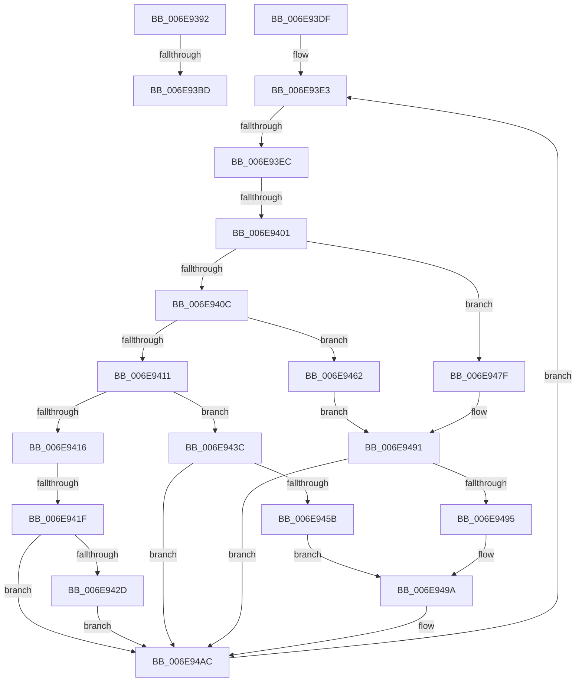

# sub_006E9392

- RVA: `0x006E9392`–`0x006E94B4` (길이 `290` bytes)
- VA: `0x00000001406E9392`
- 실행 섹션: `.text`
- PDB 이름 있음: `아니요`; PDB Function 태그: `아니요`
- unwind 정보 RVA: `0x000911DC`
- 디코드: `87`개 명령, `290/290` bytes 표시
- 미해석 바이트: `0` (있으면 어셈블리에 `.byte`로 보존)

> 이 문서는 커널 이미지의 기계어와 PDB 기호를 분석해 생성했습니다. 4번과 5번은 함수 원형과 자료형을 바이너리 사용 방식에서 추정한 C 해석이며 원본 소스 복구 결과는 아닙니다.

## 1. Dependencies

- 직접 호출 지점: **3**; 고유 호출 대상: **2**
- 직접 호출자로 확인된 함수: **0**
- RIP 상대 이미지 참조: **0**

### Outgoing calls
- `0x006E93D4` → [AuthzBasepSetAccessReasons](../42/AuthzBasepSetAccessReasons_function_0042F980.md) (function, `0x0042F980`)
- `0x006E9435` → [AuthzBasepSetAppContainerAccessReasons](../69/AuthzBasepSetAppContainerAccessReasons_function_0069D6CC.md) (function, `0x0069D6CC`)
- `0x006E94A7` → [AuthzBasepSetAccessReasons](../42/AuthzBasepSetAccessReasons_function_0042F980.md) (function, `0x0042F980`)

### Direct callers
- 이 함수 시작 RVA로 연결되는 직접 call은 확인되지 않았습니다. 간접 호출은 완전히 역산할 수 없습니다.

### Static image references
- 디코드된 RIP-relative 메모리 참조가 없습니다.

## 2. Other-region calls and transfers

- 다른 실행 섹션으로 향하는 call: **0**
- call이 아닌 외부 분기/꼬리 이동: **5**
  - `0x006E93B7` → [AuthzBasepAddAccessTypeList + 0xA9](../3D/AuthzBasepAddAccessTypeList_function_003D196C.md) (`tail-transfer`)
  - `0x006E93DA` → [AuthzBasepAddAccessTypeList + 0xAC](../3D/AuthzBasepAddAccessTypeList_function_003D196C.md) (`tail-transfer`)
  - `0x006E93E6` → [AuthzBasepAddAccessTypeList + 0xB6](../3D/AuthzBasepAddAccessTypeList_function_003D196C.md) (`tail-transfer`)
  - `0x006E93FB` → [AuthzBasepAddAccessTypeList + 0xB6](../3D/AuthzBasepAddAccessTypeList_function_003D196C.md) (`tail-transfer`)
  - `0x006E9419` → [AuthzBasepAddAccessTypeList + 0xB6](../3D/AuthzBasepAddAccessTypeList_function_003D196C.md) (`tail-transfer`)

## 3. Assembly (complete function range)

```asm
006E9392  8B BC 24 80 00 00 00            mov edi, dword ptr [rsp + 0x80]
006E9399  4B 8D 34 7F                     lea rsi, [r15 + r15*2]
006E939D  48 C1 E6 04                     shl rsi, 4
006E93A1  48 03 F3                        add rsi, rbx
006E93A4  8B 4E 20                        mov ecx, dword ptr [rsi + 0x20]
006E93A7  8B 56 1C                        mov edx, dword ptr [rsi + 0x1c]
006E93AA  F7 D2                           not edx
006E93AC  8B C2                           mov eax, edx
006E93AE  23 C7                           and eax, edi
006E93B0  0B C1                           or eax, ecx
006E93B2  89 46 20                        mov dword ptr [rsi + 0x20], eax
006E93B5  3B C8                           cmp ecx, eax
006E93B7  0F 84 58 86 CE FF               je 0x1403d1a15
006E93BD  4C 8B 4E 28                     mov r9, qword ptr [rsi + 0x28]
006E93C1  F7 D1                           not ecx
006E93C3  23 CA                           and ecx, edx
006E93C5  44 88 74 24 20                  mov byte ptr [rsp + 0x20], r14b
006E93CA  23 CF                           and ecx, edi
006E93CC  44 8B C5                        mov r8d, ebp
006E93CF  BA 00 00 02 00                  mov edx, 0x20000
006E93D4  E8 A7 65 D4 FF                  call 0x14042f980
006E93D9  90                              nop
006E93DA  E9 39 86 CE FF                  jmp 0x1403d1a18
006E93DF  45 8D 5F 01                     lea r11d, [r15 + 1]
006E93E3  45 3B DD                        cmp r11d, r13d
006E93E6  0F 83 36 86 CE FF               jae 0x1403d1a22
006E93EC  0F B7 06                        movzx eax, word ptr [rsi]
006E93EF  4F 8D 0C 5B                     lea r9, [r11 + r11*2]
006E93F3  4D 03 C9                        add r9, r9
006E93F6  66 42 39 04 CB                  cmp word ptr [rbx + r9*8], ax
006E93FB  0F 86 21 86 CE FF               jbe 0x1403d1a22
006E9401  45 33 C0                        xor r8d, r8d
006E9404  41 8B CC                        mov ecx, r12d
006E9407  45 85 E4                        test r12d, r12d
006E940A  74 73                           je 0x1406e947f
006E940C  83 E9 01                        sub ecx, 1
006E940F  74 51                           je 0x1406e9462
006E9411  83 E9 01                        sub ecx, 1
006E9414  74 26                           je 0x1406e943c
006E9416  83 F9 01                        cmp ecx, 1
006E9419  0F 85 03 86 CE FF               jne 0x1403d1a22
006E941F  42 8B 4C CB 1C                  mov ecx, dword ptr [rbx + r9*8 + 0x1c]
006E9424  23 CF                           and ecx, edi
006E9426  42 89 4C CB 1C                  mov dword ptr [rbx + r9*8 + 0x1c], ecx
006E942B  74 7F                           je 0x1406e94ac
006E942D  4E 8B 4C CB 28                  mov r9, qword ptr [rbx + r9*8 + 0x28]
006E9432  44 8B C5                        mov r8d, ebp
006E9435  E8 92 42 FB FF                  call 0x14069d6cc
006E943A  EB 70                           jmp 0x1406e94ac
006E943C  42 8B 44 CB 20                  mov eax, dword ptr [rbx + r9*8 + 0x20]
006E9441  8B C8                           mov ecx, eax
006E9443  42 8B 54 CB 1C                  mov edx, dword ptr [rbx + r9*8 + 0x1c]
006E9448  F7 D1                           not ecx
006E944A  F7 D2                           not edx
006E944C  23 CA                           and ecx, edx
006E944E  23 D7                           and edx, edi
006E9450  0B D0                           or edx, eax
006E9452  42 89 54 CB 20                  mov dword ptr [rbx + r9*8 + 0x20], edx
006E9457  23 CF                           and ecx, edi
006E9459  74 51                           je 0x1406e94ac
006E945B  BA 00 00 02 00                  mov edx, 0x20000
006E9460  EB 38                           jmp 0x1406e949a
006E9462  42 8B 44 CB 1C                  mov eax, dword ptr [rbx + r9*8 + 0x1c]
006E9467  8B C8                           mov ecx, eax
006E9469  42 8B 54 CB 20                  mov edx, dword ptr [rbx + r9*8 + 0x20]
006E946E  F7 D1                           not ecx
006E9470  F7 D2                           not edx
006E9472  23 CA                           and ecx, edx
006E9474  23 D7                           and edx, edi
006E9476  0B D0                           or edx, eax
006E9478  42 89 54 CB 1C                  mov dword ptr [rbx + r9*8 + 0x1c], edx
006E947D  EB 12                           jmp 0x1406e9491
006E947F  42 8B 54 CB 18                  mov edx, dword ptr [rbx + r9*8 + 0x18]
006E9484  8B C7                           mov eax, edi
006E9486  F7 D0                           not eax
006E9488  8B CA                           mov ecx, edx
006E948A  23 C2                           and eax, edx
006E948C  42 89 44 CB 18                  mov dword ptr [rbx + r9*8 + 0x18], eax
006E9491  23 CF                           and ecx, edi
006E9493  74 17                           je 0x1406e94ac
006E9495  BA 00 00 01 00                  mov edx, 0x10000
006E949A  4E 8B 4C CB 28                  mov r9, qword ptr [rbx + r9*8 + 0x28]
006E949F  44 88 44 24 20                  mov byte ptr [rsp + 0x20], r8b
006E94A4  44 8B C5                        mov r8d, ebp
006E94A7  E8 D4 64 D4 FF                  call 0x14042f980
006E94AC  41 FF C3                        inc r11d
006E94AF  E9 2F FF FF FF                  jmp 0x1406e93e3
```

## 4. C-style interpretation (structured pseudocode)

```c
__int64 __fastcall sub_006E9392(__int64 a1, __int64 a2, __int64 a3, __int64 a4, __int64 a5, __int64 a6, __int64 a7, __int64 a8, __int64 a9, __int64 a10, __int64 a11, __int64 a12, __int64 a13, __int64 a14, __int64 a15, unsigned int a16)
{
    __int64 result;
    __int64 v_rsi;
    unsigned __int8 v_stack_p20;

    v_rsi = (v_r15 + v_r15 * 2) << (4);
    v_rsi = (v_rsi) + (v_rbx);
    a2 = (unsigned int)(~((unsigned int)(*(unsigned int *)(v_rsi + 28))));
    result = (unsigned int)(((unsigned int)((unsigned int)(a2))) & ((unsigned int)((unsigned int)(a16))));
    result = (unsigned int)((result) | ((unsigned int)((unsigned int)(*(unsigned int *)(v_rsi + 32)))));
    *(unsigned int *)(v_rsi + 32) = (unsigned int)(result);
    a1 = (unsigned int)(~((unsigned int)(*(unsigned int *)(v_rsi + 32))));
    a1 = (unsigned int)((a1) & ((unsigned int)(a2)));
    v_stack_p20 = (unsigned __int8)(v_r14);
    a1 = (unsigned int)((a1) & ((unsigned int)((unsigned int)(a16))));
    result = AuthzBasepSetAccessReasons(a1, (unsigned int)(0x20000ULL), (unsigned int)((unsigned int)(v_rbp)), *(unsigned __int64 *)(v_rsi + 40));
}
```

## 5. (Beta) C Style

```c
int64_t sub_006E9392(int64_t Arg1, int64_t Arg2, int64_t Arg3, int64_t Arg4, uint64_t Arg5, uint64_t Arg6, uint64_t Arg7, uint64_t Arg8, uint64_t Arg9, uint64_t Arg10, uint64_t Arg11, uint64_t Arg12, uint64_t Arg13, uint64_t Arg14, uint64_t Arg15, uint32_t Arg16)
{
    int64_t result;
    int64_t local_rsi;
    uint8_t v_stack_p20;

    local_rsi = (local_r15 + local_r15 * 2) << (4);
    local_rsi = (local_rsi) + (local_rbx);
    Arg2 = (uint32_t)(~((uint32_t)(*(uint32_t *)(local_rsi + 0x1C))));
    result = (uint32_t)(((uint32_t)((uint32_t)(Arg2))) & ((uint32_t)((uint32_t)(Arg16))));
    result = (uint32_t)((result) | ((uint32_t)((uint32_t)(*(uint32_t *)(local_rsi + 0x20)))));
    *(uint32_t *)(local_rsi + 0x20) = (uint32_t)(result);
    Arg1 = (uint32_t)(~((uint32_t)(*(uint32_t *)(local_rsi + 0x20))));
    Arg1 = (uint32_t)((Arg1) & ((uint32_t)(Arg2)));
    v_stack_p20 = (uint8_t)(local_r14);
    Arg1 = (uint32_t)((Arg1) & ((uint32_t)((uint32_t)(Arg16))));
    result = AuthzBasepSetAccessReasons(Arg1, (uint32_t)(0x20000ULL), (uint32_t)((uint32_t)(local_rbp)), *(uint64_t *)(local_rsi + 0x28));
}
```

## 6. Execution-region graph

[열기: 2D/3D 그래프와 함수 탐색 컨트롤 패널](../../../control-panel.html?section=text&rva=0x006E9392&view=graph)

- 2D 그래프는 위에서 아래로 흐르고, 3D 그래프는 빈 공간을 드래그해 회전합니다. Shift+드래그는 이동, 휠은 확대·축소, 함수 노드 선택은 대상 보고서 이동입니다.

### Static fallback


