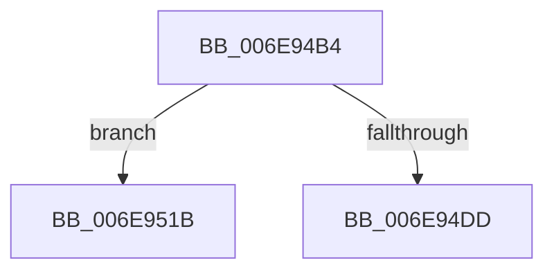

# sub_006E94B4

- RVA: `0x006E94B4`–`0x006E9555` (길이 `161` bytes)
- VA: `0x00000001406E94B4`
- 실행 섹션: `.text`
- PDB 이름 있음: `아니요`; PDB Function 태그: `아니요`
- unwind 정보 RVA: `0x00091398`
- 디코드: `38`개 명령, `161/161` bytes 표시
- 미해석 바이트: `0` (있으면 어셈블리에 `.byte`로 보존)

> 이 문서는 커널 이미지의 기계어와 PDB 기호를 분석해 생성했습니다. 4번과 5번은 함수 원형과 자료형을 바이너리 사용 방식에서 추정한 C 해석이며 원본 소스 복구 결과는 아닙니다.

## 1. Dependencies

- 직접 호출 지점: **5**; 고유 호출 대상: **5**
- 직접 호출자로 확인된 함수: **0**
- RIP 상대 이미지 참조: **0**

### Outgoing calls
- `0x006E94D0` → [MiCopyOnWrite](../36/MiCopyOnWrite_function_00362A0C.md) (function, `0x00362A0C`)
- `0x006E9521` → [MiUnlockPageTable](../21/MiUnlockPageTable_function_00216EC0.md) (function, `0x00216EC0`)
- `0x006E9531` → [MiUnlockWorkingSetShared](../27/MiUnlockWorkingSetShared_function_0027D690.md) (function, `0x0027D690`)
- `0x006E9542` → [MiCopyOnWriteCheckConditions](../2A/MiCopyOnWriteCheckConditions_function_002A750C.md) (function, `0x002A750C`)
- `0x006E954A` → [MiLockWorkingSetShared](../27/MiLockWorkingSetShared_function_0027CBF0.md) (function, `0x0027CBF0`)

### Direct callers
- 이 함수 시작 RVA로 연결되는 직접 call은 확인되지 않았습니다. 간접 호출은 완전히 역산할 수 없습니다.

### Static image references
- 디코드된 RIP-relative 메모리 참조가 없습니다.

## 2. Other-region calls and transfers

- 다른 실행 섹션으로 향하는 call: **0**
- call이 아닌 외부 분기/꼬리 이동: **2**
  - `0x006E9516` → [MiCopyToUserVa + 0x111](../3D/MiCopyToUserVa_function_003D1E68.md) (`tail-transfer`)
  - `0x006E9550` → [MiCopyToUserVa + 0x96](../3D/MiCopyToUserVa_function_003D1E68.md) (`tail-transfer`)

## 3. Assembly (complete function range)

```asm
006E94B4  48 8D 44 24 48                  lea rax, [rsp + 0x48]
006E94B9  48 89 44 24 20                  mov qword ptr [rsp + 0x20], rax
006E94BE  45 33 C9                        xor r9d, r9d
006E94C1  49 83 C8 FF                     or r8, 0xffffffffffffffff
006E94C5  49 8B D5                        mov rdx, r13
006E94C8  48 8B 8C 24 A0 00 00 00         mov rcx, qword ptr [rsp + 0xa0]
006E94D0  E8 37 95 C7 FF                  call 0x140362a0c
006E94D5  89 44 24 3C                     mov dword ptr [rsp + 0x3c], eax
006E94D9  85 C0                           test eax, eax
006E94DB  78 3E                           js 0x1406e951b
006E94DD  49 8B 4D 00                     mov rcx, qword ptr [r13]
006E94E1  48 C1 E9 0C                     shr rcx, 0xc
006E94E5  48 B8 FF FF FF FF FF 00 00 00   movabs rax, 0xffffffffff
006E94EF  48 23 C8                        and rcx, rax
006E94F2  4C 8D 34 49                     lea r14, [rcx + rcx*2]
006E94F6  49 C1 E6 04                     shl r14, 4
006E94FA  48 B8 00 00 00 00 00 DE FF FF   movabs rax, 0xffffde0000000000
006E9504  48 8B C0                        mov rax, rax
006E9507  4C 03 F0                        add r14, rax
006E950A  33 F6                           xor esi, esi
006E950C  48 39 74 24 40                  cmp qword ptr [rsp + 0x40], rsi
006E9511  0F 44 74 24 38                  cmove esi, dword ptr [rsp + 0x38]
006E9516  E9 5E 8A CE FF                  jmp 0x1403d1f79
006E951B  49 8B D4                        mov rdx, r12
006E951E  48 8B CF                        mov rcx, rdi
006E9521  E8 9A D9 B2 FF                  call 0x140216ec0
006E9526  44 8A 74 24 30                  mov r14b, byte ptr [rsp + 0x30]
006E952B  41 8A D6                        mov dl, r14b
006E952E  48 8B CF                        mov rcx, rdi
006E9531  E8 5A 41 B9 FF                  call 0x14027d690
006E9536  4C 8B 44 24 48                  mov r8, qword ptr [rsp + 0x48]
006E953B  8B 54 24 3C                     mov edx, dword ptr [rsp + 0x3c]
006E953F  48 8B CF                        mov rcx, rdi
006E9542  E8 C5 DF BB FF                  call 0x1402a750c
006E9547  48 8B CF                        mov rcx, rdi
006E954A  E8 A1 36 B9 FF                  call 0x14027cbf0
006E954F  90                              nop
006E9550  E9 A9 89 CE FF                  jmp 0x1403d1efe
```

## 4. C-style interpretation (structured pseudocode)

```c
__int64 __fastcall sub_006E94B4(__int64 a1, __int64 a2, __int64 a3, int a4, __int64 a5, unsigned __int8 a6, unsigned int a7, __int64 a8, __int64 a9, __int64 a10, __int64 a11, __int64 a12, __int64 a13, __int64 a14, __int64 a15, __int64 a16, __int64 a17, __int64 a18, __int64 a19, __int64 a20)
{
    __int64 result;
    __int64 v_r14;
    __int64 v_rsi;
    unsigned __int64 v_stack_p20;
    unsigned int v_stack_p3C;

    v_stack_p20 = a9;
    a4 = 0;
    a3 = (a3) | (-1);
    result = MiCopyOnWrite(a20, v_r13, a3, a4);
    v_stack_p3C = (unsigned int)(result);
    if (sign_flag) goto loc_006E951B;
    a1 = (*(unsigned __int64 *)(v_r13)) >> (12);
    a1 = (a1) & (result);
    v_r14 = (a1 + a1 * 2) << (4);
    v_r14 = (v_r14) + (result);
    v_rsi = 0;
    if (a8 == 0) { v_rsi = a7; }
loc_006E951B:
    result = MiUnlockPageTable(v_rdi, v_r12, a3, a4);
    result = MiUnlockWorkingSetShared(v_rdi, a6, a3, a4);
    result = MiCopyOnWriteCheckConditions(v_rdi, (unsigned int)(v_stack_p3C), a9, a4);
    result = MiLockWorkingSetShared(v_rdi, (unsigned int)(v_stack_p3C), a9, a4);
}
```

## 5. (Beta) C Style

```c
int64_t sub_006E94B4(int64_t Arg1, int64_t Arg2, int64_t Arg3, int32_t Arg4, uint64_t Arg5, uint8_t Arg6, uint32_t Arg7, int64_t Arg8, int64_t Arg9, uint64_t Arg10, uint64_t Arg11, uint64_t Arg12, uint64_t Arg13, uint64_t Arg14, uint64_t Arg15, uint64_t Arg16, uint64_t Arg17, uint64_t Arg18, uint64_t Arg19, int64_t Arg20)
{
    int64_t result;
    int64_t local_r14;
    int64_t local_rsi;
    uint64_t v_stack_p20;
    uint32_t v_stack_p3C;

    v_stack_p20 = Arg9;
    Arg4 = 0;
    Arg3 = (Arg3) | (-1);
    result = MiCopyOnWrite(Arg20, local_r13, Arg3, Arg4);
    v_stack_p3C = (uint32_t)(result);
    if (sign_flag) goto loc_006E951B;
    Arg1 = (*(uint64_t *)(local_r13)) >> (12);
    Arg1 = (Arg1) & (result);
    local_r14 = (Arg1 + Arg1 * 2) << (4);
    local_r14 = (local_r14) + (result);
    local_rsi = 0;
    if (Arg8 == 0) { local_rsi = Arg7; }
loc_006E951B:
    result = MiUnlockPageTable(local_rdi, local_r12, Arg3, Arg4);
    result = MiUnlockWorkingSetShared(local_rdi, Arg6, Arg3, Arg4);
    result = MiCopyOnWriteCheckConditions(local_rdi, (uint32_t)(v_stack_p3C), Arg9, Arg4);
    result = MiLockWorkingSetShared(local_rdi, (uint32_t)(v_stack_p3C), Arg9, Arg4);
}
```

## 6. Execution-region graph

[열기: 2D/3D 그래프와 함수 탐색 컨트롤 패널](../../../control-panel.html?section=text&rva=0x006E94B4&view=graph)

- 2D 그래프는 위에서 아래로 흐르고, 3D 그래프는 빈 공간을 드래그해 회전합니다. Shift+드래그는 이동, 휠은 확대·축소, 함수 노드 선택은 대상 보고서 이동입니다.

### Static fallback


