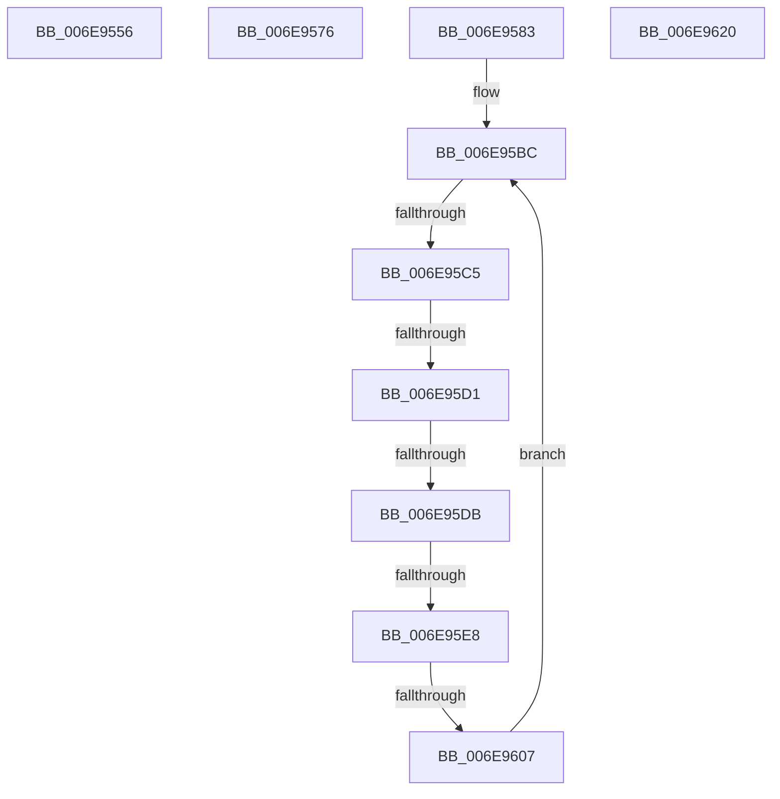

# sub_006E9556

- RVA: `0x006E9556`–`0x006E962B` (길이 `213` bytes)
- VA: `0x00000001406E9556`
- 실행 섹션: `.text`
- PDB 이름 있음: `아니요`; PDB Function 태그: `아니요`
- unwind 정보 RVA: `0x00091730`
- 디코드: `54`개 명령, `213/213` bytes 표시
- 미해석 바이트: `0` (있으면 어셈블리에 `.byte`로 보존)

> 이 문서는 커널 이미지의 기계어와 PDB 기호를 분석해 생성했습니다. 4번과 5번은 함수 원형과 자료형을 바이너리 사용 방식에서 추정한 C 해석이며 원본 소스 복구 결과는 아닙니다.

## 1. Dependencies

- 직접 호출 지점: **2**; 고유 호출 대상: **1**
- 직접 호출자로 확인된 함수: **0**
- RIP 상대 이미지 참조: **1**

### Outgoing calls
- `0x006E9576` → [MiUnlockWorkingSetShared](../27/MiUnlockWorkingSetShared_function_0027D690.md) (function, `0x0027D690`)
- `0x006E9620` → [MiUnlockWorkingSetShared](../27/MiUnlockWorkingSetShared_function_0027D690.md) (function, `0x0027D690`)

### Direct callers
- 이 함수 시작 RVA로 연결되는 직접 call은 확인되지 않았습니다. 간접 호출은 완전히 역산할 수 없습니다.

### Static image references
- `0x006E9556` → RVA `0x00FC6B30` (`ALMOSTRO`; read)

## 2. Other-region calls and transfers

- 다른 실행 섹션으로 향하는 call: **0**
- call이 아닌 외부 분기/꼬리 이동: **8**
  - `0x006E9571` → [MiMapUserLargePages + 0x105](../3D/MiMapUserLargePages_function_003D26F4.md) (`tail-transfer`)
  - `0x006E957E` → [MiMapUserLargePages + 0x443](../3D/MiMapUserLargePages_function_003D26F4.md) (`tail-transfer`)
  - `0x006E95BF` → [MiMapUserLargePages + 0x4CC](../3D/MiMapUserLargePages_function_003D26F4.md) (`tail-transfer`)
  - `0x006E95CB` → [MiMapUserLargePages + 0x4CC](../3D/MiMapUserLargePages_function_003D26F4.md) (`tail-transfer`)
  - `0x006E95D5` → [MiMapUserLargePages + 0x2C2](../3D/MiMapUserLargePages_function_003D26F4.md) (`tail-transfer`)
  - `0x006E95E2` → [MiMapUserLargePages + 0x2C2](../3D/MiMapUserLargePages_function_003D26F4.md) (`tail-transfer`)
  - `0x006E9601` → [MiMapUserLargePages + 0x2C2](../3D/MiMapUserLargePages_function_003D26F4.md) (`tail-transfer`)
  - `0x006E9626` → [MiMapUserLargePages + 0x35C](../3D/MiMapUserLargePages_function_003D26F4.md) (`tail-transfer`)

## 3. Assembly (complete function range)

```asm
006E9556  48 8B 15 D3 D5 8D 00            mov rdx, qword ptr [rip + 0x8dd5d3]
006E955D  48 C1 EA 25                     shr rdx, 0x25
006E9561  F7 D2                           not edx
006E9563  41 8B C2                        mov eax, r10d
006E9566  41 23 D2                        and edx, r10d
006E9569  48 89 55 A8                     mov qword ptr [rbp - 0x58], rdx
006E956D  48 8B 55 B8                     mov rdx, qword ptr [rbp - 0x48]
006E9571  E9 83 92 CE FF                  jmp 0x1403d27f9
006E9576  E8 15 41 B9 FF                  call 0x14027d690
006E957B  41 B7 11                        mov r15b, 0x11
006E957E  E9 B4 95 CE FF                  jmp 0x1403d2b37
006E9583  41 8D 4E 08                     lea ecx, [r14 + 8]
006E9587  B8 00 02 00 00                  mov eax, 0x200
006E958C  48 C1 E9 03                     shr rcx, 3
006E9590  81 E1 FF 01 00 00               and ecx, 0x1ff
006E9596  48 2B C1                        sub rax, rcx
006E9599  8B CA                           mov ecx, edx
006E959B  33 D2                           xor edx, edx
006E959D  48 F7 F1                        div rcx
006E95A0  48 0F AF 45 B0                  imul rax, qword ptr [rbp - 0x50]
006E95A5  48 C1 E0 0C                     shl rax, 0xc
006E95A9  49 3B C1                        cmp rax, r9
006E95AC  49 0F 47 C1                     cmova rax, r9
006E95B0  33 D2                           xor edx, edx
006E95B2  49 F7 F0                        div r8
006E95B5  48 8B 55 C8                     mov rdx, qword ptr [rbp - 0x38]
006E95B9  4C 8B C0                        mov r8, rax
006E95BC  49 3B D8                        cmp rbx, r8
006E95BF  0F 83 FB 95 CE FF               jae 0x1403d2bc0
006E95C5  49 8B 0A                        mov rcx, qword ptr [r10]
006E95C8  49 3B CA                        cmp rcx, r10
006E95CB  0F 84 EF 95 CE FF               je 0x1403d2bc0
006E95D1  4C 39 51 08                     cmp qword ptr [rcx + 8], r10
006E95D5  0F 85 DB 93 CE FF               jne 0x1403d29b6
006E95DB  48 8B 01                        mov rax, qword ptr [rcx]
006E95DE  48 39 48 08                     cmp qword ptr [rax + 8], rcx
006E95E2  0F 85 CE 93 CE FF               jne 0x1403d29b6
006E95E8  49 89 02                        mov qword ptr [r10], rax
006E95EB  4C 8D 4C 24 60                  lea r9, [rsp + 0x60]
006E95F0  4C 89 50 08                     mov qword ptr [rax + 8], r10
006E95F4  48 8B 44 24 68                  mov rax, qword ptr [rsp + 0x68]
006E95F9  48 FF 4C D5 10                  dec qword ptr [rbp + rdx*8 + 0x10]
006E95FE  4C 39 08                        cmp qword ptr [rax], r9
006E9601  0F 85 AF 93 CE FF               jne 0x1403d29b6
006E9607  48 89 41 08                     mov qword ptr [rcx + 8], rax
006E960B  4C 8D 4C 24 60                  lea r9, [rsp + 0x60]
006E9610  4C 89 09                        mov qword ptr [rcx], r9
006E9613  48 FF C3                        inc rbx
006E9616  48 89 08                        mov qword ptr [rax], rcx
006E9619  48 89 4C 24 68                  mov qword ptr [rsp + 0x68], rcx
006E961E  EB 9C                           jmp 0x1406e95bc
006E9620  E8 6B 40 B9 FF                  call 0x14027d690
006E9625  90                              nop
006E9626  E9 25 94 CE FF                  jmp 0x1403d2a50
```

## 4. C-style interpretation (structured pseudocode)

```c
__int64 __fastcall sub_006E9556(__int64 a1, __int64 a2, __int64 a3, __int64 a4)
{
    unsigned __int64 v_stack_p60;
    unsigned __int64 v_stack_p68;

    a2 = (*(unsigned __int64 *)(v_rip + 9295315)) >> (37);
    a2 = (unsigned int)(~(a2));
    a2 = (unsigned int)((a2) & ((unsigned int)(v_r10)));
    *(unsigned __int64 *)(v_rbp - 88) = a2;
}
```

## 5. (Beta) C Style

```c
int64_t sub_006E9556(int64_t Arg1, int64_t Arg2, int64_t Arg3, int64_t Arg4)
{
    uint64_t v_stack_p60;
    uint64_t v_stack_p68;

    Arg2 = (*(uint64_t *)(v_rip + 0x8DD5D3)) >> (37);
    Arg2 = (uint32_t)(~(Arg2));
    Arg2 = (uint32_t)((Arg2) & ((uint32_t)(local_r10)));
    *(uint64_t *)(local_rbp - 0x58) = Arg2;
}
```

## 6. Execution-region graph

[열기: 2D/3D 그래프와 함수 탐색 컨트롤 패널](../../../control-panel.html?section=text&rva=0x006E9556&view=graph)

- 2D 그래프는 위에서 아래로 흐르고, 3D 그래프는 빈 공간을 드래그해 회전합니다. Shift+드래그는 이동, 휠은 확대·축소, 함수 노드 선택은 대상 보고서 이동입니다.

### Static fallback


