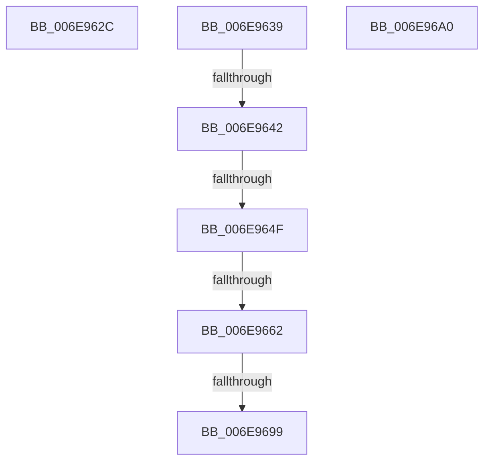

# sub_006E962C

- RVA: `0x006E962C`–`0x006E96AA` (길이 `126` bytes)
- VA: `0x00000001406E962C`
- 실행 섹션: `.text`
- PDB 이름 있음: `아니요`; PDB Function 태그: `아니요`
- unwind 정보 RVA: `0x00091764`
- 디코드: `28`개 명령, `126/126` bytes 표시
- 미해석 바이트: `0` (있으면 어셈블리에 `.byte`로 보존)

> 이 문서는 커널 이미지의 기계어와 PDB 기호를 분석해 생성했습니다. 4번과 5번은 함수 원형과 자료형을 바이너리 사용 방식에서 추정한 C 해석이며 원본 소스 복구 결과는 아닙니다.

## 1. Dependencies

- 직접 호출 지점: **1**; 고유 호출 대상: **1**
- 직접 호출자로 확인된 함수: **0**
- RIP 상대 이미지 참조: **0**

### Outgoing calls
- `0x006E967F` → [MiAllocateLargeProcessPagesFromCache](../69/MiAllocateLargeProcessPagesFromCache_function_0069818C.md) (function, `0x0069818C`)

### Direct callers
- 이 함수 시작 RVA로 연결되는 직접 call은 확인되지 않았습니다. 간접 호출은 완전히 역산할 수 없습니다.

### Static image references
- 디코드된 RIP-relative 메모리 참조가 없습니다.

## 2. Other-region calls and transfers

- 다른 실행 섹션으로 향하는 call: **0**
- call이 아닌 외부 분기/꼬리 이동: **7**
  - `0x006E9634` → [MiCreateLargePfnList + 0x314](../3D/MiCreateLargePfnList_function_003D2DA8.md) (`tail-transfer`)
  - `0x006E963C` → [MiCreateLargePfnList + 0xD8](../3D/MiCreateLargePfnList_function_003D2DA8.md) (`tail-transfer`)
  - `0x006E9649` → [MiCreateLargePfnList + 0xD8](../3D/MiCreateLargePfnList_function_003D2DA8.md) (`tail-transfer`)
  - `0x006E965C` → [MiCreateLargePfnList + 0xDF](../3D/MiCreateLargePfnList_function_003D2DA8.md) (`tail-transfer`)
  - `0x006E9693` → [MiCreateLargePfnList + 0xE4](../3D/MiCreateLargePfnList_function_003D2DA8.md) (`tail-transfer`)
  - `0x006E969B` → [MiCreateLargePfnList + 0x200](../3D/MiCreateLargePfnList_function_003D2DA8.md) (`tail-transfer`)
  - `0x006E96A5` → [MiCreateLargePfnList + 0x1E3](../3D/MiCreateLargePfnList_function_003D2DA8.md) (`tail-transfer`)

## 3. Assembly (complete function range)

```asm
006E962C  BB 03 00 00 00                  mov ebx, 3
006E9631  8D 7B 01                        lea edi, [rbx + 1]
006E9634  E9 83 9A CE FF                  jmp 0x1403d30bc
006E9639  83 FA 10                        cmp edx, 0x10
006E963C  0F 85 3E 98 CE FF               jne 0x1403d2e80
006E9642  48 81 FE 00 02 00 00            cmp rsi, 0x200
006E9649  0F 83 31 98 CE FF               jae 0x1403d2e80
006E964F  41 8B 46 04                     mov eax, dword ptr [r14 + 4]
006E9653  44 8A BD 88 00 00 00            mov r15b, byte ptr [rbp + 0x88]
006E965A  84 C2                           test dl, al
006E965C  0F 85 25 98 CE FF               jne 0x1403d2e87
006E9662  48 8B 54 24 30                  mov rdx, qword ptr [rsp + 0x30]
006E9667  44 8B CF                        mov r9d, edi
006E966A  48 89 54 24 28                  mov qword ptr [rsp + 0x28], rdx
006E966F  4C 8B C6                        mov r8, rsi
006E9672  48 8B 54 24 48                  mov rdx, qword ptr [rsp + 0x48]
006E9677  49 8B CD                        mov rcx, r13
006E967A  44 88 7C 24 20                  mov byte ptr [rsp + 0x20], r15b
006E967F  E8 08 EB FA FF                  call 0x14069818c
006E9684  4C 8B 5C 24 30                  mov r11, qword ptr [rsp + 0x30]
006E9689  4D 8B 63 40                     mov r12, qword ptr [r11 + 0x40]
006E968D  49 C1 E4 04                     shl r12, 4
006E9691  85 C0                           test eax, eax
006E9693  0F 88 F3 97 CE FF               js 0x1403d2e8c
006E9699  33 C0                           xor eax, eax
006E969B  E9 08 99 CE FF                  jmp 0x1403d2fa8
006E96A0  BF 9A 00 00 C0                  mov edi, 0xc000009a
006E96A5  E9 E1 98 CE FF                  jmp 0x1403d2f8b
```

## 4. C-style interpretation (structured pseudocode)

```c
__int64 __fastcall sub_006E962C(__int64 a1, int a2)
{
    unsigned __int8 v_stack_p20;
    unsigned __int64 v_stack_p28;
    unsigned __int64 v_stack_p30;
    unsigned __int64 v_stack_p48;
}
```

## 5. (Beta) C Style

```c
int64_t sub_006E962C(int64_t Arg1, int32_t Arg2)
{
    uint8_t v_stack_p20;
    uint64_t v_stack_p28;
    uint64_t v_stack_p30;
    uint64_t v_stack_p48;
}
```

## 6. Execution-region graph

[열기: 2D/3D 그래프와 함수 탐색 컨트롤 패널](../../../control-panel.html?section=text&rva=0x006E962C&view=graph)

- 2D 그래프는 위에서 아래로 흐르고, 3D 그래프는 빈 공간을 드래그해 회전합니다. Shift+드래그는 이동, 휠은 확대·축소, 함수 노드 선택은 대상 보고서 이동입니다.

### Static fallback


