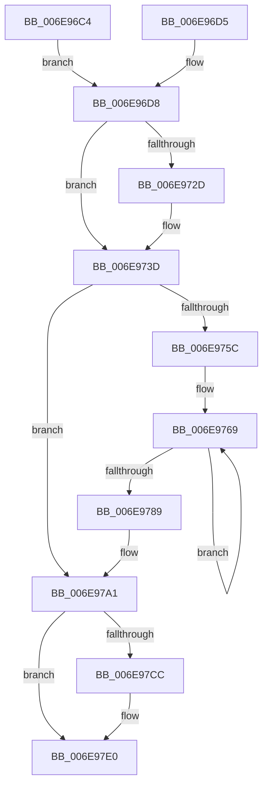

# sub_006E96C4

- RVA: `0x006E96C4`–`0x006E97E8` (길이 `292` bytes)
- VA: `0x00000001406E96C4`
- 실행 섹션: `.text`
- PDB 이름 있음: `아니요`; PDB Function 태그: `아니요`
- unwind 정보 RVA: `0x000924E0`
- 디코드: `74`개 명령, `292/292` bytes 표시
- 미해석 바이트: `0` (있으면 어셈블리에 `.byte`로 보존)

> 이 문서는 커널 이미지의 기계어와 PDB 기호를 분석해 생성했습니다. 4번과 5번은 함수 원형과 자료형을 바이너리 사용 방식에서 추정한 C 해석이며 원본 소스 복구 결과는 아닙니다.

## 1. Dependencies

- 직접 호출 지점: **11**; 고유 호출 대상: **10**
- 직접 호출자로 확인된 함수: **0**
- RIP 상대 이미지 참조: **0**

### Outgoing calls
- `0x006E9712` → [RtlInsertHeadCircularList](../43/RtlInsertHeadCircularList_function_00433510.md) (function, `0x00433510`)
- `0x006E971B` → [KeReleaseInStackQueuedSpinLock](../34/KeReleaseInStackQueuedSpinLock_function_00342CE0.md) (function, `0x00342CE0`)
- `0x006E9738` → [PerfLogExecutiveResourceWait](../4B/PerfLogExecutiveResourceWait_function_004B9E90.md) (function, `0x004B9E90`)
- `0x006E9740` → [ExpApplyPrewaitBoost](../21/ExpApplyPrewaitBoost_function_00213E50.md) (function, `0x00213E50`)
- `0x006E9752` → [ExpWaitForResource](../21/ExpWaitForResource_function_002166F0.md) (function, `0x002166F0`)
- `0x006E9764` → [KeAcquireInStackQueuedSpinLock](../27/KeAcquireInStackQueuedSpinLock_function_002757A0.md) (function, `0x002757A0`)
- `0x006E977F` → [ExpFindCurrentThread](../3D/ExpFindCurrentThread_function_003D46F0.md) (function, `0x003D46F0`)
- `0x006E979C` → [KeReleaseInStackQueuedSpinLock](../34/KeReleaseInStackQueuedSpinLock_function_00342CE0.md) (function, `0x00342CE0`)
- `0x006E97A4` → [ExpGetThreadResourceHint](../21/ExpGetThreadResourceHint_function_002134C0.md) (function, `0x002134C0`)
- `0x006E97B2` → [ExpBoostIoAfterAcquire](../21/ExpBoostIoAfterAcquire_function_00215CE0.md) (function, `0x00215CE0`)
- `0x006E97DB` → [PerfLogExecutiveResourceAcquire](../47/PerfLogExecutiveResourceAcquire_function_004795E8.md) (function, `0x004795E8`)

### Direct callers
- 이 함수 시작 RVA로 연결되는 직접 call은 확인되지 않았습니다. 간접 호출은 완전히 역산할 수 없습니다.

### Static image references
- 디코드된 RIP-relative 메모리 참조가 없습니다.

## 2. Other-region calls and transfers

- 다른 실행 섹션으로 향하는 call: **0**
- call이 아닌 외부 분기/꼬리 이동: **1**
  - `0x006E97E3` → [ExAcquireSharedWaitForExclusive + 0xDC](../3D/ExAcquireSharedWaitForExclusive_function_003D43F0.md) (`tail-transfer`)

## 3. Assembly (complete function range)

```asm
006E96C4  4C 89 30                        mov qword ptr [rax], r14
006E96C7  8B 40 08                        mov eax, dword ptr [rax + 8]
006E96CA  83 E0 07                        and eax, 7
006E96CD  83 C8 08                        or eax, 8
006E96D0  89 46 08                        mov dword ptr [rsi + 8], eax
006E96D3  EB 03                           jmp 0x1406e96d8
006E96D5  48 8B F7                        mov rsi, rdi
006E96D8  48 8D 45 E8                     lea rax, [rbp - 0x18]
006E96DC  48 89 7D C8                     mov qword ptr [rbp - 0x38], rdi
006E96E0  48 89 45 F0                     mov qword ptr [rbp - 0x10], rax
006E96E4  48 8D 4B 20                     lea rcx, [rbx + 0x20]
006E96E8  48 8D 45 E8                     lea rax, [rbp - 0x18]
006E96EC  48 89 7D D0                     mov qword ptr [rbp - 0x30], rdi
006E96F0  41 BD 01 00 00 00               mov r13d, 1
006E96F6  48 89 45 E8                     mov qword ptr [rbp - 0x18], rax
006E96FA  44 01 6B 48                     add dword ptr [rbx + 0x48], r13d
006E96FE  48 8D 55 C8                     lea rdx, [rbp - 0x38]
006E9702  48 C7 45 E0 01 00 06 00         mov qword ptr [rbp - 0x20], 0x60001
006E970A  4C 89 75 D8                     mov qword ptr [rbp - 0x28], r14
006E970E  48 89 7D F8                     mov qword ptr [rbp - 8], rdi
006E9712  E8 F9 9D D4 FF                  call 0x140433510
006E9717  48 8D 4D B0                     lea rcx, [rbp - 0x50]
006E971B  E8 C0 95 C5 FF                  call 0x140342ce0
006E9720  65 FF 04 25 CC 90 00 00         inc dword ptr gs:[0x90cc]
006E9728  45 85 FF                        test r15d, r15d
006E972B  74 10                           je 0x1406e973d
006E972D  45 33 C0                        xor r8d, r8d
006E9730  48 8B D3                        mov rdx, rbx
006E9733  B9 44 00 01 00                  mov ecx, 0x10044
006E9738  E8 53 07 DD FF                  call 0x1404b9e90
006E973D  48 8B CB                        mov rcx, rbx
006E9740  E8 0B A7 B2 FF                  call 0x140213e50
006E9745  41 B8 44 02 01 00               mov r8d, 0x10244
006E974B  48 8D 55 C8                     lea rdx, [rbp - 0x38]
006E974F  48 8B CB                        mov rcx, rbx
006E9752  E8 99 CF B2 FF                  call 0x1402166f0
006E9757  48 85 F6                        test rsi, rsi
006E975A  75 45                           jne 0x1406e97a1
006E975C  48 8D 55 B0                     lea rdx, [rbp - 0x50]
006E9760  48 8D 4B 60                     lea rcx, [rbx + 0x60]
006E9764  E8 37 C0 B8 FF                  call 0x1402757a0
006E9769  89 7C 24 28                     mov dword ptr [rsp + 0x28], edi
006E976D  4C 8D 45 B0                     lea r8, [rbp - 0x50]
006E9771  45 8B CD                        mov r9d, r13d
006E9774  44 89 6C 24 20                  mov dword ptr [rsp + 0x20], r13d
006E9779  49 8B D6                        mov rdx, r14
006E977C  48 8B CB                        mov rcx, rbx
006E977F  E8 6C AF CE FF                  call 0x1403d46f0
006E9784  48 85 C0                        test rax, rax
006E9787  74 E0                           je 0x1406e9769
006E9789  8B 48 08                        mov ecx, dword ptr [rax + 8]
006E978C  83 E1 07                        and ecx, 7
006E978F  4C 89 30                        mov qword ptr [rax], r14
006E9792  83 C9 08                        or ecx, 8
006E9795  89 48 08                        mov dword ptr [rax + 8], ecx
006E9798  48 8D 4D B0                     lea rcx, [rbp - 0x50]
006E979C  E8 3F 95 C5 FF                  call 0x140342ce0
006E97A1  49 8B CE                        mov rcx, r14
006E97A4  E8 17 9D B2 FF                  call 0x1402134c0
006E97A9  44 8B C0                        mov r8d, eax
006E97AC  49 8B D6                        mov rdx, r14
006E97AF  48 8B CB                        mov rcx, rbx
006E97B2  E8 29 C5 B2 FF                  call 0x140215ce0
006E97B7  65 FF 04 25 C4 90 00 00         inc dword ptr gs:[0x90c4]
006E97BF  65 FF 04 25 64 90 00 00         inc dword ptr gs:[0x9064]
006E97C7  45 85 FF                        test r15d, r15d
006E97CA  74 14                           je 0x1406e97e0
006E97CC  44 8B 4B 44                     mov r9d, dword ptr [rbx + 0x44]
006E97D0  45 8B C5                        mov r8d, r13d
006E97D3  48 8B D3                        mov rdx, rbx
006E97D6  B9 41 00 01 00                  mov ecx, 0x10041
006E97DB  E8 08 FE D8 FF                  call 0x1404795e8
006E97E0  41 8A F5                        mov sil, r13b
006E97E3  E9 E4 AC CE FF                  jmp 0x1403d44cc
```

## 4. C-style interpretation (structured pseudocode)

```c
__int64 __fastcall sub_006E96C4(__int64 a1, __int64 a2, int a3)
{
    __int64 result;
    unsigned int v_stack_p20;
    unsigned int v_stack_p28;

    *(unsigned __int64 *)(result) = v_r14;
    result = (unsigned int)(((unsigned int)(*(unsigned int *)(result + 8))) & (7));
    result = (unsigned int)((result) | (8));
    *(unsigned int *)(v_rsi + 8) = (unsigned int)(result);
    goto loc_006E96D8;
loc_006E96D8:
    *(unsigned __int64 *)(v_rbp - 56) = v_rdi;
    *(unsigned __int64 *)(v_rbp - 16) = v_rbp - 24;
    *(unsigned __int64 *)(v_rbp - 48) = v_rdi;
    *(unsigned __int64 *)(v_rbp - 24) = v_rbp - 24;
    *(unsigned __int64 *)(v_rbp - 32) = 0x60001ULL;
    *(unsigned __int64 *)(v_rbp - 40) = v_r14;
    *(unsigned __int64 *)(v_rbp - 8) = v_rdi;
    result = RtlInsertHeadCircularList(v_rbx + 32, v_rbp - 56, a3, a4);
    result = KeReleaseInStackQueuedSpinLock(v_rbp - 80, v_rbp - 56, a3, a4);
    if ((unsigned int)(v_r15) != 0) {
        a3 = 0;
        a2 = v_rbx;
        a1 = 0x10044ULL;
        result = PerfLogExecutiveResourceWait(a1, a2, a3, a4);
    }
    result = ExpApplyPrewaitBoost(v_rbx, a2, a3, a4);
    result = ExpWaitForResource(v_rbx, v_rbp - 56, (unsigned int)(0x10244ULL), a4);
    if (v_rsi != 0) goto loc_006E97A1;
    result = KeAcquireInStackQueuedSpinLock(v_rbx + 96, v_rbp - 80, (unsigned int)(0x10244ULL), a4);
loc_006E9769:
    v_stack_p28 = (unsigned int)(v_rdi);
    v_stack_p20 = 1;
    result = ExpFindCurrentThread(v_rbx, v_r14, v_rbp - 80, 1);
    if (result == 0) goto loc_006E9769;
    a1 = (unsigned int)(((unsigned int)(*(unsigned int *)(result + 8))) & (7));
    *(unsigned __int64 *)(result) = v_r14;
    a1 = (unsigned int)((a1) | (8));
    *(unsigned int *)(result + 8) = (unsigned int)(a1);
    result = KeReleaseInStackQueuedSpinLock(v_rbp - 80, v_r14, v_rbp - 80, 1);
loc_006E97A1:
    result = ExpGetThreadResourceHint(v_r14, v_r14, v_rbp - 80, 1);
    result = ExpBoostIoAfterAcquire(v_rbx, v_r14, (unsigned int)((unsigned int)(result)), 1);
    if ((unsigned int)(v_r15) != 0) {
        a4 = *(unsigned int *)(v_rbx + 68);
        a3 = 1;
        a2 = v_rbx;
        a1 = 0x10041ULL;
        result = PerfLogExecutiveResourceAcquire(a1, a2, a3, a4);
    }
}
```

## 5. (Beta) C Style

```c
int64_t sub_006E96C4(int64_t Arg1, int64_t Arg2, int32_t Arg3)
{
    int64_t result;
    uint32_t v_stack_p20;
    uint32_t v_stack_p28;

    *(uint64_t *)(result) = local_r14;
    result = (uint32_t)(((uint32_t)(*(uint32_t *)(result + 0x8))) & (7));
    result = (uint32_t)((result) | (8));
    *(uint32_t *)(local_rsi + 0x8) = (uint32_t)(result);
    goto loc_006E96D8;
loc_006E96D8:
    *(uint64_t *)(local_rbp - 0x38) = local_rdi;
    *(uint64_t *)(local_rbp - 0x10) = local_rbp - 24;
    *(uint64_t *)(local_rbp - 0x30) = local_rdi;
    *(uint64_t *)(local_rbp - 0x18) = local_rbp - 24;
    *(uint64_t *)(local_rbp - 0x20) = 0x60001ULL;
    *(uint64_t *)(local_rbp - 0x28) = local_r14;
    *(uint64_t *)(local_rbp - 0x8) = local_rdi;
    result = RtlInsertHeadCircularList(local_rbx + 32, local_rbp - 56, Arg3, a4);
    result = KeReleaseInStackQueuedSpinLock(local_rbp - 80, local_rbp - 56, Arg3, a4);
    if ((uint32_t)(local_r15) != 0) {
        Arg3 = 0;
        Arg2 = local_rbx;
        Arg1 = 0x10044ULL;
        result = PerfLogExecutiveResourceWait(Arg1, Arg2, Arg3, a4);
    }
    result = ExpApplyPrewaitBoost(local_rbx, Arg2, Arg3, a4);
    result = ExpWaitForResource(local_rbx, local_rbp - 56, (uint32_t)(0x10244ULL), a4);
    if (local_rsi != 0) goto loc_006E97A1;
    result = KeAcquireInStackQueuedSpinLock(local_rbx + 96, local_rbp - 80, (uint32_t)(0x10244ULL), a4);
loc_006E9769:
    v_stack_p28 = (uint32_t)(local_rdi);
    v_stack_p20 = 1;
    result = ExpFindCurrentThread(local_rbx, local_r14, local_rbp - 80, 1);
    if (result == 0) goto loc_006E9769;
    Arg1 = (uint32_t)(((uint32_t)(*(uint32_t *)(result + 0x8))) & (7));
    *(uint64_t *)(result) = local_r14;
    Arg1 = (uint32_t)((Arg1) | (8));
    *(uint32_t *)(result + 0x8) = (uint32_t)(Arg1);
    result = KeReleaseInStackQueuedSpinLock(local_rbp - 80, local_r14, local_rbp - 80, 1);
loc_006E97A1:
    result = ExpGetThreadResourceHint(local_r14, local_r14, local_rbp - 80, 1);
    result = ExpBoostIoAfterAcquire(local_rbx, local_r14, (uint32_t)((uint32_t)(result)), 1);
    if ((uint32_t)(local_r15) != 0) {
        a4 = *(uint32_t *)(local_rbx + 0x44);
        Arg3 = 1;
        Arg2 = local_rbx;
        Arg1 = 0x10041ULL;
        result = PerfLogExecutiveResourceAcquire(Arg1, Arg2, Arg3, a4);
    }
}
```

## 6. Execution-region graph

[열기: 2D/3D 그래프와 함수 탐색 컨트롤 패널](../../../control-panel.html?section=text&rva=0x006E96C4&view=graph)

- 2D 그래프는 위에서 아래로 흐르고, 3D 그래프는 빈 공간을 드래그해 회전합니다. Shift+드래그는 이동, 휠은 확대·축소, 함수 노드 선택은 대상 보고서 이동입니다.

### Static fallback


