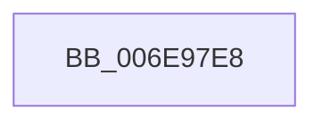

# sub_006E97E8

- RVA: `0x006E97E8`–`0x006E983C` (길이 `84` bytes)
- VA: `0x00000001406E97E8`
- 실행 섹션: `.text`
- PDB 이름 있음: `아니요`; PDB Function 태그: `아니요`
- unwind 정보 RVA: `0x00093A74`
- 디코드: `20`개 명령, `84/84` bytes 표시
- 미해석 바이트: `0` (있으면 어셈블리에 `.byte`로 보존)

> 이 문서는 커널 이미지의 기계어와 PDB 기호를 분석해 생성했습니다. 4번과 5번은 함수 원형과 자료형을 바이너리 사용 방식에서 추정한 C 해석이며 원본 소스 복구 결과는 아닙니다.

## 1. Dependencies

- 직접 호출 지점: **2**; 고유 호출 대상: **2**
- 직접 호출자로 확인된 함수: **0**
- RIP 상대 이미지 참조: **0**

### Outgoing calls
- `0x006E97F4` → [memset](../6C/memset_function_006C6C40.md) (function, `0x006C6C40`)
- `0x006E9836` → [KeBugCheckEx](../4F/KeBugCheckEx_function_004FD660.md) (function, `0x004FD660`)

### Direct callers
- 이 함수 시작 RVA로 연결되는 직접 call은 확인되지 않았습니다. 간접 호출은 완전히 역산할 수 없습니다.

### Static image references
- 디코드된 RIP-relative 메모리 참조가 없습니다.

## 2. Other-region calls and transfers

- 다른 실행 섹션으로 향하는 call: **0**
- 별도 외부 분기/꼬리 이동을 확인하지 못했습니다.

## 3. Assembly (complete function range)

```asm
006E97E8  33 D2                           xor edx, edx
006E97EA  48 8D 4D A0                     lea rcx, [rbp - 0x60]
006E97EE  41 B8 98 00 00 00               mov r8d, 0x98
006E97F4  E8 47 D4 FD FF                  call 0x1406c6c40
006E97F9  48 83 64 24 20 00               and qword ptr [rsp + 0x20], 0
006E97FF  4C 8D 4D A0                     lea r9, [rbp - 0x60]
006E9803  BA 43 00 00 00                  mov edx, 0x43
006E9808  89 5D A0                        mov dword ptr [rbp - 0x60], ebx
006E980B  45 33 C0                        xor r8d, r8d
006E980E  48 89 55 C0                     mov qword ptr [rbp - 0x40], rdx
006E9812  B9 39 01 00 00                  mov ecx, 0x139
006E9817  C7 45 B8 07 00 00 00            mov dword ptr [rbp - 0x48], 7
006E981E  48 89 7D C8                     mov qword ptr [rbp - 0x38], rdi
006E9822  48 89 75 D0                     mov qword ptr [rbp - 0x30], rsi
006E9826  4C 89 75 D8                     mov qword ptr [rbp - 0x28], r14
006E982A  4C 89 7D E0                     mov qword ptr [rbp - 0x20], r15
006E982E  4C 89 65 E8                     mov qword ptr [rbp - 0x18], r12
006E9832  4C 89 6D F0                     mov qword ptr [rbp - 0x10], r13
006E9836  E8 25 3E E1 FF                  call 0x1404fd660
006E983B  CC                              int3
```

## 4. C-style interpretation (structured pseudocode)

```c
__int64 __fastcall sub_006E97E8(__int64 a1, int a2)
{
    __int64 result;
    unsigned __int64 v_stack_p20;

    a2 = 0;
    result = memset(v_rbp - 96, a2, 152, a4);
    *(unsigned int *)(v_rbp - 96) = (unsigned int)(v_rbx);
    a3 = 0;
    *(unsigned __int64 *)(v_rbp - 64) = 67;
    *(unsigned int *)(v_rbp - 72) = 7;
    *(unsigned __int64 *)(v_rbp - 56) = v_rdi;
    *(unsigned __int64 *)(v_rbp - 48) = v_rsi;
    *(unsigned __int64 *)(v_rbp - 40) = v_r14;
    *(unsigned __int64 *)(v_rbp - 32) = v_r15;
    *(unsigned __int64 *)(v_rbp - 24) = v_r12;
    *(unsigned __int64 *)(v_rbp - 16) = v_r13;
    result = KeBugCheckEx(313, 67, a3, v_rbp - 96);
    return result;
}
```

## 5. (Beta) C Style

```c
int64_t sub_006E97E8(int64_t Arg1, int32_t Arg2)
{
    int64_t result;
    uint64_t v_stack_p20;

    Arg2 = 0;
    result = memset(local_rbp - 96, Arg2, 152, a4);
    *(uint32_t *)(local_rbp - 0x60) = (uint32_t)(local_rbx);
    a3 = 0;
    *(uint64_t *)(local_rbp - 0x40) = 67;
    *(uint32_t *)(local_rbp - 0x48) = 7;
    *(uint64_t *)(local_rbp - 0x38) = local_rdi;
    *(uint64_t *)(local_rbp - 0x30) = local_rsi;
    *(uint64_t *)(local_rbp - 0x28) = local_r14;
    *(uint64_t *)(local_rbp - 0x20) = local_r15;
    *(uint64_t *)(local_rbp - 0x18) = local_r12;
    *(uint64_t *)(local_rbp - 0x10) = local_r13;
    result = KeBugCheckEx(313, 67, a3, local_rbp - 96);
    return result;
}
```

## 6. Execution-region graph

[열기: 2D/3D 그래프와 함수 탐색 컨트롤 패널](../../../control-panel.html?section=text&rva=0x006E97E8&view=graph)

- 2D 그래프는 위에서 아래로 흐르고, 3D 그래프는 빈 공간을 드래그해 회전합니다. Shift+드래그는 이동, 휠은 확대·축소, 함수 노드 선택은 대상 보고서 이동입니다.

### Static fallback


