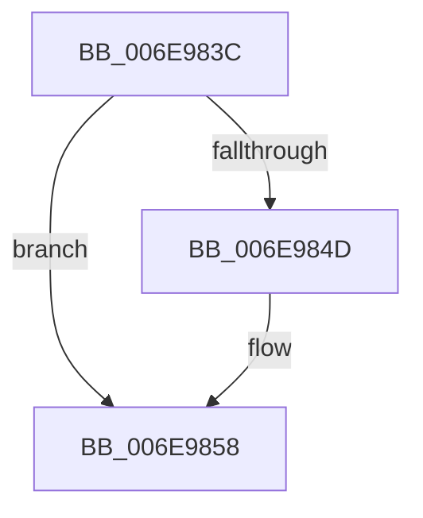

# sub_006E983C

- RVA: `0x006E983C`–`0x006E9864` (길이 `40` bytes)
- VA: `0x00000001406E983C`
- 실행 섹션: `.text`
- PDB 이름 있음: `아니요`; PDB Function 태그: `아니요`
- unwind 정보 RVA: `0x00093AB8`
- 디코드: `10`개 명령, `40/40` bytes 표시
- 미해석 바이트: `0` (있으면 어셈블리에 `.byte`로 보존)

> 이 문서는 커널 이미지의 기계어와 PDB 기호를 분석해 생성했습니다. 4번과 5번은 함수 원형과 자료형을 바이너리 사용 방식에서 추정한 C 해석이며 원본 소스 복구 결과는 아닙니다.

## 1. Dependencies

- 직접 호출 지점: **2**; 고유 호출 대상: **2**
- 직접 호출자로 확인된 함수: **0**
- RIP 상대 이미지 참조: **1**

### Outgoing calls
- `0x006E983F` → [KiSetupForInstrumentationReturn](../45/KiSetupForInstrumentationReturn_function_00459300.md) (function, `0x00459300`)
- `0x006E9853` → [KiLowerIrqlProcessIrqlFlags](../4F/KiLowerIrqlProcessIrqlFlags_function_004F5698.md) (function, `0x004F5698`)

### Direct callers
- 이 함수 시작 RVA로 연결되는 직접 call은 확인되지 않았습니다. 간접 호출은 완전히 역산할 수 없습니다.

### Static image references
- `0x006E9844` → RVA `0x00FC6D20` (`ALMOSTRO`; read)

## 2. Other-region calls and transfers

- 다른 실행 섹션으로 향하는 call: **0**
- call이 아닌 외부 분기/꼬리 이동: **1**
  - `0x006E985F` → [KiRaiseException + 0x117](../3D/KiRaiseException_function_003D5CA0.md) (`tail-transfer`)

## 3. Assembly (complete function range)

```asm
006E983C  48 8B CF                        mov rcx, rdi
006E983F  E8 BC FA D6 FF                  call 0x140459300
006E9844  83 3D D5 D4 8D 00 00            cmp dword ptr [rip + 0x8dd4d5], 0
006E984B  74 0B                           je 0x1406e9858
006E984D  44 0F 20 C1                     mov rcx, cr8
006E9851  8A D3                           mov dl, bl
006E9853  E8 40 BE E0 FF                  call 0x1404f5698
006E9858  0F B6 C3                        movzx eax, bl
006E985B  44 0F 22 C0                     mov cr8, rax
006E985F  E9 53 C5 CE FF                  jmp 0x1403d5db7
```

## 4. C-style interpretation (structured pseudocode)

```c
__int64 __fastcall sub_006E983C(void)
{
    __int64 result;

    result = KiSetupForInstrumentationReturn(v_rdi, a2, a3, a4);
    if ((*(unsigned int *)(v_rip + 9295061)) != 0) {
        a1 = v_cr8;
        a2 = (unsigned __int8)(v_rbx);
        result = KiLowerIrqlProcessIrqlFlags(a1, a2, a3, a4);
    }
}
```

## 5. (Beta) C Style

```c
void sub_006E983C(void)
{
    int64_t result;

    result = KiSetupForInstrumentationReturn(local_rdi, a2, a3, a4);
    if ((*(uint32_t *)(v_rip + 0x8DD4D5)) != 0) {
        a1 = v_cr8;
        a2 = (uint8_t)(local_rbx);
        result = KiLowerIrqlProcessIrqlFlags(a1, a2, a3, a4);
    }
}
```

## 6. Execution-region graph

[열기: 2D/3D 그래프와 함수 탐색 컨트롤 패널](../../../control-panel.html?section=text&rva=0x006E983C&view=graph)

- 2D 그래프는 위에서 아래로 흐르고, 3D 그래프는 빈 공간을 드래그해 회전합니다. Shift+드래그는 이동, 휠은 확대·축소, 함수 노드 선택은 대상 보고서 이동입니다.

### Static fallback


