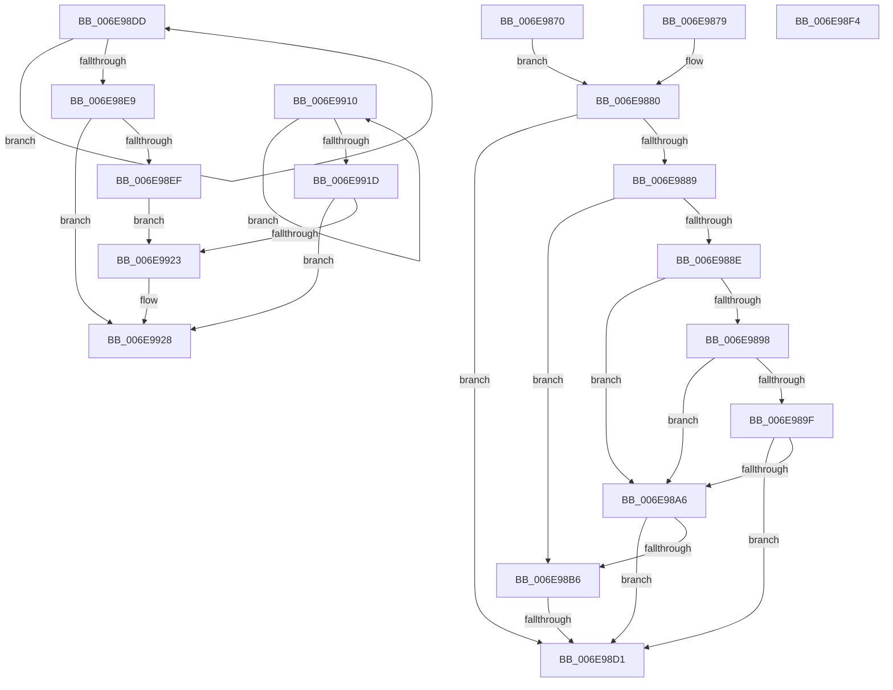

# sub_006E9870

- RVA: `0x006E9870`–`0x006E992E` (길이 `190` bytes)
- VA: `0x00000001406E9870`
- 실행 섹션: `.text`
- PDB 이름 있음: `아니요`; PDB Function 태그: `아니요`
- unwind 정보 RVA: `0x00093C64`
- 디코드: `51`개 명령, `190/190` bytes 표시
- 미해석 바이트: `0` (있으면 어셈블리에 `.byte`로 보존)

> 이 문서는 커널 이미지의 기계어와 PDB 기호를 분석해 생성했습니다. 4번과 5번은 함수 원형과 자료형을 바이너리 사용 방식에서 추정한 C 해석이며 원본 소스 복구 결과는 아닙니다.

## 1. Dependencies

- 직접 호출 지점: **3**; 고유 호출 대상: **3**
- 직접 호출자로 확인된 함수: **0**
- RIP 상대 이미지 참조: **0**

### Outgoing calls
- `0x006E9880` → [KeGetEffectiveIrql](../2F/KeGetEffectiveIrql_function_002F8030.md) (function, `0x002F8030`)
- `0x006E98C4` → [PsPicoDispatchException](../4B/PsPicoDispatchException_function_004B7610.md) (function, `0x004B7610`)
- `0x006E9923` → [KiRemoveSystemWorkPriorityKick](../26/KiRemoveSystemWorkPriorityKick_function_002631D0.md) (function, `0x002631D0`)

### Direct callers
- 이 함수 시작 RVA로 연결되는 직접 call은 확인되지 않았습니다. 간접 호출은 완전히 역산할 수 없습니다.

### Static image references
- 디코드된 RIP-relative 메모리 참조가 없습니다.

## 2. Other-region calls and transfers

- 다른 실행 섹션으로 향하는 call: **0**
- call이 아닌 외부 분기/꼬리 이동: **4**
  - `0x006E98CB` → [KiDispatchException + 0x1C7](../3D/KiDispatchException_function_003D7650.md) (`tail-transfer`)
  - `0x006E98D8` → [KiDispatchException + 0xA2](../3D/KiDispatchException_function_003D7650.md) (`tail-transfer`)
  - `0x006E990B` → [KiDispatchException + 0x250](../3D/KiDispatchException_function_003D7650.md) (`tail-transfer`)
  - `0x006E9929` → [KiDispatchException + 0x1C7](../3D/KiDispatchException_function_003D7650.md) (`tail-transfer`)

## 3. Assembly (complete function range)

```asm
006E9870  41 C7 06 94 00 00 C0            mov dword ptr [r14], 0xc0000094
006E9877  EB 07                           jmp 0x1406e9880
006E9879  41 C7 06 1D 00 00 C0            mov dword ptr [r14], 0xc000001d
006E9880  E8 AB E7 C0 FF                  call 0x1402f8030
006E9885  3C 02                           cmp al, 2
006E9887  73 48                           jae 0x1406e98d1
006E9889  40 84 FF                        test dil, dil
006E988C  75 28                           jne 0x1406e98b6
006E988E  41 8B 06                        mov eax, dword ptr [r14]
006E9891  3D 05 00 00 C0                  cmp eax, 0xc0000005
006E9896  74 0E                           je 0x1406e98a6
006E9898  3D 01 00 00 80                  cmp eax, 0x80000001
006E989D  74 07                           je 0x1406e98a6
006E989F  3D 06 00 00 C0                  cmp eax, 0xc0000006
006E98A4  75 2B                           jne 0x1406e98d1
006E98A6  48 B8 00 00 FF FF FF 7F 00 00   movabs rax, 0x7fffffff0000
006E98B0  49 39 46 28                     cmp qword ptr [r14 + 0x28], rax
006E98B4  77 1B                           ja 0x1406e98d1
006E98B6  40 88 7C 24 20                  mov byte ptr [rsp + 0x20], dil
006E98BB  4D 8B C4                        mov r8, r12
006E98BE  49 8B D7                        mov rdx, r15
006E98C1  49 8B CE                        mov rcx, r14
006E98C4  E8 47 DD DC FF                  call 0x1404b7610
006E98C9  84 C0                           test al, al
006E98CB  0F 85 46 DF CE FF               jne 0x1403d7817
006E98D1  41 89 1E                        mov dword ptr [r14], ebx
006E98D4  48 8B 55 30                     mov rdx, qword ptr [rbp + 0x30]
006E98D8  E9 15 DE CE FF                  jmp 0x1403d76f2
006E98DD  8B C8                           mov ecx, eax
006E98DF  0F BA F1 15                     btr ecx, 0x15
006E98E3  F0 0F B1 0A                     lock cmpxchg dword ptr [rdx], ecx
006E98E7  75 F4                           jne 0x1406e98dd
006E98E9  0F BA E0 15                     bt eax, 0x15
006E98ED  73 39                           jae 0x1406e9928
006E98EF  49 8B C8                        mov rcx, r8
006E98F2  EB 2F                           jmp 0x1406e9923
006E98F4  41 C7 06 1F 00 00 40            mov dword ptr [r14], 0x4000001f
006E98FB  B8 F0 FF FF FF                  mov eax, 0xfffffff0
006E9900  4C 23 F8                        and r15, rax
006E9903  4C 89 7D 18                     mov qword ptr [rbp + 0x18], r15
006E9907  4C 89 7D 48                     mov qword ptr [rbp + 0x48], r15
006E990B  E9 90 DF CE FF                  jmp 0x1403d78a0
006E9910  8B D0                           mov edx, eax
006E9912  0F BA F2 15                     btr edx, 0x15
006E9916  F0 41 0F B1 10                  lock cmpxchg dword ptr [r8], edx
006E991B  75 F3                           jne 0x1406e9910
006E991D  0F BA E0 15                     bt eax, 0x15
006E9921  73 05                           jae 0x1406e9928
006E9923  E8 A8 98 B7 FF                  call 0x1402631d0
006E9928  FB                              sti
006E9929  E9 E9 DE CE FF                  jmp 0x1403d7817
```

## 4. C-style interpretation (structured pseudocode)

```c
__int64 __fastcall sub_006E9870(void)
{
    __int64 result;
    unsigned __int8 v_stack_p20;

    *(unsigned int *)(v_r14) = 0xC0000094ULL;
    goto loc_006E9880;
loc_006E9880:
    result = KeGetEffectiveIrql(a1, a2, a3, a4);
    if (((unsigned __int8)(result)) >= 2) goto loc_006E98D1;
    if ((unsigned __int8)(v_rdi) != 0) goto loc_006E98B6;
    if (((unsigned int)((unsigned int)(*(unsigned int *)(v_r14)))) == 0xC0000005ULL) goto loc_006E98A6;
    if (((unsigned int)((unsigned int)(*(unsigned int *)(v_r14)))) == 0x80000001ULL) goto loc_006E98A6;
    if (((unsigned int)((unsigned int)(*(unsigned int *)(v_r14)))) != 0xC0000006ULL) goto loc_006E98D1;
loc_006E98A6:
    if ((*(unsigned __int64 *)(v_r14 + 40)) > ((unsigned int)(*(unsigned int *)(v_r14)))) goto loc_006E98D1;
loc_006E98B6:
    v_stack_p20 = (unsigned __int8)(v_rdi);
    result = PsPicoDispatchException(v_r14, v_r15, v_r12, a4);
loc_006E98D1:
    *(unsigned int *)(v_r14) = (unsigned int)(v_rbx);
}
```

## 5. (Beta) C Style

```c
void sub_006E9870(void)
{
    int64_t result;
    uint8_t v_stack_p20;

    *(uint32_t *)(local_r14) = 0xC0000094ULL;
    goto loc_006E9880;
loc_006E9880:
    result = KeGetEffectiveIrql(a1, a2, a3, a4);
    if (((uint8_t)(result)) >= 2) goto loc_006E98D1;
    if ((uint8_t)(local_rdi) != 0) goto loc_006E98B6;
    if (((uint32_t)((uint32_t)(*(uint32_t *)(local_r14)))) == 0xC0000005ULL) goto loc_006E98A6;
    if (((uint32_t)((uint32_t)(*(uint32_t *)(local_r14)))) == 0x80000001ULL) goto loc_006E98A6;
    if (((uint32_t)((uint32_t)(*(uint32_t *)(local_r14)))) != 0xC0000006ULL) goto loc_006E98D1;
loc_006E98A6:
    if ((*(uint64_t *)(local_r14 + 0x28)) > ((uint32_t)(*(uint32_t *)(local_r14)))) goto loc_006E98D1;
loc_006E98B6:
    v_stack_p20 = (uint8_t)(local_rdi);
    result = PsPicoDispatchException(local_r14, local_r15, local_r12, a4);
loc_006E98D1:
    *(uint32_t *)(local_r14) = (uint32_t)(local_rbx);
}
```

## 6. Execution-region graph

[열기: 2D/3D 그래프와 함수 탐색 컨트롤 패널](../../../control-panel.html?section=text&rva=0x006E9870&view=graph)

- 2D 그래프는 위에서 아래로 흐르고, 3D 그래프는 빈 공간을 드래그해 회전합니다. Shift+드래그는 이동, 휠은 확대·축소, 함수 노드 선택은 대상 보고서 이동입니다.

### Static fallback


