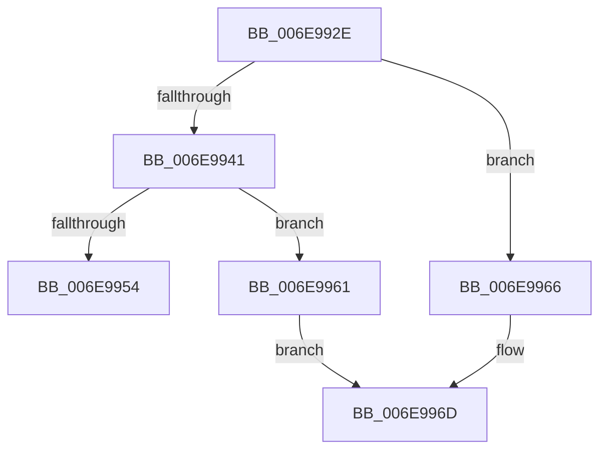

# sub_006E992E

- RVA: `0x006E992E`–`0x006E9980` (길이 `82` bytes)
- VA: `0x00000001406E992E`
- 실행 섹션: `.text`
- PDB 이름 있음: `아니요`; PDB Function 태그: `아니요`
- unwind 정보 RVA: `0x00093C94`
- 디코드: `17`개 명령, `82/82` bytes 표시
- 미해석 바이트: `0` (있으면 어셈블리에 `.byte`로 보존)

> 이 문서는 커널 이미지의 기계어와 PDB 기호를 분석해 생성했습니다. 4번과 5번은 함수 원형과 자료형을 바이너리 사용 방식에서 추정한 C 해석이며 원본 소스 복구 결과는 아닙니다.

## 1. Dependencies

- 직접 호출 지점: **0**; 고유 호출 대상: **0**
- 직접 호출자로 확인된 함수: **0**
- RIP 상대 이미지 참조: **0**

### Outgoing calls
- 직접 디코드된 call 명령이 없습니다.

### Direct callers
- 이 함수 시작 RVA로 연결되는 직접 call은 확인되지 않았습니다. 간접 호출은 완전히 역산할 수 없습니다.

### Static image references
- 디코드된 RIP-relative 메모리 참조가 없습니다.

## 2. Other-region calls and transfers

- 다른 실행 섹션으로 향하는 call: **0**
- call이 아닌 외부 분기/꼬리 이동: **2**
  - `0x006E995C` → [KiPreprocessFault + 0x91](../3D/KiPreprocessFault_function_003D7E70.md) (`tail-transfer`)
  - `0x006E997B` → [KiPreprocessFault + 0x270](../3D/KiPreprocessFault_function_003D7E70.md) (`tail-transfer`)

## 3. Assembly (complete function range)

```asm
006E992E  65 48 8B 0C 25 88 01 00 00      mov rcx, qword ptr gs:[0x188]
006E9937  48 8B 43 28                     mov rax, qword ptr [rbx + 0x28]
006E993B  48 3B 41 18                     cmp rax, qword ptr [rcx + 0x18]
006E993F  75 25                           jne 0x1406e9966
006E9941  0F B7 81 86 02 00 00            movzx eax, word ptr [rcx + 0x286]
006E9948  41 B8 00 04 00 00               mov r8d, 0x400
006E994E  66 41 3B C0                     cmp ax, r8w
006E9952  76 0D                           jbe 0x1406e9961
006E9954  66 44 89 A1 86 02 00 00         mov word ptr [rcx + 0x286], r12w
006E995C  E9 A0 E5 CE FF                  jmp 0x1403d7f01
006E9961  66 FF C0                        inc ax
006E9964  EB 07                           jmp 0x1406e996d
006E9966  48 89 41 18                     mov qword ptr [rcx + 0x18], rax
006E996A  41 8B C4                        mov eax, r12d
006E996D  66 89 81 86 02 00 00            mov word ptr [rcx + 0x286], ax
006E9974  48 89 97 F8 00 00 00            mov qword ptr [rdi + 0xf8], rdx
006E997B  E9 60 E7 CE FF                  jmp 0x1403d80e0
```

## 4. C-style interpretation (structured pseudocode)

```c
__int64 __fastcall sub_006E992E(__int64 a1, __int64 a2)
{
    __int64 result;

    if ((*(unsigned __int64 *)(v_rbx + 40)) != (*(unsigned __int64 *)(*(unsigned __int64 *)(gs_base + (0 + 392)) + 24))) goto loc_006E9966;
    if (((unsigned __int16)(*(unsigned __int16 *)(*(unsigned __int64 *)(gs_base + (0 + 392)) + 646))) <= ((unsigned __int16)((unsigned int)(0x400ULL)))) goto loc_006E9961;
    *(unsigned __int16 *)(*(unsigned __int64 *)(gs_base + (0 + 392)) + 646) = (unsigned __int16)(v_r12);
loc_006E9961:
    result = (unsigned __int16)((*(unsigned __int16 *)(*(unsigned __int64 *)(gs_base + (0 + 392)) + 646)) + 1);
    goto loc_006E996D;
loc_006E9966:
    *(unsigned __int64 *)(*(unsigned __int64 *)(gs_base + (0 + 392)) + 24) = result;
loc_006E996D:
    *(unsigned __int16 *)(*(unsigned __int64 *)(gs_base + (0 + 392)) + 646) = (unsigned __int16)((unsigned int)((unsigned int)(v_r12)));
    *(unsigned __int64 *)(v_rdi + 248) = a2;
}
```

## 5. (Beta) C Style

```c
int64_t sub_006E992E(int64_t Arg1, int64_t Arg2)
{
    int64_t result;

    if ((*(uint64_t *)(local_rbx + 0x28)) != (*(uint64_t *)(*(uint64_t *)(gs_base + (0 + 0x188)) + 0x18))) goto loc_006E9966;
    if (((uint16_t)(*(uint16_t *)(*(uint64_t *)(gs_base + (0 + 0x188)) + 0x286))) <= ((uint16_t)((uint32_t)(0x400ULL)))) goto loc_006E9961;
    *(uint16_t *)(*(uint64_t *)(gs_base + (0 + 0x188)) + 0x286) = (uint16_t)(local_r12);
loc_006E9961:
    result = (uint16_t)((*(uint16_t *)(*(uint64_t *)(gs_base + (0 + 0x188)) + 0x286)) + 1);
    goto loc_006E996D;
loc_006E9966:
    *(uint64_t *)(*(uint64_t *)(gs_base + (0 + 0x188)) + 0x18) = result;
loc_006E996D:
    *(uint16_t *)(*(uint64_t *)(gs_base + (0 + 0x188)) + 0x286) = (uint16_t)((uint32_t)((uint32_t)(local_r12)));
    *(uint64_t *)(local_rdi + 0xF8) = Arg2;
}
```

## 6. Execution-region graph

[열기: 2D/3D 그래프와 함수 탐색 컨트롤 패널](../../../control-panel.html?section=text&rva=0x006E992E&view=graph)

- 2D 그래프는 위에서 아래로 흐르고, 3D 그래프는 빈 공간을 드래그해 회전합니다. Shift+드래그는 이동, 휠은 확대·축소, 함수 노드 선택은 대상 보고서 이동입니다.

### Static fallback


