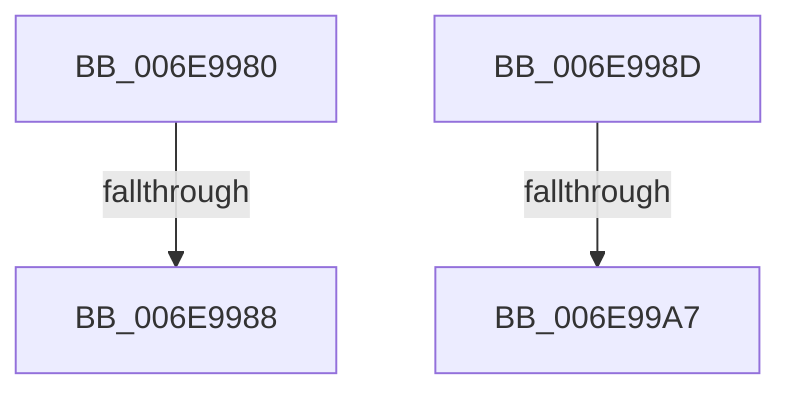

# sub_006E9980

- RVA: `0x006E9980`–`0x006E99B1` (길이 `49` bytes)
- VA: `0x00000001406E9980`
- 실행 섹션: `.text`
- PDB 이름 있음: `아니요`; PDB Function 태그: `아니요`
- unwind 정보 RVA: `0x00093CD4`
- 디코드: `11`개 명령, `49/49` bytes 표시
- 미해석 바이트: `0` (있으면 어셈블리에 `.byte`로 보존)

> 이 문서는 커널 이미지의 기계어와 PDB 기호를 분석해 생성했습니다. 4번과 5번은 함수 원형과 자료형을 바이너리 사용 방식에서 추정한 C 해석이며 원본 소스 복구 결과는 아닙니다.

## 1. Dependencies

- 직접 호출 지점: **1**; 고유 호출 대상: **1**
- 직접 호출자로 확인된 함수: **0**
- RIP 상대 이미지 참조: **0**

### Outgoing calls
- `0x006E9997` → [KiOpFetchBytes](../3D/KiOpFetchBytes_function_003D8778.md) (function, `0x003D8778`)

### Direct callers
- 이 함수 시작 RVA로 연결되는 직접 call은 확인되지 않았습니다. 간접 호출은 완전히 역산할 수 없습니다.

### Static image references
- 디코드된 RIP-relative 메모리 참조가 없습니다.

## 2. Other-region calls and transfers

- 다른 실행 섹션으로 향하는 call: **0**
- call이 아닌 외부 분기/꼬리 이동: **4**
  - `0x006E9982` → [KiOpDecode + 0x190](../3D/KiOpDecode_function_003D81F0.md) (`tail-transfer`)
  - `0x006E9988` → [KiOpDecode + 0x1D6](../3D/KiOpDecode_function_003D81F0.md) (`tail-transfer`)
  - `0x006E99A1` → [KiOpDecode + 0x1F6](../3D/KiOpDecode_function_003D81F0.md) (`tail-transfer`)
  - `0x006E99AC` → [KiOpDecode + 0x376](../3D/KiOpDecode_function_003D81F0.md) (`tail-transfer`)

## 3. Assembly (complete function range)

```asm
006E9980  3C 03                           cmp al, 3
006E9982  0F 84 F8 E9 CE FF               je 0x1403d8380
006E9988  E9 39 EA CE FF                  jmp 0x1403d83c6
006E998D  4C 8D 44 24 58                  lea r8, [rsp + 0x58]
006E9992  BA 04 00 00 00                  mov edx, 4
006E9997  E8 DC ED CE FF                  call 0x1403d8778
006E999C  44 8B C8                        mov r9d, eax
006E999F  85 C0                           test eax, eax
006E99A1  0F 88 3F EA CE FF               js 0x1403d83e6
006E99A7  48 63 44 24 58                  movsxd rax, dword ptr [rsp + 0x58]
006E99AC  E9 B5 EB CE FF                  jmp 0x1403d8566
```

## 4. C-style interpretation (structured pseudocode)

```c
__int64 __fastcall sub_006E9980(void)
{
    unsigned __int64 v_stack_p58;
}
```

## 5. (Beta) C Style

```c
void sub_006E9980(void)
{
    uint64_t v_stack_p58;
}
```

## 6. Execution-region graph

[열기: 2D/3D 그래프와 함수 탐색 컨트롤 패널](../../../control-panel.html?section=text&rva=0x006E9980&view=graph)

- 2D 그래프는 위에서 아래로 흐르고, 3D 그래프는 빈 공간을 드래그해 회전합니다. Shift+드래그는 이동, 휠은 확대·축소, 함수 노드 선택은 대상 보고서 이동입니다.

### Static fallback


