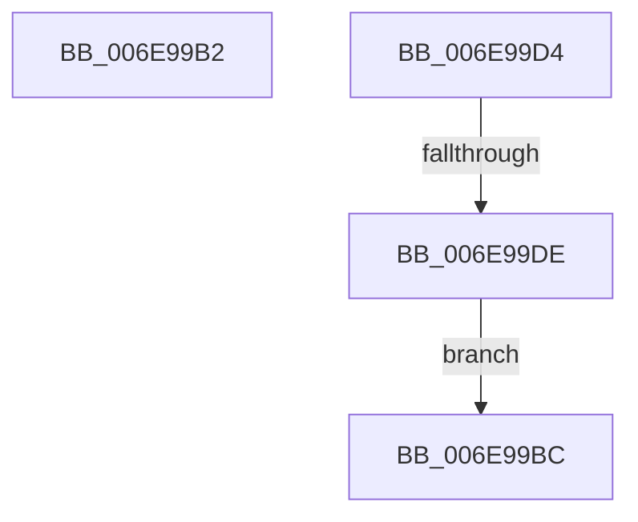

# sub_006E99B2

- RVA: `0x006E99B2`–`0x006E99E0` (길이 `46` bytes)
- VA: `0x00000001406E99B2`
- 실행 섹션: `.text`
- PDB 이름 있음: `아니요`; PDB Function 태그: `아니요`
- unwind 정보 RVA: `0x00093CF0`
- 디코드: `12`개 명령, `46/46` bytes 표시
- 미해석 바이트: `0` (있으면 어셈블리에 `.byte`로 보존)

> 이 문서는 커널 이미지의 기계어와 PDB 기호를 분석해 생성했습니다. 4번과 5번은 함수 원형과 자료형을 바이너리 사용 방식에서 추정한 C 해석이며 원본 소스 복구 결과는 아닙니다.

## 1. Dependencies

- 직접 호출 지점: **0**; 고유 호출 대상: **0**
- 직접 호출자로 확인된 함수: **0**
- RIP 상대 이미지 참조: **0**

### Outgoing calls
- 직접 디코드된 call 명령이 없습니다.

### Direct callers
- 이 함수 시작 RVA로 연결되는 직접 call은 확인되지 않았습니다. 간접 호출은 완전히 역산할 수 없습니다.

### Static image references
- 디코드된 RIP-relative 메모리 참조가 없습니다.

## 2. Other-region calls and transfers

- 다른 실행 섹션으로 향하는 call: **0**
- call이 아닌 외부 분기/꼬리 이동: **3**
  - `0x006E99B7` → [KiOp_Mov + 0xBA](../3D/KiOp_Mov_function_003D85C0.md) (`tail-transfer`)
  - `0x006E99CF` → [KiOp_Mov + 0xBA](../3D/KiOp_Mov_function_003D85C0.md) (`tail-transfer`)
  - `0x006E99D8` → [KiOp_Mov + 0x1B](../3D/KiOp_Mov_function_003D85C0.md) (`tail-transfer`)

## 3. Assembly (complete function range)

```asm
006E99B2  48 8B D1                        mov rdx, rcx
006E99B5  33 C9                           xor ecx, ecx
006E99B7  E9 BE EC CE FF                  jmp 0x1403d867a
006E99BC  44 89 45 10                     mov dword ptr [rbp + 0x10], r8d
006E99C0  4C 8D 4D 10                     lea r9, [rbp + 0x10]
006E99C4  41 B8 04 00 00 00               mov r8d, 4
006E99CA  48 8B D1                        mov rdx, rcx
006E99CD  B1 01                           mov cl, 1
006E99CF  E9 A6 EC CE FF                  jmp 0x1403d867a
006E99D4  F6 41 40 08                     test byte ptr [rcx + 0x40], 8
006E99D8  0F 85 FD EB CE FF               jne 0x1403d85db
006E99DE  EB DC                           jmp 0x1406e99bc
```

## 4. C-style interpretation (structured pseudocode)

```c
void __fastcall sub_006E99B2(__int64 a1, __int64 a2, int a3)
{
    a1 = 0;
}
```

## 5. (Beta) C Style

```c
void sub_006E99B2(int64_t Arg1, int64_t Arg2, int32_t Arg3)
{
    Arg1 = 0;
}
```

## 6. Execution-region graph

[열기: 2D/3D 그래프와 함수 탐색 컨트롤 패널](../../../control-panel.html?section=text&rva=0x006E99B2&view=graph)

- 2D 그래프는 위에서 아래로 흐르고, 3D 그래프는 빈 공간을 드래그해 회전합니다. Shift+드래그는 이동, 휠은 확대·축소, 함수 노드 선택은 대상 보고서 이동입니다.

### Static fallback


