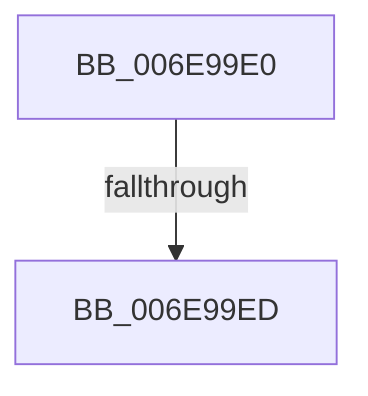

# sub_006E99E0

- RVA: `0x006E99E0`–`0x006E9A06` (길이 `38` bytes)
- VA: `0x00000001406E99E0`
- 실행 섹션: `.text`
- PDB 이름 있음: `아니요`; PDB Function 태그: `아니요`
- unwind 정보 RVA: `0x00093E18`
- 디코드: `9`개 명령, `38/38` bytes 표시
- 미해석 바이트: `0` (있으면 어셈블리에 `.byte`로 보존)

> 이 문서는 커널 이미지의 기계어와 PDB 기호를 분석해 생성했습니다. 4번과 5번은 함수 원형과 자료형을 바이너리 사용 방식에서 추정한 C 해석이며 원본 소스 복구 결과는 아닙니다.

## 1. Dependencies

- 직접 호출 지점: **1**; 고유 호출 대상: **1**
- 직접 호출자로 확인된 함수: **0**
- RIP 상대 이미지 참조: **0**

### Outgoing calls
- `0x006E9A00` → [KeBugCheckEx](../4F/KeBugCheckEx_function_004FD660.md) (function, `0x004FD660`)

### Direct callers
- 이 함수 시작 RVA로 연결되는 직접 call은 확인되지 않았습니다. 간접 호출은 완전히 역산할 수 없습니다.

### Static image references
- 디코드된 RIP-relative 메모리 참조가 없습니다.

## 2. Other-region calls and transfers

- 다른 실행 섹션으로 향하는 call: **0**
- call이 아닌 외부 분기/꼬리 이동: **1**
  - `0x006E99E7` → [KiSaveExtendedAndSupervisorState + 0xA9](../3D/KiSaveExtendedAndSupervisorState_function_003D9A1C.md) (`tail-transfer`)

## 3. Assembly (complete function range)

```asm
006E99E0  4D 8B 41 08                     mov r8, qword ptr [r9 + 8]
006E99E4  4C 3B C5                        cmp r8, rbp
006E99E7  0F 84 D8 00 CF FF               je 0x1403d9ac5
006E99ED  48 83 64 24 20 00               and qword ptr [rsp + 0x20], 0
006E99F3  4C 8B CD                        mov r9, rbp
006E99F6  BA 03 00 00 00                  mov edx, 3
006E99FB  B9 31 01 00 00                  mov ecx, 0x131
006E9A00  E8 5B 3C E1 FF                  call 0x1404fd660
006E9A05  CC                              int3
```

## 4. C-style interpretation (structured pseudocode)

```c
__int64 __fastcall sub_006E99E0(__int64 a1, __int64 a2, __int64 a3, __int64 a4)
{
    __int64 result;
    unsigned __int64 v_stack_p20;

    result = KeBugCheckEx(305, 3, *(unsigned __int64 *)(a4 + 8), v_rbp);
    return result;
}
```

## 5. (Beta) C Style

```c
int64_t sub_006E99E0(int64_t Arg1, int64_t Arg2, int64_t Arg3, void *Arg4)
{
    uint8_t *arg4 = (uint8_t *)Arg4;

    int64_t result;
    uint64_t v_stack_p20;

    result = KeBugCheckEx(305, 3, *(uint64_t *)(arg4 + 0x8), local_rbp);
    return result;
}
```

### 관측된 메모리 오프셋

구조체 형식이 확인되지 않은 접근은 인자 기준의 오프셋으로만 기록했습니다.

| 기준 인자 | 오프셋 표현 | 폭 (bit) | 접근 |
|---|---:|---:|---|
| `Arg4` | `+ 0x8` | `64` | `R` |

## 6. Execution-region graph

[열기: 2D/3D 그래프와 함수 탐색 컨트롤 패널](../../../control-panel.html?section=text&rva=0x006E99E0&view=graph)

- 2D 그래프는 위에서 아래로 흐르고, 3D 그래프는 빈 공간을 드래그해 회전합니다. Shift+드래그는 이동, 휠은 확대·축소, 함수 노드 선택은 대상 보고서 이동입니다.

### Static fallback


