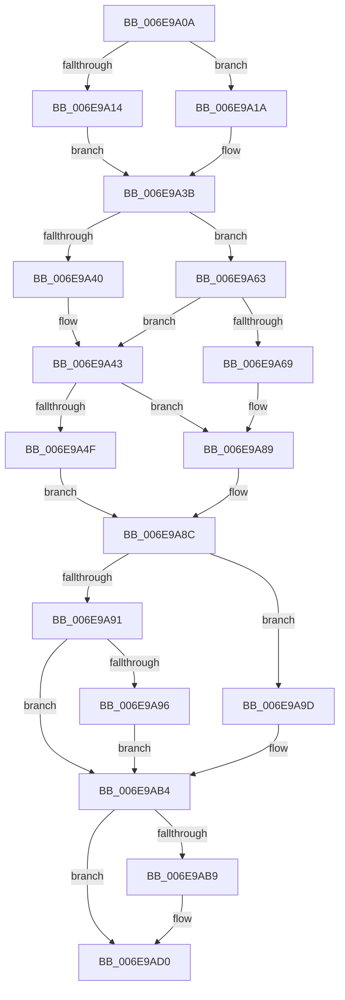

# sub_006E9A0A

- RVA: `0x006E9A0A`–`0x006E9AD8` (길이 `206` bytes)
- VA: `0x00000001406E9A0A`
- 실행 섹션: `.text`
- PDB 이름 있음: `아니요`; PDB Function 태그: `아니요`
- unwind 정보 RVA: `0x00093EB0`
- 디코드: `52`개 명령, `206/206` bytes 표시
- 미해석 바이트: `0` (있으면 어셈블리에 `.byte`로 보존)

> 이 문서는 커널 이미지의 기계어와 PDB 기호를 분석해 생성했습니다. 4번과 5번은 함수 원형과 자료형을 바이너리 사용 방식에서 추정한 C 해석이며 원본 소스 복구 결과는 아닙니다.

## 1. Dependencies

- 직접 호출 지점: **6**; 고유 호출 대상: **6**
- 직접 호출자로 확인된 함수: **0**
- RIP 상대 이미지 참조: **1**

### Outgoing calls
- `0x006E9A33` → [MmMapLockedPagesSpecifyCache](../31/MmMapLockedPagesSpecifyCache_function_00318800.md) (function, `0x00318800`)
- `0x006E9A5C` → [EtwGetKernelTraceTimestamp](../39/EtwGetKernelTraceTimestamp_function_0039FC50.md) (function, `0x0039FC50`)
- `0x006E9A83` → [KeBugCheckEx](../4F/KeBugCheckEx_function_004FD660.md) (function, `0x004FD660`)
- `0x006E9A96` → [KeInvalidateAllCaches](../30/KeInvalidateAllCaches_function_00308CC0.md) (function, `0x00308CC0`)
- `0x006E9AAF` → [KiFlushRangeAllCaches](../5B/KiFlushRangeAllCaches_function_005BE110.md) (function, `0x005BE110`)
- `0x006E9ACB` → [EtwTraceCpuCacheFlush](../64/EtwTraceCpuCacheFlush_function_0064F5EC.md) (function, `0x0064F5EC`)

### Direct callers
- 이 함수 시작 RVA로 연결되는 직접 call은 확인되지 않았습니다. 간접 호출은 완전히 역산할 수 없습니다.

### Static image references
- `0x006E9A43` → RVA `0x00FC6B10` (`ALMOSTRO`; read)

## 2. Other-region calls and transfers

- 다른 실행 섹션으로 향하는 call: **0**
- 별도 외부 분기/꼬리 이동을 확인하지 못했습니다.

## 3. Assembly (complete function range)

```asm
006E9A0A  48 89 AC 24 98 00 00 00         mov qword ptr [rsp + 0x98], rbp
006E9A12  74 06                           je 0x1406e9a1a
006E9A14  48 8B 69 18                     mov rbp, qword ptr [rcx + 0x18]
006E9A18  EB 21                           jmp 0x1406e9a3b
006E9A1A  45 33 C9                        xor r9d, r9d
006E9A1D  C7 44 24 28 20 00 00 40         mov dword ptr [rsp + 0x28], 0x40000020
006E9A25  33 D2                           xor edx, edx
006E9A27  C7 44 24 20 00 00 00 00         mov dword ptr [rsp + 0x20], 0
006E9A2F  45 8D 41 01                     lea r8d, [r9 + 1]
006E9A33  E8 C8 ED C2 FF                  call 0x140318800
006E9A38  48 8B E8                        mov rbp, rax
006E9A3B  48 85 ED                        test rbp, rbp
006E9A3E  74 23                           je 0x1406e9a63
006E9A40  45 32 FF                        xor r15b, r15b
006E9A43  F7 05 C3 D0 8D 00 00 00 00 04   test dword ptr [rip + 0x8dd0c3], 0x4000000
006E9A4D  74 3A                           je 0x1406e9a89
006E9A4F  BA 00 00 00 84                  mov edx, 0x84000000
006E9A54  48 8D 4C 24 30                  lea rcx, [rsp + 0x30]
006E9A59  41 B6 01                        mov r14b, 1
006E9A5C  E8 EF 61 CB FF                  call 0x14039fc50
006E9A61  EB 29                           jmp 0x1406e9a8c
006E9A63  41 80 FE 0F                     cmp r14b, 0xf
006E9A67  75 DA                           jne 0x1406e9a43
006E9A69  BA 86 00 00 00                  mov edx, 0x86
006E9A6E  48 C7 44 24 20 00 00 00 00      mov qword ptr [rsp + 0x20], 0
006E9A77  45 33 C9                        xor r9d, r9d
006E9A7A  41 B8 AD 0B 00 00               mov r8d, 0xbad
006E9A80  8D 4A CF                        lea ecx, [rdx - 0x31]
006E9A83  E8 D8 3B E1 FF                  call 0x1404fd660
006E9A88  CC                              int3
006E9A89  45 32 F6                        xor r14b, r14b
006E9A8C  45 84 FF                        test r15b, r15b
006E9A8F  74 0C                           je 0x1406e9a9d
006E9A91  40 84 FF                        test dil, dil
006E9A94  74 1E                           je 0x1406e9ab4
006E9A96  E8 25 F2 C1 FF                  call 0x140308cc0
006E9A9B  EB 17                           jmp 0x1406e9ab4
006E9A9D  44 0F B6 CE                     movzx r9d, sil
006E9AA1  40 88 7C 24 20                  mov byte ptr [rsp + 0x20], dil
006E9AA6  45 8B C4                        mov r8d, r12d
006E9AA9  48 8B D5                        mov rdx, rbp
006E9AAC  48 8B CB                        mov rcx, rbx
006E9AAF  E8 5C 46 ED FF                  call 0x1405be110
006E9AB4  45 84 F6                        test r14b, r14b
006E9AB7  74 17                           je 0x1406e9ad0
006E9AB9  40 84 F6                        test sil, sil
006E9ABC  48 8D 4C 24 30                  lea rcx, [rsp + 0x30]
006E9AC1  4D 8B C4                        mov r8, r12
006E9AC4  48 8B D5                        mov rdx, rbp
006E9AC7  41 0F 94 C1                     sete r9b
006E9ACB  E8 1C 5B F6 FF                  call 0x14064f5ec
006E9AD0  48 8B AC 24 98 00 00 00         mov rbp, qword ptr [rsp + 0x98]
```

## 4. C-style interpretation (structured pseudocode)

```c
__int64 __fastcall sub_006E9A0A(__int64 a1, int a2, __int64 a3, int a4, __int64 a5, __int64 a6, __int64 a7, __int64 a8, __int64 a9, __int64 a10, __int64 a11, __int64 a12, __int64 a13, __int64 a14, __int64 a15, __int64 a16, __int64 a17, __int64 a18, __int64 a19)
{
    __int64 result;
    __int64 v_r14;
    __int64 v_r15;
    unsigned int v_stack_p20;
    unsigned int v_stack_p28;
    unsigned __int64 v_stack_p98;

    v_stack_p98 = v_rbp;
    if (condition_is_equal) goto loc_006E9A1A;
    goto loc_006E9A3B;
loc_006E9A1A:
    a4 = 0;
    v_stack_p28 = 0x40000020ULL;
    a2 = 0;
    v_stack_p20 = 0;
    result = MmMapLockedPagesSpecifyCache(a1, a2, a4 + 1, a4);
loc_006E9A3B:
    if (result == 0) goto loc_006E9A63;
    v_r15 = 0;
loc_006E9A43:
    if (((*(unsigned int *)(v_rip + 9294019)) & (0x4000000ULL)) == 0) goto loc_006E9A89;
    result = EtwGetKernelTraceTimestamp(a6, (unsigned int)(0x84000000ULL), a4 + 1, a4);
    goto loc_006E9A8C;
loc_006E9A63:
    if (1 != 15) goto loc_006E9A43;
    v_stack_p20 = 0;
    a4 = 0;
    result = KeBugCheckEx(134 - 49, 134, (unsigned int)(0xBADULL), a4);
loc_006E9A89:
    v_r14 = 0;
loc_006E9A8C:
    if (0 == 0) goto loc_006E9A9D;
    if ((unsigned __int8)(v_rdi) == 0) goto loc_006E9AB4;
    result = KeInvalidateAllCaches(134 - 49, 134, (unsigned int)(0xBADULL), a4);
    goto loc_006E9AB4;
loc_006E9A9D:
    v_stack_p20 = (unsigned __int8)(v_rdi);
    result = KiFlushRangeAllCaches(v_rbx, result, (unsigned int)((unsigned int)(v_r12)), (unsigned __int8)(v_rsi));
loc_006E9AB4:
    if (0 != 0) {
        a1 = a6;
        a3 = v_r12;
        a2 = result;
        a4 = ((unsigned __int8)(v_rsi) == 0) ? 1 : 0;
        result = EtwTraceCpuCacheFlush(a1, a2, a3, a4);
    }
    return result;
}
```

## 5. (Beta) C Style

```c
int64_t sub_006E9A0A(void *Arg1, int32_t Arg2, int64_t Arg3, int32_t Arg4, uint64_t Arg5, int64_t Arg6, uint64_t Arg7, uint64_t Arg8, uint64_t Arg9, uint64_t Arg10, uint64_t Arg11, uint64_t Arg12, uint64_t Arg13, uint64_t Arg14, uint64_t Arg15, uint64_t Arg16, uint64_t Arg17, uint64_t Arg18, int64_t Arg19)
{
    uint8_t *arg1 = (uint8_t *)Arg1;

    int64_t result;
    int64_t local_r14;
    int64_t local_r15;
    uint32_t v_stack_p20;
    uint32_t v_stack_p28;
    uint64_t v_stack_p98;

    v_stack_p98 = local_rbp;
    if (condition_is_equal) goto loc_006E9A1A;
    goto loc_006E9A3B;
loc_006E9A1A:
    Arg4 = 0;
    v_stack_p28 = 0x40000020ULL;
    Arg2 = 0;
    v_stack_p20 = 0;
    result = MmMapLockedPagesSpecifyCache(Arg1, Arg2, Arg4 + 1, Arg4);
loc_006E9A3B:
    if (result == 0) goto loc_006E9A63;
    local_r15 = 0;
loc_006E9A43:
    if (((*(uint32_t *)(v_rip + 0x8DD0C3)) & (0x4000000ULL)) == 0) goto loc_006E9A89;
    result = EtwGetKernelTraceTimestamp(Arg6, (uint32_t)(0x84000000ULL), Arg4 + 1, Arg4);
    goto loc_006E9A8C;
loc_006E9A63:
    if (1 != 15) goto loc_006E9A43;
    v_stack_p20 = 0;
    Arg4 = 0;
    result = KeBugCheckEx(134 - 49, 134, (uint32_t)(0xBADULL), Arg4);
loc_006E9A89:
    local_r14 = 0;
loc_006E9A8C:
    if (0 == 0) goto loc_006E9A9D;
    if ((uint8_t)(local_rdi) == 0) goto loc_006E9AB4;
    result = KeInvalidateAllCaches(134 - 49, 134, (uint32_t)(0xBADULL), Arg4);
    goto loc_006E9AB4;
loc_006E9A9D:
    v_stack_p20 = (uint8_t)(local_rdi);
    result = KiFlushRangeAllCaches(local_rbx, result, (uint32_t)((uint32_t)(local_r12)), (uint8_t)(local_rsi));
loc_006E9AB4:
    if (0 != 0) {
        Arg1 = Arg6;
        Arg3 = local_r12;
        Arg2 = result;
        Arg4 = ((uint8_t)(local_rsi) == 0) ? 1 : 0;
        result = EtwTraceCpuCacheFlush(Arg1, Arg2, Arg3, Arg4);
    }
    return result;
}
```

### 관측된 메모리 오프셋

구조체 형식이 확인되지 않은 접근은 인자 기준의 오프셋으로만 기록했습니다.

| 기준 인자 | 오프셋 표현 | 폭 (bit) | 접근 |
|---|---:|---:|---|
| `Arg1` | `+ 0x18` | `64` | `R` |

## 6. Execution-region graph

[열기: 2D/3D 그래프와 함수 탐색 컨트롤 패널](../../../control-panel.html?section=text&rva=0x006E9A0A&view=graph)

- 2D 그래프는 위에서 아래로 흐르고, 3D 그래프는 빈 공간을 드래그해 회전합니다. Shift+드래그는 이동, 휠은 확대·축소, 함수 노드 선택은 대상 보고서 이동입니다.

### Static fallback


