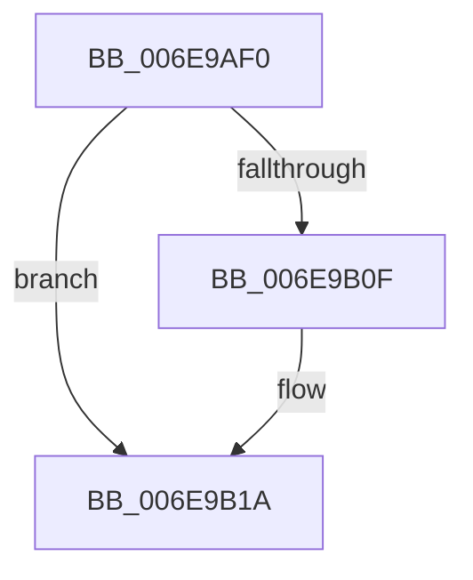

# sub_006E9AF0

- RVA: `0x006E9AF0`–`0x006E9B28` (길이 `56` bytes)
- VA: `0x00000001406E9AF0`
- 실행 섹션: `.text`
- PDB 이름 있음: `아니요`; PDB Function 태그: `아니요`
- unwind 정보 RVA: `0x00093EEC`
- 디코드: `15`개 명령, `56/56` bytes 표시
- 미해석 바이트: `0` (있으면 어셈블리에 `.byte`로 보존)

> 이 문서는 커널 이미지의 기계어와 PDB 기호를 분석해 생성했습니다. 4번과 5번은 함수 원형과 자료형을 바이너리 사용 방식에서 추정한 C 해석이며 원본 소스 복구 결과는 아닙니다.

## 1. Dependencies

- 직접 호출 지점: **2**; 고유 호출 대상: **2**
- 직접 호출자로 확인된 함수: **0**
- RIP 상대 이미지 참조: **1**

### Outgoing calls
- `0x006E9B01` → [KxReleaseSpinLock](../20/KxReleaseSpinLock_function_00206670.md) (function, `0x00206670`)
- `0x006E9B15` → [KiLowerIrqlProcessIrqlFlags](../4F/KiLowerIrqlProcessIrqlFlags_function_004F5698.md) (function, `0x004F5698`)

### Direct callers
- 이 함수 시작 RVA로 연결되는 직접 call은 확인되지 않았습니다. 간접 호출은 완전히 역산할 수 없습니다.

### Static image references
- `0x006E9B06` → RVA `0x00FC6D20` (`ALMOSTRO`; read)

## 2. Other-region calls and transfers

- 다른 실행 섹션으로 향하는 call: **0**
- call이 아닌 외부 분기/꼬리 이동: **1**
  - `0x006E9B23` → [HalpAllocateDmaChannels + 0x94](../3D/HalpAllocateDmaChannels_function_003DA3C8.md) (`tail-transfer`)

## 3. Assembly (complete function range)

```asm
006E9AF0  48 89 38                        mov qword ptr [rax], rdi
006E9AF3  48 89 48 08                     mov qword ptr [rax + 8], rcx
006E9AF7  48 89 01                        mov qword ptr [rcx], rax
006E9AFA  48 89 47 08                     mov qword ptr [rdi + 8], rax
006E9AFE  48 8B CD                        mov rcx, rbp
006E9B01  E8 6A CB B1 FF                  call 0x140206670
006E9B06  83 3D 13 D2 8D 00 00            cmp dword ptr [rip + 0x8dd213], 0
006E9B0D  74 0B                           je 0x1406e9b1a
006E9B0F  44 0F 20 C1                     mov rcx, cr8
006E9B13  8A D3                           mov dl, bl
006E9B15  E8 7E BB E0 FF                  call 0x1404f5698
006E9B1A  0F B6 C3                        movzx eax, bl
006E9B1D  44 0F 22 C0                     mov cr8, rax
006E9B21  32 C0                           xor al, al
006E9B23  E9 34 09 CF FF                  jmp 0x1403da45c
```

## 4. C-style interpretation (structured pseudocode)

```c
__int64 __fastcall sub_006E9AF0(__int64 a1)
{
    __int64 result;

    *(unsigned __int64 *)(result) = v_rdi;
    *(unsigned __int64 *)(result + 8) = a1;
    *(unsigned __int64 *)(a1) = result;
    *(unsigned __int64 *)(v_rdi + 8) = result;
    result = KxReleaseSpinLock(v_rbp, a2, a3, a4);
    if ((*(unsigned int *)(v_rip + 9294355)) != 0) {
        a1 = v_cr8;
        a2 = (unsigned __int8)(v_rbx);
        result = KiLowerIrqlProcessIrqlFlags(a1, a2, a3, a4);
    }
    result = 0;
}
```

## 5. (Beta) C Style

```c
int64_t sub_006E9AF0(void *Arg1)
{
    uint8_t *arg1 = (uint8_t *)Arg1;

    int64_t result;

    *(uint64_t *)(result) = local_rdi;
    *(void **)(result + 0x8) = Arg1;
    *(uint64_t *)(arg1) = result;
    *(uint64_t *)(local_rdi + 0x8) = result;
    result = KxReleaseSpinLock(local_rbp, a2, a3, a4);
    if ((*(uint32_t *)(v_rip + 0x8DD213)) != 0) {
        Arg1 = v_cr8;
        a2 = (uint8_t)(local_rbx);
        result = KiLowerIrqlProcessIrqlFlags(Arg1, a2, a3, a4);
    }
    result = 0;
}
```

### 관측된 메모리 오프셋

구조체 형식이 확인되지 않은 접근은 인자 기준의 오프셋으로만 기록했습니다.

| 기준 인자 | 오프셋 표현 | 폭 (bit) | 접근 |
|---|---:|---:|---|
| `Arg1` | `+ 0x0` | `64` | `W` |

## 6. Execution-region graph

[열기: 2D/3D 그래프와 함수 탐색 컨트롤 패널](../../../control-panel.html?section=text&rva=0x006E9AF0&view=graph)

- 2D 그래프는 위에서 아래로 흐르고, 3D 그래프는 빈 공간을 드래그해 회전합니다. Shift+드래그는 이동, 휠은 확대·축소, 함수 노드 선택은 대상 보고서 이동입니다.

### Static fallback


