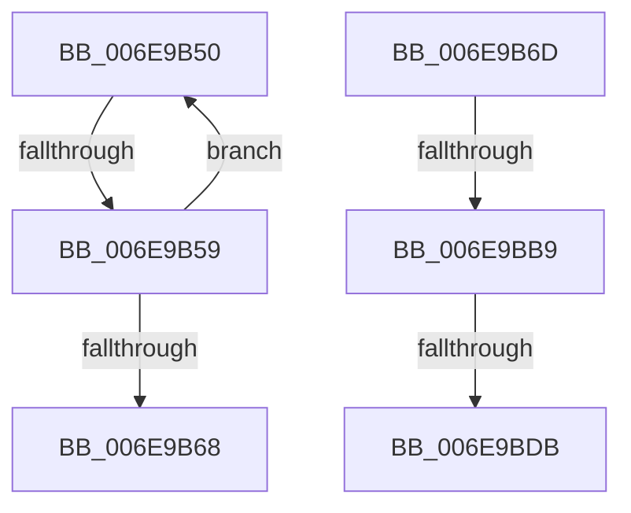

# sub_006E9B50

- RVA: `0x006E9B50`–`0x006E9BEA` (길이 `154` bytes)
- VA: `0x00000001406E9B50`
- 실행 섹션: `.text`
- PDB 이름 있음: `아니요`; PDB Function 태그: `아니요`
- unwind 정보 RVA: `0x00093F3C`
- 디코드: `34`개 명령, `154/154` bytes 표시
- 미해석 바이트: `0` (있으면 어셈블리에 `.byte`로 보존)

> 이 문서는 커널 이미지의 기계어와 PDB 기호를 분석해 생성했습니다. 4번과 5번은 함수 원형과 자료형을 바이너리 사용 방식에서 추정한 C 해석이며 원본 소스 복구 결과는 아닙니다.

## 1. Dependencies

- 직접 호출 지점: **2**; 고유 호출 대상: **2**
- 직접 호출자로 확인된 함수: **0**
- RIP 상대 이미지 참조: **1**

### Outgoing calls
- `0x006E9BAC` → [guard_dispatch_icall](../6B/guard_dispatch_icall_function_006BAAD0.md) (function, `0x006BAAD0`)
- `0x006E9BCE` → [HalpDmaUseEmergencyLogicalAddressResources](../53/HalpDmaUseEmergencyLogicalAddressResources_function_0053E5C4.md) (function, `0x0053E5C4`)

### Direct callers
- 이 함수 시작 RVA로 연결되는 직접 call은 확인되지 않았습니다. 간접 호출은 완전히 역산할 수 없습니다.

### Static image references
- `0x006E9B77` → RVA `0x00FC1778` (`.data`; read)

## 2. Other-region calls and transfers

- 다른 실행 섹션으로 향하는 call: **0**
- call이 아닌 외부 분기/꼬리 이동: **5**
  - `0x006E9B53` → [HalpAllocateDmaResourcesInternal + 0xAA](../3D/HalpAllocateDmaResourcesInternal_function_003DA7C4.md) (`tail-transfer`)
  - `0x006E9B68` → [HalpAllocateDmaResourcesInternal + 0xAA](../3D/HalpAllocateDmaResourcesInternal_function_003DA7C4.md) (`tail-transfer`)
  - `0x006E9BB3` → [HalpAllocateDmaResourcesInternal + 0xC8](../3D/HalpAllocateDmaResourcesInternal_function_003DA7C4.md) (`tail-transfer`)
  - `0x006E9BD5` → [HalpAllocateDmaResourcesInternal + 0x197](../3D/HalpAllocateDmaResourcesInternal_function_003DA7C4.md) (`tail-transfer`)
  - `0x006E9BE5` → [HalpAllocateDmaResourcesInternal + 0xC8](../3D/HalpAllocateDmaResourcesInternal_function_003DA7C4.md) (`tail-transfer`)

## 3. Assembly (complete function range)

```asm
006E9B50  48 85 C9                        test rcx, rcx
006E9B53  0F 84 15 0D CF FF               je 0x1403da86e
006E9B59  48 83 49 30 20                  or qword ptr [rcx + 0x30], 0x20
006E9B5E  FF C0                           inc eax
006E9B60  48 8B 49 08                     mov rcx, qword ptr [rcx + 8]
006E9B64  3B C5                           cmp eax, ebp
006E9B66  72 E8                           jb 0x1406e9b50
006E9B68  E9 01 0D CF FF                  jmp 0x1403da86e
006E9B6D  48 8B 8B 00 02 00 00            mov rcx, qword ptr [rbx + 0x200]
006E9B74  45 33 C9                        xor r9d, r9d
006E9B77  48 8B 05 FA 7B 8D 00            mov rax, qword ptr [rip + 0x8d7bfa]
006E9B7E  45 33 C0                        xor r8d, r8d
006E9B81  4C 8B B3 F0 00 00 00            mov r14, qword ptr [rbx + 0xf0]
006E9B88  8B 56 14                        mov edx, dword ptr [rsi + 0x14]
006E9B8B  49 83 C6 18                     add r14, 0x18
006E9B8F  48 8B 49 28                     mov rcx, qword ptr [rcx + 0x28]
006E9B93  48 81 E2 00 F0 FF FF            and rdx, 0xfffffffffffff000
006E9B9A  48 8B 80 80 00 00 00            mov rax, qword ptr [rax + 0x80]
006E9BA1  4C 89 74 24 28                  mov qword ptr [rsp + 0x28], r14
006E9BA6  48 83 64 24 20 00               and qword ptr [rsp + 0x20], 0
006E9BAC  E8 1F 0F FD FF                  call 0x1406baad0
006E9BB1  85 C0                           test eax, eax
006E9BB3  0F 89 D3 0C CF FF               jns 0x1403da88c
006E9BB9  44 8A 46 14                     mov r8b, byte ptr [rsi + 0x14]
006E9BBD  48 8D 93 58 02 00 00            lea rdx, [rbx + 0x258]
006E9BC4  41 F6 D0                        not r8b
006E9BC7  48 8B CB                        mov rcx, rbx
006E9BCA  41 80 E0 01                     and r8b, 1
006E9BCE  E8 F1 49 E5 FF                  call 0x14053e5c4
006E9BD3  84 C0                           test al, al
006E9BD5  0F 84 80 0D CF FF               je 0x1403da95b
006E9BDB  48 8B 83 30 02 00 00            mov rax, qword ptr [rbx + 0x230]
006E9BE2  49 89 06                        mov qword ptr [r14], rax
006E9BE5  E9 A2 0C CF FF                  jmp 0x1403da88c
```

## 4. C-style interpretation (structured pseudocode)

```c
__int64 __fastcall sub_006E9B50(__int64 a1, __int64 a2, int a3, int a4)
{
    __int64 result;
    unsigned __int64 v_stack_p20;
    unsigned __int64 v_stack_p28;

    result = (unsigned int)((result) + 1);
    if (((unsigned int)(result)) < ((unsigned int)(v_rbp))) goto loc_006E9B50;
}
```

## 5. (Beta) C Style

```c
int64_t sub_006E9B50(int64_t Arg1, int64_t Arg2, int32_t Arg3, int32_t Arg4)
{
    int64_t result;
    uint64_t v_stack_p20;
    uint64_t v_stack_p28;

    result = (uint32_t)((result) + 1);
    if (((uint32_t)(result)) < ((uint32_t)(local_rbp))) goto loc_006E9B50;
}
```

## 6. Execution-region graph

[열기: 2D/3D 그래프와 함수 탐색 컨트롤 패널](../../../control-panel.html?section=text&rva=0x006E9B50&view=graph)

- 2D 그래프는 위에서 아래로 흐르고, 3D 그래프는 빈 공간을 드래그해 회전합니다. Shift+드래그는 이동, 휠은 확대·축소, 함수 노드 선택은 대상 보고서 이동입니다.

### Static fallback


